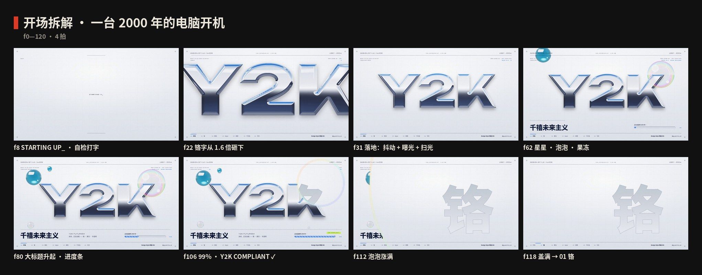
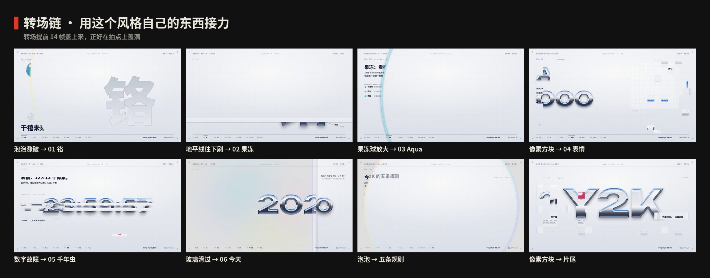
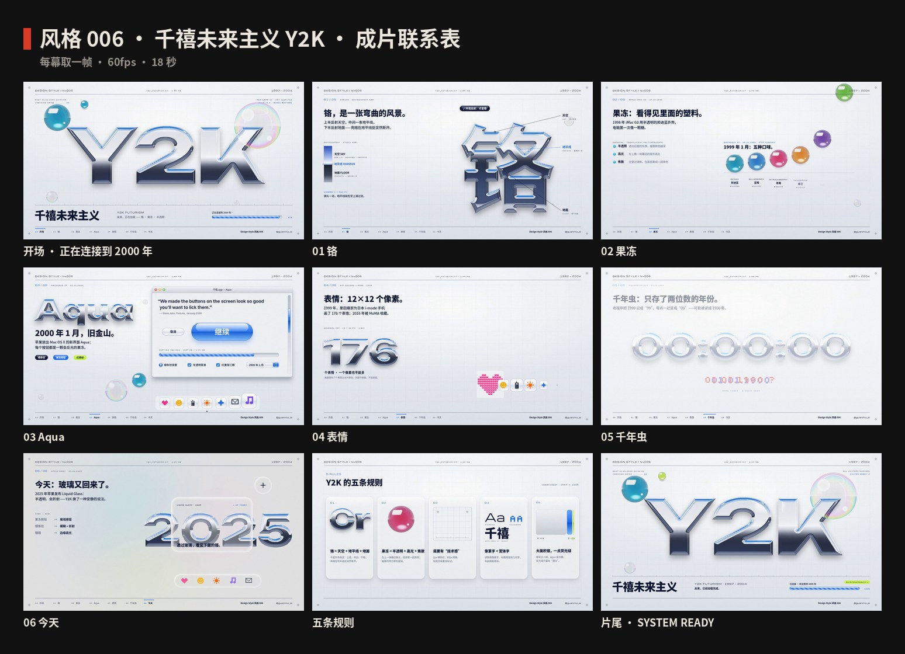
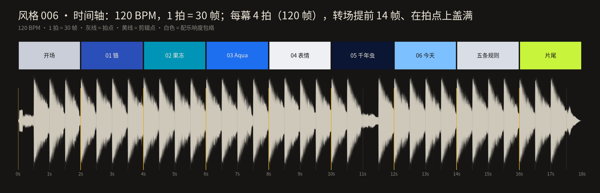

# 006 · 千禧未来主义 Y2K · 制作过程

**中文** · [English](PROCESS.en.md)

> 这一期是怎么从一个想法变成 18 秒短片和 4 张图的：怎么想的、怎么做的、哪里推翻重来、下次怎么做得更好。
> 过程图都在 [`process/`](process)，可以复现的代码在 `video/` `audio/` `images/` 和根目录的 `scripts/`。

🎬 [看成片（Releases · day-06）](https://github.com/guanmo-ai/design-style/releases/tag/day-06) · 📐 [风格指南](README.md) · 🧰 [从 0 到 1：工具与流程](MAKING.md)

---

## 0 · 一览

| # | 步骤 | 产出 | 工具 / 文件 |
|:-:|---|---|---|
| 1 | 选题与定调 | 一句话定义 + 受众 + “这一期最有用的一招” | — |
| 2 | 研究 | 时间线、五条规则、广度清单、误区 | [`README.md`](README.md) §1—§7 |
| 3 | 设计令牌 | 银灰铝面 + Aqua 蓝 + 一点荧光绿、铬的色标与“影棚”环境、果冻、细条纹与网格、四套字体、节拍 | `tokens.ts / .css / .json` |
| 4 | 材质渲染器 | 铬 / 果冻 / 泡泡 / 玻璃的 WebGL2 着色器，视频和图片共用一份 | `video/material.js` |
| 5 | 风格图 ×4 | 海报 · 速查卡 · 半透明手机 app · 四步改造 | `images/make_svgs.py` · `images/render_layers.mjs` · `scripts/build_images.py` |
| 6 | 分镜与节拍 | 9 段，36 拍；8 种转场：泡泡、地平线、果冻、像素、故障、玻璃 | `video/timeline.ts` · `process/timeline.json` |
| 7 | 视频：开场 | 开机 → 铬字 Y2K 砸下来 → 泡泡 → 进度条走满 → 泡泡转场 | `video/opening.tsx` |
| 8 | 视频：六章 | 铬 · 果冻 · Aqua · 表情 · 千年虫 · 今天 | `video/opening.tsx` · `video/chapters.tsx` · `video/finale.tsx` |
| 9 | 视频：高潮与片尾 | 五条规则五张卡片；开机自检全部 OK，SYSTEM READY ✓ | `video/finale.tsx` |
| 10 | 配乐与音效 | 千禧 trance-pop，F 大调，120 BPM，一整首，−14 LUFS | `audio/make_music.py`（numpy 合成） |
| 11 | 质检 | 关键帧拼图、联系表、转场链、节拍时间轴 | `stills.mjs` · `contact_sheet.py` · `timeline_chart.py` |
| 12 | 发布 | 分享版 MP4、封面、源码包、仓库 | ffmpeg · GitHub |

---

## 1 · 选题与定调

**为什么第六期是 Y2K：** 前五期——包豪斯、瑞士、构成主义、孟菲斯、波普——全都是**平涂**的：色块、黑线、网点。Y2K 是这个系列里第一个“有材质”的风格：铬、果冻、玻璃、半透明塑料。它也是离今天最近的一个：2020 年代的时装、唱片封面和短视频里全是它，2025 年苹果的 Liquid Glass 又把“半透明、会折射”带回了每个人的手机。观众熟悉它的样子，却很少有人说得清“铬为什么看起来像铬”。

**这一期最有用的一招（写在动手之前）：** *给平面加一层材质——铬一定要有地平线。* 同一个字，填一条灰色渐变就是塑料；上蓝、中白、下暗，在地平线处突然断开，它就变成了金属。所有画面都围着这一招转：第一章拿同一个“铬”字，先给你看灰色的，再把环境“刷”上去；速查卡第二节就是“铬的色标”六个点；第四张图演示“普通海报怎么四步改成 Y2K”，其中一步就是“标题换成铬”。

**定调：**

- 一句话：*未来，正在加载。*（片尾换成：*未来，已经加载完成。*）
- 受众：设计师拿去就能用（铬的色标、果冻按钮的四层做法、细条纹和网格的数值、字体搭配、提示词、CSS 写法），普通人看完能认出“原来这就是 Y2K”，也知道它不只是“闪闪发光的怀旧”。
- 质感：**白天的、乐观的、银色的**——像 2000 年一台刚开机的新电脑。不要夜晚、霓虹和赛博朋克。
- 叙事：整支片子是**一次开机**：从「STARTING UP_」到「SYSTEM READY ✓」；页眉是一份压缩包的文件名「Y2K_FUTURISM.SIT · 1.44 MB」（一张软盘的容量），页脚是章节进度条。
- 和前几期接上：同一套页眉页脚、同一套速查卡结构、60fps / 一整首配乐的规格；转场换成**这个风格自己的东西**：泡泡涨破、地平线刷下来、果冻球放大、像素方块、数字故障、玻璃滑过。
- 边界：只讲设计方法；画面里的铬字、果冻、窗口和表情都是“致敬”，不用苹果、微软、DOCOMO 的任何标识，7 个像素表情是原创的。

## 2 · 研究：先列清单，再动手

1. **时间线：** 1995 《反重力赛车》与 The Designers Republic、“Y2K”这个缩写出现 → **1998.8** iMac G3 邦迪蓝 → **1999** 五种口味、i-mode 的 176 个表情、《黑客帝国》、千年虫 → **2000.1.5** Mac OS X Aqua → 2001 Windows XP Luna、iPod → 2004 前后让位给 Frutiger Aero → 2016 前后被命名和整理 → 2025.6.9 Liquid Glass（详见 [风格指南 §1](README.md#1--它从哪来)）。
2. **规则：** 归纳成 5 条可执行的规则：铬 / 果冻 / 技术感的底 / 像素字 + 宽体字 / 大面积银，每条写“怎么做”和“小心”。
3. **广度清单**（视频六章和风格图都从这张表来——每章换一种材质或一个物件）：

   | 领域 | 物件 | 年份 | 学到什么 | 用在哪 |
   |---|---|---|---|---|
   | 平面 · 字 | 世纪末唱片封面、海报上的铬字 | 1997— | 铬 = 天空 + 地平线 + 地面 | 开场 · 01 铬 · 规则 01 · 海报 |
   | 工业设计 | iMac G3 邦迪蓝 → 五种口味 | 1998—1999 | 半透明有色塑料：越厚越深、底部焦散 | 02 果冻 · 规则 02 · 速查卡 |
   | 界面 | Mac OS X Aqua | 2000 | 果冻按钮、细条纹、红黄绿三颗、半透明菜单 | 03 Aqua · app 概念图 · 四步改造 |
   | 手机 | i-mode 表情（栗田穣崇） | 1999 | 12×12 像素、1-bit，一个像素也不能多 | 04 表情 · app 概念图 |
   | 软件 | 千年虫 | 1999.12.31 | 液晶读数、像素字、“故障”美学；风格的名字从这来 | 05 千年虫 · 规则 04 |
   | 游戏 · 平面 | 《反重力赛车》· The Designers Republic | 1995 | 宽体字、编号、警示条、“技术标签” | 页眉页脚 · 规则 03 · 速查卡 |
   | 今天 | Liquid Glass | 2025 | 半透明、折射、边缘高光——安静版的 Y2K | 06 今天 |

4. **误区：** Y2K 不是“2000 年那一年”；不等于赛博朋克和蒸汽波；不等于 Frutiger Aero；铬不是灰色。所以第一章专门演示“灰色渐变 ≠ 铬”，配色里没有一点霓虹紫。
5. **核对：** iMac G3 是 1998 年 5 月 6 日**发布**、8 月 15 日**上市**（片中写上市日 15.08.1998）；Aqua 是 2000 年 1 月 5 日旧金山 Macworld 发布；乔布斯那句话出自《财富》2000 年 1 月 24 日刊——片中只放英文原话（中文译文读起来很怪，审稿时删掉了）；MoMA 收藏的是 NTT DOCOMO 的**原版 176 个**表情（馆藏年份标 1998—1999）；Liquid Glass 是 WWDC 2025（6 月 9 日）发布的。

## 3 · 设计系统先行

这一期最重要的令牌不是颜色，而是**环境**：铬没有自己的颜色，它的“颜色”全是反射出来的天空、地平线和地面。

| 令牌 | 值 | 说明 |
|---|---|---|
| 底 | `#EEF0F4` → `#D9DEE6` + 银 `#C9CED8` | 铝面：上亮下暗；银灰一共占八成 |
| ink / grey | `#0A1633` / `#5E6880` | 黑里带一点蓝；刻度和次要文字 |
| Aqua | `#1E6FF0` · 深 `#0D58D6` · 浅 `#7DC0FF` | 按钮、进度条、选中；果冻中线以下 / 底部焦散 |
| 邦迪蓝 | `#0095B6` | 果冻球（1998 iMac G3） |
| 荧光绿 | `#C8F53C` | 只给“通过”：COMPLIANT、勾选、SYSTEM READY |
| 铬的色标（平面版） | `#2A4FB8` 0 · `#9DB6EE` .32 · `#FFFFFF` .49 · `#1A2236` .51 · `#3B4458` .75 · `#A9B3C6` 1 | 网页里 `background-clip: text` 用；49% → 51% 是关键 |
| 铬的环境（渲染版） | 天空顶 / 天空 / 地平线（HDR 1.35—1.45）/ 地面近 / 地面远 | 着色器里程序化生成的“影棚”，外加四块柔光箱和一条扫光 |
| 果冻 | 折射 0.55 · 按厚度吸收 · 底部焦散 · 左上硬边高光 | 平面版：胶囊 + 中线断开的渐变 + 上半截一块高光 |
| 细条纹 / 网格 | 2px 亮条（白 38%）/ 80px（ink 7%） | Aqua 的窗口背景 / 套准用的方格纸 |
| 字体 | Unbounded 900 · Michroma · Silkscreen · Noto Sans SC 500—900 · Inter | 宽体标题 · 科技小字 · 像素读数 · 中文 · 界面西文 |
| 节拍 | 120 BPM，1 拍 = 30 帧，不放慢 | 每段 4 拍（2 秒）；转场 14 帧 |

**为什么铬的“断层”在 49% → 51%：** 现实里的铬是一面弯曲的镜子。字的上半截朝天，照出天空；字的中间朝向远处，照出地平线——那是整个环境里最亮的一条线；再往下朝地面，突然就暗了。所以铬字最亮的地方旁边紧挨着最暗的地方，这一下“断开”比任何颜色都更能说明“这是金属”。网页里的平面版铬字，把它压缩成 2% 的距离；视频里的渲染版，它是真的在每个像素上算反射方向。

## 4 · 材质渲染器：先把“光”做对

上一轮的候选图（紫色线框地面、`future.exe` 加载窗口、渐变贴出来的铬字）被评价“比较普通”。问题在于：**Y2K 的核心是材质，而渐变贴出来的材质一眼就是假的。** 所以这一期在画任何画面之前，先写了一个材质渲染器 `video/material.js`（WebGL2，约 380 行），视频和图片共用同一份：

1. **形状 → 高度场：** 把字（或星星、圆角矩形）画进一张掩码 → 用精确欧氏距离变换（EDT，Felzenszwalb 算法）算出每个像素离边缘多远 → 按圆角倒角公式 `h = R·√(1 − (1 − d/R)²)` 变成高度（倒角 R = 26）→ 轻微模糊让边缘圆滑 → 算出法线。字的形状不变时，这一步只算一次并缓存。
2. **铬：** 每个像素按法线反射视线，去查一个**程序化的“影棚”环境**：天空（深蓝 → 浅蓝 → 发白的地平线）、地面（地平线下一点点就变暗，远处带一点蓝的反光）、四块柔光箱，外加一条可以动画的扫光。环境可以旋转、倾斜，镜头高度可以上下移——**地平线就在字上滑过去**。最后用 ACES 色调映射压回屏幕亮度。
3. **果冻：** 半透明有色塑料——折射背后的东西（背景按球面偏移）、按厚度吸收颜色（越厚越深）、底部聚一团焦散亮色、左上角一块硬边的窗形高光、地上一块柔和的有色阴影。
4. **泡泡：** 几乎透明，边缘按薄膜干涉画出彩虹色（`0.5 + 0.5·cos(2π(c + [0, .33, .67]))`），轻微折射，一点点高光。
5. **玻璃：** 圆角矩形透镜——边缘折射、轻微色散、边缘一圈高光，中间磨砂（06 今天的 Liquid Glass 卡片）。

**过关标准：** 把铬字截下来单独看，不需要任何说明也认得出是“金属”；果冻球放在网格上，网格在球里是弯的。

## 5 · 风格图（4 张）

| 图 | 目的 |
|---|---|
| 海报 | 一台 2000 年的电脑开机：铬字 **Y2K** 压在银灰的网格上，泡泡、铬星星、果冻球；一个 Aqua 窗口「千禧.app」里一条果冻进度条；大标题「未来，正在加载。」；刻度尺、条形码、套准标记 |
| 速查卡 | 01 四种材质（铬 / 果冻 / 泡泡 / 玻璃）· 02 铬的色标（六个点 + 一个“假铬”的反例）· 03 色板 + iMac 五种口味 + 用量 80 / 15 / 5 · 04 字体（Unbounded / Michroma / Silkscreen / 思源黑体）· 05 界面零件（果冻按钮、进度条、窗口、勾选框、药丸标签）· 06 五条规则 · 这样做 / 别这样 |
| 如果千禧年来做 app | 两部半透明糖果色手机：邦迪蓝的是电台「2K.fm」播放器（液晶屏 + 像素字、果冻球专辑封面、果冻播放键）；橘子色的是 i-mode 式短信（小美发来的消息、像素表情、表情选择器）；旁边三条注解：播放键 = 一颗果冻 / 屏幕 = 液晶 + 像素字 / 外壳 = 糖果色塑料 |
| 四步改造 | 同一张普通活动海报（周末市集），每一步只改一件事：原稿 → 银底 + 技术感（细条纹、网格、刻度）→ 标题换成铬 → 加果冻、泡泡和星星。这是这一期“最能直接拿去用”的一张 |

**管线（比前几期多一步）：** `images/make_svgs.py` 生成四张 SVG；需要材质的地方不画矢量，而是写一份图层参数 `layers/<名字>.json`（字、形状、果冻、泡泡、镜头、环境），在 SVG 里放一个 `<image href="layers/<名字>.webp">` → `images/render_layers.mjs` 用 Playwright 打开 `layer.html`，用**视频的同一份** `material.js` 把每个图层渲染成 2 倍、背景透明的 WebP → `scripts/build_images.py`（本期给 `FACES` 加了 Unbounded、Michroma、Silkscreen，并让带透明的 .png / .webp 图层保留透明）子集化字体、把字体和图层一起内嵌进 `preview/*.svg` → Chromium 渲染 2x PNG（2160×2700）。字宽用 Pillow 读真实字体度量计算。

## 6 · 改版记录

| 位置 | 问题 | 诊断 | 改了什么 |
|---|---|---|---|
| **整体视觉（审稿反馈）** | 候选图“比较普通” | 铬是用渐变贴的、配色是霓虹紫 + 线框地面——更像“赛博朋克的 Y2K 滤镜”，不像 1999—2001 年真正的样子 | 推翻重做：先写材质渲染器（§4），铬、果冻、泡泡全部真的算光；配色改成白天的银灰 + Aqua 蓝；界面零件按 Aqua 的做法重画；构图收紧，蓝和荧光绿都只用一点 |
| Aqua 引语（审稿反馈） | 中文译文“想舔一口”读起来很怪 | 直译丢掉了原话的语气 | 窗口里只放英文原话 + 出处「— Steve Jobs, Fortune, January 2000」 |
| 合成里的图层透明 | 风格图 preview 里，铬字的透明背景变成了黑色 | `build_images.py` 内嵌图片时一律转成 JPEG，透明通道丢了 | 带透明的 .png / .webp 图层保留透明、存成 WebP（最长边 2700px）；照片照旧压成 900px 的 JPEG |
| 开场前 16 帧 | 一开始是一张空的银底，像卡住了 | 铬字第 16 帧才出现，之前没有任何东西 | 屏幕中间先打出「STARTING UP_」（像素字，光标闪烁），四角的开机自检同时开始打字；铬字砸下来时它淡出 |
| 章节标题 | 02、04、05、06 章的标题在转场盖满之后才出现，前半拍是空的 | 标题按章节起点开始淡入，而转场在起点前 14 帧就开始了 | 小标题提前到起点前 8 帧、大标题提前 4 帧，转场一盖满就能读（03 Aqua 的标题跟着窗口出现，保持在后面） |
| 五条规则的标题 | 标题和第一张卡片同时出现，挤在一拍里 | — | 标题提前到泡泡转场的最后 8 帧淡入 |
| app 概念图 | 果冻播放键上的暂停符号被高光“吃”掉了一半 | 暂停的两根白竖条落在左上那块白色高光里 | 暂停符号往下压一点，避开高光 |
| 渲染 | Remotion 默认的 GL 后端在没有显卡的机器上画不出 WebGL | 无头 Chromium 没有 GPU | 渲染统一加 `--gl=swangle`（ANGLE + SwiftShader 软件渲染），并把超时放宽到 120 秒 |

整体视觉和引语来自审稿反馈，其余是用关键帧拼图自查发现的。

## 7 · 开场：一台 2000 年的电脑开机



| 帧 | 动作 | 实现要点（`video/opening.tsx`） |
|---|---|---|
| 0—16 | 开机“哔”；屏幕中间打出「STARTING UP_」；四角的自检信息一行行打出来：`BOOT 31.12.1999 23:59:57`、`MEM 64MB OK · CRT 1024×768`、`AQUA 10.0 · BONDI #0095B6` | `typed(text, f, t0, cps)` 按每秒字数截字符串；光标每 8 帧闪一次；配一串调制解调器“碎音” |
| 16—30 | 铬字 **Y2K** 从镜头前 1.6 倍“砸”下来 | 铬层的 `xf` 缩放从 1.6 加速到 1；字的形状不变，高度场只算一次，之后每帧只改 uniform |
| 30 | 第 1 拍落地：抖一下、曝光闪一下、扫光划过；大和弦 + 玻璃钟 | 抖动 = 14 帧衰减正弦；`expo` 落地瞬间 +50% 再衰减；`sweep` 34 帧从左扫到右 |
| 30—120 | 镜头高度慢慢往下走，地平线在字上滑 | `cam.y` 从 470 走到 520，`envRot` 每帧转一点——反光是“活”的 |
| 40—62 | 两颗铬星星闪出来；右上一颗大泡泡鼓起来，左边两颗邦迪蓝小果冻弹两下 | 泡泡半径用弹簧；果冻 `bounce()` 落地弹起 |
| 54—108 | 大标题「千禧未来主义」升上来；进度条「正在连接到 2000 年…」走到 99%（最后 1% 留到片尾，才变成「已连接 · 欢迎来到 2000 年」）；`CHECKING DATES ... OK`；f100「Y2K COMPLIANT ✓」药丸弹出 | 进度条是果冻（Aqua 蓝 + 斜条纹）；荧光绿第一次出现，就是“通过” |
| 106—120 | 右上那颗泡泡涨满全屏，转进第一章 | `Wipe{kind:'bubble'}`：圆形 `clipPath` 从泡泡的位置放大，边缘带一圈薄膜彩虹 |

## 8 · 六章：一章一种材质



每次换幕都用这个风格自己的东西接力：**泡泡涨破 → 地平线往下刷 → 果冻球放大 → 像素方块 → 数字故障 → 玻璃滑过 → 泡泡 → 像素方块**。转场提前 14 帧盖上来，正好在拍点上盖满。

| 章 | 主角 | 动作 | 实现要点 |
|---|---|---|---|
| 01 铬 | 一个“铬”字 | 先是灰色的；第 2 拍环境贴图从上往下“刷”上去，变成金属；左边拆开：天空 SKY · 地平线 HORIZON · 地面 FLOOR；镜头上下一动，地平线在字上滑过去 | 同一个高度场，`chromeO` 从“灰色渐变”切到“环境反射”，切换线就是一条从上往下扫的白线 |
| 02 果冻 | 邦迪蓝果冻球 | “啵”地冒出来，三个标签：半透明 · 高光 · 焦散；大球缩回队首，五种口味依次掉下来弹两下 | 果冻折射后面的网格——网格在球里是弯的；五种口味只换 `gelC` |
| 03 Aqua | 一个 Aqua 窗口 | 从程序坞里“吸”出来（横向先到位、纵向晚一点）；里面是乔布斯的原话；默认按钮一呼一吸；两个勾选；程序坞放大镜扫过一遍 | 程序坞 7 个图标都是果冻；放大镜 = 图标按到“鼠标”的距离放大 |
| 04 表情 | 12×12 的网格 | 一个像素一个像素地点亮，计数跳到 176；7 个原创像素表情一排排冒出来 | `shapeRendering="crispEdges"`，每个像素都落在整数坐标上 |
| 05 千年虫 | 液晶读数 | 23:59:57 → 58 → 59 滴答三声；日期故障成 **1900**，零点修好成 **2000**：00:00:00 | 故障 = 14 帧横向抖动 + 错位色块；零点落在第 4 拍上 |
| 06 今天 | 一块液态玻璃 | 玻璃卡片滑进来，在铬字上慢慢漂；三组对照：果冻按钮 → 玻璃按钮、细条纹 → 模糊 + 折射、镀铬 → 边缘高光 | 同一个着色器的玻璃面板：透过玻璃看到的铬是折射、模糊过的 |

页眉常驻（`DESIGN STYLE ⁄ N°006` · `Y2K_FUTURISM.SIT · 1.44 MB` · `1997 — 2004`），页脚是章节进度条，每章左上角一个章节号 `0N ⁄ 06` + 标题 + 两行说明。

## 9 · 高潮与片尾

- **五条规则（f840—960）：** 标题「Y2K 的五条规则」在泡泡转场的最后 8 帧淡入；五张卡片在 f850 / 866 / 882 / 898 / 914 一张接一张上来，每张一声玻璃钟（F 大调往上走），每张卡用自己的方法演示自己：铬的色标与一颗铬星星、一颗果冻球、细条纹 + 网格 + 刻度、三种字（Michroma / Silkscreen / 思源黑体）、银 80% / 蓝 15% / 绿 5% 的用量条。
- **片尾（f960—1080）：** 像素方块转场进来，铬字 Y2K 再落一次（首尾呼应），开机自检一行行打上「OK」，`BOOT 01.01.2000 00:00:00`；右上角 `LOADING ...` 变成 **SYSTEM READY ✓**，标题下一行从「未来，正在加载」变成「**未来，已经加载完成。**」

## 10 · 联系表



## 11 · 分镜与节拍

先写时间轴（[`process/timeline.json`](process/timeline.json)），再写代码：开场、六章、五条规则、片尾各 4 拍，一共 36 拍。这一期不放慢：Y2K 的音乐本来就是 120—140 BPM 的电子乐，每段给足 2 秒，比上一期的 1.8 秒还多一点。逐帧分镜表见 [风格指南 §9](README.md#9--18-秒分镜)。



上图由 `scripts/timeline_chart.py` 直接读取最终配乐生成：章节切换全部落在拍点上（1 拍 = 30 帧）。

## 12 · 声音

`audio/make_music.py` 用 numpy 从零合成，没有任何外部音源：

- **编排：** 120 BPM，F 大调，千禧年的 trance-pop：每个音七把失谐的锯齿波叠成的“超级锯齿波”（supersaw）铺底，跟着底鼓做侧链“呼吸”；四拍底鼓、反拍开镲、2 / 4 拍拍手、十六分沙锤；反拍上“嘟—嘟—”的贝斯；FM 合成的玻璃钟当旋律，加一路附点八分的乒乓延迟。开场第 1 拍和零点各砸一个大和弦。
- **音效全是“电脑”的：** 开机“哔”、调制解调器碎音、进度条一格一声“滴”、泡泡“啵”和弹跳、扫光“嗖”、高光“叮”、像素转场 = 8-bit 琶音、一个像素一声的点亮、数字故障的“卡顿”、钟表滴答、零点的钟 + 烟花、玻璃“嗡”的一声泛音、规则卡片的五声上行钟、SYSTEM READY 的上行琶音。
- **对位：** 所有时间点直接写帧号，和画面共用同一套数字；`fr(frame) = frame / 60` 秒。
- **响度：** −14.0 LUFS，真峰值 < −1 dBTP。
- **局限：** 配乐只用频谱、响度和时间对齐检查过，AI 听不到“好不好听”——需要人试听。

## 13 · 质检

1. **关键帧拼图：** 打包一次，`node out/stills.mjs S006-Y2K 8,112,232,…` 只导出受影响的几帧（关掉配乐），再拼成一张图；每改一处只看那几帧，不整片重渲。这一期一帧要 8—14 秒（着色器在 CPU 上软件渲染），所以“只看要看的帧”更重要。
2. **中间帧：** 转场、砸下来、果冻弹跳最容易出事：每个动作至少看起点、中间、终点三帧。
3. **材质单独看：** 把铬层、果冻层单独截出来放大到 200%，看倒角边缘有没有台阶、地平线是不是一条锐利的线、果冻里的网格是不是弯的。
4. **联系表 / 转场链：** `python3 scripts/contact_sheet.py --video` 从成片里精确抽帧（本页 01—03 图）。
5. **时间轴：** `python3 scripts/timeline_chart.py` 检查剪辑点与拍点。
6. **成片检查：** `ffprobe` 核对 1920×1080 · 60fps · 1080 帧 · 18s · H.264 + AAC · yuv420p；响度复测。
7. **风格图：** 缩小到 900px 看整体（铬是不是一眼就是金属、主角是不是只有一个），再看 2x 原图查溢出、图层边缘有没有白边。

## 14 · 渲染与发布

```bash
npm run music:006                                     # 生成配乐 → public/006-y2k/music.wav
npm run render:006                                    # 配乐 + 母版 → out/006-y2k-master.mp4（--gl=swangle）
ffmpeg -i out/006-y2k-master.mp4 -vf "scale=in_range=full:out_range=tv,format=yuv420p" \
  -c:v libx264 -preset slow -crf 18 -profile:v high -c:a aac -b:a 192k -movflags +faststart \
  out/006-y2k.mp4                                     # 分享版
npm run images:006                                    # 四张图：SVG + 材质图层 → preview（内嵌字体与图层）→ 2x PNG
```

- 铬、果冻、泡泡、玻璃每一帧都在着色器里重新算光；没有显卡的 2 核机器用软件渲染（SwiftShader），整片要渲染一个多小时——是前几期的五六倍。
- 视频不进 git 仓库，发布时放 Releases（tag `day-06`），同时附一份源码包。
- 封面：开场排好的一帧（铬字 Y2K + 泡泡 + 标题 + 进度条）→ `video/cover.jpg`。

## 15 · 踩坑记录

| 问题 | 解决 |
|---|---|
| 无头 Chromium 没有显卡，WebGL 画不出来 | Remotion 渲染加 `--gl=swangle`（ANGLE + SwiftShader）；风格图图层的 Playwright 也用 SwiftShader 启动参数 |
| 每帧重算距离场太慢（整屏的 EDT 是 CPU 上的大计算） | 高度场按“字的内容 + 倒角参数”缓存；字不变时每帧只更新 uniform（镜头、环境旋转、扫光、果冻位置） |
| 一个画面里有好几个铬层，每个都要一个 WebGL 上下文 | 静态的铬元素（星星）只渲染一次存成位图精灵，之后只做位移 / 旋转 / 缩放 |
| 透明图层内嵌进 SVG 后背景变黑 | `build_images.py` 对 .png / .webp 保留透明、存 WebP |
| 风格图里的铬要和视频里的一模一样 | 不另写一套：`layer.html` 直接加载视频的 `material.js`，图层参数写成 JSON，和 SVG 一起入库 |
| 中文字宽估不准，标签框不是太宽就是太窄 | 用 Pillow 读 Unbounded / Michroma / Silkscreen / 思源黑体的真实字形宽度 |

## 16 · 下期沿用的清单

- [ ] 先写“这一期最有用的一招”，所有画面和图都围着它转
- [ ] 风格的核心是材质，就先把材质做对，再排版——假的材质一眼就能看出来
- [ ] 第四张图做成“怎么改”的教程，而不是又一张作品
- [ ] 前 1 秒就要有东西在动（本期是「STARTING UP_」），前 0.5 秒要有“哇”（本期是砸下来的铬字）
- [ ] 换幕用这个风格自己的元素接力，不硬切；转场提前盖上来，标题跟着提前
- [ ] 视频和图片共用同一份渲染代码，图层参数入库
- [ ] 所有尺寸从令牌算出来，不目测
- [ ] 渲染慢的一期：只看要看的帧，整片渲染放到后台，期间写文档
- [ ] 每完成一步就本地提交 + 推一个 WIP 分支；`PROCESS.md` 边做边写
