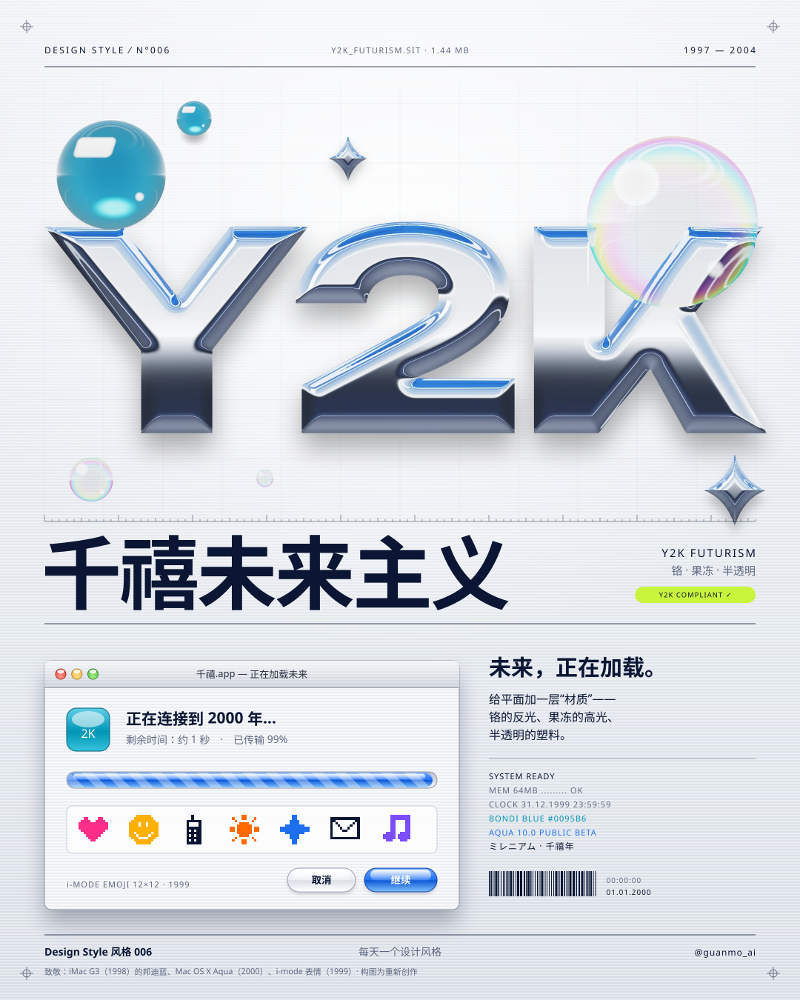
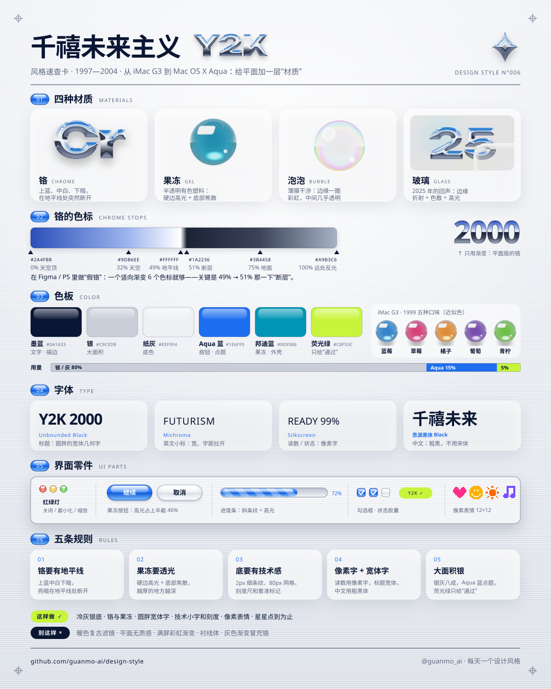
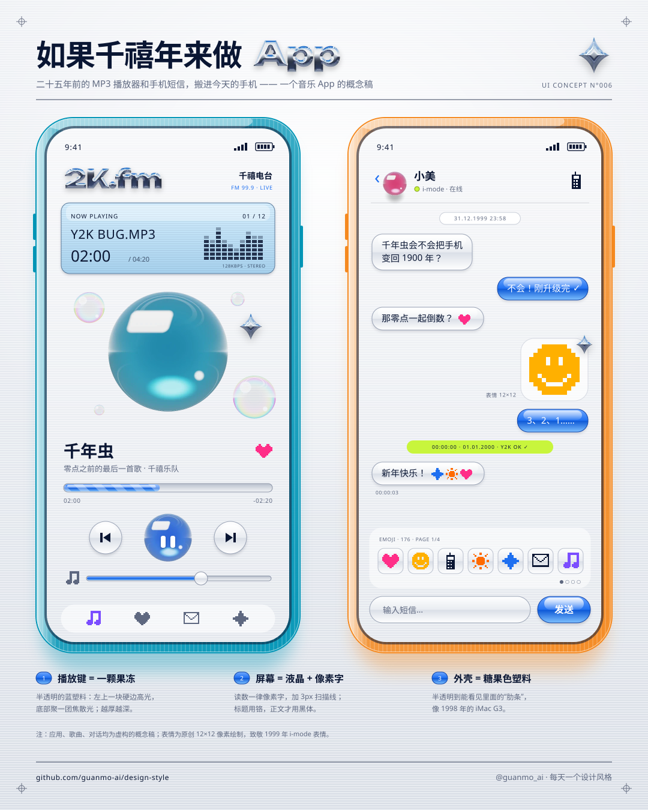
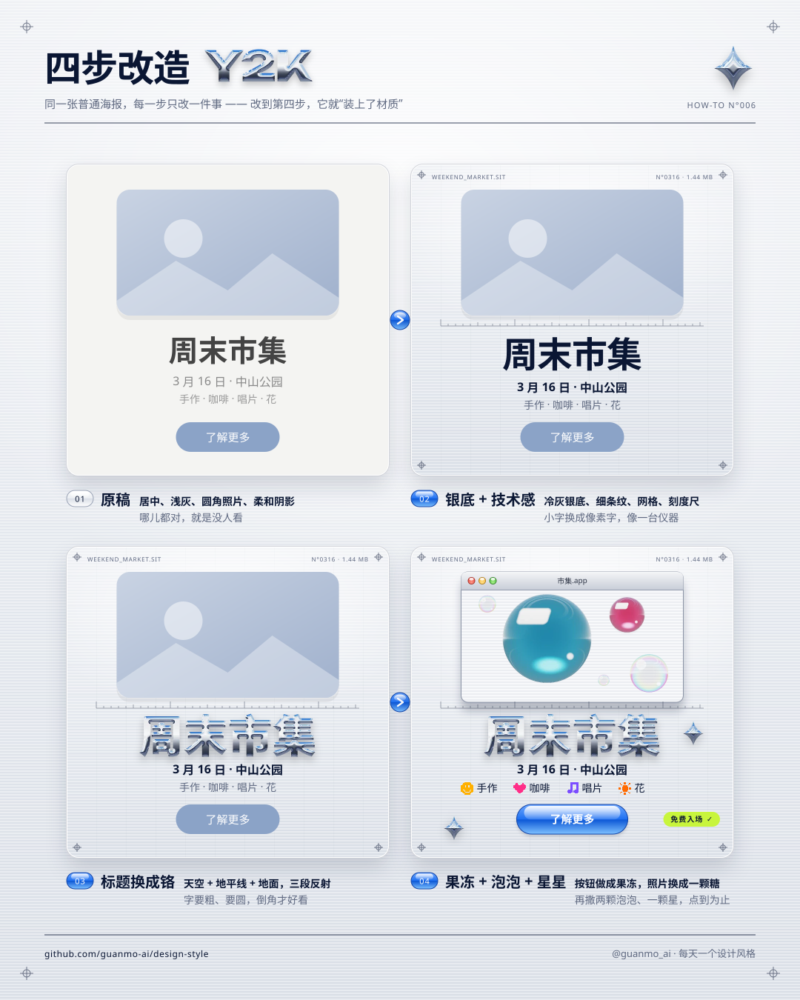
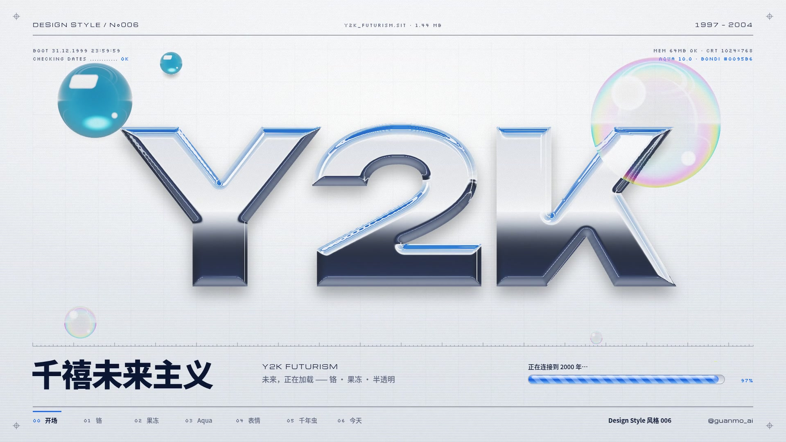

# 006 · 千禧未来主义 Y2K Futurism（1997—2004）

**中文** · [English](README.en.md)

> **一句话：** 世纪之交，人们把对“2000 年”的期待做进了电脑、手机和屏幕：铬、果冻和半透明塑料——未来，正在加载。

🎬 [看视频](https://github.com/guanmo-ai/design-style/releases/tag/day-06) · 🛠 [制作过程](PROCESS.md) · 🧰 [从 0 到 1：工具与流程](MAKING.md) · 🖼 [图片源文件](images)

| 海报 | 速查卡 |
|:-:|:-:|
|  |  |
| **如果千禧年来做 app** | **四步改造** |
|  |  |

---

## 1 · 它从哪来

| 年份 | 事件 |
|---|---|
| **1995** | 索尼 PlayStation 上的赛车游戏《**反重力赛车**》（*Wipeout*）发售，界面和包装由英国工作室 The Designers Republic 设计：宽体字、编号、警示条、像产品说明书一样的“技术标签”——“未来感”的平面语言开始成形。同一年，程序员 David Eddy 给“2000 年问题”起了个缩写：**Y2K** |
| **1998.8** | 苹果 **iMac G3** 上市（5 月 6 日发布，8 月 15 日开卖）：一台邦迪蓝（Bondi Blue）的半透明塑料电脑，看得见里面的零件和电路。电脑第一次不是米色的盒子，而像一颗糖 |
| **1999** | 1 月，iMac 推出蓝莓、草莓、橘子、葡萄、青柠**五种口味**；2 月，NTT DOCOMO 的 i-mode 手机上线，栗田穣崇（Shigetaka Kurita）在 **12×12 像素**的格子里画了 **176 个表情**。3 月，《黑客帝国》上映，绿色字符雨和黑色漆皮成了“数字世界”的样子。年底，全世界都在检查电脑会不会把“00”读成 1900 年——**千年虫** |
| **2000.1** | 1 月 1 日零点平安度过。1 月 5 日，乔布斯在旧金山 Macworld 上发布 Mac OS X 的新界面 **Aqua**：果冻一样的按钮、细条纹的窗口、半透明的菜单、红黄绿三颗“交通灯”。他对《财富》杂志说：*“We made the buttons on the screen look so good you’ll want to lick them.”*（按钮好看到让人想舔一口） 同年，PlayStation 2 和诺基亚 3310 上市 |
| **2001** | 微软 Windows XP 的 **Luna** 主题（蓝色的任务栏、绿色的“开始”按钮、圆润的高光）；苹果 **iPod**：白色塑料正面 + 镜面不锈钢背面。铬、银、半透明从电脑走进了随身听、手机壳、运动鞋和唱片封面 |
| **2004 前后** | 互联网泡沫破了，“未来”也不再那么闪亮。之后的十年，界面换成了更柔和的“**Frutiger Aero**”（水滴、绿草、蓝天、玻璃，约 2004—2013），再到 2013 年前后的扁平化 |
| **2016** | 前后，Evan Collins 等人开始在网上系统整理这段视觉，给它起名 **Y2K 美学 / 千禧未来主义**（后来发展成“消费美学研究所”，Consumer Aesthetics Research Institute，CARI）；同年 10 月，纽约现代艺术博物馆（MoMA）收藏了那 176 个原版表情 |
| **今天** | 2020 年代 Y2K 在时装、唱片封面、海报和短视频里全面回潮：铬字、果冻按钮、像素字、银色。2025 年 6 月 9 日，苹果在 WWDC 发布 **Liquid Glass**：半透明、会折射——25 年后，玻璃又回来了 |

**为什么重要：** Y2K 是**第一次“屏幕本身”成为设计的主角**。在它之前，电脑界面是灰色的方块，硬件是米色的盒子；1998—2001 年，设计师第一次认真地问“数字的东西应该是什么质感？”——答案是铬、果冻、玻璃和半透明塑料。它留下的不只是一种“怀旧滤镜”：拟物的按钮高光、半透明的面板、像素字的读数、iMac 的糖果色，今天的界面设计还在一次次回到这里。

> 这一期只讲设计方法。画面里的铬字、果冻、窗口和表情都是按那个年代的手法重新画的“致敬”，不是原版：没有使用苹果、微软、DOCOMO 等任何品牌的标识，7 个像素表情为本片原创；乔布斯的话引自《财富》杂志 2000 年 1 月 24 日刊。

## 2 · 五条规则

| # | 规则 | 怎么做 | 小心 |
|:-:|---|---|---|
| 01 | **铬** CHROME | 铬 = 一张弯曲的风景：上半反射天空（蓝 → 白），中间一条最亮的**地平线**，下半反射地面（突然变暗，远处再亮一点）。色标：`#2A4FB8` 0% · `#9DB6EE` 32% · `#FFFFFF` 49% · `#1A2236` 51% · `#3B4458` 75% · `#A9B3C6` 100% | 别用“浅灰 → 深灰”的渐变——那是塑料。49% → 51% 那一下“断层”才是金属 |
| 02 | **果冻** GEL | 半透明 + 一块**硬边高光**（左上角，像窗户的倒影）+ 底部一团**焦散**亮色；越厚的地方颜色越深 | 高光要硬边、要偏上；别整个罩一层白色的半透明——那是“雾”，不是果冻 |
| 03 | **技术感的底** TECH | 冷灰银底 + **2px 细条纹** + **80px 网格** + 刻度尺、套准标记、条形码、编号 | 这些是“配料”，透明度 5%—10% 就够；别盖过主角 |
| 04 | **像素字 + 宽体字** TYPE | 读数、状态、时间用**像素字**（Silkscreen）；标题用**宽体几何字**（Unbounded / Michroma）；中文用粗黑体 900 | 像素字只用在小字上，要按整数像素对齐；别拿像素字排正文 |
| 05 | **大面积银，一点荧光绿** SILVER | 银灰占八成，Aqua 蓝点题（按钮、进度条、选中），荧光绿只留给“通过”：COMPLIANT、勾选、SYSTEM READY | 别把五种糖果色全堆上去；荧光绿一个画面只出现一两次 |

## 3 · 色板

| 名称 | HEX | RGB | 建议面积 | 用途 |
|---|---|---|:-:|---|
| 银 | `#C9CED8` | 201 206 216 | 30% | 大面积金属底、标题栏 |
| 铝面亮 | `#EEF0F4` | 238 240 244 | 28% | 底色上端（铝的亮面） |
| 铝面暗 | `#D9DEE6` | 217 222 230 | 14% | 底色下端 |
| 白 | `#FFFFFF` | 255 255 255 | 8% | 细条纹的亮条、高光 |
| 墨蓝 | `#0A1633` | 10 22 51 | 6% | 正文、细线（黑里带一点蓝） |
| Aqua 蓝 | `#1E6FF0` | 30 111 240 | 6% | 默认按钮、进度条、选中 |
| 刻度灰 | `#5E6880` | 94 104 128 | 4% | 次要文字、刻度 |
| 邦迪蓝 | `#0095B6` | 0 149 182 | 1% | 果冻球、半透明外壳 |
| Aqua 深 / 浅 | `#0D58D6` / `#7DC0FF` | 13 88 214 / 125 192 255 | 2% | 果冻按钮中线以下 / 底部焦散 |
| 荧光绿 | `#C8F53C` | 200 245 60 | 1% | 只给“通过”：COMPLIANT、勾选 |
| 交通灯 | `#E0443A` `#F2B53A` `#4DBA3F` | — | 点缀 | 窗口左上角的关闭 / 最小化 / 缩放 |

**iMac 五种口味（1999，近似色）：** 蓝莓 `#1D7FD0` · 草莓 `#E5336F` · 橘子 `#F5891F` · 葡萄 `#7442A8` · 青柠 `#6CC13A`——只用在果冻上，并且一次只挑一两种。

> 铬和果冻是 Y2K 的“光源”：同样的银灰底，没有铬就是一张办公软件截图，没有果冻就是冷冰冰的金属；两样都有，才像是从 2000 年的电脑里截下来的。

## 4 · 字体

| 用途 | 本项目 | 商用原版 / 其他选择 |
|---|---|---|
| 宽体标题 | **Unbounded**（免费，OFL；宽、圆、几何，可变字重 200—900） | Eurostile Extended · Handel Gothic · Monument Extended（免费的还有 Syncopate、Krona One） |
| 科技小字 | **Michroma**（免费，OFL；Vernon Adams 设计，宽体方圆） | Microgramma / Eurostile（1952 / 1962 年的“太空时代”字体） |
| 像素字 | **Silkscreen**（免费，OFL；Jason Kottke 设计的网页像素小字） | Press Start 2P · VT323 · Pixelify Sans（均免费） |
| 中文 | **思源黑体 / Noto Sans SC** 500 / 700 / 900（免费，OFL） | 阿里巴巴普惠体 · 站酷高端黑（免费商用） |
| 界面西文 | **Inter**（免费，OFL；代替 Aqua 的系统字 Lucida Grande） | Lucida Grande · Tahoma · Verdana（2000 年前后的系统字） |

**说明：** 大标题的铬字用 Unbounded Black 900，字距收紧（−3%），交给着色器“镀铬”；栏目号、型号、英文副标题用 Michroma，字距放开（+15% 左右）；进度、时间、状态这些“读数”用 Silkscreen，全大写、整数像素。中文标题用思源黑体 900，正文 500。Unbounded 和 Michroma 没有中文，中英混排时中文交给思源黑体。

## 5 · 版式参数

**视频（1920×1080，60fps，120 BPM）**
- 节拍：**1 拍 = 30 帧**，不放慢；开场、六章、五条规则、片尾各 **4 拍（2 秒）**，一共 18 秒；换幕都落在拍点上
- 铬、果冻、泡泡、玻璃**逐帧用 WebGL 着色器算光**（反射、折射、薄膜干涉、焦散），不是贴图；铬字倒角 26、反射一个“摄影棚”环境（天空 + 地平线 + 地面），镜头一动，地平线就在字上滑过去
- 底：铝面渐变 + **2px** 细条纹 + **80px** 网格（透明度 7%）+ 四角套准标记；页眉「DESIGN STYLE ⁄ N°006」、页脚章节进度条
- 动作：铬字从 1.6 倍“砸”下来，落地抖一下；果冻和泡泡用弹簧（阻尼 9、质量 0.6、刚度 180）弹两下；Aqua 窗口“神灯”式从程序坞吸出来
- 转场 **14 帧**，提前盖上来、正好在拍点上盖满；8 次各不相同：泡泡涨破 ×2、地平线往下刷、果冻球放大、像素方块 ×2、数字故障、玻璃滑过
- 胶片颗粒 3%

**图片（1080×1350 竖图，导出 2160×2700）**
- 左右边距 **90**、上下边距 **72**，与前几期同一套页眉页脚
- 铬字、果冻、泡泡、玻璃先用同一个着色器渲染成透明 WebP 图层，再放进 SVG；其余（窗口、按钮、进度条、刻度、条形码）全部是矢量
- 果冻按钮：胶囊 + 中线断开的渐变 + 上半截一块高光；窗口：细条纹标题栏 + 红黄绿三颗 + 1px 深色边 + 柔和投影 `0 18 28 rgba(10,22,51,.3)`
- 字宽按 Unbounded / Michroma / Silkscreen / 思源黑体的真实度量计算

## 6 · 这样做 / 别这样

**✅ 这样做：** 铬一定要有地平线 · 果冻要透光、高光要硬边 · 银灰底 + 细条纹 + 网格 · 读数用像素字、标题用宽体字 · 大面积银，一点 Aqua 蓝，荧光绿只给“通过” · 让界面零件（进度条、窗口、勾选框）当主角
**❌ 别这样：** 灰色渐变冒充金属 · 糖果色全上 · 霓虹紫 + 粉的“赛博朋克” · 像素字排正文 · 所有东西都发光 · 用真实品牌的标识和界面截图

## 7 · 其他误区

- **Y2K 不是“2000 年那一年”。** 它指的是 1997—2004 年前后、围绕“千禧年”的一整段视觉；名字借自“千年虫”（Y2K = Year 2 Kilo，2000 年），但千年虫本身是一个软件问题，不是一种风格。
- **不等于“赛博朋克”和“蒸汽波”。** 赛博朋克是夜晚、霓虹、雨和反乌托邦；蒸汽波（2010 年代）是粉紫色、希腊雕像和 Windows 95 的反讽拼贴。Y2K 是白天的、乐观的、银色的——它真心相信未来会更好。
- **不等于“Frutiger Aero”。** Frutiger Aero（约 2004—2013）接在 Y2K 后面：水滴、绿叶、蓝天、柔和的玻璃，更“自然”、更安静；Y2K 更“机器”：铬、编号、像素字、技术标签。
- **铬不是灰色。** 真正的铬几乎没有自己的颜色，你看到的全是它反射的环境：天空的蓝、地平线的白、地面的暗。所以铬字的“色标”其实是一张风景。

## 8 · AI 提示词（直接复制）

**图片（Midjourney / 即梦 / ChatGPT 图像）**

```
Y2K futurism poster, 1999-2001 tech aesthetic, a huge liquid chrome 3D logo "Y2K" with a sharp horizon line reflection
(blue sky above, bright white horizon, dark ground below), floating translucent Bondi blue jelly spheres with hard window-shaped
highlights and bright caustics at the bottom, soap bubbles with iridescent thin-film colors, a silver aluminum background with
2px pinstripes and a faint 80px grid, registration marks, rulers, a barcode, an Aqua-style window with pinstripe title bar and
red yellow green traffic lights, a glossy blue gel progress bar, small pixel font readouts "LOADING 99%", wide geometric typography,
colors #C9CED8 #EEF0F4 #1E6FF0 #0095B6 #0A1633 with one tiny accent of neon lime #C8F53C, clean studio lighting,
no neon purple, no cyberpunk night scene, no brand logos --ar 4:5
```

**视频（Runway / 可灵 / Sora）**

```
Motion graphics in Y2K futurism style (1999-2001): a computer boots up with "STARTING UP_" in pixel font, a liquid chrome "Y2K"
logo slams down from the camera and a light sweep crosses it, the horizon reflection slides over the chrome as the camera moves,
a translucent Bondi blue jelly sphere pops out and splits into five candy colors that bounce, an Aqua-style window genies out of
a dock of glossy icons, a 12x12 pixel emoji grid lights up pixel by pixel, a digital clock ticks 23:59:59 to 00:00:00 and glitches
from 1999 to 1900 to 2000, a frosted liquid glass card slides over chrome. Silver pinstripe background, wide geometric type,
transitions made of bubbles, pixel blocks and glass. 120 bpm bright trance-pop with supersaw pads, clean studio light, no cyberpunk.
```

**代码（让 AI 写网页 / 组件）**

```
用 Y2K 千禧未来主义风格做这个界面：背景用铝面渐变 #EEF0F4 → #D9DEE6，叠一层 2px 细条纹
（repeating-linear-gradient(180deg, rgba(255,255,255,.38) 0 2px, transparent 2px 4px)）和 80px 网格（rgba(10,22,51,.07)）。
文字 #0A1633，次要 #5E6880，主色 Aqua 蓝 #1E6FF0，荧光绿 #C8F53C 只用于“成功 / 已完成”。
字体：Unbounded 900（英文大标题）+ Michroma（编号、英文副标题，字距放开）+ Silkscreen（状态、进度、时间等读数，全大写）+ Noto Sans SC（中文 900 / 500）。
大标题做成“铬”：background: linear-gradient(180deg, #2A4FB8 0%, #9DB6EE 32%, #FFFFFF 49%, #1A2236 51%, #3B4458 75%, #A9B3C6 100%);
background-clip: text; 再描 1px 深色边。主按钮做成果冻：胶囊形、linear-gradient(#6FA8FF, #1E6FF0 50%, #0D58D6 52%, #7DC0FF)，
::before 在上半截放一块白色高光（硬边）。卡片做成 Aqua 窗口：细条纹标题栏 + 左上角红黄绿三颗圆点 + 1px 边 + box-shadow 0 18px 28px rgba(10,22,51,.3)。
加一条果冻进度条、刻度尺和条形码当装饰。设计令牌见 tokens.css。
```

## 9 · 18 秒分镜

Y2K 最有用的一招，是“**铬一定要有地平线**”——同一个字，填一条灰色渐变就是塑料；上蓝、中白、下暗，在地平线处突然断开，它就变成了金属。短片里的铬、果冻、泡泡和玻璃都是逐帧用着色器算出来的：镜头一动，地平线就在铬字上滑过去；光穿过果冻，在底部聚成一团亮色。整支片子像一台 2000 年的电脑开机：从「STARTING UP_」到「SYSTEM READY ✓」。配乐是 120 BPM 的千禧年 trance-pop，F 大调，超级锯齿波和弦 + 四拍底鼓，音效全是开机“哔”、调制解调器、泡泡“啵”和玻璃钟。

<a href="https://github.com/guanmo-ai/design-style/releases/tag/day-06"></a>

| 时间 | 帧 | 章节 | 画面 | 致敬 |
|---|---|---|---|---|
| 0:00—2.0 | 0—120 | 开场 | 开机“哔”，屏幕中间打出「STARTING UP_」；铬字 **Y2K** 从镜头前砸下来，扫光划过；一大两小三颗泡泡弹起来，进度条「正在连接到 2000 年…」走到 99%，最后 1% 留给片尾 | 世纪之交的开机画面与“千禧倒计时” |
| 2.0—4.0 | 120—240 | 01 铬 | 一个灰色的大字「铬」；第 2 拍环境贴图从上往下“刷”上去，变成金属；左边拆开给你看：天空 SKY + 地平线 HORIZON + 地面 FLOOR；镜头上下一动，地平线就在字上滑过去 | 世纪末唱片封面、海报上的铬字 |
| 4.0—6.0 | 240—360 | 02 果冻 | 一颗邦迪蓝的半透明果冻球“啵”地冒出来：半透明、高光、焦散三个标签；大球缩回队首，五种口味依次掉下来弹两下 | iMac G3（1998 邦迪蓝，1999 五种口味） |
| 6.0—8.0 | 360—480 | 03 Aqua | 细条纹窗口从果冻图标的程序坞里“吸”出来，里面是乔布斯那句 “…so good you’ll want to lick them.”；默认按钮一呼一吸，两个勾选打上，程序坞的放大镜扫过一遍 | Mac OS X Aqua（2000.1.5，旧金山 Macworld） |
| 8.0—10.0 | 480—600 | 04 表情 | 12×12 的网格一个像素一个像素地点亮，计数一路跳到 176；7 个原创像素表情一排排冒出来 | 栗田穣崇 · i-mode 表情（1999；2016 年 MoMA 收藏） |
| 10.0—12.0 | 600—720 | 05 千年虫 | 液晶屏读数 23:59:57 → 58 → 59 滴答三声；日期从 1999 故障成 **1900**，零点一到修好成 **2000**：00:00:00，大和弦 + 钟 + 烟花；「Y2K = Year 2 Kilo」 | 千年虫（1999.12.31 → 2000.1.1） |
| 12.0—14.0 | 720—840 | 06 今天 | 一块会折射的玻璃卡片滑进来，在铬字上慢慢漂：「透过玻璃，看见下面的铬。」；三组对照：果冻按钮 → 玻璃按钮、细条纹 → 模糊 + 折射、镀铬 → 边缘高光 | 苹果 Liquid Glass（2025.6.9，WWDC） |
| 14.0—16.0 | 840—960 | 五条规则 | 铬 / 果冻 / 技术感的底 / 像素字 + 宽体字 / 大面积银，五张卡片一张接一张上来，每张一声玻璃钟，每张卡用自己的方法演示自己 | — |
| 16.0—18.0 | 960—1080 | 片尾 | 铬字 Y2K 再落一次，开机自检一行行打上「OK」，右上角「SYSTEM READY ✓」：「未来，已经加载完成。」 | — |

> 画面中的铬字、果冻、窗口、程序坞图标和表情都是按那个年代的手法重新画的“致敬”，不是原版截图；没有使用任何品牌标识。app 概念图里的电台、歌曲、联系人和短信都是虚构的。

## 10 · 文件

```
006-y2k/
├─ PROCESS.md                             # 制作过程
├─ MAKING.md                              # 从 0 到 1：用了哪些工具、按什么顺序、敲什么命令
├─ process/                               # 过程图：成片联系表 · 开场拆解 · 转场链 · 节拍时间轴 · 制作流程图
├─ tokens.ts / tokens.css / tokens.json   # 同一份设计令牌（颜色与面积、字体、铬的色标与环境、果冻、细条纹与网格、节拍）
├─ video/Y2K.tsx                          # 短片主合成：按时间窗挂载各章、8 种转场、页眉页脚、颗粒、配乐（Remotion，React）
├─ video/timeline.ts                      # 各章起点（帧）、总长与转场长度 TR
├─ video/material.js                      # 材质着色器（WebGL2）：文字 → 掩码 → 距离场 → 倒角高度场 → 法线 → 铬 / 果冻 / 泡泡 / 玻璃
├─ video/opening.tsx                      # 开场（开机 → 铬字 Y2K）+ 01 铬
├─ video/chapters.tsx                     # 02 果冻 · 03 Aqua · 04 表情 · 05 千年虫
├─ video/finale.tsx                       # 06 今天 · 五条规则 · 片尾
├─ video/ui.tsx                           # 底（细条纹 + 网格）、页眉页脚、材质画布 Mat、窗口、果冻按钮、进度条、像素字、转场
├─ video/cover.jpg                        # 视频封面
├─ audio/make_music.py                    # 配乐：numpy 合成，120 BPM，F 大调千禧 trance-pop，-14 LUFS
└─ images/
   ├─ make_svgs.py        # 四张图的生成脚本：窗口、果冻按钮、进度条、刻度、条形码；字宽按真实字体度量计算
   ├─ layer.html          # 用视频的同一个着色器把铬 / 果冻 / 泡泡 / 玻璃渲染成透明图层
   ├─ render_layers.mjs   # 批量渲染图层（Playwright + 无头 Chromium）→ layers/*.webp
   ├─ layers/             # 图层的参数（.json）和渲染结果（.webp）
   ├─ poster.svg          # 海报
   ├─ cheatsheet.svg      # 速查卡
   ├─ app-ui.svg          # 如果千禧年来做 app：半透明手机里的电台和短信
   ├─ steps.svg           # 四步改造：普通海报 → Y2K
   └─ preview/            # 内嵌字体和图层的自包含 SVG
```

**延伸阅读：** Consumer Aesthetics Research Institute（CARI）的 Y2K 图片档案 · Rick Poynor《No More Rules: Graphic Design and Postmodernism》（2003）· The Designers Republic 作品集 · 苹果 2000 年 1 月 5 日 Mac OS X 新闻稿 · MoMA 馆藏「NTT DOCOMO 表情（1998—1999）」· 苹果 Human Interface Guidelines 里的 Liquid Glass 章节
