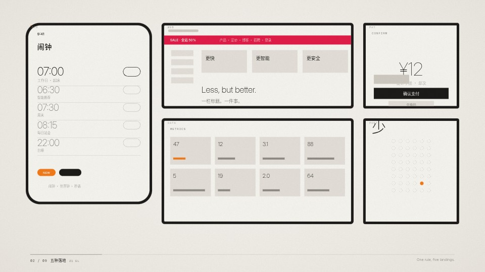
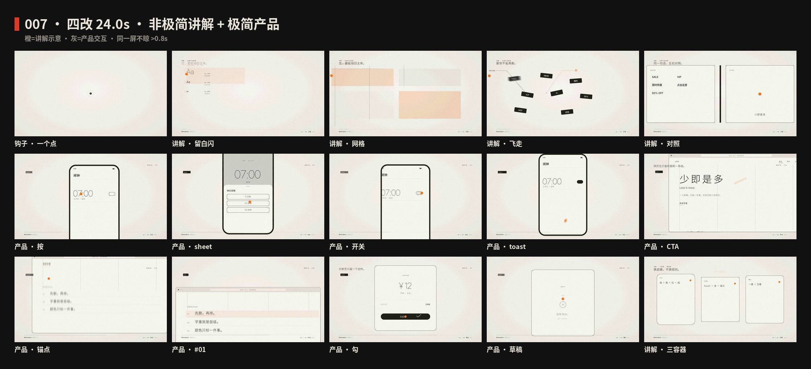
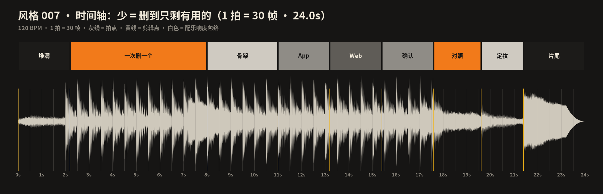

# Minimalism · Making of

[中文](PROCESS.md) · **English** · [English guide](README.en.md)

> A concise English production overview. The [full Chinese production log](PROCESS.md) records the rejected first draft, the rebuild, and every check. The film and process images retain their original labels.

## Design constraint

Perform one move — subtraction — with one protagonist: a signal-orange dot. Each scene is reduced to its last shape, which becomes the first shape of the next scene. Every deletion lands on a sixteenth note at 120 BPM, and the music loses voices together with the picture.

Deliberately different from 002 Swiss Style: no red, no visible grid, no heavy Helvetica headlines, no column-reflow machinery. Warm paper, neutral greys, ink, one accent; thin type is a quiet caption, space and the dot are the subject.

## Why it was rebuilt

The first draft was rejected: centered text cards on empty paper, no protagonist, no camera, and a soundtrack of a pad and a bell. The rebuild starts from the opposite of emptiness — a screen packed with 147 pieces of visual noise — and earns the empty frame by deleting it on the beat.

## Production workflow

1. Research the timeline (Browning, Sullivan, Loos, Mies, Rams, Judd, Reich, flat UI) and reduce it to five rules.
2. Write all frame numbers in `video/timeline.ts` and the scene files; `video/cues.ts` gathers them and `audio/export_cues.mjs` writes `audio/cues.json`, so the music reads the same numbers as the picture.
3. Sixth cut: write a 10-cell high-density storyboard in `video/script.ts` first (on-screen count + motion move + principle). Opening 0–3s explodes with ≥16 moving elements; five landings run in parallel; a readable motion event every 1–1.2s. Thesis stays “less = remove until only the useful remains.”
4. Synthesize the score with NumPy (`audio/make_music.py`): Swiss-grid kicks from beat 0, land/shout ticks, scheme cuts, explode/suck, then voices drop after the versus; mastered to −14 LUFS with a −2 dBTP ceiling.
5. Generate the four sheets with `images/make_svgs.py` and embed font subsets with `scripts/build_images.py`.
6. Check stills, contact sheets, the beat chart, loudness and the encoded files.

## Timing and output

| Property | Project value |
|---|---|
| Canvas | 1920 × 1080 |
| Frame rate | 60 fps |
| Composition duration | 24 seconds |
| Frames | 1440 |
| Tempo | 120 BPM (beat = 30 frames, sixteenth = 7.5 frames) |
| Loudness | −14 LUFS, true peak below −1 dBTP after AAC |

## Reproduce locally

From the repository root, after installing the dependencies and fonts described in the [English project README](../../README.en.md):

```bash
npm run studio          # pick S007-Minimalism
npm run render:007      # music → out/007-minimalism-master.mp4 (motion blur)
npm run images:007
```

## Process images








## Files and further reading

- [English design guide](README.en.md)
- [Full production log in Chinese](PROCESS.md)
- [Timing data](process/timeline.json)
- [Animation source](video)
- [Released video](https://github.com/guanmo-ai/design-style/releases/tag/day-07)

When sharing the film or artwork, credit **Guanmo / @guanmo_ai**.
