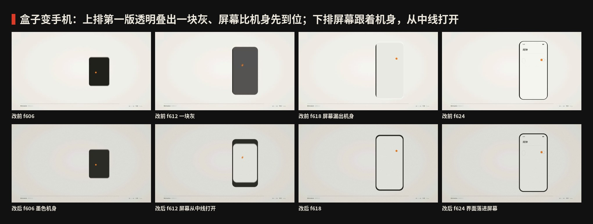

# 007 · 极简主义 · 制作过程

**中文** · [English](PROCESS.en.md)

> 这一期是怎么从一个被否掉的草稿，推到 22 秒产品幕短片和 4 张图的：怎么想的、怎么做的、哪里改过、下次怎么做得更好。
> 过程图都在 [`process/`](process)，可以复现的代码在 `video/` `audio/` `images/` 和根目录的 `scripts/`。

🎬 [看成片（Releases · day-07）](https://github.com/guanmo-ai/design-style/releases/tag/day-07) · 📐 [风格指南](README.md)

---

## 0 · 一览

| # | 步骤 | 产出 | 工具 / 文件 |
|:-:|---|---|---|
| 1 | 复盘被否的第一版 | 三条问题 → 三条重做原则 | — |
| 2 | 选题与定调 | 一句话定义、和 002 的边界、禁区 | — |
| 3 | 研究 | 时间线、五条规则、广度清单、误区 | [`README.md`](README.md) §1—§7 |
| 4 | 设计令牌 | 4 色 + 3 个辅助色、Inter Display 细字重 + 思源黑体 Light、线宽、节拍 | `tokens.ts / .css / .json` |
| 5 | 分镜：橙点接力 | 每一幕剩下的最后一样东西 = 下一幕的开头 | `video/timeline.ts` · [`process/timeline.json`](process/timeline.json) |
| 6 | 视频 | 六个场景文件，一个连续镜头 | Remotion · `@remotion/motion-blur` |
| 7 | 配乐与音效 | 一首按画面帧号写的曲子，−14 LUFS | `audio/make_music.py`（numpy 合成）· `cues.json` |
| 8 | 风格图 ×4 | 海报 · 速查卡 · app 概念 · 四个年代 | `images/make_svgs.py` · `scripts/build_images.py` |
| 9 | 质检与修正 | 成片抽帧、联系表、节拍时间轴、响度复测 | `scripts/stills.mjs` · `contact_sheet.py` · `timeline_chart.py` · ffmpeg |
| 10 | 渲染 | 母版 + 分享版 MP4、封面 | Remotion · ffmpeg |

---

## 1 · 复盘：第一版为什么被否

主人的原话是“画面空洞、BGM 敷衍”。对着被否的静帧逐条拆：

1. **像 PPT。** 每一幕是一张居中的字卡：一句话 + 一个灰色几何形，切到下一张。没有主角，也没有镜头运动——留白很多，但留白没有“指向”任何东西，所以只是空。
2. **动效廉价。** 淡入淡出 + 轻微缩放，所有东西同一种缓动；没有节拍，也没有“删”这个动作。
3. **配乐单薄。** 一层 pad、几声铃，和画面没有对位关系。

所以这一版不在旧稿上修，**整套重写**，先立三条原则：

- **先满后空：** 空要“挣”出来。开场先给满屏 147 样视觉噪音，在拍子上一样一样删掉，删到只剩一个点——观众亲眼看着“少”是怎么来的。
- **一个主角、一个动作：** 全片只有一个信号橙的点，只做一件事：删。不讲课，能用动作说明的就不写字。
- **声音也做减法：** 配乐是一整首曲子，但它跟着画面一个声部一个声部地减；每删一样东西都有一声。

## 2 · 选题与定调

**为什么第七期是极简主义：** 第六期千禧未来主义是“加”到极致——铬、果冻、泡泡、玻璃。紧接着做“删”到极致，正好是一组对照。极简主义又是今天几乎所有产品官网和手机界面的底色，观众每天都在用，只是说不清它到底是什么。

**定调（写在动手之前）：**

- 一句话：*一个点、一条线、大片的空——删到不能再删，剩下的每一样都有理由。*
- 受众：设计师拿去就能用（色值、字重、版式参数、提示词）；普通人看完能说出“极简不是空，是删”。
- 质感：暖纸白 + 中性灰 + 墨，外加一处信号橙。细线、细字、轻微的纸面颗粒；不用投影、不用渐变。
- **和 002 瑞士风格划清界限：** 不用红；不画网格；不拿 Helvetica 粗黑大字当主角；没有“12 栏重排”的机器感。瑞士风格的主角是版面秩序，这一期的主角是空间和那一个点。
- **禁区：** 不用任何日本元素（和风、书法、侘寂、鸟居、禅石、障子……）。致敬对象全部来自建筑、工业设计、艺术与今天的界面：密斯、拉姆斯、贾德、斯特拉、扁平界面。
- 署名：片尾和每张图的页脚都是 `@guanmo_ai`。

## 3 · 研究：先列清单，再动手

1. **时间线：** 1855 勃朗宁 → 1896 沙利文 → 1908—1913 路斯 → 1929 德国馆 → 1947 MoMA 密斯回顾展 → 1955—1958 拉姆斯与博朗 → 1960s 极简艺术 → 1964—1976 极简音乐 → 1970s 末 十条原则 → 2010—2014 扁平界面（详见 [风格指南 §1](README.md#1--它从哪来)）。
2. **规则：** 归纳成 5 条可执行的规则：负空间 / 删减 / 功能 / 重复 / 一处强调，每条写“怎么做”和“小心”。
3. **广度清单**（视频章节和风格图都从这张表来）：

   | 领域 | 人物 | 作品 | 年份 | 用在哪 |
   |---|---|---|---|---|
   | 建筑 | 密斯·凡·德·罗 | 巴塞罗那德国馆 | 1929 | 01 负空间 · 四个年代图 |
   | 工业设计 | 迪特·拉姆斯 | 博朗 T3 口袋收音机；十条原则 | 1958 / 1970s 末 | 02 删减 · 03 功能 · 四个年代图 |
   | 艺术 | 唐纳德·贾德 · 弗兰克·斯特拉 | 堆叠；What you see is what you see | 1960s | 04 重复 · 四个年代图 |
   | 音乐 | 特里·莱利 · 史蒂夫·赖希 | In C；18 位音乐家的音乐 | 1964 / 1976 | 配乐的马林巴固定音型 |
   | 界面 | — | 扁平界面：Metro、iOS 7、Material | 2010—2014 | 05 今天 · app 概念图 |
   | 口号 | 勃朗宁 → 密斯 | Less is more | 1855 / 1947 | 开场与片尾 · 海报 |

4. **误区：** “Less is more” 不是密斯发明的；极简 ≠ 空、≠ 便宜、≠ 只有黑白、≠ 瑞士风格（见 [风格指南 §7](README.md#7--其他误区)）。所以片尾写的是“LUDWIG MIES VAN DER ROHE”（让它出名的人），没有写“密斯说过”这类出处不严的话。

## 4 · 设计系统先行

- **令牌：** `tokens.ts` 是唯一来源；`tokens.css`（`--mn-*` 变量 + 示例类）和 `tokens.json`（含建议面积）手写同步。
- **颜色：** 暖纸白 80% · 中性灰 12% · 墨 7.5% · 信号橙 0.5%；另有亮面 / 阴面 / 石色三个辅助色，只给轴测体块的三个面和水池用。
- **字体：** 为这一期新增 Inter Display Thin / ExtraLight / Light、Inter Light 和思源黑体 Light（`scripts/fetch_fonts.sh`，都是 OFL），`scripts/build_images.py` 同步登记。标题越大越细；中文也用 Light，和拉丁一样轻。
- **字宽：** `video/metrics.py` 从字体文件读出每个字的步进宽度写进 `metrics.ts`，右对齐、加字距后的锚点修正都按真实字宽算，不目测。
- **线：** 只有 1.5 / 1 两种（墙 10）；全部 `non-scaling-stroke`，这样回顾里把整幕缩到 0.16 倍当小图时，线不会变成一根头发丝。
- **节拍：** 120 BPM，1 拍 = 30 帧，十六分音符 = 7.5 帧，三十二分音符 = 3.75 帧。所有“删”都落在这张格子上。

## 5 · 分镜：今天怎么用

主人四改：三改 22 秒产品幕「先记一下」，但感觉一个东西停在那儿。核心缺口是动效太少——虽是 Minimalism，**讲解它的地方不必极简**。片长 24.0s：开场钩子仍短；中间加厚非极简示意幕；产品 UI 保持极简，但每个交互看得见，同一屏不晾 >0.8s。


| 幕 | 秒 | 帧 | 层 | 动作 |
|---|---|---|---|---|
| 开场 | 0.0—1.8 | 0—108 | 钩子 | 147 样噪音 → 一个点；地平线；标题 |
| **示意** | **1.8—6.0** | **108—360** | **非极简讲解** | 字重 + 测量线；留白填色闪退；网格显现；噪音飞走；before→after；一处强调 |
| **App** | **6.0—10.4** | **360—624** | **极简产品** | 按压缩放；推页；滑动；sheet；拨开关；toast；加号。节拍更密 |
| **Web** | **10.4—15.0** | **624—900** | **极简产品** | hover 下划线；CTA；整页上滚；锚点；行 hover；地址栏 #01 |
| **确认** | **15.0—18.4** | **900—1104** | **极简产品** | 按下；勾上；空着；草稿飞入再折走 |
| **对照** | **18.4—21.0** | **1104—1260** | **非极简讲解** | 三容器并排，箭头标「同一套语言」，收成一个点 |
| 片尾 | 21.0—24.0 | 1260—1440 | 片尾 | 「少即是多。」`@guanmo_ai` |

章节条从讲解幕起常驻底部（左边“Minimalism 极简主义”和一根进度发丝线，右边 `0N / 05` + 章节名），开场和片尾让画面完全空出来。

开场单独当一支片子来做：0.5 秒里从满屏噪音删到一个点，第 30 帧落在第一个重拍上。


## 6 · 关键实现

- **一张大 SVG：** 所有场景画在同一个 1920×1080 的 `<svg>` 里，按时间窗挂载（`Minimalism.tsx` 里的 `on(from, to)`），相邻两幕有约 20 帧重叠。App 离开时手机外框弹簧插值成浏览器窗口。
- **运动模糊：** `@remotion/motion-blur` 的 `CameraMotionBlur`（快门角 180°，6 次采样）；纸面颗粒放在模糊之外。产品三幕各有一条 `camTrack` 运镜（按、推、拉、拨、滚、锚点时轻轻推近）。
- **讲解（`teach.tsx`）：** 故意不极简。三档字重旁画测量线；留白四块填色闪一下再退；4×4 网格从角落长出；促销 junk 弹入再飞走；左右 before→after；圈出「一处强调」。18.4s 三容器对照再收成一个点。
- **App（`app.tsx`）：** 地平线 → 手机；列表先删多余闹钟；`pressAmt` 做按压缩放；响铃页从右侧弹簧推入；sheet 从底边 `spr` 拉起；橙点拨进开关；toast「已开启」；加号弹回再按。同一屏不晾 >0.8s。
- **Web（`web.tsx`）：** 浏览器窗口 + 细线栏；hover 画出导航下划线；CTA 橙线；整页 `translateY` 上滚再加一段锚点；原则行 hover；地址栏改成 `#01`。
- **确认（`pay.tsx`）：** 一张纸、¥12、一个主按钮；按下后勾画上「已支付」，再弹簧切到空状态；加号按下后草稿飞入再折走。
- **逐字母动画：** `Letters` 按真实字宽排每一个字；片尾的“少即是多”四个字和配乐的四个音一一对应。

## 7 · 声音

`audio/make_music.py` 用 numpy 从零合成，没有任何外部音源；时间点全部从 `cues.json` 读——它由 `audio/export_cues.mjs` 把 `video/cues.ts`（汇总所有场景的帧号常量）打包导出，画面和声音共用同一套数字。

- **编排：** 120 BPM，D 大调。五条总线：鼓 / 律动（贝斯、pad、马林巴）/ 簇和弦 / 键盘 / 音效，另有一条混响发送。律动总线跟着底鼓做侧链压缩。
- **开场：** 147 样东西每删一样一声软 “噗”（低通）；底下是暖的纸噪，整轨前 0.7 秒再过一遍 1.5 kHz 暖低通。第 30 帧一个 D6 的 ping。
- **App：** 多余闹钟每删一样一声 tick；按下 / 推页 / sheet / 拨开关各一对位（click、空气声、ping）。
- **Web：** hover 两声玻璃 tink；滚动一阵空气 + 短 riser；锚点落地一声 ping。
- **确认：** 卡片弹出 thock；按下 click；勾上 ping + 轻镲；空状态时鼓、贝斯、马林巴依次退出。
- **片尾：** ping + Dmaj9；“少即是多”四个字四个音；主题句最后一次越来越轻。
- **母带：** 测响度 → 增益 → 前瞻限幅，迭代到 −14 LUFS；真峰值压到 −2 dBTP，给两次 AAC 转码留余量。开头 6ms 淡入，避免 AAC 在“静音 → 满屏噪音”那一下冒出过冲。
- **局限：** 配乐只用频谱图、响度和时间轴图检查过，没有人耳试听——发布前请主人试听把关。


## 8 · 风格图

四张都由 `images/make_svgs.py` 生成（字宽从字体文件读），`scripts/build_images.py` 内嵌字体子集、导出 2x PNG。共同规则：边距 96 / 112，线只有 1.5 / 1，每个画面只有一处橙。

| 图 | 内容 |
|---|---|
| `poster.svg` | “Less is more.” + 6 × 8 = 48 个虚线圆，空掉一格，那一格顺着点线落到地平线上变成橙点；左边只有两个数字：47 删掉了，1 留下了 |
| `cheatsheet.svg` | 按面积画的色板（橙色只有 0.5%，用一根引线拎出来）、三档字重的 Aa、视频版式缩略图 + 参数表、五条规则各配一个发丝线小图标 |
| `app-ui.svg` | 闹钟 app 两屏：列表只有一个闹钟、响铃只有一个动作；四根引线收进两屏之间的空白，底部列出这张稿子删掉了什么 |
| `eras.svg` | 1929 德国馆平面 / 1958 收音机 / 1967 堆叠 / 2013 手机，几何和视频同源 |

## 9 · 质检与修正

1. **关键帧截图：** `npx remotion bundle` 打包一次，`node scripts/stills.mjs` 只导出受影响的帧（`blur: 1` 关掉运动模糊，快）。
2. **成片联系表：** 每拍一帧，看整片的节奏和留白分布。

   

3. **从成片里抽帧复查**，发现并修掉：
   - **盒子变手机那 0.2 秒发灰（f606—618）：** 屏幕用透明度淡入，叠在墨色机身上就是一块灰；而且屏幕直接画在最终位置，机身还在弹簧插值里，屏幕先漏出了机身。改成屏幕跟着机身内缩、从中线打开、始终不透明，界面用同一个矩形裁切。

     

   - **开场标题推镜时，字越过了地平线的端点：** 推镜改成作用在“线 + 涟漪 + 点 + 标题”整组上，下一幕台基收线的起点也按推镜后的长度算。
   - **墙比台基先出现：** 台基的三条边提前合拢，第 120 帧第一面墙落下时台基已经是满的。
   - **贾德那一幕点在 f547.5 跳了一下：** 点的轨迹拆成“跟着码盒子往上”和“一级一级往下跳”两段，往下跳的落点对齐十六分音符。
   - **回顾里的时间线刻度跟着缩放变得很粗：** 刻度画在缩放组外面。
   - **片尾“少，即是多。”逗号留出一个大洞：** 改成“少即是多”四个字等距。
4. **配乐：** 第一版开场的噪音比 ping 还轻、低频持续音太重、收音机那一段太空、片尾没写完——逐段调了电平、补了片尾段。成片的 AAC 真峰值一度到 −0.5 dBTP，母带天花板压到 −2 dBTP 并加 6ms 淡入后，母版 −1.7、分享版 −1.8 dBTP。
5. **成片检查：** `ffprobe` 核对 1920×1080 · 60fps · 1440 帧 · 24.0s · H.264 High + AAC；分享版 **−14.02 LUFS · 真峰值 −4.18 dBTP**。
6. **二改：** 开场整轨过 1.5 kHz 暖低通；拿掉收音机/贾德展板停留；片长 15s → 18s。
7. **三改：** 历史幕压成 2 秒钩子；加入 App / HTML / 确认三幕真实产品 UI；片长 22.0s。
8. **四改（本版）：** 讲解幕加厚（测量 / 字重 / 留白闪 / 飞走 / 网格 / 前后对比 / 三容器对照）；产品幕每个交互看得见、同一屏不晾 >0.8s；片长 24.0s。

## 10 · 渲染与发布

```bash
npm run music:007                                     # 生成配乐 → public/007-minimalism/music.wav（先导出 cues.json）
npx remotion render src/index.ts S007-Minimalism out/007-minimalism-master.mp4 --codec=h264 --crf=16   # 母版
ffmpeg -i out/007-minimalism-master.mp4 -i public/007-minimalism/music.wav -map 0:v -map 1:a \
  -vf "scale=in_range=full:out_range=tv,format=yuv420p" -c:v libx264 -preset slow -crf 18 -profile:v high \
  -c:a aac -b:a 192k -shortest -movflags +faststart out/007-minimalism.mp4   # 分享版（Releases 附件）
```

- 分享版的声音直接从 WAV 编码（只转一次 AAC），真峰值更稳。
- 运动模糊每帧渲染 6 次：这台云端机器上整片约 8—10 分钟。改动时只渲受影响的帧，最后才整片渲。
- 母版约 119MB、分享版约 58MB：纸面颗粒每帧都在变，比 002 的纯色画面大得多。
- 视频不进 git 仓库，审片通过后放在 [Releases · day-07](https://github.com/guanmo-ai/design-style/releases/tag/day-07)。
- 封面：App 幕拨开橙点开关附近的一帧 → `video/cover.jpg`。

## 11 · 踩坑记录

| 问题 | 解决 |
|---|---|
| 留白多 ≠ 极简，第一版因此被否 | 先满后空：先给满屏噪音，在拍子上删出来；全片一个主角（橙点）、一个动作（删） |
| 轴测要能从平面连续“升”起来，3D 引擎太重 | 自写投影：旋转 + 压扁 + 按高度抬起，画家算法排序；镜头参数全是帧号的函数 |
| 回顾里把整幕缩成 0.16 倍，线细得看不见 | 所有线 `vector-effect: non-scaling-stroke`；需要固定大小的刻度画在缩放组外面 |
| 配乐和画面的帧号各写一份，改一处就错位 | `video/cues.ts` 汇总所有帧号常量，`export_cues.mjs` 打包成 `cues.json`，配乐只读这一份 |
| 透明度淡入的白屏叠在墨色机身上发灰 | 屏幕始终不透明，用尺寸（从中线打开）代替透明度 |
| AAC 转码后真峰值冒过 −1 dBTP | 母带留到 −2 dBTP，开头 6ms 淡入；分享版声音直接从 WAV 编码 |
| 系统 Chrome 截 PNG 时中文字边缘有彩边（次像素抗锯齿） | 用 `npx playwright install chromium-headless-shell` 装的无头浏览器，灰度抗锯齿 |

## 12 · 下期沿用的清单

- [ ] 被否的版本先逐条复盘，写出“重做原则”再动手
- [ ] 极简类题材：空要“挣”出来——先满后空
- [ ] 全片一个主角、一个动作；每一幕剩下的最后一样东西 = 下一幕的开头
- [ ] 画面和配乐共用一份帧号（`cues.ts → cues.json`）
- [ ] 线一律 `non-scaling-stroke`，方便回顾里复用整幕
- [ ] 母带留 2dB 真峰值余量；分享版声音从 WAV 直接编码
- [ ] 联系表 + 时间轴 + 从成片抽帧复查；`PROCESS.md` 边做边写
