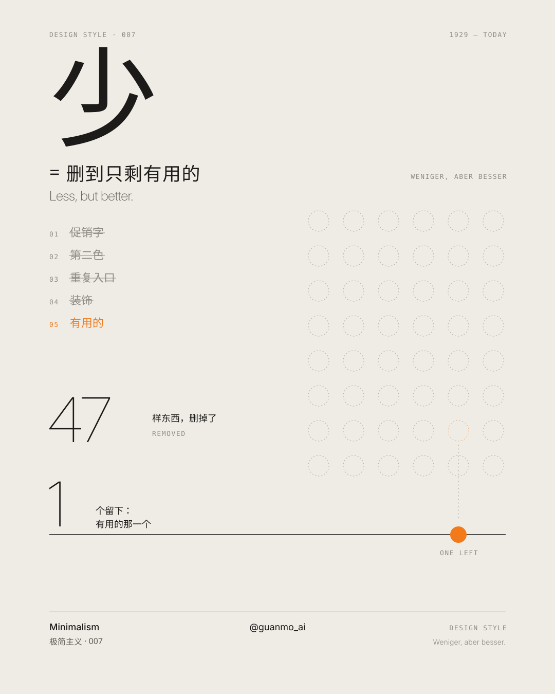
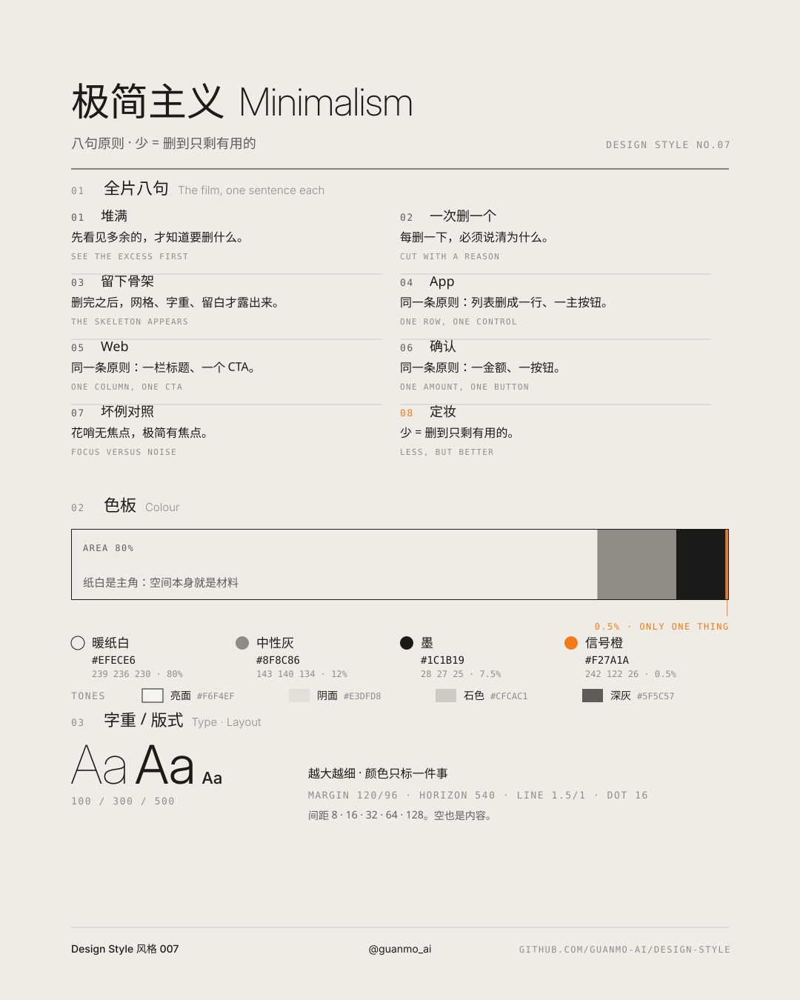
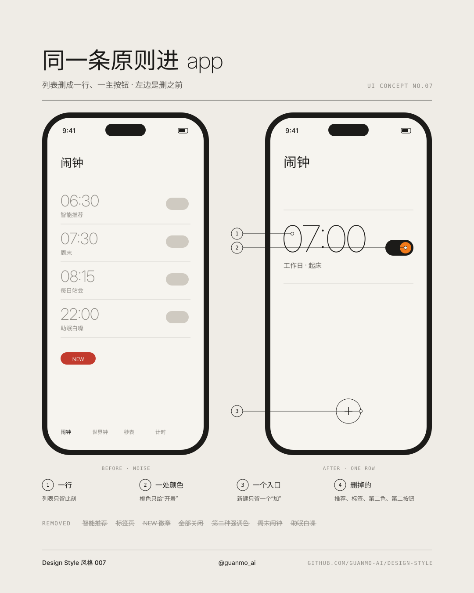
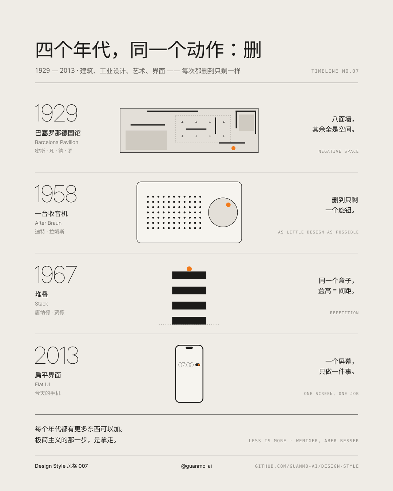

# 007 · Minimalism

[中文](README.md) · **English** · [Watch the film](https://github.com/guanmo-ai/design-style/releases/tag/day-07) · [Making of](PROCESS.en.md)

> English quick guide to this episode. Videos and SVG artwork retain their original Chinese labels. The [detailed Chinese guide](README.md) includes the longer history and frame-by-frame storyboard.

## Overview

One dot, one line, a lot of space. Remove until nothing more can be removed; everything that is left has a reason to be there. Less is more.

The 15-second film performs a single move — subtraction — with a single protagonist: a signal-orange dot. Every scene is reduced to its last remaining shape, and that shape becomes the start of the next scene: noise → dot → horizon → Mies's pavilion plan → roof slab → radio → knob → box → phone → timeline → dot.

Series: **Design styles**. Period shown in this episode: **1929—today**.

## A short history

| Year | Event |
|---|---|
| 1855 | Robert Browning writes “Well, less is more, Lucrezia” in *Andrea del Sarto* — long before Mies. |
| 1896 | Louis Sullivan writes “form ever follows function”. |
| 1908—1913 | Adolf Loos argues against ornament in *Ornament und Verbrechen* (lecture 1910, published 1913). |
| 1929 | Mies van der Rohe's German Pavilion in Barcelona: a podium, eight cruciform columns, one roof, free-standing walls. Demolished in 1930, rebuilt in 1986. |
| 1947 | MoMA's Mies retrospective and Philip Johnson's monograph; “less is more” spreads as Mies's motto. |
| 1955—1958 | Dieter Rams joins Braun: SK 4 with Hans Gugelot (1956), the T3 pocket radio (1958). |
| 1960s | Minimal art: Donald Judd's stacks (from 1965), Frank Stella's “What you see is what you see”, Dan Flavin, Carl Andre. |
| 1964—1976 | Minimal music: Terry Riley's *In C*, Steve Reich's *Music for 18 Musicians*. The film's marimba ostinato nods to it. |
| late 1970s | Rams's ten principles of good design; No. 10: “Good design is as little design as possible.” Motto: *Weniger, aber besser*. |
| 2010—2014 | Interfaces go flat: Metro (2010), iOS 7 (2013), Material Design (2014). |

## Five practical rules

| Rule | How to apply it |
|---|---|
| **Negative space** | Treat space as a material. Keep the subject small and let the space point at it. Empty is not the same as minimal — space needs something to answer it. |
| **Reduce** | Remove one thing at a time and ask whether it still works. Remove decoration and repetition, not function. |
| **Function** | Every shape needs a reason: holes let sound out, the knob is round because it turns, color marks the one thing that matters. |
| **Repetition** | Repeat one shape at one interval. Box height = gap; every gap equal. |
| **One accent** | One accent color, on one thing only. A second accent color collapses the hierarchy. |

## Project palette and typography

- Colors: warm paper `#EFECE6` (80%), neutral grey `#8F8C86` (12%), ink `#1C1B19` (7.5%), signal orange `#F27A1A` (0.5%, the dot). Tones `#F6F4EF`, `#E3DFD8`, `#CFCAC1`, `#5F5C57`. No red, no second accent.
- Typefaces: Inter Display 100/200/300 for headlines (the bigger, the thinner), Inter 300/400/500, Geist Mono for captions, Noto Sans SC Light for Chinese. All OFL.
- Layout: video margins 120/96, horizon at y = 540, hairlines 1.5/1 px with `non-scaling-stroke`, dot radius 16, 120 BPM (one beat = 30 frames; every deletion lands on a sixteenth note).
- Editable values: [JSON tokens](tokens.json), [CSS tokens](tokens.css), and [TypeScript tokens](tokens.ts).

## Visual references

The four editable diagrams explain the same rules from different angles. Their embedded labels are in Chinese.

### Less is more: 48 circles, 47 removed



### Palette by area, typography, layout, five rules



### Minimalism in an app: one screen, one job



### Four eras, one move: take away



## Common pitfalls

Minimal is not empty: space only works when it points at something. Minimal is not cheap: the Barcelona Pavilion is onyx, travertine and green marble. Minimal is not black-and-white only: the point is *one* accent. And minimalism is not Swiss Style: Swiss Style is a typographic method (grid, sans serif, flush left); minimalism is a move (subtraction).

## AI image prompt

```text
Minimalist poster, "Less is more", warm off-white paper #EFECE6, vast negative space, one thin horizon line,
a single small signal-orange dot #F27A1A as the only color, ultra-light sans-serif headline (Inter Display Thin),
tiny monospace captions, neutral grey #8F8C86 and ink #1C1B19, inspired by Mies van der Rohe and Dieter Rams,
precise hairlines, no texture, no gradients, no shadows, no ornaments --ar 4:5
```

## Explore the source

- [Making of: English overview](PROCESS.en.md)
- [Detailed guide in Chinese](README.md)
- [Animation source](video)
- [Music synthesis](audio/make_music.py)
- [Original SVG files](images)

The pavilion, radio, stack and phone in the film are re-drawn homages, not reproductions; the radio does not correspond to any Braun product and the alarm interface is fictional.
