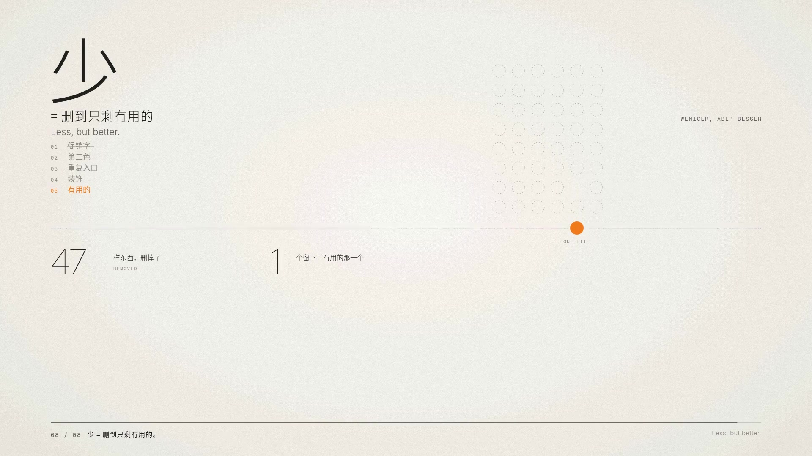

# 007 · 极简主义 Minimalism（1929—今天）

**中文** · [English](README.en.md)

> **一句话：** 一个点、一条线、大片的空——删到不能再删，剩下的每一样都有理由。少即是多。

🎬 [看视频](https://github.com/guanmo-ai/design-style/releases/tag/day-07) · 🛠 [制作过程](PROCESS.md) · 🖼 [图片源文件](images)

| 海报 | 速查卡 |
|:-:|:-:|
|  |  |
| **如果极简主义来做 app** | **四个年代，同一个动作：删** |
|  |  |

---

## 1 · 它从哪来

| 年份 | 事件 |
|---|---|
| **1855** | 英国诗人罗伯特·勃朗宁（Robert Browning）在诗《安德烈亚·德尔·萨尔托》（*Andrea del Sarto*）里写下 “Well, less is more, Lucrezia”——这句话比密斯早了半个多世纪 |
| **1896** | 美国建筑师路易斯·沙利文（Louis Sullivan）写下 “form ever follows function”，后来被简化成“形式追随功能” |
| **1908—1913** | 维也纳建筑师阿道夫·路斯（Adolf Loos）写《装饰与罪恶》（*Ornament und Verbrechen*）：装饰浪费劳动和材料，现代人不再需要它。1910 年首次演讲，1913 年发表 |
| **1919—1933** | 包豪斯把“去掉装饰、从功能和材料出发”变成可以教的课程（见 [001 包豪斯](../001-bauhaus)）；密斯·凡·德·罗是它的最后一任校长（1930—1933） |
| **1929** | 密斯为巴塞罗那世界博览会设计德国馆：一块石台、八根十字形钢柱、一片屋顶、几面独立的墙，没有房间，空间在墙之间流动。展会结束后拆除，1986 年在原址重建 |
| **1947** | 纽约现代艺术博物馆办密斯回顾展，菲利普·约翰逊（Philip Johnson）编写同名专著；“Less is more” 作为密斯的名言流传开来 |
| **1955—1958** | 迪特·拉姆斯（Dieter Rams）加入博朗（Braun）。1956 年与汉斯·古格洛特（Hans Gugelot）做出 SK 4 收音唱机（外号“白雪公主的棺材”）；1958 年的 T3 口袋收音机：一块圆孔面板、一个圆形调台轮 |
| **1960s** | 极简艺术（Minimal Art）：唐纳德·贾德（Donald Judd）从 1965 年起做“堆叠”，把同样的盒子等距挂上墙；弗兰克·斯特拉（Frank Stella）说“你看到的就是你看到的”（What you see is what you see）；丹·弗莱文（Dan Flavin）只用日光灯管，卡尔·安德烈（Carl Andre）把金属板直接铺在地上 |
| **1964—1976** | 极简音乐：特里·莱利（Terry Riley）《In C》（1964）、史蒂夫·赖希（Steve Reich）《18 位音乐家的音乐》（1976）——一个短句不断重复，靠一点点变化往前推。本期配乐的马林巴固定音型就是向它致敬 |
| **1970s 末** | 拉姆斯提出“好设计的十条原则”，最后一条是“好设计是尽可能少的设计”（Good design is as little design as possible）；他的座右铭是 *Weniger, aber besser*（少，但更好） |
| **2001—2007** | 苹果的产品常被拿来和拉姆斯的博朗作品对照：iPod（2001）之于 T3 口袋收音机，初代 iPhone（2007）的计算器之于博朗 ET66（1987） |
| **2010—2014** | 界面告别拟物：微软 Metro（Windows Phone 7，2010）→ 苹果 iOS 7（2013）→ 谷歌 Material Design（2014）。扁平、留白、一屏一件事，成了今天手机界面的默认样子 |
| **今天** | 产品官网、App、设计系统、家电与建筑：大面积留白 + 一种字体几档字重 + 一个强调色，几乎成了“高级感”的同义词 |

**为什么重要：** 极简主义与其说是一种“长相”，不如说是一个动作：删。从建筑到收音机、从艺术到手机，每次都是把“看起来有用”的东西拿掉，只留下真正有用的那一样。它让东西更好用、更耐看——也最难做好，因为剩下的每一样都必须站得住。

## 2 · 五条规则

| # | 规则 | 怎么做 | 小心 |
|:-:|---|---|---|
| 01 | **负空间** Negative space | 把空当成材料：主体只占画面的一小块，剩下的空间都用来“指向”它。一条地平线、一个点就能撑住整个画面 | 空不等于没设计。留白要有东西去“对”它，否则就是空洞（本期第一版就栽在这里） |
| 02 | **删减** Reduce | 一样一样删：每删一样问一次“少了它还能用吗？”能，就删，删到不能再删为止 | 别删掉功能本身。删的是“看起来像功能”的装饰、重复和噪音 |
| 03 | **功能** Function | 每个形状都要有理由：孔是为了出声，圆是因为要转，颜色只给最要紧的那一处 | 不是“越少越好”，是“刚好够用”。少到用不了，是另一种失败 |
| 04 | **重复** Repetition | 同一个形状、同一个间距，一直重复下去；节奏来自重复，而不是花样 | 重复要严格：盒高 = 间距，间距处处相等。差 2px 就会显得乱 |
| 05 | **一处强调** One accent | 整个画面只有一种强调色，只用在一样东西上（本期是那个信号橙的点） | 第二种强调色一出现，层级就塌了；也别把强调色当装饰撒得到处都是 |

## 3 · 色板

| 名称 | HEX | RGB | 建议面积 | 用途 |
|---|---|---|:-:|---|
| 暖纸白 | `#EFECE6` | 239 236 230 | 80% | 底色。比纯白暖、比米色干净——空间本身就是主角 |
| 中性灰 | `#8F8C86` | 143 140 134 | 12% | 次要文字、注释、旋钮 |
| 墨 | `#1C1B19` | 28 27 25 | 7.5% | 线、字、贾德的盒子、手机机身 |
| 信号橙 | `#F27A1A` | 242 122 26 | 0.5% | 全片唯一的彩色：那个点 |
| 亮面 / 阴面 / 石色 | `#F6F4EF` / `#E3DFD8` / `#CFCAC1` | — | — | 轴测体块的三个面、水池、屏幕 |
| 深灰 | `#5F5C57` | 95 92 87 | — | 副标题、英文注释 |
| 发丝线 | `rgba(28,27,25,.16)` | — | — | 分隔线、铺地分缝 |

> 强调色只做功能标记，就像拉姆斯的设备只给开关和指示灯上色：只标“最要紧的一处”。它不是瑞士红——这一期没有红色，也没有第二种彩色。

## 4 · 字体

| 用途 | 本项目 | 商用原版 / 其他选择 |
|---|---|---|
| 拉丁 · 标题 | **Inter Display** Thin 100 / ExtraLight 200 / Light 300（免费，OFL） | SF Pro Display · Söhne · Neue Haas Unica |
| 拉丁 · 正文 | **Inter** Light 300 / Regular 400 / Medium 500（OFL） | SF Pro Text · Graphik |
| 注释 / 编号 | **Geist Mono** 400（OFL） | SF Mono · Berkeley Mono |
| 中文 | **思源黑体 / Noto Sans SC** Light 300 / Regular 400 / Medium 500（OFL） | 苹方 · HarmonyOS Sans |

**说明：** 选字体也是在“删”：一个字族、几档字重，层级只靠字号和字重。越大的字越细（标题用 Thin / ExtraLight），中文也用 Light，和拉丁一样轻。和 002 瑞士风格不同，这里不拿字体当主角——没有粗黑的 Helvetica 大字，字是安静的注释，主角是空间和那个点。

## 5 · 版式参数

**视频（1920×1080）**
- 边距 **120 / 96**（左右 / 上下），地平线 **y = 540**——开场、回顾、片尾都落在这一条线上
- 线宽：主线 **1.5**、注释 **1**、建筑的墙 **10**；所有线都用 `vector-effect: non-scaling-stroke`，缩成回顾里的小图时粗细不变
- 那个点：半径 **16**，全片唯一的彩色；设备圆角 **64**（手机）、物件圆角 **28**（收音机）
- 字号阶梯：230（计数）/ 96（片尾）/ 84（标题）/ 46（章节句）/ 24 / 16（注释，字距 0.16em）
- 节拍：120 BPM，1 拍 = 30 帧，十六分音符 = 7.5 帧；删东西一律按十六分音符（或三十二分音符 3.75 帧）一样一样删
- 轴测：平面绕画面中心转 −35°、纵向压到 0.55、墙按高度抬起，按旋转后的深度从后往前画

**图片（1080×1350 竖图）**
- 边距 **96 / 112**；海报把地平线放低到 **y = 1030**，上面全是空间
- 海报：6 × 8 = 48 个虚线圆（直径 44、间距 72），删掉 47 个，剩下一个落到地平线上变成橙点
- 字号阶梯：118（Less is more.）/ 52（页眉）/ 22 / 18 / 13（注释）
- 线只有 1.5 / 1 两种；每个画面只有一处橙；不用投影、不用渐变

## 6 · 这样做 / 别这样

**✅ 这样做：** 把空当成材料 · 一个画面一个主角 · 一种字体几档字重 · 越大越细 · 强调色只给一样东西 · 线细而准 · 重复用严格的等距
**❌ 别这样：** 空着不放东西就叫极简 · 第二种强调色 · 投影、渐变、毛玻璃 · 装饰性图标 · 为了“干净”删掉必要的信息 · 粗黑大字堆满画面

## 7 · 其他误区

- **“Less is more” 不是密斯发明的。** 1855 年勃朗宁的诗里就有这一句；是密斯让它成了建筑和设计的口号。
- **极简 ≠ 空。** 空白只有在“指向”某样东西时才有力量。本期第一版就是反例：留白很多，但没有主角、没有动作，看起来只是空。
- **极简 ≠ 便宜。** 德国馆用的是缟玛瑙、石灰华和绿色大理石——墙越少，每一面墙越要好；博朗的“少”，背后是多年的工程。
- **极简 ≠ 只有黑白。** 拉姆斯用颜色标功能，贾德的盒子用过彩色有机玻璃。关键是“一处”，不是“没有”。
- **极简 ≠ 瑞士风格。** 瑞士风格是一套排版方法（网格、无衬线、左对齐），追求秩序；极简主义是一个动作（删），追求只留必要的。两者常常一起出现，但瑞士海报可以排得很满，极简作品也可以根本没有网格。

## 8 · AI 提示词（直接复制）

**图片（Midjourney / 即梦 / ChatGPT 图像）**

```
Minimalist poster, "Less is more", warm off-white paper #EFECE6, vast negative space, one thin horizon line,
a single small signal-orange dot #F27A1A as the only color, ultra-light sans-serif headline (Inter Display Thin),
tiny monospace captions, neutral grey #8F8C86 and ink #1C1B19, inspired by Mies van der Rohe and Dieter Rams,
precise hairlines, no texture, no gradients, no shadows, no ornaments --ar 4:5
```

**视频（Runway / 可灵 / Sora）**

```
Minimalist motion graphics on warm off-white paper: a screen crowded with stickers and badges is deleted item by item
on a 120 bpm sixteenth-note grid until one orange dot remains; the dot draws a thin horizon line, walks into a
Mies-style floor plan that rises into an axonometric pavilion, becomes the single knob of a Braun-style radio while
47 other parts disappear, turns into identical Judd-like stacked boxes, then becomes the toggle of a phone alarm.
Hairlines, ultra-light type, one accent color, smooth camera moves with motion blur, no gradients, no clutter.
```

**代码（让 AI 写网页 / 组件）**

```
用极简主义风格做这个界面：背景 #EFECE6，文字 #1C1B19，次要文字 #8F8C86，唯一的强调色 #F27A1A（整页只用在一个元素上，比如主开关）。
字体 Inter Display 200（标题）/ Inter 400（正文）/ Geist Mono（注释，全大写，letter-spacing: 0.12em）+ Noto Sans SC 300。
一屏只做一件事：一个主数字、一个主操作；分隔只用 1px 发丝线 rgba(28,27,25,.16)；不要卡片阴影、渐变、装饰图标；
间距只用 8 / 16 / 32 / 64 / 128，留白比你觉得够的再多一倍。设计令牌见 tokens.css。
```

## 9 · 18 秒分镜

极简主义最难拍的地方是：“少”本身不会动。所以短片不讲概念，只演一个动作——删。全片只有一个主角：一个信号橙的点。每一幕都删到只剩最后一样东西，这样东西直接变成下一幕的开头（橙点接力）：噪音 → 点 → 地平线 → 德国馆的平面 → 屋顶板 → 收音机 → 旋钮 → 盒子 → 手机 → 时间线 → 点。每一次删都落在 120 BPM 的十六分音符上，配乐也跟着一个声部一个声部地减。

<a href="https://github.com/guanmo-ai/design-style/releases/tag/day-07"></a>

| 时间 | 帧 | 章节 | 画面 | 致敬 |
|---|---|---|---|---|
| 0:00—0.5 | 0—30 | 开场 · 噪音 | 满屏 147 样贴纸、星爆、价签、“限时特惠”，一个十六分音符删一批，删到只剩一个点（重击） | — |
| 0.5—2.0 | 30—120 | 开场 · 标题 | 点里拉出一条地平线；MINIMALISM / 极简主义 逐字母落下；线收短，成了台基的前沿 | — |
| 2.0—4.0 | 104—240 | 01 负空间 | 台基从线上长出，八面墙一个十六分音符一面；点在平面里走八步；平面升成轴测，十字柱立起，屋顶落下——「八面墙，其余全是空间。」 | 密斯 · 巴塞罗那德国馆（1929） |
| 4.0—6.0 | 224—360 | 02 删减 | 屋顶板变成一台塞满 48 样东西的收音机（喇叭、贴纸、VU 表、均衡器……），按三十二分音符一样一样删，计数 48 → 1——「删到不能再删。」 | 拉姆斯 · 十条原则之十 |
| 6.0—8.0 | 360—480 | 03 形式追随功能 | 镜头推进格栅再摇到旋钮；引线一次只出一根；旋钮转到底，开机，立刻压扁成盒子 | 致敬博朗 T3（1958） |
| 8.0—10.0 | 452—600 | 04 重复 | 收音机缩成一个盒子，镜头钉着往上码到十个；拉开看整摞，点跳下来，推进留下的那一个 | 唐纳德·贾德 · 堆叠 · 弗兰克·斯特拉 |
| 10.0—12.0 | 600—720 | 05 今天 | 盒子立起来变成手机，屏幕亮起一个闹钟；点跳进开关：开。状态栏、另外两个闹钟、加号一样一样删掉——「一个屏幕，只做一件事。」 | 扁平界面（2013—） |
| 12.0—14.0 | 704—840 | 回顾 | 镜头拉远：手机成了时间线上的 2013，左边是 1929 / 1958 / 1967——「近一百年，同一个动作：删。」四个年代一个一个删掉，线收成一点 | — |
| 14.0—18.0 | 840—1080 | 片尾 | 点落回正中，和开场同一个位置——「少即是多。」 | 密斯 · Less is more |

> 画面里的德国馆、收音机、堆叠和手机都是按原作手法重新画的“致敬”，不是原作复刻：德国馆的平面经过简化，收音机不对应任何一款博朗产品，闹钟界面是虚构的。

## 10 · 文件

```
007-minimalism/
├─ PROCESS.md                             # 制作过程（含被否的第一版、为什么推倒重来）
├─ process/                               # 过程图：橙点接力 · 每拍联系表 · 开场拆解 · 节拍时间轴
├─ tokens.ts / tokens.css / tokens.json   # 同一份设计令牌（颜色、字体、版式、线宽、节拍）
├─ video/Minimalism.tsx                   # 主合成：按时间窗挂载六幕、章节条、运动模糊、颗粒、配乐（Remotion，React）
├─ video/opening.tsx                      # 0—2 秒：噪音删到一个点、地平线、标题
├─ video/space.tsx                        # 01 负空间：德国馆平面 → 轴测（自写的轴测投影 + 画家算法）
├─ video/radio.tsx                        # 02 删减 + 03 功能：48 样东西删到一个旋钮、引线注释、开机
├─ video/judd.tsx                         # 04 重复：一点透视的贾德堆叠
├─ video/today.tsx                        # 05 今天：手机闹钟，一个开关
├─ video/finale.tsx                       # 回顾时间线 + 片尾
├─ video/ui.tsx                           # 按基线定位的文字、逐字母动画、发丝线、引线、点、涟漪
├─ video/timeline.ts · cues.ts            # 所有帧号；cues.ts 汇总给配乐用
├─ video/metrics.py → metrics.ts          # 从字体文件读出的字宽（右对齐、字距修正用）
├─ video/cover.jpg                        # 视频封面
├─ audio/make_music.py                    # 配乐：numpy 合成，120 BPM，D 大调，-14 LUFS；读 cues.json，和画面共用帧号
├─ audio/export_cues.mjs → cues.json      # 把 video/cues.ts 导出成 JSON
└─ images/
   ├─ make_svgs.py    # 四张图的生成脚本：字宽按真实字体度量计算
   ├─ poster.svg      # 海报：48 个虚线圆删到 1 个
   ├─ cheatsheet.svg  # 速查卡
   ├─ app-ui.svg      # 如果极简主义来做 app：闹钟两屏
   ├─ eras.svg        # 四个年代，同一个动作：删
   └─ preview/        # 内嵌字体的自包含 SVG
```

**延伸阅读：** Dieter Rams《Less but Better / Weniger, aber besser》（1995）· Sophie Lovell《Dieter Rams: As Little Design as Possible》（2011）· Philip Johnson《Mies van der Rohe》（MoMA，1947）· Donald Judd《Specific Objects》（1965）· John Pawson《Minimum》（1996）· 纪录片《Rams》（Gary Hustwit，2018）
