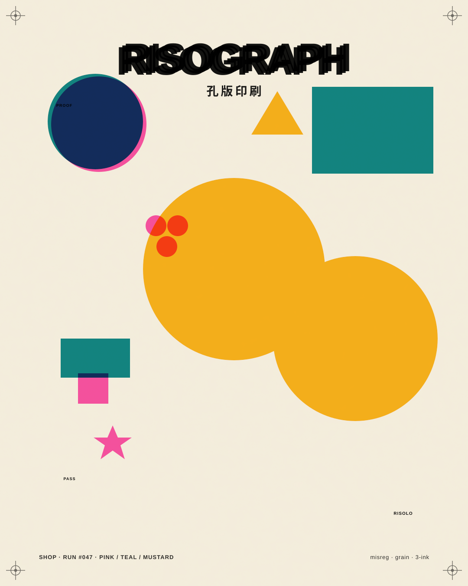
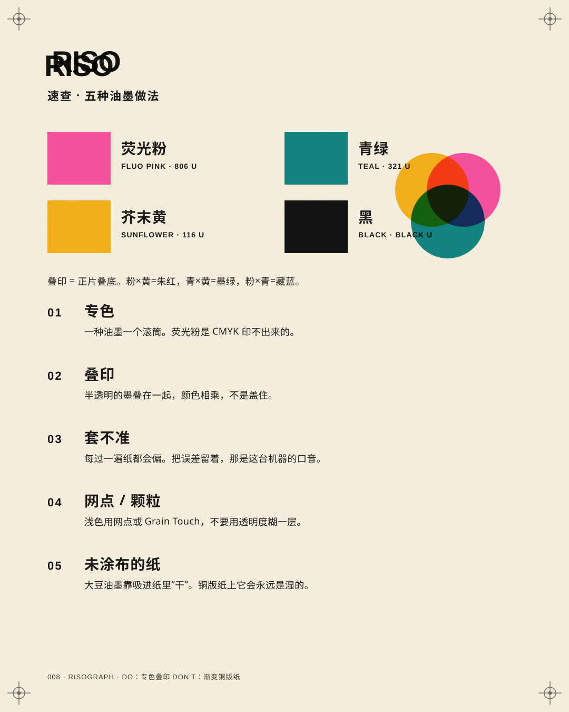
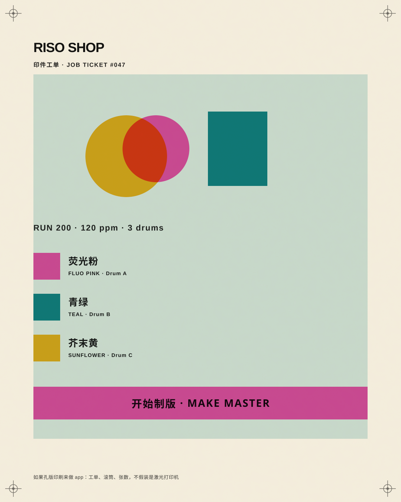
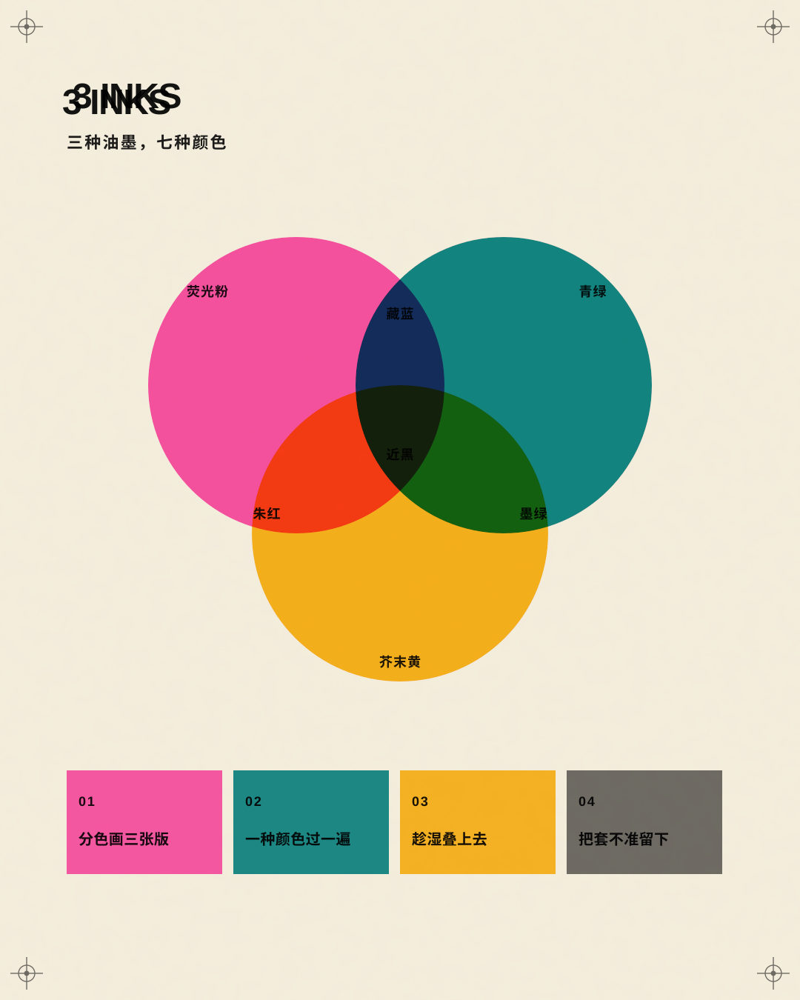

# 008 · Risograph

[中文](README.md) · **English** · [Watch the film](https://github.com/guanmo-ai/design-style/releases/tag/day-08) · [Making of](PROCESS.en.md)

> English quick guide. The film and SVG artwork keep their original Chinese labels. The [Chinese guide](README.md) has the longer history and frame-by-frame storyboard.

## Overview

Three soy inks on uncoated paper. A 15-second film treats every frame as a print run: plates slam into register, a thermal head burns a master, colors reprint one drum at a time, overprints mix by multiplying, and sheets leave the machine as zines.

Series: **Design styles**. Period shown: **1946—today**.

## Five practical rules

| Rule | How to apply it |
|---|---|
| **Spot color** | Pick 2–4 inks first. Fluorescent pink is not a CMYK build. |
| **Overprint** | Stack translucent inks with multiply. The overlap is a third color. |
| **Misregistration** | Let layers miss by a millimetre. That offset is the machine’s accent. |
| **Halftone / grain** | Tint with dots or Grain Touch, not opacity. |
| **Uncoated paper** | Soy ink dries by soaking in. Coated stock stays wet. |

## Project palette and typography

Screen approximations of Riso inks (stencil.wiki / Pantone U), not a press-proof.

- Paper `#F3ECDB`; Fluorescent Pink `#FF48B0`; Teal `#00838A`; Sunflower `#FFB511`; Black `#000000`.
- Typefaces: Archivo, Space Mono, Noto Sans SC.
- Tokens: [JSON](tokens.json), [CSS](tokens.css), [TypeScript](tokens.ts).

## Visual references

### Risograph at a glance



### Inks, overprint, and five rules



### Risograph in an app



### Three inks, seven colors



## Timing

| Property | Value |
|---|---|
| Canvas | 1920 × 1080 |
| Frame rate | 60 fps |
| Duration | 15 s / 900 frames |
| Tempo | 120 BPM (one sheet per beat) |

## Reproduce

```bash
npm run studio
npm run render:008
npm run images:008
```

Open Remotion Studio and select composition `S008-Risograph`.
