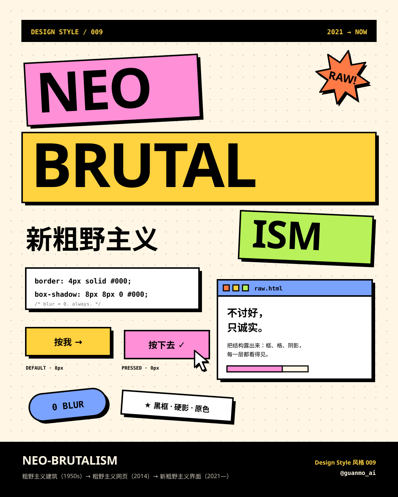
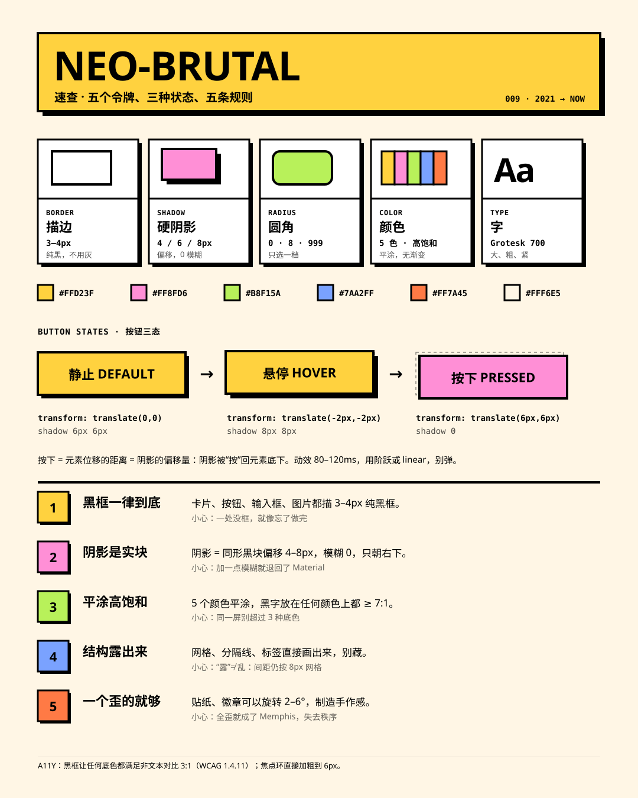
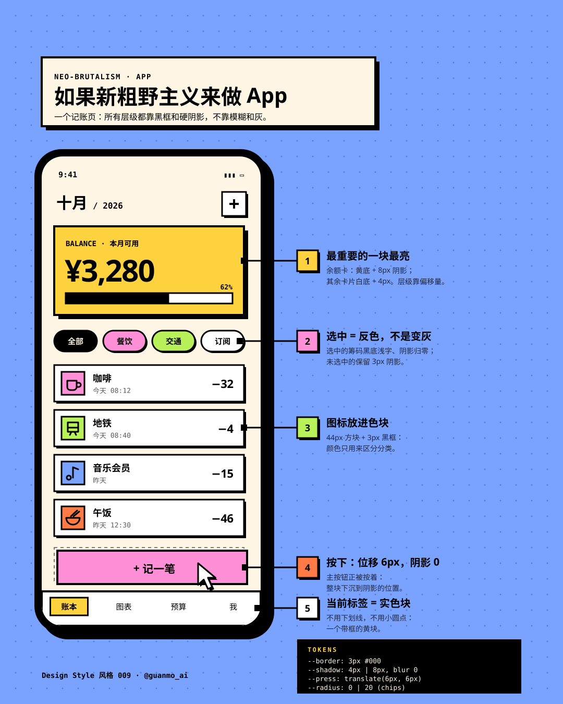
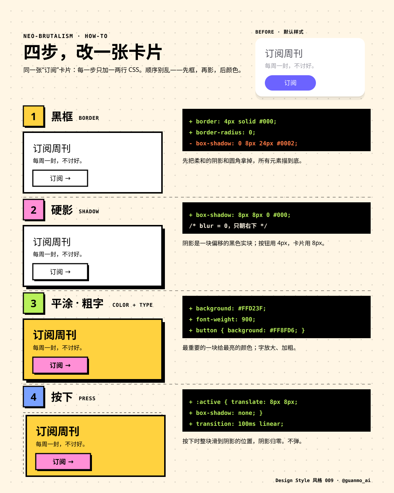

# 009 · Neo-Brutalism

[中文](README.md) · **English** · [Watch the film](https://github.com/guanmo-ai/design-style/releases/tag/day-09) · [Making of](PROCESS.en.md)

> English quick guide. The film and SVG artwork keep their original Chinese labels. The [Chinese guide](README.md) has the longer history and frame-by-frame storyboard.

## Overview

Black borders on everything, shadows that are solid offset blocks, flat saturated color. A 20-second film runs on one piece of physics — shadow length is height. It opens on its own end card; press it and it shatters into thirteen giant keycaps that land, get typed and pressed, and the camera dives into the O. Then, on an empty canvas, a pen draws each frame first and a sign-up form grows out of the borders one element at a time, a card lifts and fans into a staircase of shadows, and a grid of twenty buttons ripples when pressed, drains into 1952 raw concrete, flips into a 2014 brutalist web page, and pops back as 2021 UI. Finally a landing page and a phone app assemble layer by layer, so you see the style in real interfaces.

Series: **Design styles**. Period shown: **2021—today** (roots in 1950s Brutalist architecture).

**The one trick:** *pressing = the element slides onto its shadow, and the shadow goes to zero.* The hard shadow is both the “you can press this” cue and the press animation.

## Five practical rules

| Rule | How to apply it |
|---|---|
| **Border everything** | 3–4px solid black on cards, buttons, inputs, images and tags. One radius only: 0, 8, or pill. |
| **Hard shadow** | `box-shadow: 8px 8px 0 #000` — blur is always 0. Buttons 4px, cards 8px; longer shadow = higher in the hierarchy. |
| **Flat color** | Yellow, pink, lime, blue and orange, no gradients. The most important block gets the brightest color. Max three fills per screen. |
| **Show the structure** | Draw the grid, dividers and labels; use a dot-grid background and monospaced numbers. Spacing still sits on an 8px grid. |
| **Tilt one thing** | One sticker or badge may rotate 2–6°. Body text, buttons and forms stay straight. |

## Project palette and typography

- Ink `#000000`; Paper `#FFF6E5`; White `#FFFFFF`; Yellow `#FFD23F`; Pink `#FF8FD6`; Lime `#B8F15A`; Blue `#7AA2FF`; Orange `#FF7A45`.
- Black text passes 7:1 (WCAG AAA) on all five fills; black borders give every fill 3:1 non-text contrast (WCAG 1.4.11).
- Typefaces: Archivo 900 (wide), Space Grotesk, Space Mono, Noto Sans SC; Tinos stands in for the browser-default Times in the “no CSS” scenes.
- Tokens: [JSON](tokens.json), [CSS](tokens.css) (includes a ready-made three-state button), [TypeScript](tokens.ts).

## Visual references

### Neo-Brutalism at a glance



### Five tokens, three button states, five rules



### Neo-Brutalism in an app



### Four steps to restyle one card



## Common mix-ups

- **Not the 2014 “brutalist web”.** That was anti-design: default styles shipped as-is. Neo-Brutalism is a precise system that happens to look blunt.
- **Not Memphis.** Memphis is pattern and squiggle; Neo-Brutalism is interface structure.
- **Not neumorphism.** Neumorphism uses soft same-color emboss with weak contrast — the opposite approach.

## Timing

| Property | Value |
|---|---|
| Canvas | 1920 × 1080 |
| Frame rate | 60 fps |
| Duration | 20 s / 1200 frames (chapters 01 and 05 run slightly slower) |
| Tempo | 120 BPM (every slam and press lands on a beat or half-beat) |
| Loop | First frame = last frame; the music’s tail folds back into the start, so autoplay loops are seamless |

## Reproduce

```bash
npm run studio
npm run render:009
npm run images:009
```

Open Remotion Studio and select composition `S009-NeoBrutalism`.
