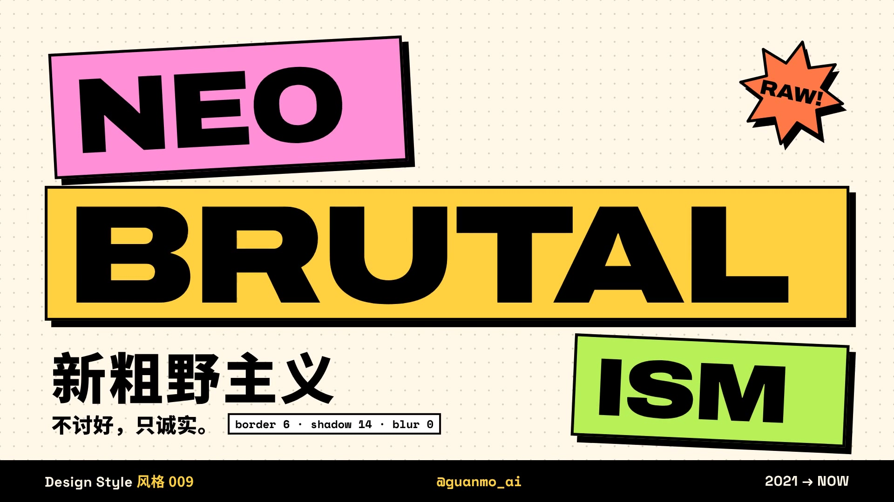

# 009 · 新粗野主义 Neo-Brutalism（2021—今天）

**中文** · [English](README.en.md)

> **一句话：** 黑框描到底，阴影是一块偏移的黑——不讨好，只诚实。

🎬 [看视频](https://github.com/guanmo-ai/design-style/releases/tag/day-09) · 🛠 [制作过程](PROCESS.md) · 🖼 [图片源文件](images)

| 海报 | 速查卡 |
|:-:|:-:|
|  |  |
| **如果新粗野主义来做 app** | **四步，改一张卡片** |
|  |  |

---

## 1 · 它从哪来

| 年份 | 事件 |
|---|---|
| **1952** | 勒·柯布西耶的马赛公寓（Unité d'Habitation）落成。清水混凝土 *béton brut*：模板的木纹留在墙上，结构不粉饰；阳台侧墙刷成红、黄、蓝、绿 |
| **1953—1955** | 史密森夫妇（Alison & Peter Smithson）提出“新粗野主义”；1955 年 Reyner Banham 在《建筑评论》发表 *The New Brutalism*。“粗野”从此是一种态度：材料是什么样，就让它是什么样 |
| **1960s—1970s** | 伦敦巴比肯、波士顿市政厅：大块体、重复的网格、毫不掩饰的结构 |
| **2014** | Pascal Deville 开了 brutalistwebsites.com，收集“看起来没设计过”的网站：浏览器默认字体、蓝色下划线链接、表格、1px 黑线。粗野主义第一次搬到了屏幕上 |
| **2010s 后期** | 扁平化 + Material 成了默认答案：圆角、柔和投影、渐变按钮。网页越来越像 |
| **2021** | Gumroad 改版等一批产品把“粗野”做成了可用的界面：黑色粗描边、偏移的硬阴影、高饱和平涂、粗体 Grotesk。设计圈开始叫它 **Neo-Brutalism / Neubrutalism** |
| **今天** | 独立产品落地页、作品集、AI 工具、Figma / Tailwind 模板里到处都是。它从“反设计”变成了一套非常明确的设计系统 |

**为什么重要：** 新粗野主义是对“所有界面都长一个样”的回答。它把层级交给最简单的东西——一根黑线、一块偏移的黑——而不是模糊、渐变和半透明。普通人一眼就知道哪里能按；设计师拿走的是**一组能直接写进 CSS 的数字**，不是一张情绪板。

**这一期最有用的一招：** *按下 = 元素滑到阴影的位置，阴影归零。* 硬阴影不只是装饰，它就是“能按”的提示，也是按下去的动画本身。所有画面围着这一招转。

## 2 · 五条规则

| # | 规则 | 怎么做 | 小心 |
|:-:|---|---|---|
| 01 | **黑框一律到底** Border | 卡片、按钮、输入框、图片、标签都描 3—4px 纯黑框；圆角归零（或统一 8，或胶囊） | 一处没框就像没做完；别用灰色描边，灰框会把它退回 Material |
| 02 | **阴影是实块** Hard shadow | `box-shadow: 8px 8px 0 #000`——同形黑块向右下偏移，模糊 0。按钮 4px，卡片 8px | 加一点点模糊就不是了；不要四面投影，不要彩色阴影 |
| 03 | **平涂高饱和** Flat color | 黄、粉、草绿、蓝、橙平涂，不用渐变；最重要的一块给最亮的颜色 | 同一屏别超过 3 种底色；颜色只用来区分，不用来装饰 |
| 04 | **结构露出来** Show the grid | 网格、分隔线、标签、点阵背景直接画出来；数字用等宽字 | “露”不等于乱：间距照样按 8px 网格，对齐照样对齐 |
| 05 | **一个歪的就够** Tilt one thing | 贴纸、徽章、一个标题块可以转 2—6°，给手作感 | 全都歪就成了孟菲斯；正文、按钮、表单永远是正的 |

## 3 · 色板

| 名称 | HEX | 建议面积 | 用途 | 黑字对比度 |
|---|---|:-:|---|:-:|
| 纯黑 | `#000000` | 15% | 描边、阴影、正文 | — |
| 暖白 | `#FFF6E5` | 40% | 底（像没刷漆的纸板） | 19.6 : 1 |
| 白 | `#FFFFFF` | 15% | 卡片 | 21 : 1 |
| 黄 | `#FFD23F` | 12% | 主色：最重要的一块 | 14.5 : 1 |
| 粉 | `#FF8FD6` | 6% | 按下 / 选中 | 10.2 : 1 |
| 草绿 | `#B8F15A` | 5% | 成功、第三层 | 15.8 : 1 |
| 蓝 | `#7AA2FF` | 5% | 信息、整屏背景 | 8.4 : 1 |
| 橙 | `#FF7A45` | 2% | 贴纸、警告 | 8.1 : 1 |

> 黑字放在五个底色上全部 ≥ 7 : 1（WCAG AAA）。黑框让任何底色都满足非文本对比 3 : 1（WCAG 1.4.11）——这是新粗野主义对无障碍最友好的地方。

## 4 · 字体

| 用途 | 本项目 | 说明 |
|---|---|---|
| 标题 | **Archivo** 900，字宽 112—125%（OFL） | 宽、黑、像砸下来的 |
| 界面 | **Space Grotesk** 700（OFL） | 有一点怪的 Grotesk，数字好看 |
| 代码 / 令牌 | **Space Mono** 400 / 700（OFL） | 数值、CSS、标签 |
| 中文 | **思源黑体 / Noto Sans SC** 400—900（OFL） | 标题用 900，正文 400—500 |
| “没写 CSS 的网页” | **Tinos**（Apache 2.0） | 与 Times New Roman 等宽的开源替代，只在开场和 2014 段出现 |

## 5 · 令牌与版式参数

| 令牌 | 界面（1x） | 短片（1920×1080） |
|---|---|---|
| 描边 | 3—4px | 6px |
| 阴影 | 4 / 8px，模糊 0 | 8 / 14 / 24px |
| 圆角 | 0 · 8 · 999 只选一档 | 0（筹码、开关用胶囊） |
| 按下 | `translate(阴影, 阴影)` + `box-shadow: none`，100ms 线性 | 4 帧压到底、6 帧弹回，不用弹簧 |
| 背景 | 30px 点阵 | 同 |

- 视频：12 栏，模块 122，间距 24，边距 96（与 002 / 008 同一套）。
- **层级 = 偏移量：** 越重要的东西阴影越长。整屏最多三档（4 / 8 / 14）。
- 动效只有两种：**砸**（落地允许一次过冲）和**按**（线性，不弹）。

## 6 · 这样做 / 别这样

**✅ 这样做：** 先描框，再加影，最后上色 · 阴影一律朝右下 · 按下就把阴影“按”回去 · 选中用反色（黑底浅字） · 焦点环直接加粗到 4—6px · 一屏只歪一样东西
**❌ 别这样：** 灰色描边 · 带模糊的阴影 · 渐变按钮 · 半透明玻璃 · 每个元素都转一下 · 用颜色当唯一的状态提示

## 7 · 其他误区

- **新粗野主义 ≠ 粗野主义网页。** 2014 年的粗野主义网页是“反设计”：默认样式、原样上线。新粗野主义恰恰相反——每个数字都是定好的，只是长得很直接。
- **≠ 孟菲斯。** 孟菲斯（004）是图案、波浪线、几何拼贴；新粗野主义是界面结构：框、影、格。贴纸可以借一点孟菲斯，但只能一个。
- **≠ 新拟态 Neumorphism。** 新拟态用同色的柔和浮雕，对比度常常不够；新粗野主义用纯黑实线，是它的反面。
- **不是“越丑越好”。** 粗野的是材料（黑线、平涂），不是排版。对齐、间距、字号层级一样不能乱。
- **深色模式怎么办？** 把“黑”换成纸色：浅色描边 + 浅色偏移阴影放在深底上；或者保留黑框、把底换成深灰 `#1A1A1A` 上的彩色卡片。别把阴影直接去掉。

## 8 · AI 提示词（直接复制）

**图片**

```
Neo-brutalism UI poster, thick 4px solid black outlines on every element, hard offset drop shadows
(8px 8px, zero blur), flat saturated fills of yellow #FFD23F pink #FF8FD6 lime #B8F15A blue #7AA2FF,
warm off-white background with dot grid, bold wide grotesk typography, one tilted sticker,
visible grid, no gradients, no soft shadows, no glassmorphism --ar 4:5
```

**视频**

```
Motion graphics of a neo-brutalist interface: an unstyled default web page gets CSS one line per beat,
black borders stamp down, hard shadows pop out, flat yellow wipes in; cards slam in from off-screen with
one small overshoot; buttons press exactly into their shadows (shadow goes to zero, 100ms linear);
full-screen cards stack and get pushed away like paper. 120 bpm, every hit on the beat, no motion smear.
```

**代码**

```
新粗野主义风格：背景 #FFF6E5 加 30px 点阵；所有卡片和按钮 border: 4px solid #000; border-radius: 0;
box-shadow: 8px 8px 0 #000（按钮 4px），模糊永远为 0。按下：transform: translate(阴影, 阴影); box-shadow: none;
transition: 100ms linear。颜色平涂 #FFD23F / #FF8FD6 / #B8F15A / #7AA2FF / #FF7A45。
字体 Archivo 900 + Space Grotesk 700 + Space Mono + Noto Sans SC。令牌见 tokens.css。
```

## 9 · 15 秒分镜

全片是一叠卡片：每一章都是一张带黑框和硬阴影的整屏卡片。换章不用淡入淡出，用这个风格自己的动作——**推走、砸下、抽走、叠上去**。每一次“砸”和“按”都落在 120 BPM 的拍点或半拍上。

<a href="https://github.com/guanmo-ai/design-style/releases/tag/day-09"></a>

| 时间 | 帧 | 章节 | 画面 | 教的是什么 |
|---|---|---|---|---|
| 0:00—2.0 | 0—120 | 开场 | 一张没写 CSS 的网页；四行 CSS 一拍一行砸上去：黑框盖章、硬影弹出、黄色刷过、字体换成宽体；光标按下标题，标题块撑满全屏 | 新粗野主义就是几行 CSS |
| 2.0—4.0 | 120—240 | 01 黑框 | 六个默认样式组件（按钮、输入框、卡片、开关、复选框、头像）半拍一个描上 6px 黑框、圆角归零；整张黄卡片被推走 | 规则 01 |
| 4.0—6.0 | 240—360 | 02 硬影 | 模糊从 40 拉到 0；偏移 8 → 24 → 14；三张卡片砸下来，阴影 4 / 8 / 14 | 层级 = 偏移量 |
| 6.0—8.0 | 360—480 | 03 按下 | 蓝卡片从上面砸下来；在记账 App 里按筹码、按条目、按“记一笔”，新条目弹进来、余额跳字；再按左边的大按钮 | 本期最有用的一招 |
| 8.0—10.0 | 480—600 | 04 来历 | 同一面网格：1952 清水混凝土立面 → 2014 粗野主义网页（翻牌）→ 2021 新粗野主义色块（依次弹出） | 它从哪来 |
| 10.0—12.5 | 600—750 | 五个词 | 黑框 / 硬影 / 平涂 / 露结构 / 歪一点：一拍一张整屏卡片从不同方向砸进来，叠成一摞 | 五条规则 |
| 12.5—15.0 | 750—900 | 片尾 | 整叠卡片掉下去；NEO / BRUTAL / ISM 半拍一块砸回来；贴纸、署名；光标一按，所有阴影一起归零再弹回 | — |

## 10 · 文件

```
009-neo-brutalism/
├─ README.md / README.en.md
├─ PROCESS.md / PROCESS.en.md
├─ process/                     # timeline.json、联系表、开场拆解、时间轴图
├─ tokens.ts / tokens.css / tokens.json
├─ video/NeoBrutalism.tsx       # 主合成、HUD、运动模糊、配乐
├─ video/opening.tsx            # 0—2 秒：没写 CSS 的网页 → 四行 CSS
├─ video/scenes.tsx             # 2—10 秒：黑框、硬影、按下、来历
├─ video/finale.tsx             # 10—15 秒：五个词、片尾
├─ video/ui.tsx · timeline.ts   # 硬阴影 Box、光标、点阵、打字、按下 / 砸下
├─ audio/make_music.py
└─ images/make_svgs.py          # poster / cheatsheet / app-ui / steps
```

**延伸阅读：** Reyner Banham, *The New Brutalism*（Architectural Review, 1955）· brutalistwebsites.com · WCAG 2.2 · 1.4.11 Non-text Contrast
