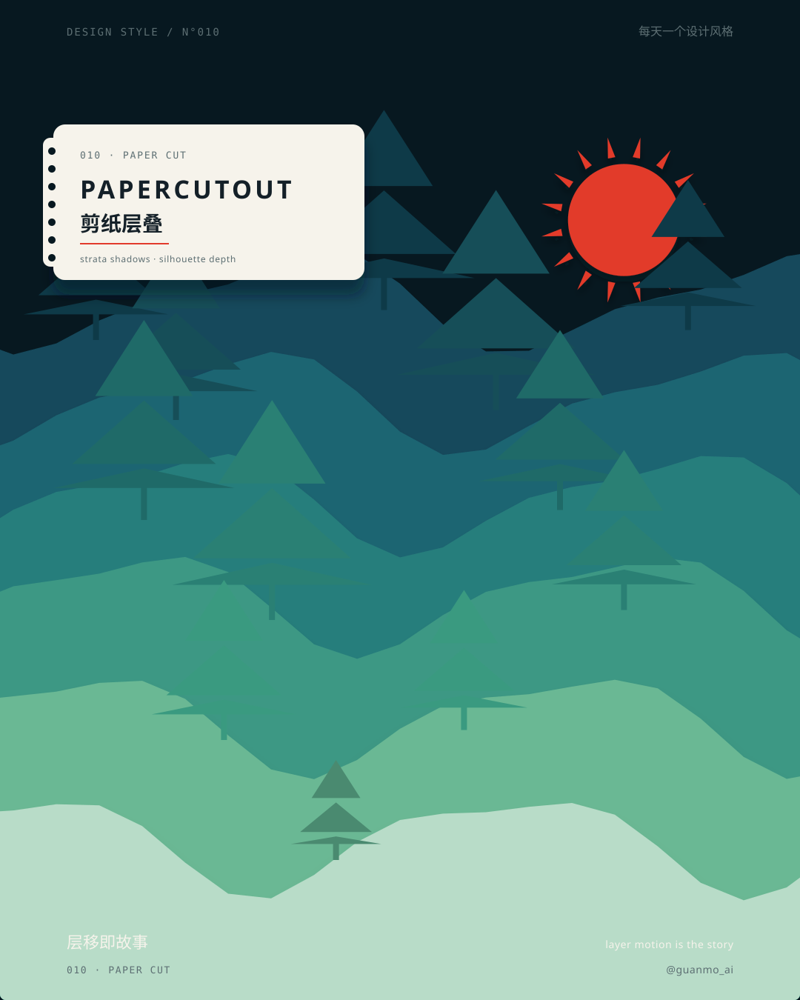
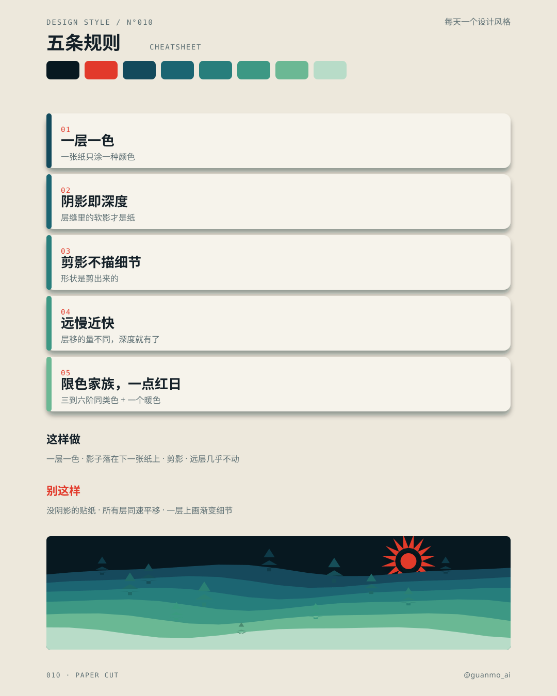
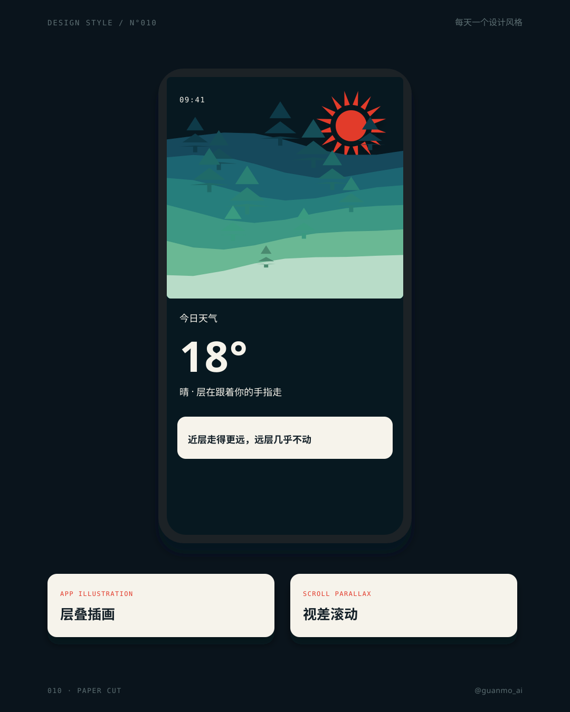
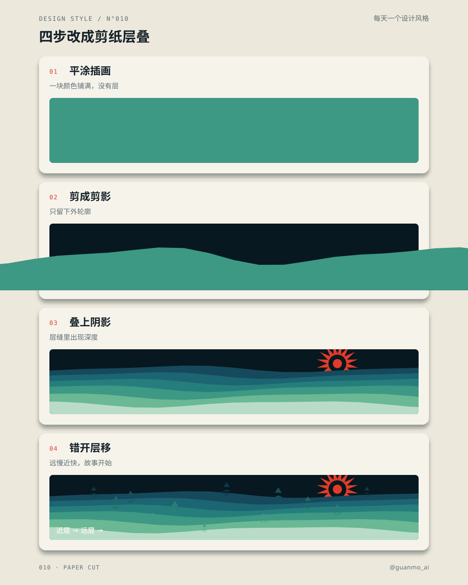

# 010 · Paper Cut

[中文](README.md) · **English** · [Making of](PROCESS.en.md)

> English quick guide. Videos and SVG artwork retain their original Chinese labels. The [detailed Chinese guide](README.md) includes the longer history and frame-by-frame storyboard.

## Overview

Paper cut is more than one look. A 24-second expo of six named variants — folk red cutouts, color-block strata, cardboard diorama, monochrome silhouette, deckle-edge wash, and type cut from stacked sheets — handed off with unfold, tear, peel, blade, and fold. Strata lands in a weather app and an editor poster. The ending stays in the paper language: the opening window flower spins down to a point and slams as a red seal; the three lines are punched 门笺, plus **@guanmo_ai**.

Series: **Design styles**. Period shown: **folk tradition — today**.

## Five practical rules

| Rule | How to apply it |
|---|---|
| **One color per layer** | Each sheet is a single flat color. Darker values come from another sheet, not a gradient. |
| **Shadow = depth** | A soft contact shadow (6–20px down) between sheets. Without it the cut-out reads as a sticker. |
| **Silhouette, not detail** | Cut the outline. Inner detail is a hole or another smaller sheet. |
| **Far slow / near fast** | Parallax 0.1–0.3 in the back, 0.8–1.2 in front. The motion *is* the depth. |
| **Family + one sun** | Three to six related hues (here a teal–mint family) and one warm accent. |

## Project palette and typography

- Colors: `#071820`, `#E23A2B`, `#134A5C`, `#1B6572`, `#287E7C`, `#3D9884`, `#6BB894`, `#B8DCC8`, `#F6F3EB`, `#142028`.
- Typefaces: Jost, Noto Sans SC, JetBrains Mono.
- Editable values: [JSON](tokens.json), [CSS](tokens.css), [TypeScript](tokens.ts).

## Visual references

### Paper Cut at a glance

### Five rules, palette, and do / don’t

### If Paper Cut designed an app

### Four steps from a flat fill to layered paper

## Timing

| Property | Value |
|---|---|
| Canvas | 1920 × 1080 |
| Frame rate | 60 fps |
| Duration | 24 seconds / 1440 frames |
| Tempo | 120 BPM (one beat = 30 frames) |

When sharing the film or artwork, credit **Guanmo / @guanmo_ai**.
