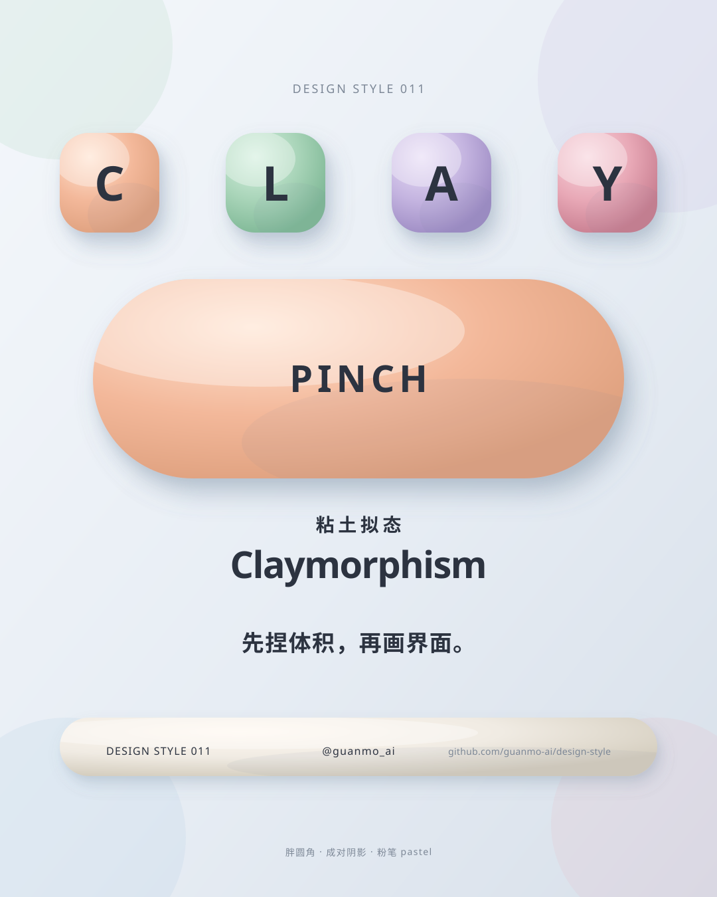
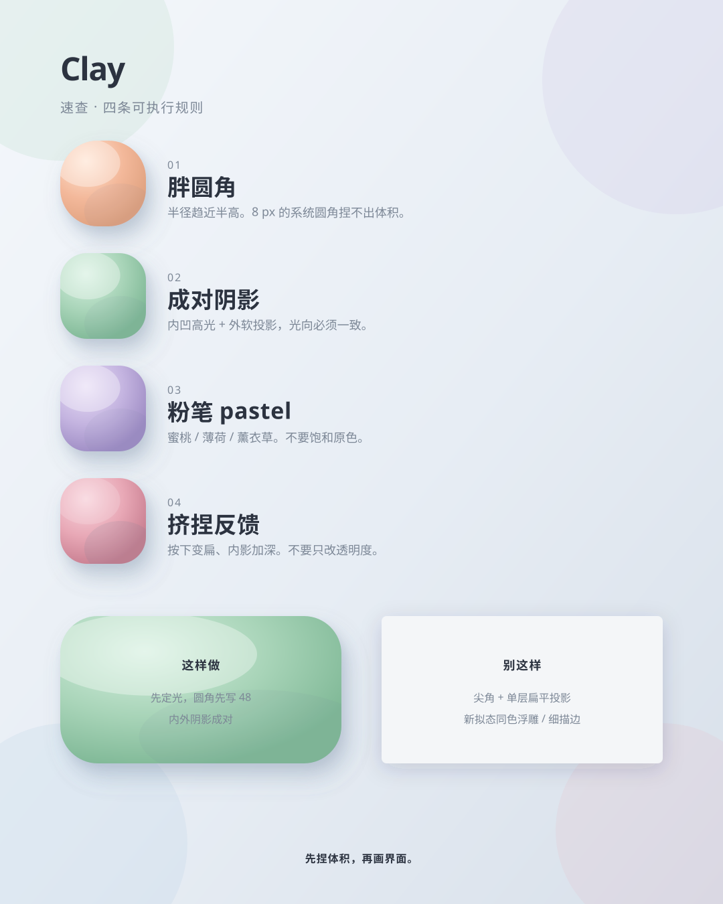
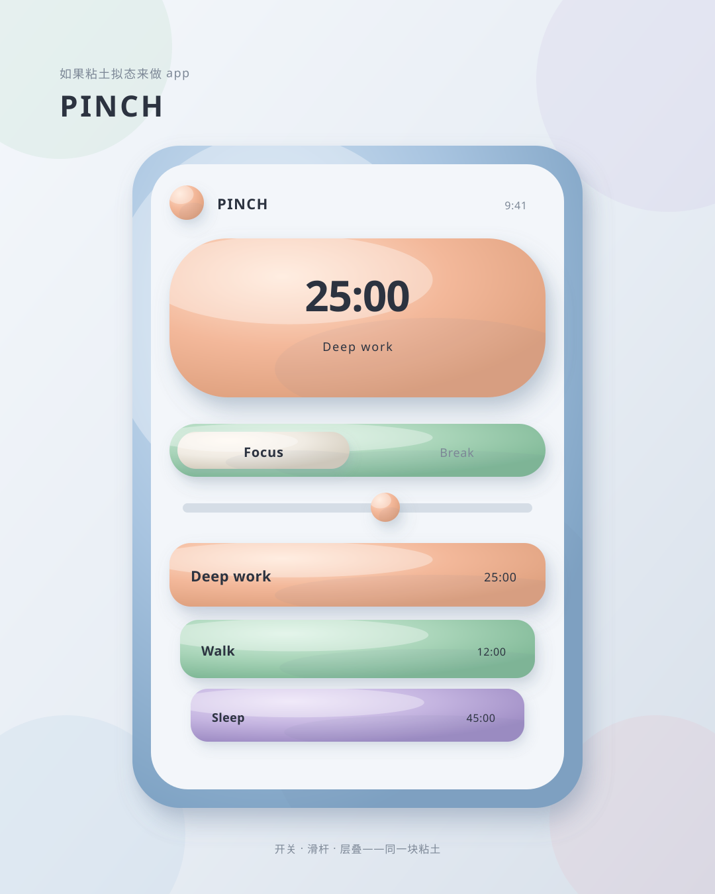
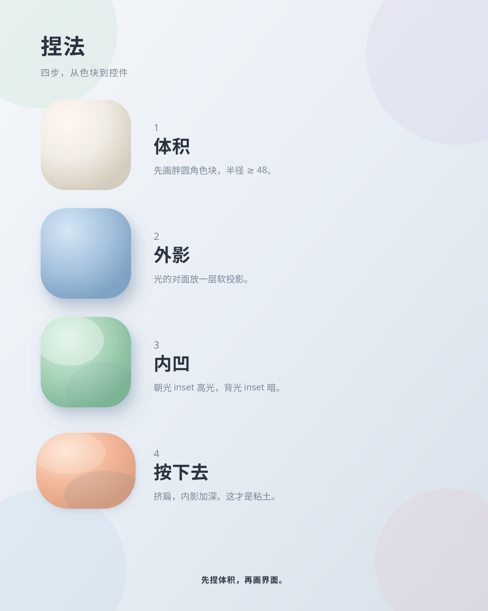

# 011 · Claymorphism

[中文](README.md) · **English** · [Making of](PROCESS.en.md)

> English quick guide. The film and SVG artwork keep their original Chinese labels. The [Chinese guide](README.md) has the longer history and frame-by-frame storyboard.

## Overview

Fat corners and paired shadows, as if just pinched. A 24-second film treats one peach clay object as the relay: it is pinched into a button, inflates its corners, lets light orbit so inner highlight and outer shadow travel together, kneads into pastel, drops into a real focus-timer UI, and lands as a clay title card.

Series: **Design styles**. Period shown: **2021—**.

**The useful trick:** pinch the volume first, then draw the interface.

## Five practical rules

| Rule | How to apply it |
|---|---|
| **Fat radius** | Button radius approaches half height. Cards start at 48, not 8. |
| **Twin shadows** | Soft outer shadow opposite the light; inset highlight toward it. |
| **Chalky pastel** | Peach / mint / lavender / mist blue. No neon primaries. |
| **Soft bulge** | Radial fill, highlight biased to the light. No hairline strokes. |
| **Squish** | On press: flatten 8–12%, deepen the inset. Do not flash opacity. |

## Project palette and typography

- Paper `#E7EDF4`; Peach `#F3B89A`; Mint `#A8D4B8`; Lavender `#C4B4E0`; Rose `#E8A8B6`; Sky `#A8C4E0`; Cream `#F0EBE3`.
- Typefaces: Fredoka, Noto Sans SC, JetBrains Mono.
- Tokens: [JSON](tokens.json), [CSS](tokens.css), [TypeScript](tokens.ts).

## Visual references

### Claymorphism at a glance



### Four executable rules



### Claymorphism in an app



### Four steps to pinch a button



## Timing

| Property | Value |
|---|---|
| Canvas | 1920 × 1080 |
| Frame rate | 60 fps |
| Duration | 24 s / 1440 frames |
| Tempo | 120 BPM |

## Reproduce

```bash
npm run studio
npm run render:011
npm run images:011
```

Open Remotion Studio and select composition `S011-Claymorphism`. This branch does not touch `styles/010-*` or `styles/007-minimalism/`.
