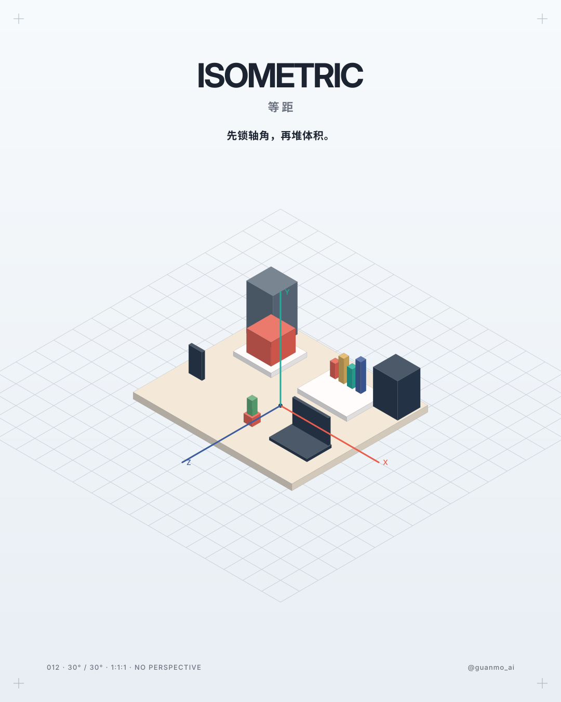
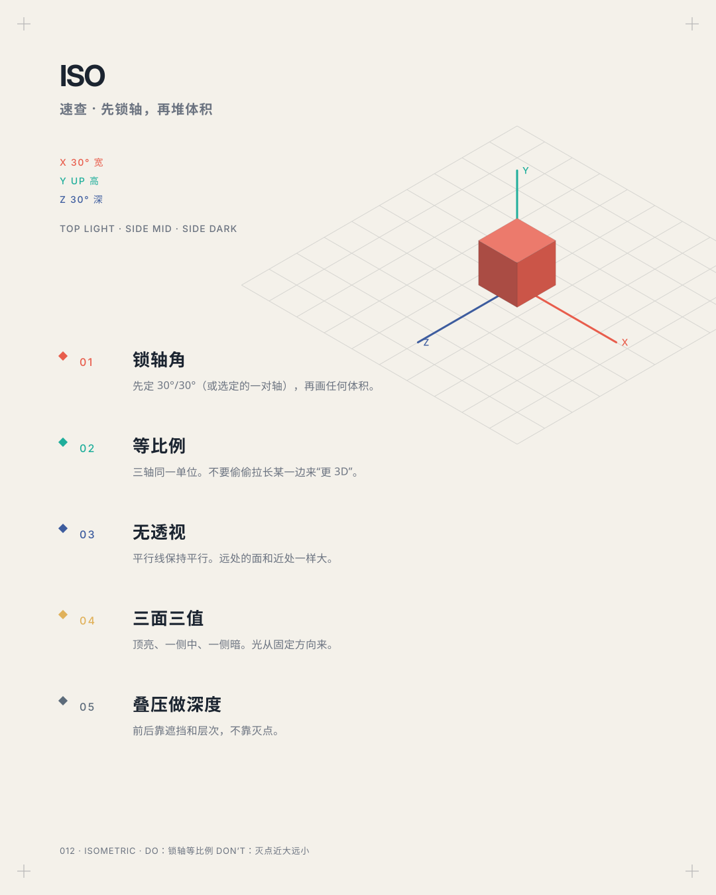
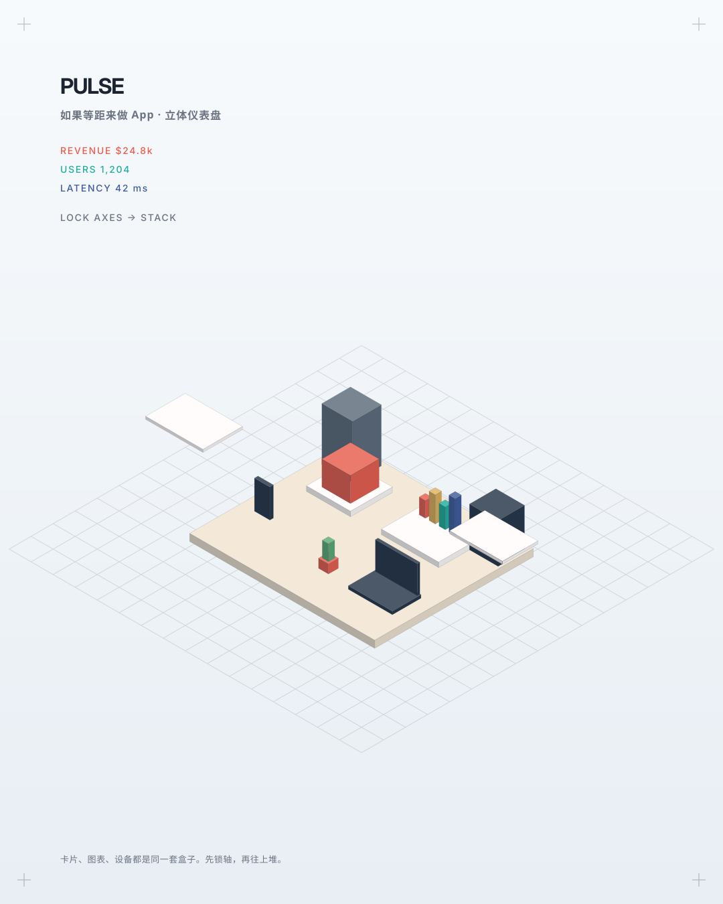
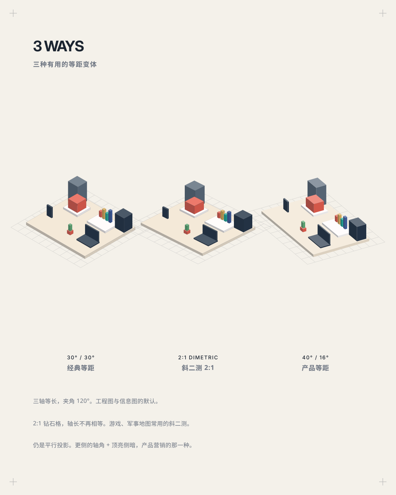

# 012 · 等距 Isometric（1822—今天）

**中文** · [English](README.en.md)

> **一句话：** 先锁轴角，再堆体积。——30° 的三根轴一旦钉死，扁平界面就会长成可以走的空间。

🎬 视频待发布（审片稿） · 🛠 [制作过程](PROCESS.md) · 🖼 [图片源文件](images)

| 海报 | 速查卡 |
|:-:|:-:|
|  |  |
| **如果等距来做 app** | **三种变体** |
|  |  |

---

## 1 · 它从哪来

| 年份 | 事件 |
|---|---|
| **1820s** | 剑桥的威廉·法里什（William Farish）把工程里的轴测画法整理成课：三轴等长、互成 120°，零件不用灭点也能量 |
| **19 世纪** | 等距成为机械制图的标准之一。和一点透视不同：平行线保持平行，尺度沿轴不变 |
| **1920s** | 荷兰风格派、构成主义把轴测当成“客观空间”——不是眼睛看到的，是结构本身。本期的 30° 和 [003 构成主义](../003-constructivism) 的斜线不是一回事：那里是平面构图轴，这里是三根空间轴 |
| **1982** | 《Zaxxon》《Q*bert》：游戏把 2:1 像素等距（其实是斜二测）做成可玩的空间 |
| **1989—1999** | 《SimCity》一路把等距城市做成公共视觉：楼是盒子，路是钻石格 |
| **2014** | 《Monument Valley》把等距的“假 3D”做成错觉：轴锁死之后，体积可以骗人 |
| **2010s—今天** | 产品插画、SaaS 解说、Apple 产品渲染、Stripe / Linear 一类的营销图：扁平 UI 被挤成等距小世界，仍然没有灭点 |

**为什么重要：** 等距教的是空间语法，不是滤镜。先选定轴角（真等距 30°/30°，或 2:1 斜二测），三轴用同一单位，用三个面的明暗和叠压做出深度。界面、城市、设备，都可以是同一套盒子。

## 2 · 五条规则

| # | 规则 | 怎么做 | 小心 |
|:-:|---|---|---|
| 01 | **锁轴角** Axes | 动笔前先画三根轴。真等距：右下 30°、左下 30°、竖直向上，轴间 120° | 不要边画边改角度；一套图只锁一次 |
| 02 | **等比例** Scale | 三轴同一单位。宽、高、深都按这根尺子量 | 不要把某一轴拉长来“更有透视感”——那已经不是等距 |
| 03 | **无透视** Parallel | 平行线保持平行。远处的面和近处一样大 | 不要加灭点、近大远小、空气透视当主深度 |
| 04 | **三面三值** Three values | 顶面最亮，受光侧中，背光侧暗。光向全图固定 | 不要每块用不同光源；不要把三个面画成同一明度 |
| 05 | **叠压做深度** Layer | 前后靠遮挡、地面格子、影子。体积一块块叠上去 | 不要靠地平线灭点来“推远” |

## 3 · 色板

产品等距插画常用冷灰棚 + 三轴身份色。顶面混白、侧面混墨。

| 名称 | HEX | 建议面积 | 用途 |
|---|---|:-:|---|
| 冷灰棚 | `#E8EEF4` | 48% | 底。空气，不是纯白 |
| 陶土 X | `#E85D4C` | 12% | 右行轴、主角色块 |
| 青绿 Y | `#1FAE9B` | 10% | 上行轴、高度 |
| 靛蓝 Z | `#3D5C9E` | 10% | 左深轴、纵深 |
| 墨 | `#1B2430` | 8% | 字、细线 |
| 平台米 | `#F1E4D0` | 4% | 地面体积 |
| 暖纸 | `#F4F1EA` | 片尾 | 信息卡 |

## 4 · 字体

| 用途 | 本项目 | 说明 |
|---|---|---|
| 标题 | **Inter Display** 700（OFL） | 产品工作室的无衬线，字距收紧 |
| 标注 | **Geist Mono** 500（OFL） | 30°、1:1:1、轴名 |
| 中文 | **思源黑体 / Noto Sans SC** 500—900（OFL） | 和轴一样干净，不取巧 |

## 5 · 版式参数

**视频（1920×1080，60fps，24 秒）**
- 12 栏，模块 122，间距 24，边距 96
- 真等距：`x' = (x − z) · cos 30°`，`y' = (x + z) · sin 30° − y`
- 斜二测：2:1 钻石格（游戏 / 军事地图常用）；产品：40°/16° 的平行斜二测 + 更软的顶亮侧暗
- 120 BPM，剪辑点落在拍上；镜头持续微移，没有定格

**图片（1080×1350 竖图）**
- 6 栏 × 8 行，模块 135，间距 18，边距 90 / 72
- 体积用同一套投影函数，不贴图

## 6 · 这样做 / 别这样

**✅ 这样做：** 先画轴 · 三轴同一尺子 · 三个面三种明度 · 用叠压排前后 · 变体也保持平行投影
**❌ 别这样：** 没有轴就开始挤盒子 · 近大远小当等距 · 三面同色 · 用真透视相机“摆一下”再截图充等距 · 和构成主义的 30° 斜线混为一谈

## 7 · 其他误区

- **像素 2:1 不是真等距。** 游戏里常见的 2:1 钻石格是斜二测（约 26.6°），看起来像，轴长并不相等。
- **等距 ≠ 3D 渲染。** 等距是平行投影。三维软件里把透视焦距拉到无限远，才接近它。
- **军事投影 / 2:1 不是“打仗滤镜”。** 片里对照的是 2:1 斜二测（钻石更扁）。传统军事投影一轴水平、平面可量，装配说明也常用。
- **产品等距仍然没有灭点。** 圆角和柔阴影是材质，不是透视。

## 8 · AI 提示词（直接复制）

**图片**

```
Isometric product illustration, true 30 degree axes, equal scale, no vanishing point,
three-face lighting (light top, mid right, dark left), coral teal indigo axis colors,
tiny SaaS dashboard world of boxes, laptop phone charts plants, cool gray studio backdrop,
flat vector faces not photoreal 3D, locked axonometric grid --ar 4:5
```

**视频**

```
Motion graphics teaching isometric method: a flat UI card snaps onto 30° axes and extrudes,
unit cubes prove 1:1:1, a perspective box un-foreshortens into iso, then a product world
assembles brick by brick (tiles, device, bars, notifications). Split into classic iso,
2:1 dimetric, and soft-shaded product iso. Continuous camera, no holds.
```

**代码**

```
等距风格：背景 #E8EEF4，轴色 #E85D4C / #1FAE9B / #3D5C9E。
投影 x'=(x-z)*cos30, y'=(x+z)*sin30 - y。每个盒子三个面，顶亮侧暗。
不要透视缩放。字体 Inter Display + Geist Mono + Noto Sans SC。令牌见 tokens.css。
```

## 9 · 24 秒分镜

全片都是方法：锁轴 → 证明规则 → 堆世界 → 对照变体 → 口诀。镜头不停。

| 时间 | 帧 | 章节 | 画面 |
|---|---|---|---|
| 0:00—3.5 | 0—210 | 开场 | 扁平卡片；X/Z/Y 三轴依次锁上；顶面切到钻石；弹出体积；ISOMETRIC |
| 3.5—5.2 | 210—310 | 01 锁轴角 | 30°/30°，夹角 120° |
| 5.2—6.8 | 310—410 | 02 等比例 | 三只单位立方，1:1:1 |
| 6.8—8.5 | 410—510 | 03 无透视 | 近大远小收回成平行 |
| 8.5—17.0 | 510—1020 | 04 堆体积 | 平台、磁贴、楼、笔记本、柱、手机、头像、植物、通知……一块块长出 |
| 17.0—21.0 | 1020—1260 | 05 变体 | 经典 30° / 斜二测 2:1 / 产品柔阴影 |
| 21.0—24.0 | 1260—1440 | 片尾 | 「先锁轴角，再堆体积。」DESIGN STYLE 012 · @guanmo_ai · github |

## 10 · 文件

```
012-isometric/
├─ PROCESS.md / PROCESS.en.md
├─ process/timeline.json
├─ tokens.ts / tokens.css / tokens.json
├─ video/Isometric.tsx      # 主合成、HUD、运动模糊、配乐
├─ video/opening.tsx        # 0–3.5s：锁轴、弹出
├─ video/scenes.tsx         # 规则、变体、片尾
├─ video/world.tsx          # 产品小世界
├─ video/iso.ts · primitives.tsx · ui.tsx · timeline.ts
├─ audio/make_music.py
└─ images/make_svgs.py      # poster / cheatsheet / app-ui / variants
```

**预览：** `npm run studio` 选 `S012-Isometric` · `npm run render:012` · `npm run images:012`

**延伸阅读：** Farish *On Isometrical Perspective*（1822）· 轴测 / 等距 / 斜二测的制图区分 · Pixel art 2:1 isometric · Monument Valley 的“假 3D” · 当代产品等距插画
