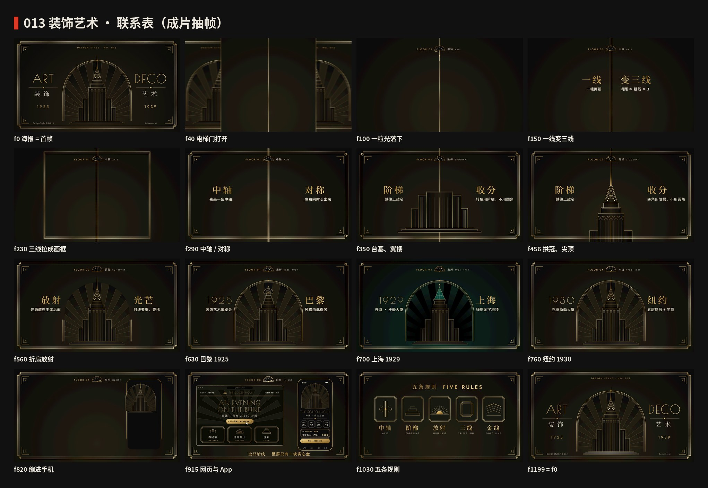
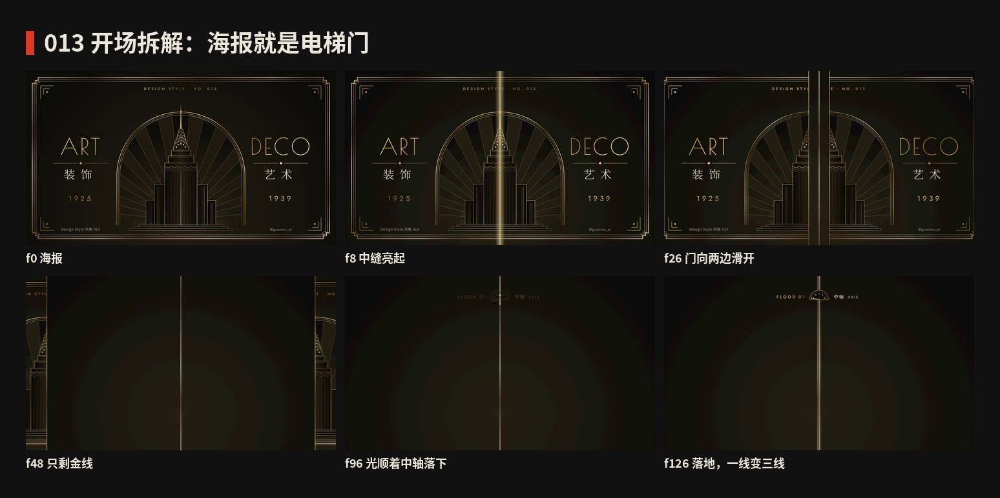
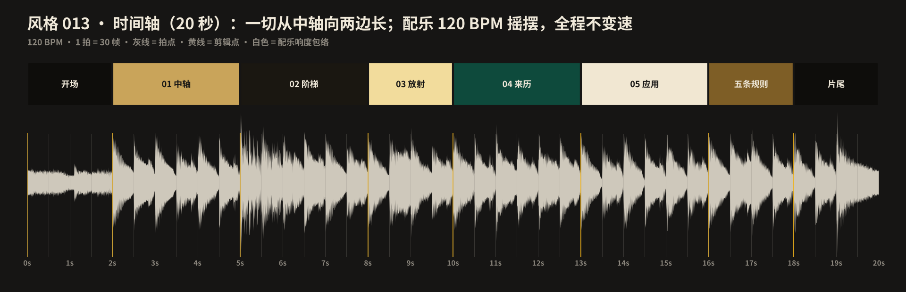

# 013 · 装饰艺术 · 制作过程

**中文** · [English](PROCESS.en.md)

> 这一期是怎么从草稿里的三张图，变成 20 秒短片和 4 张图的。
> 过程图在 [`process/`](process)，可复现的代码在 `video/` `audio/` `images/`。

🎬 [看成片（Releases · day-13）](https://github.com/guanmo-ai/design-style/releases/tag/day-13) · 📐 [风格指南](README.md)

---

## 0 · 一览

| # | 步骤 | 产出 | 工具 / 文件 |
|:-:|---|---|---|
| 1 | 选题 | 009 选题时留下的候选（海报、速查卡、App 已完成），主人这次选定 | `drafts/art-deco` → `styles/013-art-deco` |
| 2 | 研究 | 时间线、五条规则、对比度、误区 | [`README.md`](README.md) §1—§7 |
| 3 | 设计令牌 | 六色 + 对比度、三线、阶梯切角、两套尺度、摇摆节拍 | `tokens.ts / .css / .json` |
| 4 | 风格图 ×4 | 海报 · 速查卡 · 爵士酒吧 App · 五步教程（含错误示范） | `images/make_svgs.py` |
| 5 | 视频 | 门开 → 中轴 → 阶梯 → 放射 → 来历 → 应用 → 五条规则 → 门合 | `video/*.tsx` |
| 6 | 配乐 | 120 BPM 摇摆爵士，F 大调，−14 LUFS，镜像音效 | `audio/make_music.py` |
| 7 | 质检 | 联系表、开场拆解、节拍时间轴、首尾帧比对 | `contact_sheet.py` · `timeline_chart.py` |



## 1 · 选题

装饰艺术是 009 选题时的三个候选之一，三张风格图已经做完放在 `drafts/`。这次直接接着做，省掉一轮候选。期号取 013：007、010、011、012 已有其他分支在做。

**定调：**

- 一句话：*先立一条中轴，所有东西从中轴往两边同时长。*
- 这一期对设计师最有用的一招：**中轴**。阶梯、放射、三线都只是“从中轴长出来的东西”。
- 和前几期的反差：001—009 大多是浅底、高饱和、平面；这一期是深底、金线、对称、隆重。

## 2 · 动效：给整片定一条规矩

009 用的是“阴影长度 = 高度”。这一期的规矩是**镜像**：

- **进场 = 从中轴往两边打开**（scaleX 0 → 1，约 5% 过冲），**退场 = 合回中轴**。楼、射线、拱窗、网页、规则牌子都这样动。
- **字幕也从中轴劈成两半**：左半句靠右对齐、右半句靠左对齐，同时从中轴里滑出来。一句话本身就在示范“对称”。
- **一条金线接力到底**：海报中缝 → 落下的一粒光 → 一线变三线 → 三线拉成画框 → 楼的中肋 → 尖顶 → 拱窗 → 手机头图 → 门合上的中缝。全片没有一次淡入淡出式的换场。
- **镜头本身在动**：楼长高时跟着往上摇，03 拉远让整座楼进画，05 整座楼缩进手机的拱窗。
- **一个巨大的主角**：楼。02 近景占满画面，03—04 是海报构图，05 变成 App 的头图。
- **整片是一趟电梯**：开场和片尾的海报就是电梯门；顶上的楼层指示盘就是章节，指针每章往上走一格。



## 3 · 为推特做的事

- **第一帧 = 海报 = 最后一帧。** 0.03 秒中缝开始亮，0.23 秒门开始滑开。
- **首尾无缝。** 金色的“高光扫过”是把渐变沿自身方向平移整数个反射周期（2 × 渐变向量），首尾相位一致；最后一记 F 大九和弦和混响尾巴折回开头。首帧与末帧逐像素比对，最大差值 4 / 255。
- **静音能看懂。** 每条规则都写在画面上；说明字 42px，手机上看得清。
- **镜头不抖。** 只有门合上那一下有一个“咚”的声音，画面不震。

## 4 · 风格图

前三张沿用草稿（期号改成 013）。第四张是**五步教程**：立中轴 → 一线变三线 → 阶梯收分 → 放射藏光 → 金只给线，每一步只加一样东西；最后一格是错误示范（圆角 + 满屏金底 + 粗密射线 = 土豪，不是 Deco）。

金色在 SVG 里统一用一条斜向多段渐变（`userSpaceOnUse`），线再细也有明暗；大面积低不透明度的金色楔形预先用 `mix()` 算成实色，避免 Chromium 分块色差。视频里沿用同一个函数。

## 5 · 分镜与节拍



120 BPM，1 拍 = 30 帧，20 秒 = 10 小节。每章 4—6 拍：开场 4、01 中轴 6、02 阶梯 6、03 放射 4、04 来历 6（每座城 2 拍）、05 应用 6、五条规则 4、片尾 4。所有“长出来”的起点落在拍点或 1/5 拍的细分上（台基三级相隔 6 帧，拱冠五层相隔 7 帧，射线相隔 2.4 帧），像一串快速的装饰音。

## 6 · 声音

- **摇摆爵士**：低音提琴走路贝斯（每拍一个音，换和弦前一拍半音靠近）、钢琴查尔斯顿式反拍（正拍 + 第二拍的反拍，反拍在 2/3 拍）、刷子军鼓、叮叮镲。全程不变速。
- **和弦**：Fmaj9 → Dm9 → Gm9 · C13 · Fmaj9（楼长高）→ B♭maj9 · A7♭13（放射）→ Dm9 · Gm9 · C13（三座城）→ … → Fmaj9（门合上）。
- **镜像写进声音**：左右同时长出来的东西，音效也是一左一右各一份（声像 ±0.3—0.95）。射线打开时竖琴左右同时往外刷；规则牌子从中间往两边开，钢琴声也从中间往两边走。
- **金色 = 钢片琴**：每次高光扫过是一串五声音阶上行。
- **音效让出 BGM**：音效总线 −2 dB；台基落地与射线两处比平均响 3—4 dB，已分别调小。乐队进来之后，每半秒的响度在 −16 ± 3 dB 之间；开场两秒只有门声和钢片琴，故意轻一些（约 −21 dB）。

## 7 · 渲染

```bash
npm run render:013     # 先合成配乐，再渲染 out/013-art-deco-master.mp4
npm run images:013     # 4 张风格图：preview/*.svg + png/*.png
```

整片是一张 SVG（一个 `<svg>` 里画所有东西，渐变和裁剪只定义一次）。运动模糊 6 次采样，快门 120°。本机 1200 帧约 2 分 20 秒，成片约 8 MB。

## 8 · 踩坑

- **SVG 字距会加在最后一个字后面。** 右对齐的左半句因此离中轴远了一个字距，左右看起来不对称。`T` 组件在 `text-anchor: end` 时把 x 往右补一个字距。
- **Poiret One 只有 400 一个字重。** 写成 600 会被浏览器假加粗，线条糊掉；镜像字幕遇到 Poiret 时强制 400。
- **同一个 id 的渐变 / 裁剪在多处使用。** 海报（门上）和正片里都有那座楼；`Scene` 加了 id 前缀，门上的海报用 `<use>` 引用一次定义、两半各裁一次。
- **高光平移的方向要沿渐变向量。** 第一次按屏幕方向平移，首尾帧差了一截相位；改成沿 (520, 560) 平移两倍向量长度后，首尾一致。
- **GitHub 的 `raw` 跳转在本环境被拦。** 字体改从 `raw.githubusercontent.com` 下载。

## 9 · 沿用清单

- 镜像字幕 `Pair`、三线框 `TripleRect`、阶梯切角 `stepRect`、角花 `Corner`：`video/ui.tsx`
- 门（海报裁成两半）、五块规则牌：`video/finale.tsx`
- 楼、三座城的楼顶、折扇射线、拱窗、镜头：`video/tower.tsx`
