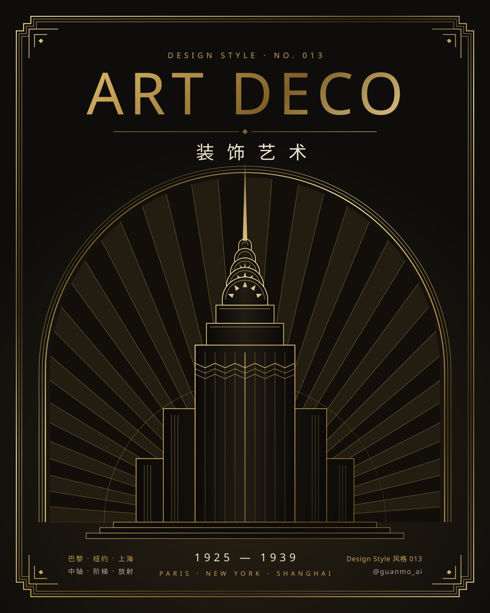
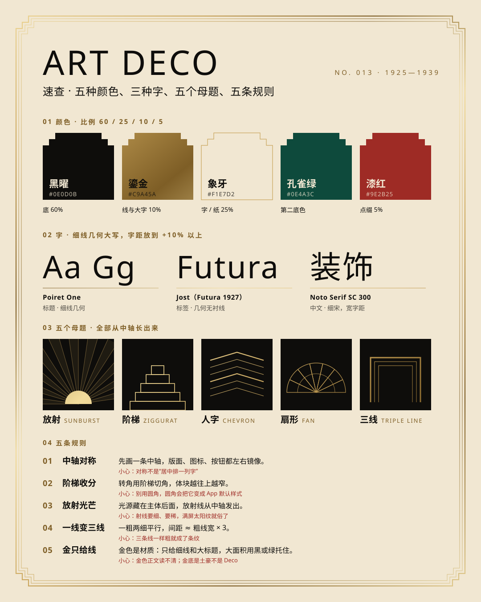
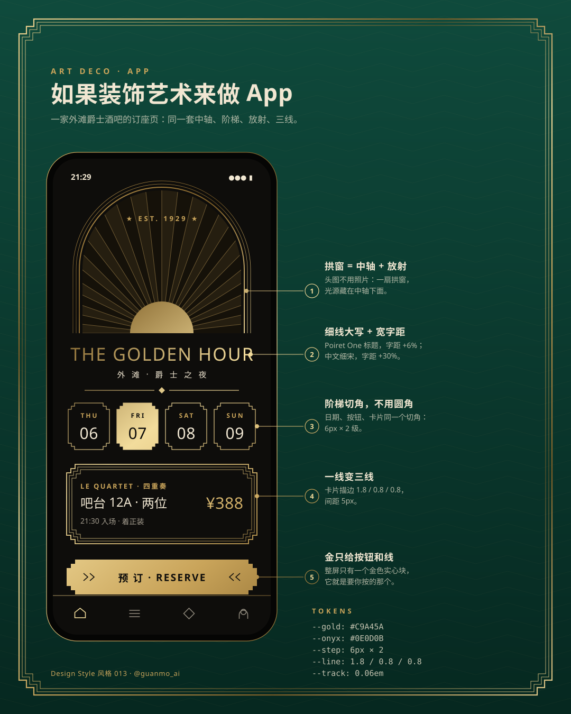
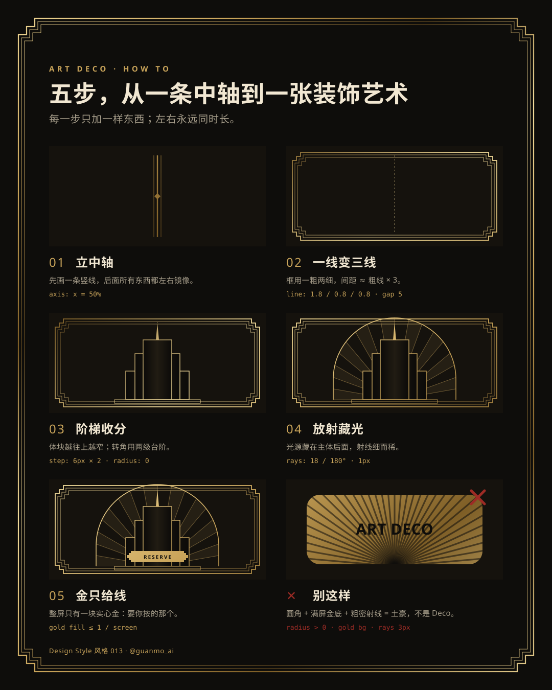

# 013 · Art Deco

[中文](README.md) · **English** · [Watch the film](https://github.com/guanmo-ai/design-style/releases/tag/day-13) · [Making of](PROCESS.en.md)

> English quick guide. The film and SVG artwork keep their original Chinese labels. The [Chinese guide](README.md) has the longer history and frame-by-frame storyboard.

## Overview

Onyx black, ivory, and gold that only ever appears as a line. A 20-second film runs on one rule — mirroring — and gold works as light: highlights run along the gold lines and land as star flares. It is a single continuous shot with no fades. It opens on its own poster while light runs around the triple-line frame, then the camera pushes into the arched window and the window turns out to be a tunnel. The camera flies through a row of triple-line arches in real depth and stops at a twelve-spoke rose window; the rose window becomes a 24-way mirrored kaleidoscope in the manner of a Busby Berkeley overhead shot, which collapses into a sun on the horizon. A three-layer night skyline rises in front of the sun, mirrored searchlights cross above it, and the camera rises up the hero tower to the spire before pulling far back. Five rule plaques flip in from the depth, then rush at the camera, and the poster redraws itself stroke by stroke until the film is back on its first frame.

Series: **Design styles**. Period shown: **1925—1939** (Paris 1925 exposition to the eve of World War II).

**The one trick:** *draw the axis first; everything grows left and right at the same time.* Layout, icons, buttons and motion all start from the center line. In the film the arches, kaleidoscope, skyline, searchlights and rule plaques are all mirrored, and even the captions split in two halves at the axis: the rule name on the left, its explanation on the right.

## Five practical rules

| Rule | How to apply it |
|---|---|
| **Axis symmetry** | Draw one vertical line first, then mirror layout, icons and buttons around it. Symmetry needs pairs (wings, corner ornaments, two halves of a sentence), not just a centered column. |
| **Ziggurat steps** | Masses get narrower as they rise. Corners are cut with two steps (6px × 2 in UI), never rounded. |
| **Sunburst** | Hide the light source behind the subject; thin 1px rays radiate from the axis, 18–24 across 180°, wedges filled every other one. A sun filling the screen looks cheap. |
| **One line becomes three** | One thick, two thin, parallel; gap ≈ thick × 3 (UI: 1.8 / 0.8 / 0.8, gap 5). Three equal lines are just stripes. |
| **Gold only for lines** | Gold goes to thin lines, large titles and the **one** solid block you want pressed. Large areas stay onyx or emerald. |

## Project palette and typography

- Onyx `#0E0D0B` (60%); Ivory `#F1E7D2` (25%); Gold `#C9A45A` (10%); Emerald `#0E4A3C` (second base); Lacquer `#9E2B25` (5%); Smoke `#A89F8C`.
- Gold is a material, not a flat color: a diagonal multi-stop gradient, `#F2DC9C → #C9A45A → #7E5E26`, light–dark–light, so even a hairline catches a reflection.
- On onyx: ivory 15.8:1, gold 8.3:1, smoke 7.4:1; onyx text on a gold block is 8.3:1 — all WCAG AAA. Gold as text only at 24px and up.
- Typefaces: Poiret One (titles, +6% tracking and more), Jost (caps labels, 0.24–0.42em), Noto Serif SC (Chinese titles, 0.2–0.5em), Noto Sans SC (Chinese body).
- Tokens: [JSON](tokens.json), [CSS](tokens.css) (includes a ready-made stepped frame and gold button), [TypeScript](tokens.ts).

## Visual references

All four sheets keep their original Chinese labels.

### Art Deco at a glance



### Five colors, three typefaces, five motifs, five rules



### Art Deco in an app



### Five steps from one axis to Art Deco



## Common mix-ups

- **Not Art Nouveau.** Art Nouveau (1890—1910) is vines, curves and flowers; Art Deco is its opposite — straight lines, steps, machines. If you see plant curves, it is not Deco.
- **Not Bauhaus.** Bauhaus opposed ornament and followed function; Art Deco loves geometry too, but uses it to decorate and to impress.
- **Not “black + gold = luxury”.** Black and gold is only a palette. Without the axis, steps and triple line, it is just a sale poster.

## Timing

One continuous shot with no fades; the camera only pushes, rises and pulls back, and never shakes. Every rule is also written on the caption plaque at the bottom (rule name 54px, explanation 40px), so the film reads with the sound off.

| Time | Frames | Chapter | On screen |
|---|---|---|---|
| 0–1.5 s | 0–90 | Opening | First frame is the poster; light runs around the triple-line frame from the axis outward and a star lights on the spire; the tower sinks, the rays fold shut like a fan, and the camera pushes into the arched window, which is already a tunnel |
| 1.5–4.5 s | 90–270 | 01 Triple line | Tunnel of triple-line arches (stepped frame / arch / stepped lintel in turn), one passing every half beat, light running along its three lines before it passes; the end grows brighter and the camera brakes in front of a twelve-spoke rose window |
| 4.5–8 s | 270–480 | 02 Sunburst | Kaleidoscope: 24-way mirrored, fans, chevrons and diamonds flowing out from the center, one pulse per beat; rays shoot out and the whole thing collapses into a sun on the horizon |
| 8–13 s | 480–780 | 03 Ziggurat | Three-layer skyline rises in mirrored pairs in front of the sun, the hero tower lands last, windows light up, four searchlights cross in mirrored pairs; the camera rises up the hero tower to the spire, then pulls far back to take in the whole skyline |
| 13–16 s | 780–960 | Five rules | Five plaques flip in from the depth (the middle one first, then pair by pair), light runs around each as it settles and its motif starts moving; then all rush at the camera |
| 16–20 s | 960–1200 | Ending | The axis drops; ART / DECO is stroke-drawn, then filled with gold; the frame widens to the edges with stepped corners; the window closes, the rays open and the tower regrows, ending on the first frame: the poster is redrawn |

| Property | Value |
|---|---|
| Canvas | 1920 × 1080 |
| Frame rate | 60 fps |
| Duration | 20 s / 1200 frames |
| Tempo | 120 BPM swing throughout (off-beats land at 2/3 of a beat) |
| Loop | First frame = last frame (pixel-identical); the music’s tail folds back into the start, so autoplay loops are seamless |

## Reproduce

```bash
npm run studio
npm run render:013
npm run images:013
```

Open Remotion Studio and select the `S013-ArtDeco` composition.
