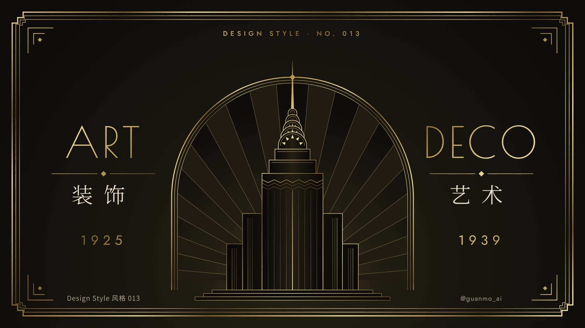

# 013 · 装饰艺术 Art Deco（1925—1939）

**中文** · [English](README.en.md)

> **一句话：** 先立一条中轴，再让阶梯、放射和三线从中轴往两边同时长出来；金色是材质，只给线。

🎬 [看视频](https://github.com/guanmo-ai/design-style/releases/tag/day-13) · 🛠 [制作过程](PROCESS.md) · 🖼 [图片源文件](images)

| 海报 | 速查卡 |
|:-:|:-:|
|  |  |
| **如果装饰艺术来做 app** | **五步，从一条中轴到一张装饰艺术** |
|  |  |

---

## 1 · 它从哪来

| 年份 | 事件 |
|---|---|
| **1909—1914** | 俄罗斯芭蕾舞团在巴黎演出，巴克斯特的舞台与服装把浓烈的颜色和异域图案带进巴黎；维也纳工坊、格拉斯哥的麦金托什已经在用几何化的装饰 |
| **1922** | 图坦卡蒙墓被发现，埃及的阶梯、放射、莲花纹立刻变成流行图案；同一时期，阿兹特克金字塔的“阶梯”也被搬进建筑和家具 |
| **1925** | 巴黎**国际现代装饰与工业艺术博览会**（Exposition internationale des Arts Décoratifs）。“Art Deco”这个名字就来自它——不过要到 1960 年代才被叫开 |
| **1928—1931** | 纽约的摩天楼竞赛：克莱斯勒大厦（1930，七层不锈钢拱冠 + 尖顶）、帝国大厦（1931）。规划法规要求高楼逐层后退，“收分”从法规变成了风格 |
| **1929—1934** | 上海外滩：沙逊大厦（1929，绿铜金字塔顶，今和平饭店北楼）、百老汇大厦、国际饭店（1934）。上海是亚洲 Art Deco 建筑最集中的城市之一 |
| **1930s** | 远洋邮轮诺曼底号、电影宫、收音机、香水瓶、海报（卡桑德尔）——从建筑一路用到了日用品和平面设计 |
| **1939—** | 二战开始，奢华装饰退场；1960 年代末被重新发现，此后在品牌、酒店、包装、电影（《了不起的盖茨比》）里不断回来 |

**为什么重要：** Art Deco 是第一次把“机器时代”的几何——直线、阶梯、放射——做成了“高级感”。它不靠花纹堆砌，而靠**对称、节奏和材质**。今天做品牌、包装、酒店餐饮、奢侈品、活动主视觉，凡是要“隆重但不俗”的，都在借它的手法。

**这一期最有用的一招：** *先画中轴，所有东西左右同时长。* 版面、图标、按钮、动效全都从中轴出发——有了这条线，阶梯、放射、三线才有地方站。短片里的拱门、万花筒、天际线、探照灯、规则牌子全部左右镜像，连字幕牌也从中轴劈成两半：规则名在左，说明在右。

## 2 · 五条规则

| # | 规则 | 怎么做 | 小心 |
|:-:|---|---|---|
| 01 | **中轴对称** Axis | 先画一条竖线，版面、图标、按钮都左右镜像；动效也从中轴往两边同时展开 | 对称不是“居中排一列字”——要有左右成对的东西（翼楼、角花、两半句话） |
| 02 | **阶梯收分** Ziggurat | 体块越往上越窄；转角用两级阶梯切角（界面 6px × 2） | 别用圆角，圆角会把它变回 App 默认样式 |
| 03 | **放射光芒** Sunburst | 光源藏在主体后面，放射线从中轴发出；楔形隔一条填一条 | 射线要细（1px）、要稀（180° 里 18—24 条），满屏太阳纹就俗了 |
| 04 | **一线变三线** Triple line | 一粗两细平行，间距 ≈ 粗线 × 3（界面 1.8 / 0.8 / 0.8，间距 5） | 三条一样粗就成了条纹；线宽差要看得出来 |
| 05 | **金只给线** Gold line | 金色只给细线、大标题和**唯一**一个实心块（要你按的那个）；大面积用黑或孔雀绿托住 | 金色正文读不清；金底是土豪不是 Deco |

## 3 · 色板

| 名称 | HEX | 建议面积 | 用途 | 在黑曜上的对比度 |
|---|---|:-:|---|:-:|
| 黑曜 | `#0E0D0B` | 60% | 底 | — |
| 象牙 | `#F1E7D2` | 25% | 正文、纸 | 15.8 : 1 |
| 鎏金 | `#C9A45A`（斜向多段渐变 `#F2DC9C → #C9A45A → #7E5E26`） | 10% | 线、大字、唯一的按钮 | 8.3 : 1 |
| 孔雀绿 | `#0E4A3C` | 第二底色 | 换底、上海的绿铜屋顶 | — |
| 漆红 | `#9E2B25` | 5% | 点缀、错误 | — |
| 烟灰 | `#A89F8C` | — | 次要文字 | 7.4 : 1 |

> 金按钮上的黑曜字 8.3 : 1，象牙正文 15.8 : 1，都过 WCAG AAA。金色当**线**用时没有对比度负担；当**字**用时只给 ≥ 24px 的标题。

**金是材质，不是颜色。** 不要用一个平的 `#C9A45A`：用一条斜向多段渐变（亮—暗—亮），线再细也看得出反光。短片里让这条渐变整体平移一个周期，就是“高光扫过”。

## 4 · 字体

| 用途 | 本项目 | 说明 |
|---|---|---|
| 标题 | **Poiret One**（OFL） | 细线几何大写，1920 年代海报字；字距 +6% 以上 |
| 标签 / 数字 | **Jost**（OFL） | Futura（1927）的开源替代；大写 + 宽字距 0.24—0.42em |
| 中文标题 | **Noto Serif SC** 300—600（OFL） | 细宋，字距放到 +20%—50%；小于 24px 时换黑体 |
| 中文正文 | **Noto Sans SC** 400—700（OFL） | 手机上要看得清 |

## 5 · 令牌与版式参数

| 令牌 | 界面（1x） | 短片（1920×1080） |
|---|---|---|
| 三线 | 1.8 / 0.8 / 0.8，间距 5 | 4 / 1.6 / 1.6，间距 12 |
| 阶梯切角 | 6px × 2 级 | 18px × 2 级 |
| 圆角 | 0 | 0（只有手机机身是圆的） |
| 放射 | 180° 里 18—24 条，1px | 每边 11 条，楔形隔一条填 10% 金 |
| 字距 | 拉丁大写 0.06—0.42em，中文 0.2—0.5em | 同 |
| 中轴 | x = 50% | x = 960 |

- **层级 = 离中轴多远：** 最重要的东西在中轴上，次要的成对放在两边。
- **动效的规矩：** 一切沿中轴镜像出现、运动、消失；金色当光用——高光顺着线跑（一段亮线 + 两层光晕），落点上亮一颗星芒。界面里可以做成 hover 时沿描边跑一圈的 `stroke-dashoffset` 动画。
- 120 BPM 摇摆：反拍落在 2/3 拍上。

## 6 · 这样做 / 别这样

**✅ 这样做：** 先画中轴 · 体块越往上越窄 · 光源藏在楼后 · 一粗两细 · 金只给线和一个按钮 · 黑底或孔雀绿底托住金 · 大写字母拉开字距
**❌ 别这样：** 圆角卡片 · 满屏金底 · 粗而密的太阳纹 · 三条一样粗的线 · 左右不对称的“随便摆” · 金色小字正文

## 7 · 其他误区

- **Art Deco ≠ Art Nouveau（新艺术运动）。** 新艺术（1890—1910）是藤蔓、曲线、女性与花；Art Deco 是它的反面：直线、阶梯、机器。看到“植物曲线”，就不是 Deco。
- **≠ 包豪斯。** 包豪斯（001）反对装饰，形式追随功能；Art Deco 同样爱几何，但几何是拿来**装饰**的，要华丽。
- **≠ “黑金 = 高级”。** 黑金只是配色。没有中轴、阶梯、三线的黑金，只是一张促销海报。
- **深色模式天然合适。** Deco 本来就是深底；浅色版用象牙底 + 黑线 + 金点缀（见速查卡）。
- **中文怎么配？** 细宋 + 宽字距最接近；外滩的老招牌、月份牌是最好的中文样本。黑体只用在小字和正文。

## 8 · AI 提示词（直接复制）

**图片**

```
Art Deco poster, strict central axis and mirror symmetry, a stepped ziggurat skyscraper with a
Chrysler-style arched crown and spire on the axis, thin sunburst rays radiating from behind the
building inside an arched window, triple-line frame (one thick two thin) with stepped corners,
metallic gold #C9A45A line art on onyx black #0E0D0B, ivory text, thin geometric capitals with
wide letter-spacing, no rounded corners, no gold background, no Art Nouveau curves --ar 4:5
```

**视频**

```
Art Deco motion graphics, everything grows out of a single golden vertical axis and mirrors left
and right at the same time: the axis splits into a triple line that slides out to become the frame,
a ziggurat tower rises step by step while the camera tilts up, sunburst rays open like a folding fan
behind it, the crown morphs between Paris 1925, Shanghai 1929 and New York 1930, a specular highlight
sweeps across the gold. Poster doors open and close like an elevator. 120 bpm swing jazz.
```

**代码**

```
装饰艺术风格：背景 #0E0D0B；金色用斜向多段渐变 linear-gradient(135deg, #F2DC9C, #C9A45A 22%, #7E5E26 40%, #F2DC9C 60%)，
只用于线、标题和唯一的主按钮。卡片无圆角，转角用两级阶梯切角（clip-path，6px × 2），描边三线 1.8 / 0.8 / 0.8、间距 5。
版面以中轴对称；标题 Poiret One（字距 0.06em），标签 Jost 大写（字距 0.24em），中文 Noto Serif SC（字距 0.3em）。
令牌见 tokens.css。
```

## 9 · 20 秒分镜

全片只有一条规矩：**镜像**——所有东西沿中轴左右对称地出现、运动、消失。金色当“光”来用：高光顺着金线跑，落点上亮一颗星芒。一镜到底，没有一次淡入淡出：镜头推进海报的拱窗，穿过一串三线拱门，停在玫瑰窗前；玫瑰窗变成万花筒，万花筒塌成地平线上的太阳；太阳前面升起一座城，镜头贴着主楼一路上升到尖顶，再猛地拉远；规则牌子从纵深里翻转着飞来，又一起冲向镜头；最后海报一笔一笔重新长回去。镜头是真的纵深（每一层按 F / (z − 镜头 z) 缩放），不是平移。配乐 120 BPM 摇摆爵士，全程不变速；左右成对出现的东西，声音也一左一右成对出现。

**为推特做的三件事：** 第一帧就是海报，0.03 秒光就开始顺着画框跑；首尾是同一帧，配乐的余音折回开头，循环看不出接缝；静音也看得懂——每条规则都写在画面下方的字幕牌上，规则名 54px、说明 40px。镜头不晃，只推、升、拉。

<a href="https://github.com/guanmo-ai/design-style/releases/tag/day-13"></a>

| 时间 | 帧 | 章节 | 画面 | 教的是什么 |
|---|---|---|---|---|
| 0:00—1.5 | 0—90 | 开场 | 第一帧就是海报；光顺着三线画框从中轴往两边跑一圈，尖顶亮一颗星；楼沉进地面、射线像扇子一样收拢；镜头推进拱窗——拱窗里已经是隧道 | — |
| 1.5—4.5 | 90—270 | 01 三线 | 穿过一串三线拱门（阶梯框 / 拱门 / 阶梯门楣轮换），每半拍擦过一道，擦过之前光顺着它的三条线跑一圈；尽头越来越亮，镜头刹住，停在一扇十二辐玫瑰窗前 | 一线变三线 · 阶梯切角 |
| 4.5—8.0 | 270—480 | 02 放射 | 玫瑰窗变成十二瓣万花筒（1930 年代巴斯比·伯克利歌舞片的俯拍）：扇、人字、菱形从中心往外流，每拍一次脉冲，转满一个扇区停下；射线从中心射出去；整片塌成地平线上的太阳 | 放射光芒 |
| 8.0—13.0 | 480—780 | 03 阶梯 | 太阳前面，三层纵深的天际线从外往里成对升起，主楼最后落地；窗户一盏盏亮起，四道探照灯两两镜像交叉扫；镜头贴着主楼外墙一路上升，楼层指示盘从 1925 数到 1939；拱冠一层层亮起、尖顶射出、探照灯汇到尖顶；猛地拉远，整片天际线进画 | 阶梯收分 · 来历 · 中轴对称 |
| 13.0—16.0 | 780—960 | 五条规则 | 五块牌子从纵深里翻转着飞到面前（中间一块先到，再两边一对、一对），落稳时光顺着牌子跑一圈，牌子里的母题自己动起来；然后一起冲向镜头 | 五条规则 |
| 16.0—20.0 | 960—1200 | 片尾 | 中轴落下；ART / DECO 一笔一笔描出来再填金；画框从中轴拉到画面边上、转角切出阶梯；拱窗合拢、射线打开、楼按 02 的顺序重新长高；光跑一圈、尖顶一颗星——停在第一帧 | 金只给线 |

## 10 · 文件

```
013-art-deco/
├─ README.md / README.en.md
├─ PROCESS.md / PROCESS.en.md
├─ tokens.ts / tokens.css / tokens.json
├─ video/ArtDeco.tsx       # 主合成：各章按时间叠放、字幕牌、运动模糊、配乐
├─ video/poster.tsx        # 海报（首帧 = 末帧）、开场推进拱窗、片尾重新长回去
├─ video/tower.tsx         # 海报上的那座楼、折扇射线、拱窗（由一个状态驱动生长与收起）
├─ video/tunnel.tsx        # 01：三线拱门隧道（真纵深）、玫瑰窗
├─ video/kaleido.tsx       # 02：十二瓣万花筒、塌成太阳
├─ video/city.tsx          # 03：三层天际线、探照灯、主楼与上升镜头、楼层指示盘
├─ video/rules.tsx         # 五条规则：翻转飞来的牌子
├─ video/ui.tsx · timeline.ts  # 金、沿线跑的高光、星芒、三线框、阶梯切角、角花、字幕牌
├─ audio/make_music.py     # 120 BPM 摇摆爵士 + 镜像音效
└─ images/make_svgs.py     # poster / cheatsheet / app-ui / steps
```
