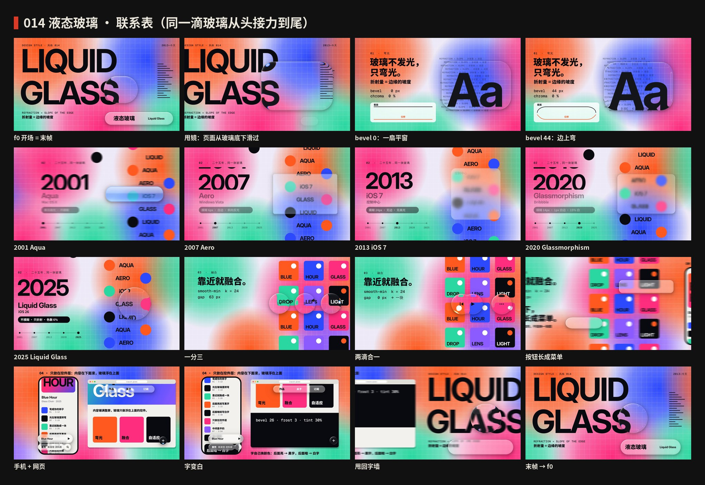

# 014 · Liquid Glass · Making of

[中文](PROCESS.md) · **English** · [Watch the film](https://github.com/guanmo-ai/design-style/releases/tag/day-14) · [Style guide](README.en.md)

> How this issue went from three candidates to a 20-second film and four images. Process images are in [`process/`](process); reproducible code is in `video/`, `audio/` and `images/`.

## Overview

| # | Step | Output | Files |
|:-:|---|---|---|
| 1 | Pick | Three candidates with three images each: Liquid Glass, 1-bit Dither, Futurism. Liquid Glass was chosen | `drafts/dither`, `drafts/futurism` |
| 2 | Research | Five generations of UI “glass” (2001–2025), five rules, contrast, mix-ups | [`README.en.md`](README.en.md) |
| 3 | Tokens | Glass parameters (bevel / edge / mag / chroma / frost / tint), three thicknesses, five era recipes | `tokens.ts / .css / .json` |
| 4 | Images ×4 | Poster · cheatsheet · music app · five-step tutorial | `images/make_svgs.py`, `images/glass.py` |
| 5 | Film | Type wall → lens → five eras → split and merge → phone + web → type wall, one continuous shot | `video/*` |
| 6 | Music | 120 BPM, D major, FM glass plucks, −14 LUFS, effects synced to keyframes | `audio/make_music.py` |

## The glass is real

Earlier issues are drawn as SVG. Refraction needs per-pixel sampling of whatever is behind the glass, every frame, with changing shapes — so this film uses a shader.

- **Content layer (Canvas2D):** everything behind the glass. During whip pans it averages 3–8 sub-frames for motion blur.
- **Glass layer (WebGL2):** each piece is a smooth-min union of rounded-rect / circle distance fields. Inside the bevel ring it samples inward by slope t^2.4, once per color channel (6% apart), magnifies the middle, takes frost from mipmaps, then adds a 1px rim highlight from one light source and a drop shadow.
- **Label layer (Canvas2D):** text and icons on top of the glass. Labels marked `auto` read the luminance of the content under them and pick black or white.

The same displacement formula drives the images: `images/glass.py` builds displacement maps with numpy and SVG `feDisplacementMap` applies them per channel.

## One shot, one droplet

Six pages sit side by side in world space; the camera drifts right at 0.8 px/frame and whip-pans between chapters along a cubic Hermite curve whose end velocities match the drift. The glass stays on screen while the pages slide under it, so the refraction is always alive — the whip pans are where it looks best. Page 6 is page 1, so frame 1200 is frame 0 and the droplet keeps rolling at the same speed: a seamless loop.

The droplet is the protagonist throughout: droplet → lens → Aqua button → Aero window → iOS 7 control center → Glassmorphism card → liquid droplet → three drops (two merge, one grows into a menu) → phone mini player and web nav bar → droplet.

## Sound

FM glass plucks (modulator ratio 3.5 for inharmonic, glassy partials) in sixteenth-note arpeggios; drums enter at chapter 01 and leave before the ending so the loop also matches in sound. Each whip pan has a whoosh; bevel flattening and rising are a falling and a rising glide; each era has its own timbre; the split is three panned “bloops” and the merge a gooey “glub”. The effects bus sits 3 dB under the music.

## Pitfalls

- Sample **inward** at the rim (convex lens). Sampling outward shows what is outside the glass and looks broken.
- Frost from mipmaps: regenerate mipmaps each frame and take five taps on the matching level.
- Everything is a pure function of the frame number so Remotion can render out of order in parallel.
- Adaptive text reads the content layer before the glass is drawn, with a soft 0.42–0.55 luminance band to avoid flicker.
- Pages and the color-field drift are indexed modulo 5 so the last page matches the first.
- Embed displacement maps as PNG data URIs; the image build would otherwise convert them to lossy WebP.
