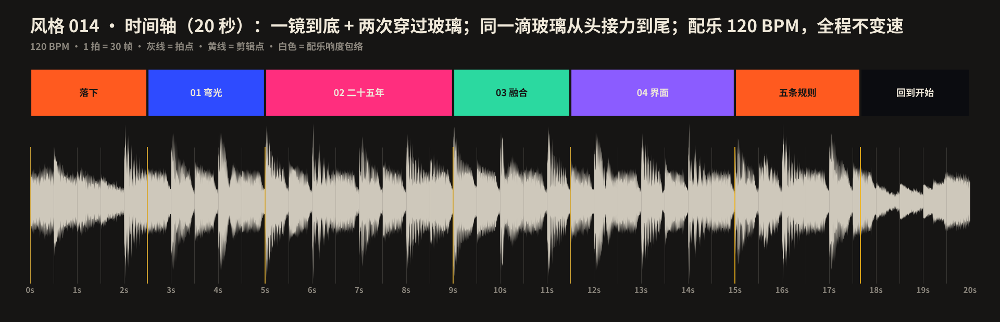

# 014 · 液态玻璃 · 制作过程

**中文** · [English](PROCESS.en.md)

> 这一期是怎么从三个候选里选出来，变成 20 秒短片和 4 张图的。
> 过程图在 [`process/`](process)，可复现的代码在 `video/` `audio/` `images/`。

🎬 [看成片（Releases · day-14）](https://github.com/guanmo-ai/design-style/releases/tag/day-14) · 📐 [风格指南](README.md)

---

## 0 · 一览

| # | 步骤 | 产出 | 工具 / 文件 |
|:-:|---|---|---|
| 1 | 选题 | 三个候选各三张图：液态玻璃 / 1-bit 抖动 / 未来主义；主人选液态玻璃 | `drafts/dither`、`drafts/futurism` |
| 2 | 研究 | 2001—2025 五代“玻璃”的做法、五条规则、对比度、误区 | [`README.md`](README.md) §1—§7 |
| 3 | 设计令牌 | 玻璃参数（bevel / edge / mag / chroma / frost / tint）、三种厚度、五个年代的配方 | `tokens.ts / .css / .json` |
| 4 | 风格图 ×4 | 海报 · 速查卡 · 音乐 App · 五步教程（含误区） | `images/make_svgs.py` + `images/glass.py` |
| 5 | 视频 | 字墙 → 镜片 → 五个年代 → 分裂与融合 → 手机 + 网页 → 回到字墙，一镜到底 | `video/*.ts(x)` |
| 6 | 配乐 | 120 BPM，D 大调，玻璃拨奏，−14 LUFS，音效对准每个关键帧 | `audio/make_music.py` |
| 7 | 质检 | 联系表、节拍时间轴、首尾帧比对 | `contact_sheet.py` · `timeline_chart.py` |


## 1 · 选题

这一期按新流程先出三个候选，每个三张图，不做动效样片：

| 候选 | 一句话 | 动效的招牌动作 |
|---|---|---|
| **液态玻璃** ✓ | 玻璃不发光，只弯光 | 实时折射：一滴玻璃从头接力到尾 |
| 1-bit 抖动 | 灰，是点的密度 | 无限钻进一个像素，像素里又是整张画 |
| 未来主义 | 动的东西，留下它刚才的样子 | 残影由真实轨迹生成，刹车时自己收拢 |

没选上的两个放在 `drafts/`，说明见 [`drafts/README.md`](../../drafts/README.md)。

**定调：**

- 一句话：*玻璃不发光，只把后面的东西弯过来——折射量 = 边缘的坡度。*
- 对设计师最有用的：**参数**。bevel、edge、mag、chroma、frost、tint 六个数就能描述一块玻璃，也能描述过去二十五年的每一代“玻璃”。
- 质量标准：超过 001 包豪斯、002 瑞士、布局 01 便当盒、02 瀑布流。它们强在“每章换一个真实场景”“规则配图解”“结尾干净”；这一期三样都要有，动效再往前走一步——**玻璃是真的**。

## 2 · 玻璃是真的：一个着色器

前几期的画面都是 SVG。玻璃不行：折射要按每个像素去后面“取样”，还要每帧变形状，只能用着色器。

**三层画布，每帧从头画：**

| 层 | 做什么 |
|---|---|
| 内容（Canvas2D） | 玻璃后面的一切：彩色场、网格、字、手机、网页。镜头甩动时画 3—8 个子帧求平均（运动模糊） |
| 玻璃（WebGL2） | 把内容当贴图。每块玻璃由几个圆角矩形 / 圆的有向距离场 smooth-min 合成；按“坡度”往里取样、R/G/B 各取一次、需要磨砂时在 mipmap 上取；再加高光、投影 |
| 字（Canvas2D） | 压在玻璃上的字和图标；`color: 'auto'` 的字先读内容层在它底下的亮度，再决定黑还是白 |

**位移公式**（视频的着色器和图里的 `glass.py` 是同一个）：

```
t      = clamp(1 − 深度 / bevel, 0, 1)        // 0 = 平的内部，1 = 最外缘
offset = 向内法线 × bevel × edge × t^2.4 − (p − 中心) × mag
颜色   = 内容(p + offset × 1.06).r, 内容(p + offset).g, 内容(p + offset × 0.94).b
```

**融合**用多项式 smooth-min：两块的距离场在 k 以内平滑相减，所以靠近时先长出“颈”，再合成一块；分开时颈被拉长、拉断。

## 3 · 一镜到底：同一滴玻璃接力

六页内容在世界里从左到右排成一排（每页 1920 宽），镜头一路往右走：停留时 0.8 px/帧 慢慢漂，换章时用三次 Hermite 曲线甩过去（两端速度等于漂移速度，进出没有顿挫）。**玻璃不跟着页面走**，留在屏幕上，页面从它底下滑过去——所以甩镜的那 40 帧，是折射最好看的时候。

第 6 页就是第 1 页；第 1200 帧的镜头位置正好比第 0 帧多走 5 页。首尾因此是同一个画面，水滴也以同样的速度（5.6 px/帧）往左滚，循环没有接缝。

主角是同一滴玻璃：

```
水滴（开场） → 镜片（01） → Aqua 按钮 → Aero 窗口 → iOS 7 控制中心 → Glassmorphism 卡片 → 液态玻璃（02）
→ 分成三滴，两滴合一、第三滴长成菜单（03） → 手机播放条 + 网页导航（04） → 水滴（片尾）
```

### 第一版自查后改的

第一版渲染出来逐秒看，两处“太老实”：

- **01 弯光有 3 秒是静的**：镜片停在 Aa 上，只有读数在变。改成镜片像放大镜一样在 Aa 上来回移动（±110px，再叠一个上下的小摆），坡度变化时后面的字一直在被弯。
- **03 融合的水滴被专辑墙淹没**：水滴半径 92 → 118，专辑墙从四列改成三列、间距加大。

再加三处“玻璃对运动有反应”的细节：甩镜时玻璃沿运动方向拉长、上下变扁（最多 16%，体积大致不变，像液体的惯性）；高光的方向跟着镜头速度偏一点；开场那一滴每拍轻轻抖一下（±3%，周期一拍，循环接得上）。

## 4 · 为推特做的事

- **第一帧就好看，0 帧就在动。** 第一帧是字墙海报，水滴已经压在 GLASS 上往左滚。
- **首尾无缝。** 见上；配乐的余音折回开头。
- **静音能看懂。** 每章的规则用 52—104px 大字写在画面左边；bevel、chroma、gap 的读数跟着画面实时变；五个年代都写出配方。
- **镜头不抖。** 只在两个落点往下“咚”一下（落到 2025、两滴合一），单向，14 帧。

## 5 · 风格图

- **海报**：字墙 + 网格 + 彩色场，四块玻璃压上去——横跨 GLASS 的大胶囊、一颗大水滴、两滴正在融合的小水滴、压着一句话的胶囊。
- **速查卡**：一块玻璃拆成五层（内容 / 折射 / 底色 / 高光 / 投影）、截面与位移曲线、三种厚度并排、三条规则、CSS。
- **App 概念**：音乐播放页。返回 / 更多是薄玻璃，播放浮层是厚玻璃 + 磨砂，标签栏和搜索融成一块。
- **五步教程**：同一块胶囊、同一张背景，每步只加一层：形状 → 折射 → 色散 → 高光 → 投影；最后是误区（模糊 + 白边 = Glassmorphism）。

图里的玻璃也是真折射：`glass.py` 用 numpy 按形状算出位移贴图（2 倍密度），SVG 里用 `feImage` + `feDisplacementMap`，R / G / B 三个通道各做一次再合起来；贴图直接内嵌成 PNG data URI，避免被构建脚本转成有损 WebP。

## 6 · 分镜与节拍



120 BPM，1 拍 = 30 帧，20 秒 = 10 小节。开场 5 拍、01 弯光 8 拍、02 二十五年 8 拍（每个年代约 1.5 拍）、03 融合 6 拍、04 界面 9 拍、片尾 4 拍。五次甩镜的中点都落在拍点上（150、390、630、810），最后一次横跨片尾。

## 7 · 声音

- **玻璃拨奏**：FM 合成，调制比 3.5——不和谐的泛音听起来就是玻璃。十六分音符琶音，开场和片尾只弹每拍第一个。
- **和声**：Dmaj9 · Bm9 · Gmaj9♯11 · A6/9 · Dmaj9 · F♯m7 · Gmaj9 · A6/9 · Bm9 · Gmaj9 → 回到 Dmaj9（循环接上）。
- **鼓从 01 章进来、片尾前退下**：开场和片尾只有铺底与玻璃铃的同一句动机，首尾在声音上也接得上。
- **音效对准画面**：五次甩镜各一道风声；bevel 压平是下滑音、加坡是上滑音；色散是左右失谐的一对高音；五个年代各一个音色（Aqua 气泡、Aero 风铃、iOS 7 轻点、Glassmorphism 闪光、液态玻璃玻璃铃）；一分三是左中右三声“啵”；两滴合一是一声黏稠的“咕”。音效总线 −3 dB，让出背景音乐。

## 8 · 渲染

```bash
npm run render:014     # 先合成配乐，再渲染 out/014-liquid-glass-master.mp4（WebGL：--gl=swangle）
npm run images:014     # 4 张风格图：preview/*.svg + png/*.png
```

没有显卡的环境用 SwiftShader（`--gl=swangle`）跑 WebGL2。

## 9 · 踩坑

- **折射要“往里”取样。** 往外取样，边缘会出现玻璃外面的东西，看起来像破了；往里取样才是凸透镜：边上的内容被拉宽。
- **磨砂不用多次模糊。** 每帧把内容贴图 `generateMipmap`，在对应的 mip 层上取 5 个点，又快又平滑。
- **Remotion 渲染时不能依赖上一帧。** 所有状态（弹簧、滚动、镜头）都是帧号的纯函数；WebGL 上下文和画布在第一次用时建一次。
- **字色自适应要读“玻璃后面”。** 读的是内容层（玻璃还没画上去）在字底下的平均亮度，0.42 以下转白、0.55 以上转黑，中间按比例过渡，不会闪。
- **页面要首尾相接。** 页码按 5 取模；彩色场的漂移相位也按页码取模，否则第 6 页和第 1 页颜色不一样。
- **SVG 位移贴图会被转成有损 WebP。** `build_images.py` 会把相对路径的 PNG 内嵌成 WebP；位移贴图直接写成 data URI 就不会被动到。
