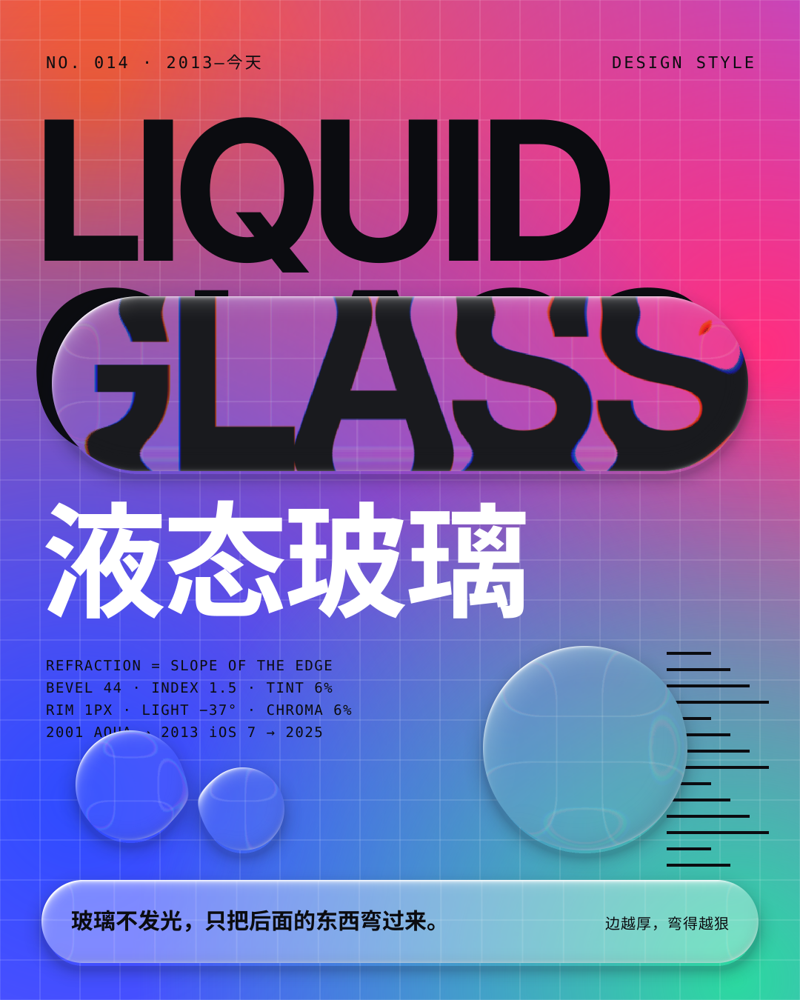
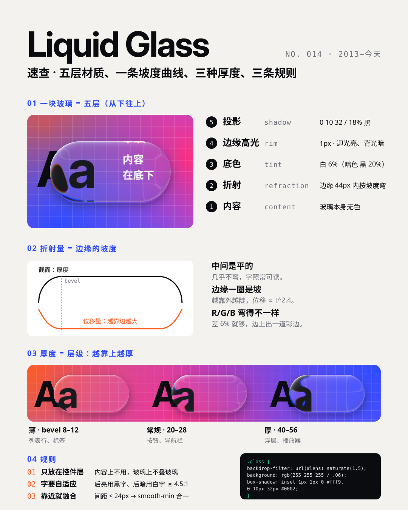
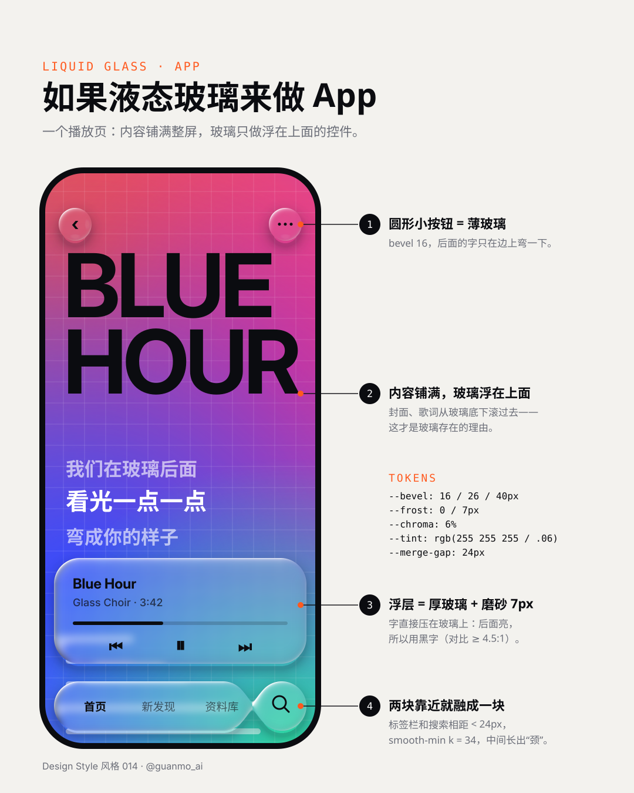
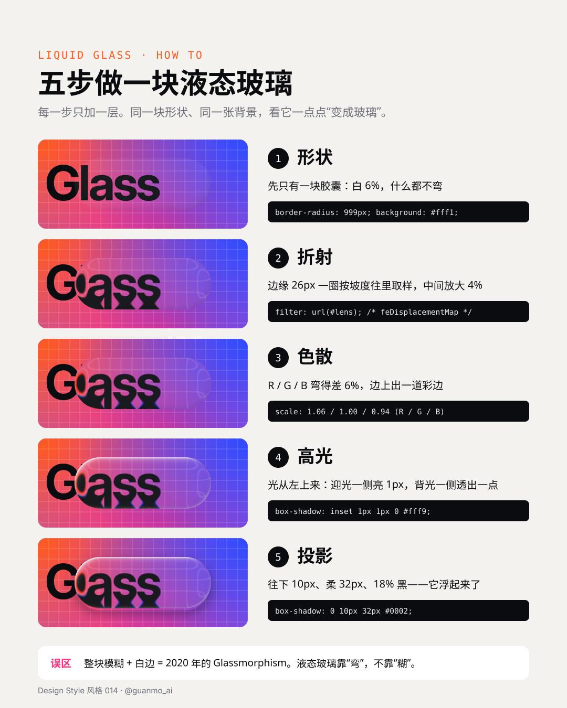

# 014 · Liquid Glass

[中文](README.md) · **English** · [Watch the film](https://github.com/guanmo-ai/design-style/releases/tag/day-14) · [Making of](PROCESS.en.md)

> English quick guide. The film and SVG artwork keep their original Chinese labels. The [Chinese guide](README.md) has the longer history and frame-by-frame storyboard.

## Overview

Glass that does not glow and has no color of its own — it only bends what is behind it. The amount of bending equals the slope of the edge: the middle is flat and stays readable, the rim gets steeper and bends harder. The 20-second film follows **one glass droplet** from start to finish in a single shot: it rolls across a wall of type, flattens into a lens while a bevel readout counts 44 → 0 → 44, changes material five times through 2001 Aqua, 2007 Aero, 2013 iOS 7, 2020 Glassmorphism and 2025 Liquid Glass, splits into three drops, lets two of them merge through a gooey neck while the third grows into a menu, then becomes the floating mini player of a music app next to a web page whose nav bar switches its text between black and white as content scrolls underneath. The glass is real: every frame is refracted in a WebGL shader from the shape's distance field, not a texture.

Series: **Design styles**. Period shown: **2013—today**, with its ancestors back to 2001.

**The one trick:** *refraction = slope of the edge.* Wider bevel = thicker glass; steeper slope = harder bending at the rim; the center is always flat.

## Five practical rules

| Rule | How to apply it |
|---|---|
| **Bend, don't blur** | Displace only inside the bevel ring, by slope t^2.4, sampling inward; magnify the middle by 3–6%. If the middle bends, text is unreadable; if the edge doesn't bend, you are back to 2013 frosted glass. |
| **Thickness = hierarchy** | Higher layers are thicker: list rows 12px, buttons 26px, sheets and players 44px. |
| **Controls only** | Content fills the screen; glass is only for navigation, buttons and players floating above it. Never glass on glass, never body cards made of glass. |
| **Merge when close** | Two pieces closer than 24px join via smooth-min and grow a neck; a button growing into a menu is one shape morphing continuously. |
| **Adaptive text** | Pick text color from the luminance behind the glass: light behind → black, dark behind → white, ≥ 4.5:1. |

## Project palette and typography

- Glass itself: white 4–6%, a 1px rim highlight from one light source (top-left, −37°), a soft drop shadow `0 10px 32px rgb(0 0 0 / .18)`. Glass that carries text adds a little frost (6–14px) and 30–46% white.
- Content behind it: Ink `#0B0C10`, Paper `#F3F2EE`, Orange `#FF5A1F`, Pink `#FF2E7E`, Mint `#2BD9A0`, Violet `#8B5CFF`, Blue `#2E4BFF` (white text only on blue).
- Glass parameters: bevel 12 / 26 / 44px, edge 0.9, magnification 3 / 4 / 6%, chromatic aberration 6% (R / G / B scales 1.06 / 1.00 / 0.94).
- Typefaces: Inter Display (titles), Inter (UI text), Geist Mono (parameter readouts), Noto Sans SC 700+ for Chinese on glass.
- Tokens: [JSON](tokens.json), [CSS](tokens.css) (with an SVG-filter refraction path and a frosted fallback, `prefers-reduced-transparency` support), [TypeScript](tokens.ts).

## Visual references

All four sheets keep their original Chinese labels. The glass in them is real refraction: `images/glass.py` builds displacement maps from each shape's distance field and SVG `feDisplacementMap` bends the content behind, once per color channel.

### Liquid Glass at a glance



### Five layers, one slope curve, three thicknesses, three rules



### Liquid Glass in an app



### Five steps to a piece of liquid glass



## Common mix-ups

- **Not Glassmorphism.** Glassmorphism (2020) is blur plus a white border. Liquid Glass keeps the background sharp and bends only at the edges.
- **Not skeuomorphism.** It imitates how glass treats light, not what a glass object looks like.
- **Legibility is the real problem.** Adaptive text color, frost under text, and respecting the system's reduce-transparency setting are part of the style, not extras.

## Timing

| Time | Frames | Chapter | On screen |
|---|---|---|---|
| 0–2.5 s | 0–150 | Opening | Type wall LIQUID / GLASS; a droplet already rolling left bends the letters; the capsule labelled “液态玻璃” folds away; whip pan |
| 2.5–6.5 s | 150–390 | 01 Bend | The droplet becomes a lens over “Aa”; bevel 44 → 0 (a flat window, nothing bends) → 44 with a live cross-section; chromatic aberration 0 → 6% |
| 6.5–10.5 s | 390–630 | 02 Twenty-five years | One piece of glass, five materials: Aqua button, Aero window, iOS 7 control center, Glassmorphism card, Liquid Glass droplet |
| 10.5–13.5 s | 630–810 | 03 Merge | One drop splits into three; two merge through a neck (gap 66 → 0); the “more” drop grows into a menu |
| 13.5–18 s | 810–1080 | 04 UI | Phone mini player, merged tab bar + search, web nav bar and a round button; content scrolls under the glass and text flips black/white |
| 18–20 s | 1080–1200 | Ending | Whip pan back to the type wall; everything folds back into the droplet and the capsule — the first frame |

| Property | Value |
|---|---|
| Canvas | 1920 × 1080 |
| Frame rate | 60 fps |
| Duration | 20 s / 1200 frames |
| Tempo | 120 BPM throughout |
| Loop | First frame = last frame (page 6 is page 1); the music's tail folds back into the start |

## Reproduce

```bash
npm run studio
npm run render:014   # needs WebGL: --gl=swangle is already in the script
npm run images:014
```

Open Remotion Studio and select the `S014-LiquidGlass` composition.
