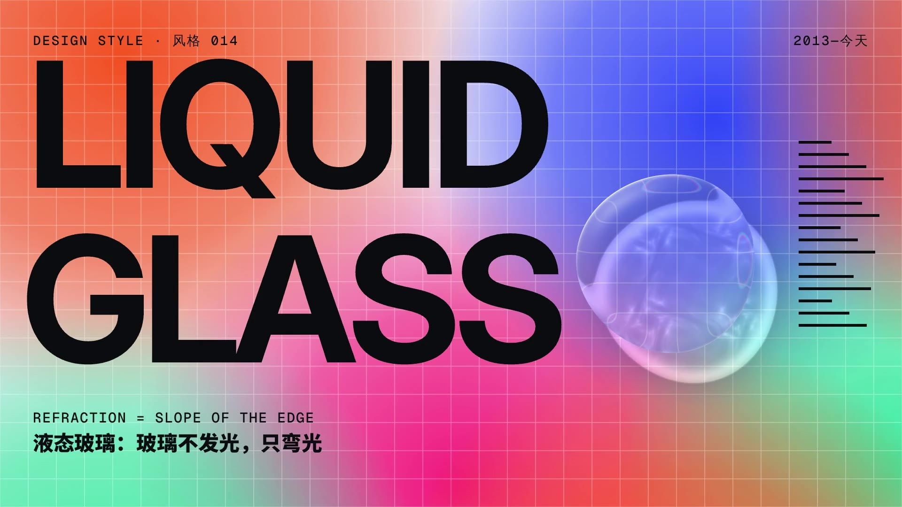

# 014 · 液态玻璃 Liquid Glass（2013—今天）

**中文** · [English](README.en.md)

> **一句话：** 玻璃不发光，只把后面的东西弯过来——折射量 = 边缘的坡度。中间是平的，字照常可读；越靠边越陡，弯得越狠。

🎬 [看视频](https://github.com/guanmo-ai/design-style/releases/tag/day-14) · 🛠 [制作过程](PROCESS.md) · 🖼 [图片源文件](images)

| 海报 | 速查卡 |
|:-:|:-:|
|  |  |
| **如果液态玻璃来做 App** | **五步做一块液态玻璃** |
|  |  |

> 图里的玻璃全部是真折射，不是贴图：`images/glass.py` 按形状的距离场算出位移贴图，SVG 用 `feDisplacementMap` 把后面的内容弯过来，R / G / B 三个通道各弯一次（色散）。改形状、厚度、光的方向，重跑即可。

---

## 1 · 它从哪来

“玻璃”在界面里出现过很多次，每一次做法都不一样。液态玻璃是最新的一次，也是第一次不靠**模糊**、而靠**折射**。

| 年份 | 事件 | 玻璃是怎么做的 |
|---|---|---|
| **2000—2001** | Mac OS X 的 **Aqua**。乔布斯说，希望你看到按钮就想舔一口 | 果冻：着色 + 上半截一层高光，不模糊 |
| **2007** | Windows Vista 的 **Aero Glass**（Authentic, Energetic, Reflective, Open） | 窗口标题栏毛玻璃：模糊 + 白边 + 斜向反光 |
| **2013** | **iOS 7**，乔纳森·艾夫主导的扁平化；控制中心、通知中心是半透明的模糊层 | 只剩模糊：大半径高斯模糊 + 白色 |
| **2014—2017** | OS X Yosemite 的 vibrancy、Windows 的 Fluent Design “亚克力”（Acrylic） | 模糊 + 噪点 + 着色，成为系统级材质 |
| **2020** | 设计师 Michal Malewicz 把 Dribbble 上流行的半透明卡片叫作 **Glassmorphism** | 模糊 + 1px 白边 + 15% 白，放在彩色渐变上 |
| **2025** | Apple 在 WWDC 发布 **Liquid Glass**，用在 iOS 26、macOS Tahoe 26 等全线系统 | 折射（lensing）：边缘把后面的内容弯过来；高光随设备转动；控件之间能融合、能变形 |

**为什么重要：** 前面四次“玻璃”本质上都是**模糊**——把后面的东西糊掉，让前面的字看得清。液态玻璃反过来：中间几乎不处理，后面的内容清清楚楚；“玻璃感”全部来自边缘那一圈的**弯曲**。这让控件可以真正浮在内容上，而不必盖住内容。

**这一期最有用的一招：** *折射量 = 边缘的坡度。* 只要记住这一条，就知道参数怎么调：坡越宽（bevel），玻璃越“厚”；坡越陡，边上弯得越狠；中间永远是平的。

## 2 · 五条规则

| # | 规则 | 怎么做 | 小心 |
|:-:|---|---|---|
| 01 | **只弯光** Bend | 位移只发生在边缘 bevel 这一圈，按坡度 t^2.4 往里取样；中间整体放大 3%—6% | 中间也弯，字就读不了；边缘不弯，就退回了 2013 年的毛玻璃 |
| 02 | **厚度 = 层级** Depth | 越靠上的东西越厚：列表行 12px、按钮 26px、浮层 44px | 所有玻璃一样厚，层级就没了 |
| 03 | **只放在控件层** Controls only | 内容铺满整屏，玻璃只做浮在上面的导航、按钮、播放条 | 玻璃上不叠玻璃；正文卡片不要做成玻璃 |
| 04 | **靠近就融合** Merge | 两块间距 < 24px 时用 smooth-min 合成一块，中间长出“颈”；按钮长成菜单是同一块形状连续变形 | 合成时要有颈，直接“啪”地贴在一起不像液体 |
| 05 | **字要自适应** Adapt | 按玻璃后面的亮度选字色：后面亮用黑字，后面暗用白字，对比 ≥ 4.5:1 | 一直用白字，滚到浅色内容上就看不见了 |

## 3 · 色板

玻璃本身**没有颜色**。下面这些都是“玻璃后面的内容”——玻璃要在有内容、有颜色的东西上才看得出来。

| 名称 | HEX | 用途 | 黑字对比度 |
|---|---|---|:-:|
| 墨 | `#0B0C10` | 字、深色内容 | — |
| 纸 | `#F3F2EE` | 浅底 | 17.5 : 1 |
| 次要 | `#6B6E78` | 次要文字 | 4.5 : 1（在纸上） |
| 橙 | `#FF5A1F` | 内容色 | 6.3 : 1 |
| 粉 | `#FF2E7E` | 内容色 | 5.5 : 1 |
| 薄荷 | `#2BD9A0` | 内容色 | 10.7 : 1 |
| 紫 | `#8B5CFF` | 内容色 | 4.7 : 1 |
| 蓝 | `#2E4BFF` | 内容色（上面只放白字，5.9 : 1） | 3.3 : 1 ✗ |

> 玻璃的“颜色”只有三样：极淡的白（4%—6%）、1px 的边缘高光、往下的投影。要压字的浮层再加一点磨砂和 30%—46% 白。

## 4 · 字体

| 用途 | 本项目 | 说明 |
|---|---|---|
| 标题 | **Inter Display** 500—700（OFL） | SF Pro 的开源替代；大字收紧字距 −4% |
| 正文 | **Inter** 400—500（OFL） | 界面文字 |
| 参数 | **Geist Mono**（OFL） | bevel / chroma / frost 这类读数 |
| 中文 | **Noto Sans SC** 500—900（OFL） | 玻璃上的中文用 700 以上，细字压在折射边上会碎 |

## 5 · 玻璃的参数

| 参数 | 含义 | 薄（列表行） | 常规（按钮） | 厚（浮层） |
|---|---|:-:|:-:|:-:|
| `bevel` | 边缘坡的宽度 | 12px | 26px | 44px |
| `edge` | 边缘最大位移 = bevel × edge | 0.9 | 0.9 | 0.9 |
| `mag` | 中间整体放大 | 3% | 4% | 6% |
| `chroma` | R / G / B 弯曲量差 | 6% | 6% | 6% |
| `frost` | 磨砂（只给压字的浮层） | 0 | 0—6px | 0—14px |
| `tint` | 白 | 6% | 6%—36% | 6%—46% |
| 高光 | 迎光一侧 1px 亮边，背光一侧透出一点 | ✓ | ✓ | ✓ |
| 投影 | `0 10px 32px rgb(0 0 0 / .18)` | — | ✓ | ✓ |

- **一个光源：** 所有玻璃的光都从左上方来（−37°）。高光方向不一致，玻璃就像贴纸。
- **位移公式：** `offset = 向内法线 × bevel × edge × t^2.4 − (p − 中心) × mag`，t 从平的内部（0）到最外缘（1）。
- **动效：** 落地用约 5% 过冲的弹簧（damping 15 / mass 0.7 / stiffness 170）；形状永远连续变化，不切换。
- **在网页里：** 折射用 SVG 滤镜 `feDisplacementMap`，位移贴图由形状算出来（见 `images/glass.py`）；`backdrop-filter: url(#lens)` 目前只有 Chromium 支持，其他浏览器退回磨砂（见 `tokens.css`）。

## 6 · 这样做 / 别这样

**✅ 这样做：** 内容铺满、玻璃浮在上面 · 中间平、边上弯 · 越靠上越厚 · 一个光源 · 靠近就融合 · 字跟着后面的亮度换黑白 · 系统要求“降低透明度”时变成实底
**❌ 别这样：** 整块大半径模糊（那是 2020 年的 Glassmorphism）· 玻璃叠玻璃 · 正文卡片做成玻璃 · 细字压在折射边上 · 每块玻璃的高光方向不一样 · 放在纯白底上（看不出玻璃）

## 7 · 其他误区

- **液态玻璃 ≠ Glassmorphism。** Glassmorphism 靠“糊”：模糊 + 白边。液态玻璃靠“弯”：后面清清楚楚，只有边上弯。
- **≠ 拟物。** 它模仿的不是“一块玻璃的样子”，而是“玻璃怎么对待光”。没有木纹、没有反光贴图。
- **可读性是它最大的问题。** 2025 年发布后，最多的批评就是字看不清。解决办法写在规则 05 里：字色自适应、压字的地方加磨砂、尊重系统的“降低透明度”。
- **色散不要多。** 6% 刚好在边上出一道彩边；超过 10% 就像廉价的 3D 眼镜。
- **中文怎么配？** 玻璃上的中文用粗体（700 以上），字号 ≥ 16px；细宋、细黑压在折射边上会被弯碎。

## 8 · AI 提示词（直接复制）

**图片**

```
Liquid Glass UI (Apple 2025 style), clear glass capsules and droplets floating over a vivid mesh gradient
(orange #FF5A1F, pink #FF2E7E, blue #2E4BFF, mint #2BD9A0) with a thin white grid and huge black
sans-serif type behind; real refraction only at the rounded edges (lensing), the center stays flat and
readable, subtle chromatic aberration on the rim, 1px specular highlight from the top-left, soft drop
shadow, no frosted blur, no white border --ar 4:5
```

**视频**

```
Liquid Glass motion graphics, one continuous shot: a single glass droplet rolls across a wall of bold
black type and bends the letters at its edges; it flattens into a lens while a bevel readout counts
0 → 44px; it morphs through 2001 Aqua, 2007 Aero, 2013 iOS 7 blur, 2020 glassmorphism and 2025 liquid
glass; it splits into three drops, two merge with a gooey neck, the third grows into a menu; finally
it becomes the floating tab bar of a music app while content scrolls underneath. Whip pans, 120 bpm.
```

**代码**

```
液态玻璃控件：内容铺满整屏，控件浮在上面。玻璃本身无色：background rgb(255 255 255 / .06)，
box-shadow inset 1px 1px 0 #fff9, 0 10px 32px #0002，圆角 999px。折射用 SVG feDisplacementMap（边缘 26px
按坡度往里取样，中间放大 4%，R/G/B 位移差 6%），backdrop-filter: url(#lens) saturate(1.5)，不支持时退回 blur(6px)。
玻璃上的字按背景亮度切换黑 / 白；两块间距 < 24px 时合成一块；prefers-reduced-transparency 时变实底。令牌见 tokens.css。
```

## 9 · 20 秒分镜

全片只有一条物理规则：**玻璃只弯光**——它不发光、没有颜色，画面上所有的颜色都在它后面。主角是**同一滴玻璃**，从头接力到尾。一镜到底，中间**两次穿过玻璃**：镜头推进镜片，镜片里已经是下一个世界，穿过去以后，盖满屏幕的镜片再收回成下一章的主角。

只做玻璃才能做的动作：落下时整面墙泛起涟漪、玻璃把光聚成会流动的光池（焦散）、被扯开时长出颈和甩出的小水珠、离墙越高影子离得越远、设备一转高光就从玻璃上滑过。每个大动作都有起势（先往反方向蓄一下）和约 5% 过冲的落地，液体落地后再抖两三下。玻璃是真的：每一帧在 WebGL 着色器里按形状的距离场算涟漪、光池、折射、色散、磨砂和高光；运动快的帧取 2—6 个子帧求平均（运动模糊）。配乐 120 BPM，全程不变速。

**为推特做的三件事：** 第一帧就是字墙海报，一滴玻璃挂在右上、在抖，它的光池落在 GLASS 上；首尾是同一帧（片尾水滴升回原处），配乐的余音折回开头，循环看不出接缝；静音也看得懂——每章的规则都用 52—104px 大字从遮罩里升起，参数读数跟着画面实时变。镜头只在两个落点往下“咚”一下（f30 落下、f510 落到 2025）。

<a href="https://github.com/guanmo-ai/design-style/releases/tag/day-14"></a>

| 时间 | 帧 | 镜 | 画面 | 教的是什么 |
|---|---|---|---|---|
| 0:00—2.5 | 0—150 | 落下 | 一滴玻璃往上一收、加速落下（越近越小，影子与光池收拢），砸在字墙上：压扁、光池一亮、整面墙一圈涟漪把 LIQUID GLASS 弯过去；甩出三颗小水珠划弧线落回，被表面张力拉回来、长出颈并进去；这一摊收成镜片往右滑，镜头跟着走 | 折射量 = 边缘的坡度 |
| 2.5—5.0 | 150—300 | 01 弯光 | 镜片像放大镜在 Aa 上游走；bevel 44 → 0（一扇平窗，字不弯）→ 44，截面图与读数同步；色散 0 → 6%；光源绕一整圈，高光与光池跟着转；镜头推进镜片、穿过去 | 只弯光 · 一个光源 |
| 5.0—9.0 | 300—540 | 02 二十五年 | 盖满屏幕的镜片收回成 2001 的 Aqua 按钮，沿时间尺一跳一跳：空中换形状与材质，落地压扁回弹——Aero 毛玻璃窗口、iOS 7 控制中心、Glassmorphism 卡片、2025 一滴液态玻璃（咚）；只有液态玻璃有光池 | 模糊 vs 折射 · 来历 |
| 9.0—11.5 | 540—690 | 03 融合 | 一滴被扯成三滴；左边两滴互相吸过去，颈先长出来再合成一块（间距读数 140 → 0）；点一下“更多”，先横向冲出去再纵向展开成菜单 | 靠近就融合 · 形状连续变化 |
| 11.5—15.0 | 690—900 | 04 界面 | 手机带透视转进来，合成的那块变成迷你播放条；往下滚时标签栏缩成小胶囊、播放条落进同一行；浏览器转进来，导航条压在滚动的网页上；点按钮整页一圈涟漪；深色内容滚到标签栏底下，字自己变白 | 只放在控件层 · 字要自适应 · 厚度 = 层级 |
| 15.0—17.7 | 900—1060 | 五条规则 | 播放条从手机里飞出来、朝镜头放大，第二次穿过玻璃；镜片收回成一条横的放大镜，一拍一条读过五条规则 | 五条规则 |
| 17.7—20.0 | 1060—1200 | 回到开始 | 放大镜收成一滴往上升（影子与光池离它越来越远），镜头往上摇回字墙；水滴回到右上挂着——第一帧 | — |

## 10 · 文件

```
014-liquid-glass/
├─ README.md / README.en.md
├─ PROCESS.md / PROCESS.en.md
├─ tokens.ts / tokens.css / tokens.json
├─ video/LiquidGlass.tsx   # 主合成：每帧（运动快时多个子帧）画世界 → 设备屏幕过玻璃、3D 贴进来 → 主玻璃 → 压在玻璃上的字
├─ video/gl.ts             # WebGL2：玻璃着色器（涟漪、光池 = 影子 + 焦散、折射、色散、磨砂、高光）+ 透视贴图（设备）
├─ video/scene.ts          # 剧本：任意时刻 t 的镜头、每块玻璃的形状与材质、涟漪、设备姿态
├─ video/planes.ts         # 玻璃后面的两个平面（字墙 / 弯光 / 规则页；时间尺 / 融合 / 界面）与两块设备屏幕
├─ video/motion.ts         # 动作的基本件：起势、5% 过冲的落地、液体抖动、抛物线、带滞后的跟随
├─ video/STORYBOARD.md     # 第三版分镜与原则
├─ audio/make_music.py     # 120 BPM 玻璃拨奏 + 对准每个关键帧的音效
├─ process/timeline.json
└─ images/make_svgs.py     # poster / cheatsheet / app-ui / steps（glass.py：位移贴图生成器）
```
