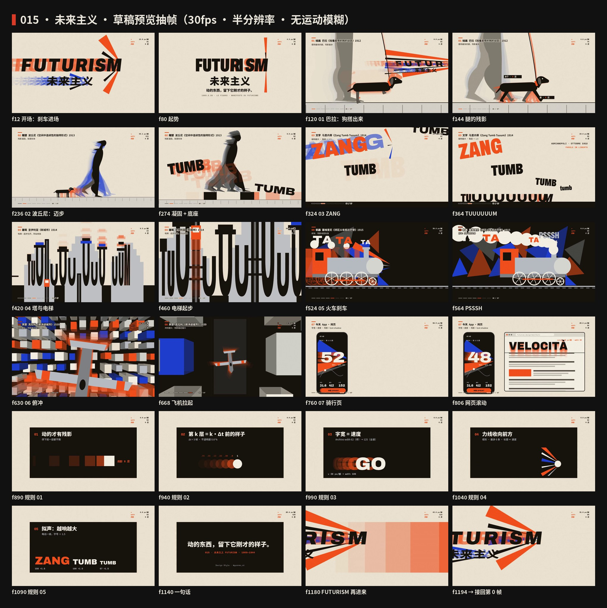

# 015 · Futurism · Making of

[中文](PROCESS.md) · **English**

> How three draft sheets became a 20-second film, a score and a fourth sheet — and why everything moves the way it does. Process images are in [`process/`](process); reproducible code is in `video/`, `audio/` and `images/`.

## Overview

| # | Step | Output |
|:-:|---|---|
| 1 | Pick | The three sheets made during the 014 selection moved from `drafts/futurism`, renumbered 015 |
| 2 | Pre-flight checklist | One trick, breadth list, signature physics, relay chain, frame, first hit, rule cards, loop — see [`video/STORYBOARD.md`](video/STORYBOARD.md) |
| 3 | Tokens | Five colors, echoes (6 layers · Δt 3 frames · 0.6^k), width formula, force lines, onomatopoeia ÷ 1.5, 144 BPM |
| 4 | Fourth sheet | Four-step makeover: plain poster → force lines → echoes → width = speed + onomatopoeia + five colors |
| 5 | Film | Opening + six chapters (six works, six fields) + today + five rules + ending; seamless loop |
| 6 | Score | 144 BPM, A Phrygian, noise-intoner timbres, sound effects placed on frames computed from the trajectories, −14 LUFS |
| 7 | QA | Key stills, film strips, motion curves, draft preview, first/last frame comparison |

## Only motions this style owns

- **Echoes from the real trajectory.** `Echoes` in `kit.tsx` renders the object again at `t − k·Δt` instead of offsetting a copy, so braking folds echoes in, accelerating spreads them, and stopped echoes coincide with the body (those layers are skipped to avoid a colored fringe).
- **Width = speed.** Archivo's `wdth` axis 62—125, set per letter from that letter's own speed; `metrics.ts` stores each glyph's advance at six widths.
- **Inertial lean.** Lean = −7 × acceleration through a second-order spring (ζ = 0.69): letters pitch forward while braking and spring back with ~5% overshoot.
- **Force lines** are wedges whose tips converge on the front, length 26 · (v − 4) px, at most six, retracting when the object stops.
- **Onomatopoeia** gets ÷ 1.5 smaller each step; the train's TA size and width equal the wheel speed at that moment.

There are no fades in the film: things fly in and brake, grow, or rise out of masks.

## Why it moves this way

- **Echoes are sampled through the camera.** In the tracking shot of chapter 01, world-space echoes would ghost the whole dog. Sampling through the camera (the camera goes back in time too) leaves the body single and the swinging legs fanned — exactly Balla's picture. Live tags count the layers.
- **Gait phase comes from distance travelled**, so legs stop swinging and their echoes fold in when the dog brakes, and feet don't slide.
- **The sculpture is a time freeze, not a brake.** Braking would fold the echoes away first; at f245 time stops instead and the echoes turn from 0.6^k cobalt into solid bronze tints. The freeze lands on the widest stride.
- **TUUUUUUM records its own deceleration.** TUM flies in at 100 px/frame; T and U slam to a stop while M carries on under drag (speed ∝ remaining distance). Every U it leaves behind takes M's width at that moment, from 125 down to 80.
- **Letters become towers** by the other side of width = speed: stopped = narrow, then stretched upward from the baseline.
- **Smoke is a speedometer**: one puff every 4 frames that stays in the air, so the spacing is speed × 4 frames.
- **The dive's echoes grow towards the camera** because the plane outruns the camera; its past self was closer.
- **Rule cards are a Newton's cradle**: the incoming card brakes into the centre and the old one leaves at 1.15× the contact speed. The last card launches on its own and clears the frame, echoes included, before f1182, so f1199 meets f0 cleanly.

## QA without rendering the final film in the cloud

Key stills (`scripts/stills_batch.mjs`), film strips (`strip.py`), motion curves (`video/curves.ts` → `scripts/motion_curves.mjs` → `scripts/plot_probe.py`, see [`process/02-curves.png`](process/02-curves.png)) and the draft preview (`npm run preview:015`). The film is pure SVG, so the draft preview takes about a minute on the 4-core cloud machine (014's WebGL preview took ten). The final render goes to Codex on a Mac GPU (`npm run render:015:gpu`).

## Sound

144 BPM throughout, A Phrygian. Timbres after Russolo's intonarumori: howler (the falling TUUUUUUM), roarer, exploder (ZANG), hisser (PSSSH), crackler (wheels). At the freeze the whole track tape-stops. Footsteps and TA hits are placed on frames computed from the trajectories. −14 LUFS; the tail folds back to the start.
