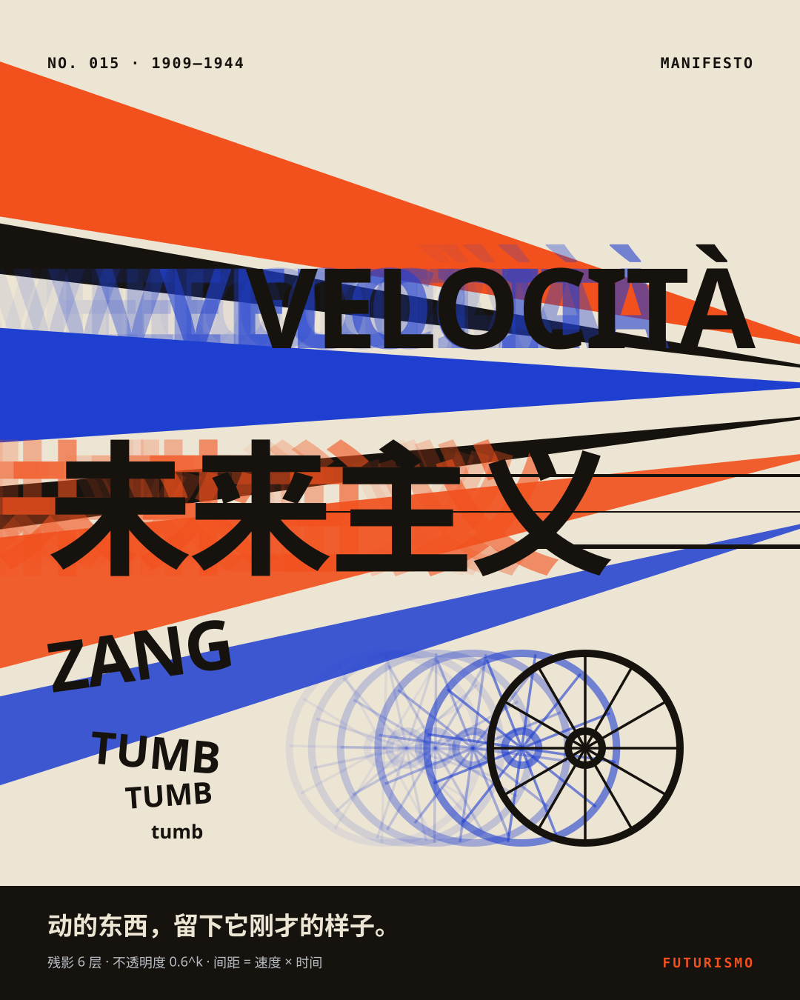
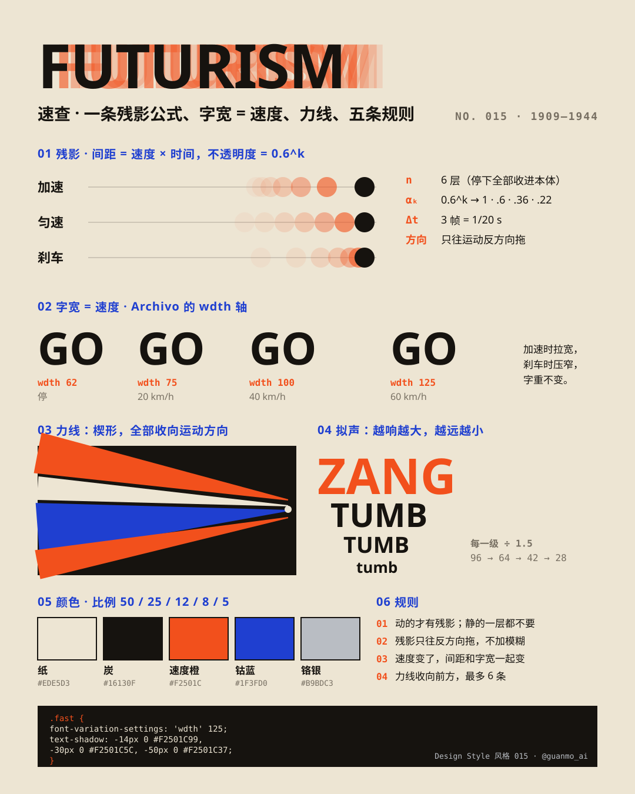
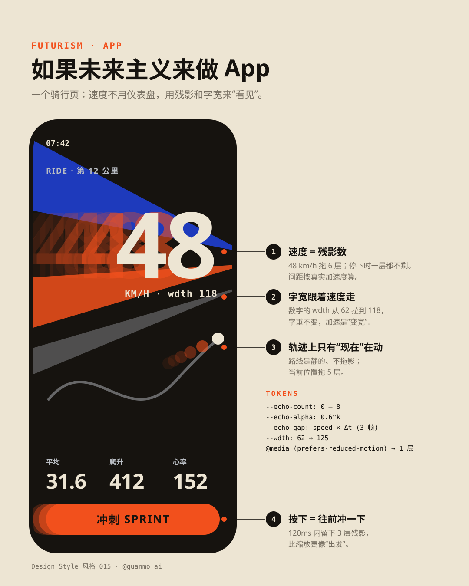

# 015 · Futurism (1909—1944)

[中文](README.md) · **English** · Watch the film (Release `day-15`, published after review) · [Making of](PROCESS.en.md)

> English quick guide. The film and SVG artwork keep their original Chinese labels. The [Chinese guide](README.md) has the longer history and the frame-by-frame storyboard.

## Overview

**Moving things leave behind what they just looked like.**

The 20-second film runs on a single physical rule: **echoes come from the real trajectory.** Every echo layer is the object as it was 3 frames earlier (Δt = 1/20 s), at 0.6^k opacity — so echoes stretch apart on their own when something accelerates, collapse back into it when it brakes, and disappear when it stops. Type width follows speed through Archivo's `wdth` axis (62 at rest → 125 at full speed), and a live readout in the top-right corner shows `v`, `wdth` and the number of echo layers.

Six chapters, six real works, six fields — each one built piece by piece, each handing over to the next with the style's own elements:

1. **Painting** · Balla, *Dynamism of a Dog on a Leash* (1912) — the leftover letter I becomes the leash; the dachshund is assembled part by part and trots; its legs fan out into Balla's many legs while its body stays single (live tags count “legs 6 · body 1”); when it brakes, the leg echoes fold back in.
2. **Sculpture** · Boccioni, *Unique Forms of Continuity in Space* (1913) — the camera follows the leash up to the walker, who speeds up; at f245 time freezes and the echoes stop fading and turn solid: the flames behind the calves are frozen echoes. Two plinths slide in: TUMB · TUMB.
3. **Literature** · Marinetti, *Zang Tumb Tuuum* (1914) — TUMB flies into the page; ZANG hits like a bullet and brakes; TUMB / tumb, each ÷ 1.5. TUM flies in together; T and U slam to a stop and M keeps going under drag: every U is left behind as M passes, at the width of M's speed at that moment, so TUUUUUUUM gets narrower towards the end — the word records its own deceleration.
4. **Architecture** · Sant'Elia, *La Città Nuova* (1914) — the stopped, condensed letters grow upward into towers; setbacks drop, elevator shafts rise, bridges slide in; elevators open their echoes on take-off and fold them on arrival; one dives underground into the dark.
5. **Machines** · Severini, *Suburban Train Arriving in Paris* (1915) — the train brakes uniformly into the station; smoke is emitted every 4 frames and stays put, so the puffs bunch up as it slows; the wheels shout TA every half turn, smaller and narrower each time; PSSSH.
6. **Sky** · Crali, *Nose-dive on the City* (1939) — the steam becomes a cloud that tears open; the camera dives straight down, the building edges all converge on the vanishing point (the buildings are the force lines); the plane outruns the camera so its echoes are its closer, larger past.
7. **Today** — the vanishing point is a phone screen: a ride app whose speed number widens with km/h, a web page whose sticky headline widens with scroll velocity, and the two lines of CSS that do it.

Then five rule cards hit each other like a Newton's cradle, and FUTURISM races back in; the last frame is the first frame. The 144 BPM score in A Phrygian borrows its timbres from Russolo's noise intoners (1913).

**The one trick:** *echo k = where it was k·Δt ago.* Spacing is speed × time, so accelerating spreads the echoes and braking folds them in.

## Five practical rules

| Rule | How to apply it |
|---|---|
| **Only moving things have echoes** | Draw echoes only while something moves; at rest, none. |
| **Echo k = the object k·Δt ago** | Sample the past, don't copy-and-offset: Δt = 1/20 s, opacity 0.6^k. Even spacing reads as decoration; real spacing reads as speed. No blur. |
| **Width = speed** | `wdth = 62 + 63 · min(1, v / vmax)^0.8`; weight stays the same. Chinese has no width axis: stretch only while moving. |
| **Force lines point forward** | Wedges, wide end behind, tips converging on the front; at most 6; length ∝ speed; they retract when it stops. |
| **Onomatopoeia: louder = bigger** | Each step further away is ÷ 1.5 (300 → 200 → 133 → 89). Words in freedom don't sit on a line. |

## Palette and typography

- Paper `#EDE5D3` 50% · Charcoal `#16130F` 25% · Speed orange `#F2501C` 12% (echoes, force lines, the loudest word) · Cobalt `#1F3FD0` 8% (second echo color, sky) · Chrome `#B9BDC3` 5% (machines).
- Echoes always use one accent (charcoal objects trail orange, orange objects trail cobalt) so “now” and “just now” never mix.
- Typefaces: **Archivo** (variable, wght 100—900, **wdth 62—125**), Space Mono for readouts, Noto Sans SC Black for Chinese.
- Tokens: [JSON](tokens.json), [CSS](tokens.css) (with a `--v` speed variable driving `wdth` and `text-shadow`, a 3-echo button press, and `prefers-reduced-motion`), [TypeScript](tokens.ts).

## Visual references

### Futurism at a glance

### One echo formula, width = speed, force lines, onomatopoeia, five colors

### Futurism in an app

### Four steps to a Futurist poster

## Common mix-ups

- **Not Y2K futurism (see 006).** 1909 is speed and machines; 2000 is chrome, bubbles and digital utopia.
- **Echoes are not motion blur.** Blur is a continuous smear; echoes are countable, crisp “just now” layers with readable spacing.
- **More is not better.** Balla's dog has many legs but one body: the faster a part moves, the more echoes it gets.
- **Not Cubism.** Cubism shows a still object from several angles at once; Futurism shows a moving object at several moments at once.

> Futurism was deeply entangled with Italian Fascism. This issue covers design methods only. The dog, sculpture, page, city, train and plane in the film are homages redrawn with the original methods, not reproductions.

## Commands

`npm run preview:015` (draft: 30fps, half resolution, no motion blur — about a minute in the cloud) · `npm run render:015:gpu` (final render on a Mac GPU) · `npm run render:015` (CPU fallback) · `npm run images:015`
