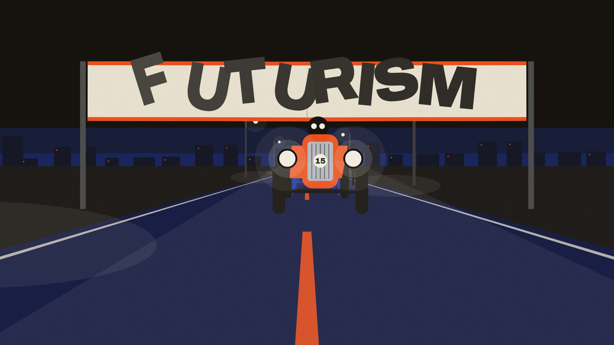

# 015 · 未来主义 Futurism（1909—1944）

**中文** · [English](README.en.md)

> **一句话：** 动的东西，留下它刚才的样子。

🎬 看视频（Release `day-15`，成片审过后发布）· 🛠 [制作过程](PROCESS.md) · 🖼 [图片源文件](images)

| 海报 | 速查卡 |
|:-:|:-:|
|  |  |
| **如果未来主义来做 App** | **四步改造** |
|  |  |

---

## 1 · 它从哪来

| 年份 | 事件 |
|---|---|
| **1909** | 2 月 20 日，马里内蒂在巴黎《费加罗报》头版发表《未来主义宣言》：“一辆吼叫的汽车……比萨莫色雷斯的胜利女神更美。”速度、机器、城市第一次被写成一种美学 |
| **1910** | 波丘尼、卡拉、鲁索洛、巴拉、塞维里尼签署《未来主义画家宣言》和《技术宣言》：“一匹奔跑的马不是四条腿，而是二十条腿，它们的运动是三角形的。”——这就是残影 |
| **1911—1913** | 布拉加利亚兄弟的“光动态摄影”（Fotodinamismo）：长曝光拍下一个人转身、打字的连续轨迹。巴拉画《拴着皮带的狗的动态》（1912）和《阳台上奔跑的女孩》（1912） |
| **1913** | 波丘尼做出雕塑《空间中连续性的独特形式》：一个迈步的人，小腿和背后拖着火焰一样的形——运动本身被做成了青铜。鲁索洛发表《噪音的艺术》，造出一批“噪音机”（Intonarumori） |
| **1914** | 马里内蒂出版《Zang Tumb Tuuum》：用不同字号、字体、方向排出炮弹、爆炸和火车的声音——“自由字”（Parole in libertà）。圣伊利亚在米兰展出《新城市》的建筑画，同年发表《未来主义建筑宣言》：退台的高楼、外挂的电梯、立体交叉的铁路和机场 |
| **1915** | 塞维里尼画《郊区火车抵达巴黎》《行进中的装甲列车》。巴拉和德佩罗发表《宇宙的未来主义重建》，要把未来主义做进家具、衣服、玩具和广告 |
| **1916** | 波丘尼、圣伊利亚都死在第一次世界大战里。第一代未来主义基本结束 |
| **1920—1930 年代** | “第二代未来主义”：德佩罗做广告与书（1927 年用螺栓装订的《德佩罗未来主义》），1929 年《航空绘画宣言》，克拉利画《俯冲进城市》（1939）这样从驾驶舱往下看的城市 |
| **1944** | 马里内蒂去世，运动结束。未来主义和意大利法西斯纠缠很深——这一期只讲设计方法，不讲它的政治 |
| **之后** | 漫画里的速度线、动画里的“拖影”帧、体育品牌的斜体字、赛车和运动 App 的界面，都是它的后代；今天的可变字体（宽度轴）和动效设计，让“字跟着速度变宽”第一次能直接写进代码 |

**为什么重要：** 未来主义第一次认真回答了“怎么在一张静止的纸上画出速度”。它的答案到今天还是最好用的那一个：**把刚才的样子留下来**——同一个东西画好几遍，越早的越淡；间距是速度给的，所以加速时拉开、刹车时挤拢。速度线、拖影、`text-shadow` 残影都从这里来。

> 画面里的狗、雕塑、书页、城市、火车、飞机都是按原作手法重新设计的“致敬”，不是原作复刻；App 概念图里的骑行数据是虚构的。

## 2 · 五条规则

| # | 规则 | 怎么做 | 小心 |
|:-:|---|---|---|
| 01 | **动的才有残影** | 只给正在动的东西画残影；停下就一层都不剩 | 静的东西拖残影只是“重影”，读起来像印刷错位 |
| 02 | **第 k 层 = k·Δt 前的样子** | 残影不是往后平移的复制，而是“过去的自己”：取 Δt = 1/20 秒，第 k 层画 k·Δt 之前的位置和姿态，不透明度 0.6^k。间距因此 = 速度 × 时间：加速时越拉越开，刹车时自己挤进本体 | 等距的残影 = 匀速，看起来是“装饰”，不是“速度”；别加模糊，残影是清楚的一层层 |
| 03 | **字宽 = 速度** | 用可变字体的宽度轴：`wdth = 62 + 63 · min(1, v / vmax)^0.8`。停下最窄、全速最宽，字重不变 | 中文没有宽度轴：只在动的时候横向拉宽，停下回到正常字宽 |
| 04 | **力线收向前方** | 力线是楔形：宽的一头在后、尖的一头收向运动前方；最多 6 条，长度 ∝ 速度，停下就缩回去 | 别画成从中心向外的放射线（那是“爆炸”）；别超过 6 条 |
| 05 | **拟声：越响越大** | 声音写成字：最响的一声最大，往远处每一级 ÷ 1.5（300 → 200 → 133 → 89）；字可以斜、可以出血 | 别把拟声字排整齐——“自由字”就是不按行走 |

## 3 · 色板

| 名称 | HEX | 建议面积 | 用途 |
|---|---|:-:|---|
| 纸 | `#EDE5D3` | 50% | 底色，略黄的旧纸 |
| 炭 | `#16130F` | 25% | 主角、文字、黑底 |
| 速度橙 | `#F2501C` | 12% | 残影、力线、最响的拟声字 |
| 钴蓝 | `#1F3FD0` | 8% | 第二组残影（主角是橙色时）、天空 |
| 铬银 | `#B9BDC3` | 5% | 机器、金属、次要力线 |
| 说明 | `#776F62` | — | 小字 |

> 残影统一用一种强调色（炭色的东西拖橙色、橙色的东西拖钴蓝），不跟着本体的颜色走：一眼就分得清“现在”和“刚才”。

## 4 · 字体

| 用途 | 本项目 | 商用原版 / 其他选择 |
|---|---|---|
| 拉丁 · 大字 | **Archivo**（免费，OFL；可变：字重 100—900，**字宽 62—125**） | 1910 年代多是手绘字和诺比奥洛铸字厂的怪诞体 · Roboto Flex（免费，字宽 25—151）· GT Flexa · Druk 系列 |
| 等宽 · 读数 | **Space Mono**（免费，OFL） | JetBrains Mono · IBM Plex Mono |
| 中文 | **思源黑体 / Noto Sans SC** Black（免费，OFL） | 站酷高端黑 · 优设标题黑 |

**说明：** 这一期的字是会动的零件。宽度轴就是“速度表”：同一个字重，停下是窄长的、全速是扁宽的，读者不用看数字就知道它多快。

## 5 · 版式参数

**视频（1920×1080，60fps，144 BPM）**
- 节拍：**1 拍 = 25 帧**；开场 4 拍、01 巴拉 6 拍，其余每章 4 拍（100 帧 = 1.67 秒），换章落在小节线上
- 光影：车头灯三圈光晕（7% / 14% / 实心），路灯光锥 11% + 地面光斑 34%，聚光灯在定格那一下亮起；狗背上 3px 的轮廓光；美术馆地板 16% 的倒影
- 剧情时间：开场 0—8 帧慢动作（0.3×）、8—24 帧追回（1.31×），残影在剧情时间里取样（慢动作时拖得一样长）
- 残影：**6 层，Δt = 3 帧（1/20 秒），不透明度 0.6^k**；在“镜头里”取样——跟拍时身子几乎没有残影、摆动的腿残影最多（巴拉的画就是这么看的）
- 字宽：`wdth = 62 + 63 · min(1, v / 60)^0.8`（v 单位 px/帧），右上角实时显示 v / wdth / 残影层数
- 刹车 = 匀减速（速度曲线是直线）；惯性前倾：倾角 = −7 · 加速度，过二阶弹簧（ζ = 0.69，过冲 ≈ 5%）
- 力线：楔形，尖端距前沿 20px，长度 = 26 · (v − 4) px，最多 6 条
- 运动模糊：快门半帧，按这一帧最快的东西取 2—6 个子帧；胶片颗粒 5%

**图片（1080×1350 竖图）**
- 左右边距 64—90；海报的力线全部从左后方收向右前方
- 字号阶梯：标题 54 / 小节 20 / 正文 17 / 注释 14；拟声字每级 ÷ 1.5

## 6 · 这样做 / 别这样

**✅ 这样做：** 残影按真实轨迹取样 · 停下就收掉 · 字宽跟速度走 · 力线收向前方 · 拟声字大小跟音量走 · 残影只用一种强调色
**❌ 别这样：** 等距的装饰性残影 · 静止的东西也拖影 · 用高斯模糊代替残影 · 从中心往外的放射线 · 拟声字排成整齐的一行

## 7 · 其他误区

- **未来主义 ≠ 千禧未来主义（Y2K，见 006）。** 一个是 1909 年的“速度与机器”，一个是 2000 年前后的“铬、气泡和数字乌托邦”。
- **残影 ≠ 运动模糊。** 运动模糊是一段连续的糊；残影是一层层清楚的“刚才”，数得出几层、看得出间距——这才是未来主义画家的办法。
- **不是“越多越好”。** 巴拉的狗只有腿是很多条的，身子是一条；摆得越快的部分残影越多。
- **和立体主义的区别。** 立体主义把一个静止的东西从几个角度同时画出来；未来主义把一个动的东西在几个时刻同时画出来。

## 8 · AI 提示词（直接复制）

**图片（Midjourney / 即梦 / ChatGPT 图像）**

```
Italian Futurist poster, 1914 Milan, homage to Balla and Boccioni: a word in a heavy grotesque races to the right,
leaving 6 sharp echoes of itself behind, each echo more transparent (60% → 36% → 22%), spacing growing with speed,
orange wedge-shaped force lines converging toward the front, onomatopoeia "ZANG TUMB tumb" in decreasing sizes,
a spoked wheel with rotating echoes, palette paper #EDE5D3, charcoal #16130F, speed orange #F2501C, cobalt #1F3FD0,
chrome #B9BDC3, flat screen-printed colors, no blur, no gradients --ar 4:5
```

**视频（Runway / 可灵 / Sora）**

```
Motion graphics in Italian Futurist style on warm paper: every moving object leaves crisp echoes of its past positions
(6 layers, fading), echoes stretch apart when it accelerates and collapse into it when it brakes; a dachshund trots with
fanned legs like Balla's painting, a striding figure freezes into a bronze sculpture with flame-like trails, onomatopoeia
words fly in like bullets, letters grow into skyscrapers with external elevators, a steam train brakes into a station,
a plane dives into a city seen from above; text widens with speed; 144 bpm machine rhythm, no 3D render, no blur.
```

**代码（让 AI 写网页 / 组件）**

```
用未来主义风格做这个界面：背景 #EDE5D3，文字 #16130F，强调色 #F2501C（残影和力线），第二强调色 #1F3FD0。
字体 Archivo 可变字体（font-variation-settings: 'wdth'，62 = 停，125 = 全速）+ Space Mono（读数）+ Noto Sans SC Black。
规则：只有在动的元素才有残影；用 JS 每帧算出速度 v，写进 CSS 变量 --v（0—1）：
  font-variation-settings: 'wdth' calc(62 + 63 * var(--v));
  text-shadow: calc(var(--v) * -14px) 0 #F2501C99, calc(var(--v) * -30px) 0 #F2501C5C, calc(var(--v) * -50px) 0 #F2501C37;
停下时 --v 回到 0，残影自己收掉；按钮按下往前冲 14px，120ms 内留 3 层残影。prefers-reduced-motion 时不拖残影、不变字宽。
设计令牌见 tokens.css。
```

## 9 · 20 秒分镜

未来主义最有用的一招，是“动的东西，留下它刚才的样子”。短片从头到尾只有一条物理规则：**残影由真实轨迹生成**——每一层都是 3 帧之前的自己，所以刹车时残影自己收拢、加速时自己拉开、停下一层不剩；字宽跟速度实时变。前 7 秒是一段“夜”：车头灯、路灯的光锥、美术馆的聚光灯；之后进入白天的书页和城市。换幕都用风格自己的东西接力：车身擦过镜头 → 狗绳 → 鞋落地 = 铬银的脚 → 雕塑的底座喊出 TUMB → TUMB 的白色竖画就是书页的纸 → 字长成塔 → 电梯冲进地下 → 火车进站 → 蒸汽升成云 → 俯冲进一块屏幕 → 规则卡牛顿摆 → 片尾卡冲走，夜路上赛车再冲过来，最后一帧接回第一帧。配乐是 144 BPM 的 D 大调律动，音效按轨迹算出来的帧号对齐。



| 时间 | 帧 | 章节 | 画面 | 致敬 |
|---|---|---|---|---|
| 0:00—1.6 | 0—96 | 开场 | 夜路：红色赛车撕开横幅 FUTURISM，慢动作里急刹（残影收回车头）；字母被惯性甩向镜头、一个个贴上来，f25 车头灯一亮；赛车起势冲向镜头，字被风吹走，车身盖满画面 | 马里内蒂 ·《未来主义宣言》（1909） |
| 1.6—4.2 | 96—250 | 01 绘画 | 车身甩走，夜里的人行道，路灯的光锥；腿的残影扇开、身子只有一条；狗急刹闻杆子、太太走过去、狗绳“嘣”地绷直、狗被拽走小碎步追上；推近太太的鞋 | 巴拉 ·《拴着皮带的狗的动态》（1912） |
| 4.2—5.8 | 250—350 | 02 雕塑 | 鞋落地的位置 = 一只铬银的脚；人在美术馆里跑，地板上有倒影；定格、聚光灯亮，残影凝固成铬银的“火焰”；底座顶上来：TUMB · TUMB | 波丘尼 ·《空间中连续性的独特形式》（1913） |
| 5.8—7.5 | 350—450 | 03 文学 | TUMB 落进书页；ZANG 像子弹打进来砸停；每级 ÷ 1.5；TUM 一起飞进来，T 和 U 撞停、M 冲出去，每个 U 是它留下的——越往后越窄 | 马里内蒂 ·《Zang Tumb Tuuum》（1914） |
| 7.5—9.2 | 450—550 | 04 建筑 | 字母停下压窄、长成塔；退台块、电梯井、天桥一块块搭；电梯起步拉开残影、到站收拢；冲进地下 | 圣伊利亚 ·《新城市》（1914） |
| 9.2—10.8 | 550—650 | 05 机器 | 火车匀减速刹停：残影收回车身；烟越来越密；TA 越来越小；PSSSH；蒸汽冲上天 | 塞维里尼 ·《郊区火车抵达巴黎》（1915） |
| 10.8—12.5 | 650—750 | 06 天空 | 蒸汽长成云、破开；俯冲，楼的边收向灭点；飞机的残影越近越大 | 克拉利 ·《俯冲进城市》（1939） |
| 12.5—14.2 | 750—850 | 07 今天 | 灭点是一块屏幕：骑行页数字跟速度变宽、冲刺键 3 层残影；网页滚得越快标题越宽；代码写在画面上 | — |
| 14.2—18.3 | 850—1100 | 五条规则 | 五张卡依次撞进来、把前一张撞走 | — |
| 18.3—20 | 1100—1200 | 片尾 | 「动的东西，留下它刚才的样子。」卡片撑满画面冲走 → 夜路，赛车冲向横幅 = 第 0 帧 | — |

## 10 · 文件

```
015-futurism/
├─ PROCESS.md                             # 制作过程
├─ process/                               # 过程图：草稿预览联系表 · 剧本曲线
├─ tokens.ts / tokens.css / tokens.json   # 同一份设计令牌（颜色、残影、字宽公式、力线、拟声、节拍）
├─ video/Futurism.tsx                     # 主合成：一张 SVG 舞台，按时间挂载各段 + 外框 + 自适应运动模糊（step / blur / res 参数）
├─ video/scenes.ts                        # 各段的时间窗、读数、背景色、最快速度（决定运动模糊取几个子帧）
├─ video/timeline.ts · STORYBOARD.md      # 时间轴（帧）、分镜与开工清单
├─ video/kit.tsx                          # Echoes（残影）· Word（逐字排的可变字）· ForceLines（力线）· Rise（遮罩升起）
├─ video/motion.ts                        # 动作基本件：分段匀加速 kin、速度连续的轨迹 path1、惯性前倾 springOf、落地 land……
├─ video/metrics.ts · make_metrics.py     # Archivo 每个字母在 wdth 62—125 的前进宽度（逐字排版用）
├─ video/night.tsx                        # 开场 / 片尾：夜路、赛车撕开横幅、字母贴上镜头、车身擦过镜头
├─ video/balla.tsx                        # 01 路灯下的太太和腊肠狗（三层视差、光锥、推近鞋子）
├─ video/boccioni.tsx                     # 02 美术馆：铬银的人、定格、聚光灯、底座
├─ video/figure.tsx                       # 狗和迈步者的骨架（步态相位由走过的距离决定）
├─ video/type.tsx                         # 03 马里内蒂的自由字 + 04 圣伊利亚的城（一页书 = 一座城）
├─ video/train.tsx                        # 05 塞维里尼的火车
├─ video/sky.tsx                          # 06 克拉利的俯冲
├─ video/today.tsx                        # 07 骑行 App + 网页
├─ video/rules.tsx                        # 五条规则 + 片尾卡（牛顿摆交接）
├─ video/curves.ts                        # 剧本曲线导出（scripts/motion_curves.mjs + plot_probe.py）
├─ video/cover.jpg                        # 封面（第 0 帧）
├─ audio/make_music.py                    # 配乐：numpy 合成，144 BPM，D 大调律动，音效按轨迹对齐，−14 LUFS
└─ images/
   ├─ make_svgs.py    # 四张图的生成脚本（残影、力线、拟声都用同一套公式）
   ├─ poster.svg      # 海报
   ├─ cheatsheet.svg  # 速查卡
   ├─ app-ui.svg      # 如果未来主义来做 App：骑行页
   ├─ steps.svg       # 四步改造：普通海报 → 未来主义
   └─ preview/        # 内嵌字体的自包含 SVG
```

**命令：** `npm run preview:015`（草稿预览：30fps、半分辨率、无运动模糊，云端约 1 分钟）· `npm run render:015:gpu`（Mac 显卡渲正片）· `npm run render:015`（无显卡兜底）· `npm run images:015`

**延伸阅读：** Caroline Tisdall & Angelo Bozzolla《Futurism》（1977）· Lawrence Rainey 等编《Futurism: An Anthology》（2009）· 古根海姆美术馆《Italian Futurism, 1909–1944: Reconstructing the Universe》图录（2014）· Luigi Russolo《The Art of Noises》（1913）· Johanna Drucker《The Visible Word》（1994，讲自由字的排版）
