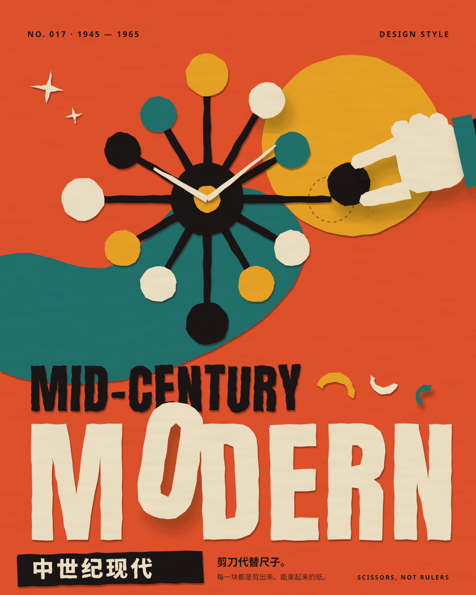
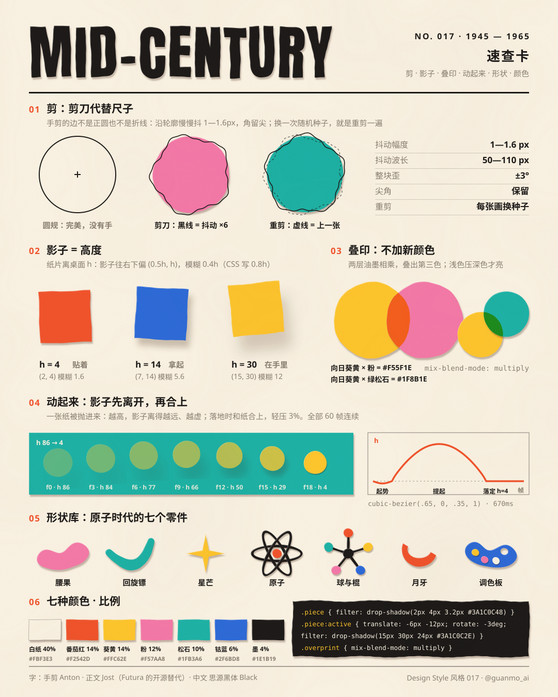
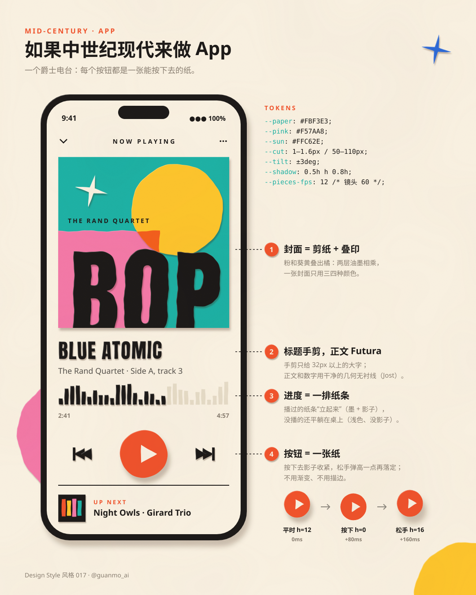
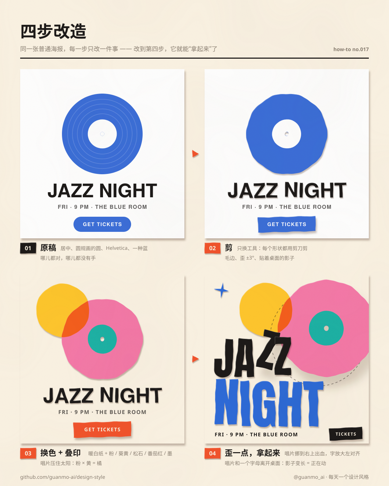

# 017 · Mid-Century Modern (1945–1965)

[中文](README.md) · **English**

> **In one line:** scissors, not rulers — every piece is a sheet of cut paper you could pick up.

🎬 [Watch the film](https://github.com/guanmo-ai/design-style/releases/tag/day-17) · 📦 [Full source](https://github.com/guanmo-ai/design-style/releases/download/day-17/017-mid-century-modern-source.zip) · 🛠 [Process](PROCESS.en.md) · 🖼 [Image sources](images) · 🎞 [Storyboard](video/STORYBOARD.md)

| Poster | Cheat sheet |
|:-:|:-:|
|  |  |
| **If Mid-Century Modern designed an app** | **Four-step makeover** |
|  |  |

## Where it comes from

1945 Case Study House program (Arts & Architecture) · 1946 Eames LCW chair · 1948–49 George Nelson office ball clock · 1950 Formica boomerang pattern, UPA's *Gerald McBoing-Boing* · 1952 Alexander Girard textiles for Herman Miller · 1953 Eames Hang-It-All · 1955 Saul Bass, *The Man with the Golden Arm* titles · 1956–67 Reid Miles' Blue Note covers · 1956–62 Paul Rand's IBM, Westinghouse, ABC · 1960 Pierre Koenig's Case Study House #22 · 1964 Mary Blair's "it's a small world" · 1984 Cara Greenberg's book gives the movement its name.

Post-war designers made modernism lovable: still geometric, still flat, but cut by hand, tilted a little, in candy colors. Today's flat illustration and friendly brand design come straight from it.

## Five rules

1. **Scissors, not rulers** — every edge wobbles 1–1.6 px (wavelength 50–110 px), corners stay sharp, each piece tilts ±3°.
2. **Shadow = height** — a sheet h px above the table casts a shadow offset (0.5h, h), blur 0.4h (0.8h in CSS), opacity 0.3 − 0.004h, and grows 1 + 0.0032h. Resting 4, lifted 14, in hand 30, pressed 0.
3. **Overprint a third color** — where two inks overlap, multiply them; light over dark only (yellow × pink = `#F55F1E`).
4. **Atomic-age shapes** — kidney, boomerang, starburst, atom orbit, ball-and-stick, crescent off-cut, palette.
5. **Warm paper + candy colors** — off-white 40%, then tomato, sunflower, Girard pink, turquoise and cobalt in small doses; ink only for type and thin lines.

## Palette

`#FBF3E3` warm paper 40% · `#F2542D` tomato 14% · `#FFC62E` sunflower 14% · `#F57AA8` Girard pink 12% · `#1FB3A6` turquoise 10% · `#2F6BD8` cobalt 6% · `#1E1B19` ink 4% · shadow `#3A1C0C`

## Type

Display: **Anton**, converted to outlines and cut with the same scissor edge · Text: **Jost** (open-source Futura) · Chinese: **Noto Sans SC Black**.

## AI prompt (image)

```
Mid-century modern cut-paper poster, 1950s, homage to Saul Bass, Paul Rand and Alexander Girard:
an atomic ball clock made of hand-cut paper (12 black spokes, 12 colored balls), a big hand-cut word "MODERN"
in six candy colors, a large sun circle and a kidney shape behind, slightly wobbly scissor-cut edges,
every piece casts a soft warm-brown shadow offset down-right (higher pieces cast longer, softer shadows),
two inks overprint where shapes overlap (yellow x pink = orange), warm off-white paper #FBF3E3,
tomato #F2542D, sunflower #FFC62E, Girard pink #F57AA8, turquoise #1FB3A6, cobalt #2F6BD8, ink #1E1B19,
flat colors, no gradients, no outlines, no grunge texture --ar 4:5
```

More prompts (video, code), layout parameters and the 15-second storyboard are in the [Chinese guide](README.md). Design tokens: [`tokens.css`](tokens.css) · [`tokens.json`](tokens.json).


## Reproduce locally

Requires Node.js 22.12+, Python 3.10+ and FFmpeg. From the project root:

```bash
npm ci
python3 -m pip install numpy scipy fonttools brotli pillow
npx remotion browser ensure
npm run fonts
npm run render:017
```

The release uses the approved review file unchanged. These commands are for local reproduction. Run `npm run images:017` to rebuild the four images; `python3 styles/017-mid-century-modern/video/make_geometry.py` regenerates the paper outlines. Font sources and licenses are recorded in `scripts/fetch_fonts.sh`.
