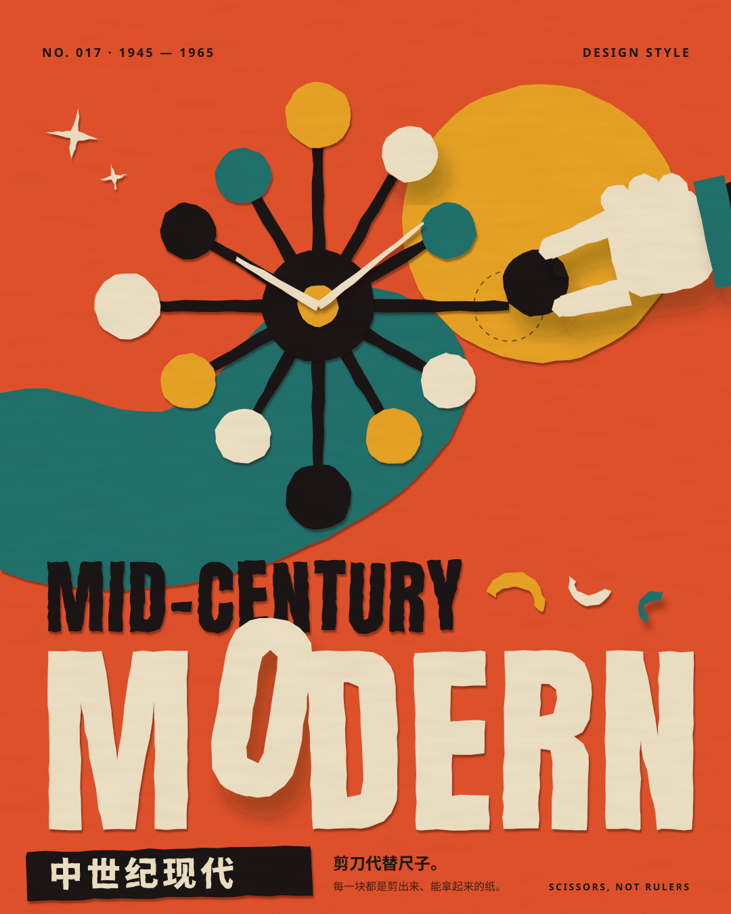
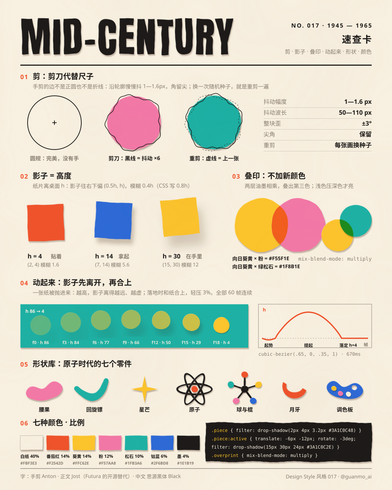
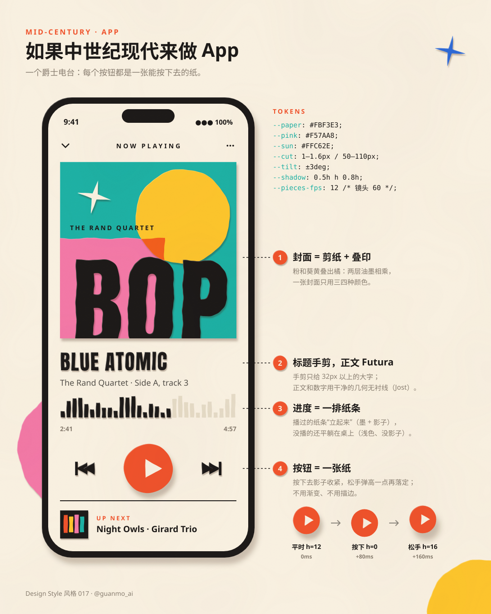
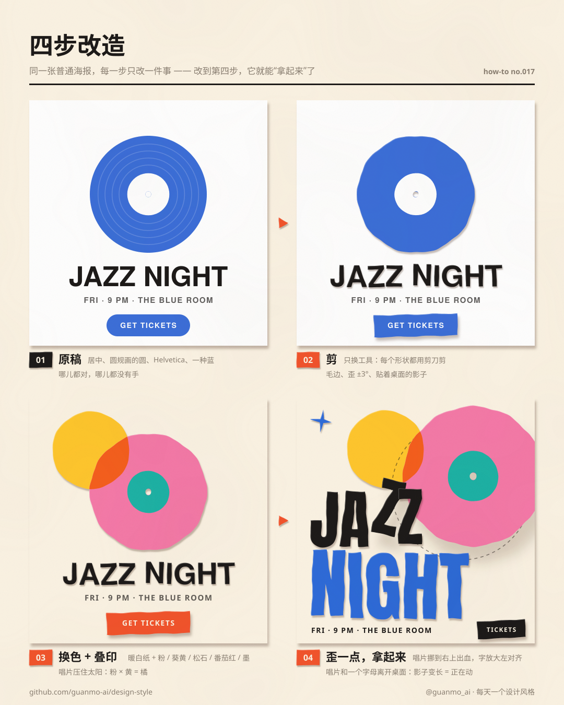

# 017 · 中世纪现代 Mid-Century Modern（1945—1965）

**中文** · [English](README.en.md)

> **一句话：** 剪刀代替尺子——每一块都是一张剪出来、能拿起来的纸。

🎬 [看视频](https://github.com/guanmo-ai/design-style/releases/tag/day-17) · 📦 [完整源码](https://github.com/guanmo-ai/design-style/releases/download/day-17/017-mid-century-modern-source.zip)· 🛠 [制作过程](PROCESS.md) · 🖼 [图片源文件](images) · 🎞 [分镜](video/STORYBOARD.md)

| 海报 | 速查卡 |
|:-:|:-:|
|  |  |
| **如果中世纪现代来做 App** | **四步改造** |
|  |  |

---

## 1 · 它从哪来

| 年份 | 事件 |
|---|---|
| **1945** | 二战结束。美国《Arts & Architecture》杂志的主编 John Entenza 发起“案例研究住宅”（Case Study House）计划：请建筑师给普通家庭设计便宜、明亮、能批量建造的新房子，一直做到 1966 年 |
| **1946** | Charles 与 Ray Eames 用压弯的胶合板做出 LCW 椅：一张薄板、几块弧面，像剪纸一样拼出来 |
| **1948—1949** | George Nelson 事务所（Irving Harper 主笔）为 Howard Miller 做球钟：12 根辐条、12 颗彩球——原子模型被做成了挂在墙上的钟 |
| **1950** | Formica 推出“回旋镖”台面纹样；UPA 的动画《Gerald McBoing-Boing》用平涂色块和极简线条，告别迪士尼式的写实 |
| **1952** | Alexander Girard 加入 Herman Miller 做织物：大块的粉、橙、绿松石、黄，几何图案平铺 |
| **1953** | Eames 夫妇设计 Hang-It-All 挂衣架：钢丝折线 + 一排彩色木球 |
| **1955** | Saul Bass 为电影《金臂人》做片头：几根白色纸条在黑底上扎进来，拼成一条折线手臂。电影片头第一次成了“设计作品” |
| **1956—1967** | Reid Miles 给 Blue Note 唱片做了几百张封套：大字出血、照片裁得很狠、两三种油墨叠印 |
| **1956—1962** | Paul Rand 设计 IBM（1956）、Westinghouse（1960）、ABC（1962）标志：几个几何形，像小孩剪出来一样简单 |
| **1960** | Pierre Koenig 的 Case Study House #22（Stahl House）落成，玻璃盒子悬在洛杉矶的山崖上；Julius Shulman 的夜景照片让它成了这个年代的象征 |
| **1964** | Mary Blair 为迪士尼的“小小世界”做美术：糖果色、平面、剪纸感的城市 |
| **1984** | Cara Greenberg 的书《Mid-Century Modern: Furniture of the 1950s》出版，“中世纪现代”这个名字才被叫开——它是事后起的名字 |
| **今天** | 扁平插画、品牌吉祥物、动效里的“纸片质感”、Notion 和 Headspace 的插画、无数复刻家具，都是它的后代 |

**为什么重要：** 二战后的设计师第一次把“现代主义”做得让普通人喜欢：形状还是几何的、颜色还是平涂的，但边是手剪的、角度是歪一点的、颜色是糖果色的。它证明了**简单和温暖可以同时成立**——这正是今天的扁平插画和品牌设计最常用的那一套。

> 视频和图里的片头、挂衣架、唱片封套、房子都是按原作手法重新设计的“致敬”，不是原作复刻；App 里的电台和曲目是虚构的。

## 2 · 五条规则

| # | 规则 | 怎么做 | 小心 |
|:-:|---|---|---|
| 01 | **剪刀代替尺子** | 每个形状的边都是剪出来的：沿轮廓慢慢抖 **1—1.6px（波长 50—110px）**，尖角保留，每块歪 **±3°** | 抖得太碎（像撕纸）或太规则（像锯齿）都不对；字也要剪，但只剪 32px 以上的大字 |
| 02 | **影子 = 高度** | 纸离桌面 h px，影子往右下偏 **(0.5h, h)**、模糊 **0.4h**（CSS 写 0.8h），浓度 **0.3 − 0.004h**，纸放大 **1 + 0.0032h**。贴着 4、拿起 14、在手里 30、按下 0 | 影子用暖棕 `#3A1C0C`，不用纯黑；所有东西用同一个光源方向 |
| 03 | **叠印出第三色** | 两块颜色重叠的地方用 multiply，叠出第三色，不另加新颜色。浅色压深色才亮：黄 × 粉 = 橘 `#F55F1E` | 两种深色相乘会发黑发脏；叠印只给少数几处，不要满屏半透明 |
| 04 | **原子时代的形状** | 腰果、回旋镖、星芒、原子轨道、球与棍、月牙边角料、调色板——七个零件够用 | 别用完美的圆角矩形和渐变：那是今天的 UI，不是 1950 年代 |
| 05 | **暖白纸 + 糖果色** | 一张暖白纸占 40%，番茄红、向日葵黄、Girard 粉、绿松石、钴蓝各一小块，墨只给字和细线 | 底色别用纯白；也别把五个颜色平均分——总有一两个是主角 |

## 3 · 色板

| 名称 | HEX | 建议面积 | 用途 |
|---|---|:-:|---|
| 暖白纸 | `#FBF3E3` | 40% | 底色 |
| 番茄红 | `#F2542D` | 14% | 主角、按钮 |
| 向日葵黄 | `#FFC62E` | 14% | 太阳、高光、叠印的“浅色” |
| Girard 粉 | `#F57AA8` | 12% | 大块的背景形状 |
| 绿松石 | `#1FB3A6` | 10% | 第二主角 |
| 钴蓝 | `#2F6BD8` | 6% | 点睛、星芒 |
| 墨 | `#1E1B19` | 4% | 字、辐条、细线 |
| 说明 | `#8A7F72` | — | 小字 |
| 影子 | `#3A1C0C` | — | 所有影子（浓度随高度变） |

**叠印出来的颜色：** 黄 × 粉 = `#F55F1E` · 黄 × 绿松石 = `#1F8B1E` · 粉 × 绿松石 = `#1E566D`

## 4 · 字体

| 用途 | 本项目 | 商用原版 / 其他选择 |
|---|---|---|
| 拉丁 · 大字 | **Anton**（免费，OFL），转成轮廓后用剪刀边剪一遍 | 1950 年代多是手绘或手剪字 · Bass 的片头字是他自己剪的 · 其他选择：Bebas Neue、League Gothic |
| 拉丁 · 正文 | **Jost**（免费，OFL，Futura 的开源替代） | Futura（Paul Renner 1927，Blue Note 和 Paul Rand 都爱用）· Avenir |
| 中文 | **思源黑体 / Noto Sans SC** Black（免费，OFL），大字同样剪一遍 | 站酷快乐体 · 优设标题黑 |

**说明：** 大字是“剪出来的纸”，正文是“印上去的字”——这两种身份分开，画面才不乱。

## 5 · 版式参数

**视频（1920×1080，60fps，144 BPM，15 秒）**
- 结构：开场 1.5 秒先把海报搭出来；然后每章一件真实代表作、一张新彩纸当底（蓝 / 绿松石 / 黄 / 粉 / 蓝 / 白），每章约 1.6 秒；最后五条规则，首尾无缝循环
- 换章：一整张彩纸带着剪出来的毛边从右 / 上 / 左 / 下拍进来（18 帧），进来时歪 7°、落定摆正；落定全部在小节第一拍
- 接力：同一批纸一路接力，翻面是主要动作——辐条 → 折线手臂（翻成白）→ 钢丝折线（翻回墨）→ 蓝球 → 唱片 → 落日 → 玻璃盒子 → 手机
- 纸片物理：影子 = 高度（见规则 02）；落地轻压 4%（单向，不来回抖），转角回正 ±2°
- 重击：镜头往落点冲 3.5—8% 再回来；大落地溅起 12 片彩纸碎片（剪剩的边角料）
- 丝滑：所有动作 60 帧连续、速度连续；镜头走单调三次样条；按最快的东西每帧走多少 px 取 2—6 个子帧做运动模糊
- 外框：左上章节标题（编号 · 领域 / 作者 作品 · 年份 / 这一章教什么）；左下 h 读数——一小块纸和它的影子，跟着画面里正在动的那块纸实时变

**图片（1080×1350 竖图）**
- 左右边距 56；字号阶梯：标题 42—46 / 小节 21 / 正文 15—17 / 注释 13—14
- 底部信息栏和 003 / 004 / 005 同一种版式：名字年代 · 一句话 · 期号

## 6 · 这样做 / 别这样

**✅ 这样做：** 边剪出来、歪一点 · 影子跟着高度走 · 一张暖白纸 + 几块糖果色 · 浅色压深色叠印 · 大字剪、正文印 · 动的时候先提起、再落下
**❌ 别这样：** 完美的圆和直线 · 渐变、玻璃、霓虹 · 纯黑的投影 · 满屏半透明 · 五种颜色平均分 · 东西直接淡入淡出

## 7 · 其他误区

- **中世纪现代 ≠ 中世纪。** “Mid-Century” 指的是二十世纪的中段（1945—1965），和欧洲中世纪没有关系。
- **不只是家具。** 它同时是平面（Rand、Miles）、片头（Bass）、织物（Girard）、建筑（Case Study Houses）、插画（Mary Blair、Charley Harper）——这一期的五章就是想把这些都摆出来。
- **不是“复古滤镜”。** 加噪点、做旧、泛黄都不是它；它的“手感”来自剪刀和纸的厚度，颜色本身是干净、饱和的。
- **和孟菲斯（004）的区别。** 孟菲斯是 1980 年代对现代主义的反叛：黑描边、乱纹样、故意不协调；中世纪现代没有描边，形状更克制，靠剪纸边和影子讲“手作”。

## 8 · AI 提示词（直接复制）

**图片（Midjourney / 即梦 / ChatGPT 图像）**

```
Mid-century modern cut-paper poster, 1950s, homage to Saul Bass, Paul Rand and Alexander Girard:
an atomic ball clock made of hand-cut paper (12 black spokes, 12 colored balls), a big hand-cut word "MODERN"
in six candy colors, a large sun circle and a kidney shape behind, slightly wobbly scissor-cut edges,
every piece casts a soft warm-brown shadow offset down-right (higher pieces cast longer, softer shadows),
two inks overprint where shapes overlap (yellow x pink = orange), warm off-white paper #FBF3E3,
tomato #F2542D, sunflower #FFC62E, Girard pink #F57AA8, turquoise #1FB3A6, cobalt #2F6BD8, ink #1E1B19,
flat colors, no gradients, no outlines, no grunge texture --ar 4:5
```

**视频（Runway / 可灵 / Sora）**

```
Stop-motion style motion graphics made of cut paper on a warm off-white table, top-down camera, 60fps smooth:
paper pieces are thrown onto the table and land with a small slap, their shadows separate when lifted and meet again on landing;
a ball clock bursts out of its center and 12 colored balls drop around it; a giant word MODERN slams down letter by letter;
full sheets of colored paper slide in from the edges to change chapters; white paper strips flip over in mid-air
and form a jagged arm like Saul Bass's 1955 title; a record flips over and becomes a setting sun over a glass house;
bright major-key groove at 144 bpm, every landing on the beat, no 3D render, no blur trails.
```

**代码（让 AI 写网页 / 组件）**

```
用中世纪现代风格做这个界面：底色 #FBF3E3（暖白纸），主色 #F2542D / #FFC62E / #F57AA8 / #1FB3A6 / #2F6BD8，文字 #1E1B19。
大标题用 Anton 并让每个字母轻微倾斜（±3°）；正文用 Jost（Futura 的开源替代）；中文用 Noto Sans SC Black。
每个卡片、按钮都是“一张纸”：用 CSS 变量 --h 表示离桌面的高度（贴着 4、悬停 14、按下 0），
  filter: drop-shadow(calc(var(--h)*0.5px) calc(var(--h)*1px) calc(var(--h)*0.8px) rgb(58 28 12 / calc(0.3 - var(--h)*0.004)));
  transform: scale(calc(1 + var(--h)*0.0032));
  transition: 670ms cubic-bezier(.65,0,.35,1)；按下用 80ms。
两块颜色重叠的地方用 mix-blend-mode: multiply 叠印；不要渐变、描边、玻璃效果；装饰形状用腰果、回旋镖、星芒、原子轨道。
prefers-reduced-motion 时关掉过渡。设计令牌见 tokens.css。
```

## 9 · 15 秒分镜

| 秒 | 底 | 画面 |
|---|---|---|
| 0—1.7 | 暖白纸 | **开场 = 海报**：第 0 帧辐条从钟心炸开、太阳正在落；12 颗球落满一圈；MID- / CENTURY 抛上桌；MODERN 六个字从镜头上方砸下来，蓝色的 O 最后 |
| 1.8—3.4 | 蓝纸 | **01 片头 · Saul Bass《金臂人》1955**：辐条弹起来、在空中翻面（墨 → 白），拼成折线手臂；1955 |
| 3.4—5.1 | 绿松石纸 | **02 家具 · Eames Hang-It-All 1953**：手臂翻回墨色，拼成两排钢丝折线，14 颗球落上去；1953 |
| 5.1—6.8 | 黄纸 | **03 唱片 · Reid Miles / Blue Note 1956—**：一颗蓝球越飞越大、翻面成唱片；封套滑进来，BOP 砸在封套上，粉圆叠印；1956 |
| 6.8—8.4 | 粉纸 | **04 建筑 · Case Study House #22 1960**：唱片翻到背面变成落日；山升起，楼板、玻璃盒子落下，窗一盏盏亮；1960 |
| 8.4—10.5 | 蓝纸 | **05 今天 · App 2026**：玻璃盒子翻面成手机，界面一块块落进去，手按下播放键 |
| 10.5—13.8 | 白纸 | **五条规则**：五张卡一拍一张砸下来，每张卡自己演示自己 |
| 13.8—15 | 白纸 | 卡片飞走，海报重新落下 → 接回第 0 帧 |

配乐：144 BPM · F 大调 · 明亮律动（四拍底鼓、八度跳的贝斯、反拍钢琴、钟琴主旋律），每块纸落下都对一个落在和弦上的音，全部由代码合成。

## 10 · 文件

| 文件 | 内容 |
|---|---|
| `images/make_svgs.py` · `images/cut.py` | 四张风格图；剪纸工具（剪刀边、影子 = 高度、叠印、形状库） |
| `images/make_storyboard.py` → `process/01-storyboard.jpg` | 开工时的分镜草案 |
| `video/*.tsx` · `video/make_geometry.py` | 短片（Remotion）；视频和图片用同一批剪好的纸片 |
| `audio/make_music.py` | 配乐与音效（numpy 合成） |
| `tokens.ts` · `tokens.css` · `tokens.json` | 设计令牌 |

命令：`npm run images:017` · `npm run music:017` · `npm run preview:017`（草稿）· `npm run render:017`（正片）


### 本地复现

需要 Node.js 22.12+、Python 3.10+ 和 FFmpeg。从项目根目录准备依赖、Chromium 与开源字体（来源与许可证见 `scripts/fetch_fonts.sh`）：

```bash
npm ci
python3 -m pip install numpy scipy fonttools brotli pillow
npx remotion browser ensure
npm run fonts
npm run render:017
```

已发布成片直接采用审片通过的版本；以上命令供本地复现使用。四张图片可用 `npm run images:017` 重建；先运行 `python3 styles/017-mid-century-modern/video/make_geometry.py` 可重新生成视频的剪纸轮廓。
