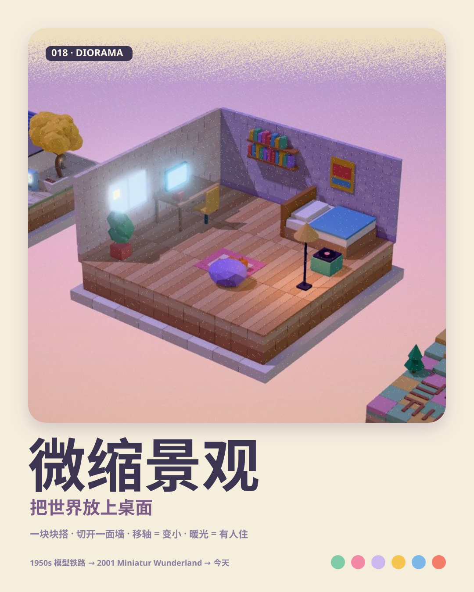
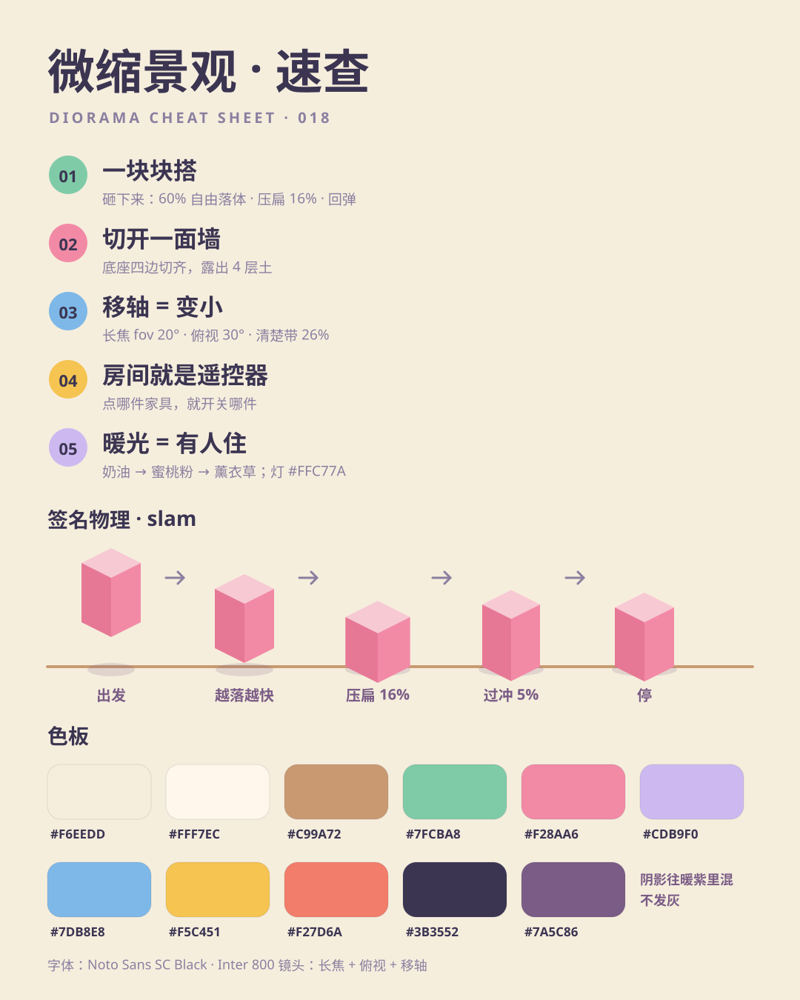
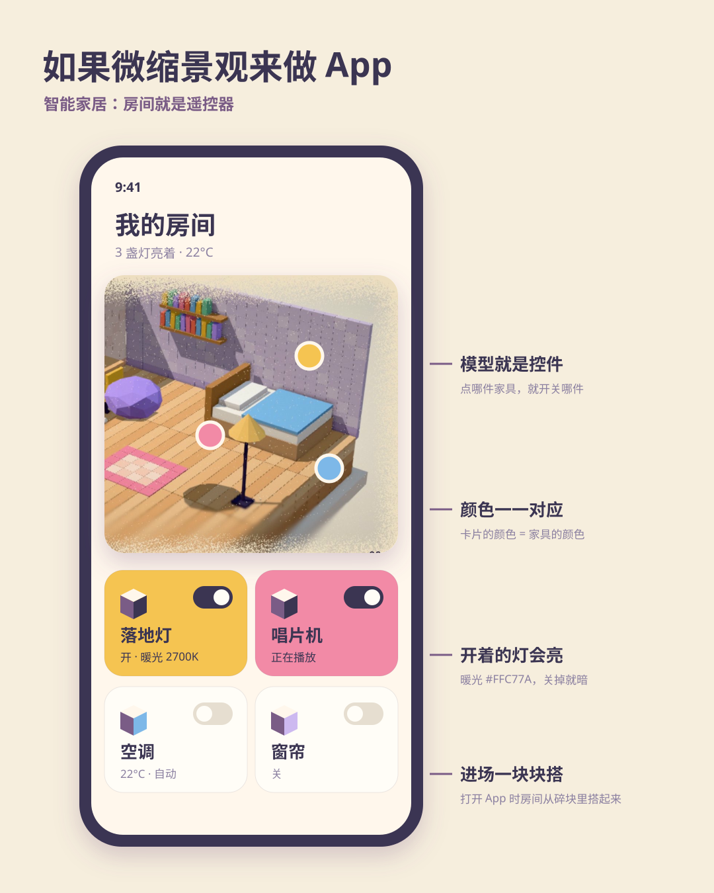
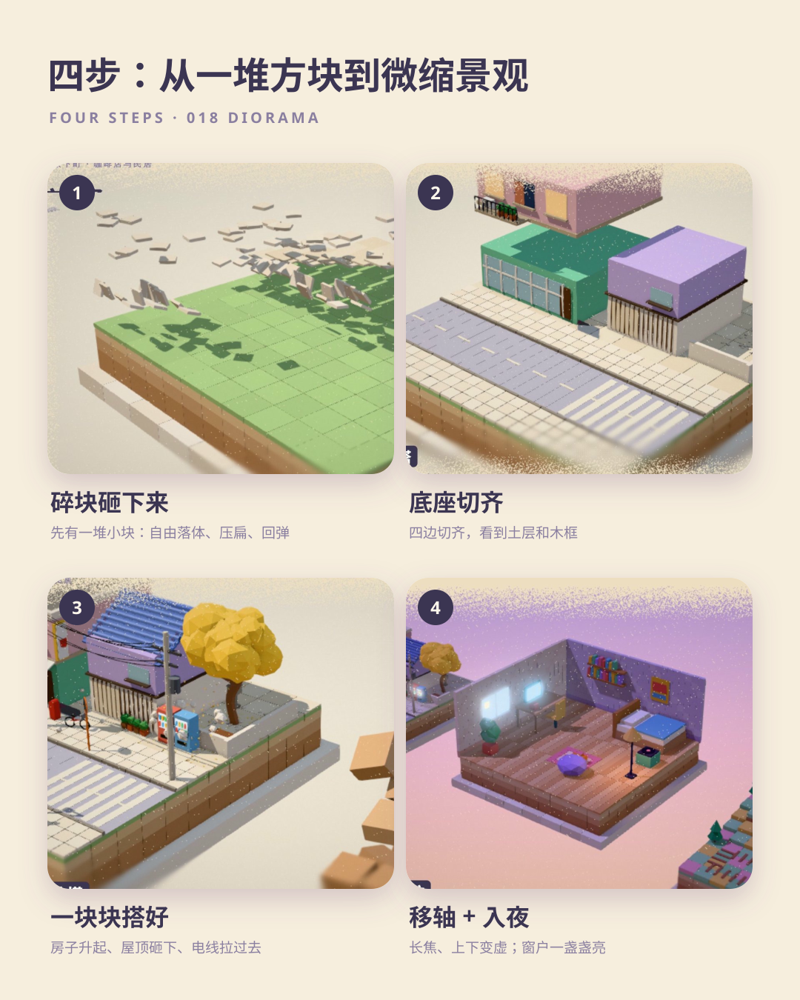

# 018 · Diorama (1950s—today)

[中文](README.md) · **English**

> **In one line:** cut the world into a block on a base, build it piece by piece, then make it small with tilt-shift.

🎬 [Video (Release `day-18`)](https://github.com/guanmo-ai/design-style/releases/tag/day-18) · 🛠 [Process](PROCESS.en.md) · 🎞 [Storyboard](video3d/STORYBOARD.md)

| Poster | Cheat sheet |
|:-:|:-:|
|  |  |
| **If a diorama designed an app** | **Four steps** |
|  |  |

---

## 1 · Where it comes from

| Year | Event |
|---|---|
| **1950s—60s** | Post-war model railways: HO scale (1:87) trains, hills, tunnels and towns on a tabletop board. The "base + cut soil layers + wooden frame" shape comes from here |
| **1970s—80s** | Film effects shoot cities on miniature sets; architects show clients cutaway section models — removing a wall becomes the clearest way to explain a space |
| **2001** | Miniatur Wunderland opens in Hamburg; today it is the largest model railway in the world, with lights that switch on as its day turns to night |
| **2006—2010s** | Tilt-shift photography goes mainstream: real cities shot to look like models — a sharp band in the middle, blur above and below, saturated colour |
| **2010s** | Isometric illustration and games: *Monument Valley* (2014), *Townscaper* (2020), *Mini Motorways* (2021) — a floating island with empty space around it |
| **2020s** | The Blender "isometric room" becomes a 3D rite of passage; miniature city build animations (e.g. @EianLu's Chengdu streets) go viral |
| **Today** | Smart-home apps, maps and gamified product pages use small models: a cutaway house is the remote control |

**Why it matters:** a diorama makes a complex world look cute, controllable and readable at a glance. **Put the world on a table** — a block with square-cut edges and visible soil, a long lens that flattens perspective, tilt-shift blur. People see "model" and lean in for details.

> The street, room and railway were designed for this episode; app devices and data are fictional.

## 2 · Five rules

| # | Rule | How | Watch out |
|:-:|---|---|---|
| 01 | **Build it piece by piece** | Everything is a block that slams down: free fall for 60%, squash 16% on landing, rebound from its base (≈5% overshoot); tiles 22 ms apart, soil layers 0.14 s apart | Fading or scaling a whole object in is not "building"; floors are laid tile by tile too |
| 02 | **Cut away a wall** | Square-cut base showing 4 soil layers (dark to light); the room loses two walls | One flat colour per layer — no mud textures |
| 03 | **Tilt-shift = small** | Long lens (fov 20°), 30° from above; 26% of the frame sharp, linear blur above and below | Too much blur reads as "short-sighted"; keep the sharp band on the subject |
| 04 | **The room is the remote** | In UI, the model is the control: tap furniture to toggle it; cards match model colours | Don't use the model as decoration |
| 05 | **Warm light = someone lives here** | Dusk sky cream → peach → lavender; windows light up one by one in `#FFC77A` | Cold blue nights with white lights read as "office block" |

## 3 · Palette

| Name | HEX | Area | Use |
|---|---|:-:|---|
| Paper | `#F6EEDD` | 35% | Background, paper-speck edge |
| Cream | `#FFF7EC` | 15% | Wooden frame, white walls |
| Soil | `#C99A72` | 10% | Soil layers (`#C99A72` `#DDB48A` `#EED0A6`) |
| Mint | `#7FCBA8` | 10% | Shopfront, grass |
| Pink | `#F28AA6` | 8% | Awning, rug, buttons |
| Lilac | `#CDB9F0` | 8% | House, room walls |
| Sky | `#7DB8E8` | 5% | Water, vending machine |
| Butter | `#F5C451` | 5% | Ginkgo, chair, accents |
| Coral | `#F27D6A` | 2% | Vending machine, cups |
| Ink | `#3B3552` | 2% | Text, wires, phone frame |
| Shade | `#7A5C86` | — | Shadows lean warm purple, never grey |

## 4 · Type

Chinese: **Noto Sans SC** Black · Latin: **Inter** 800. Labels are white on ink rounded pills, like the brass plates next to a model.

## 5 · Parameters

Released film: **1920×1080 · 30 fps · 600 frames · 20 seconds**. `tokens.json` and `process/timeline.json` describe this version; 60 fps is an optional render.

- Camera: long lens, fov 20—24°, about 30° from above; each chapter is the next base on the same table and the camera slides across
- Light: one warm sun (PCF soft shadows) + hemisphere light; GTAO switched on after the base is built; light bloom
- Tilt-shift: sharp band at 56% of frame height, 26% wide, max blur 2.0; snaps on at 8.75 s as a before/after demo
- Signature physics `slam`: free fall 60%, squash 16%, rebound from the base with `easeOutBack(s = 1.2)`; a puff of dust on landing
- Thousands of instanced blocks (tiles, planks, bricks, terrain columns), each with its own start, duration and type (slam / slide / flip / pop)
- Camera "thump": the camera dips and rebounds on each base's first landing

## 6 · Do / Don't

**✅ Do:** square-cut base with soil · slam pieces in · long lens from above · sharp band on the subject · warm-purple shadows · windows light one by one
**❌ Don't:** fade whole objects in · wide-angle perspective · cold grey shadows · over-blur · clutter around the model

## 7 · 20-second storyboard

| Time | Chapter | Picture | Rule |
|---|---|---|---|
| 0:00—4.2 | 01 Street corner | Frame 0: soil chunks tumbling down, camera pulls back; café rises at 0.55 s; frame slides in, tiles slam in waves, asphalt rolls, crosswalk flips; roofs, poles, ginkgo, vending machine, truck | Build it piece by piece |
| 4.2—7.8 | 02 Room cutaway | Floor planks slam, two brick walls stack row by row, furniture drops in, the chair spins down | Cut away a wall |
| 7.8—11.2 | 03 Model railway | Terrain stacks into a hill, lake flips in, trees pop, sleepers drop, the train runs; tilt-shift snaps on at 8.75 s | Tilt-shift = small |
| 11.2—14.2 | 04 On screen | The frame closes into a phone; the street is the app; furniture toggle cards pop up | The room is the remote |
| 14.2—16.4 | 05 Night | Pull back to all three bases; sky turns peach and lavender; windows and street lamps light up | Warm light = someone lives here |
| 16.4—19.0 | Finale | Push into the room's window; title rises with the byline “观默”; the lamp clicks off at 18.6 s | — |
| 19.0—20.0 | Rewind | Tape stop; every piece flies back up; frame 20 s = frame 0 | — |

Music: F major, 120 BPM, synthesised in numpy — marimba and pizzicato groove, piano theme, choir and celesta at night, string tutti for the title.

## 8 · Files & commands

Requires Node.js, Python 3, FFmpeg, Playwright Chromium, the root Python dependencies and fonts, and the local Three.js dependency. `video/cover.jpg` is an identical copy of `video3d/cover.jpg` for gallery previews.

See the file tree and commands in the [Chinese README](README.md#10--文件).
