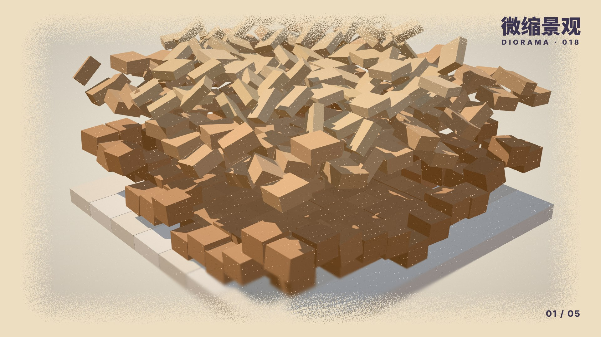

# 018 · 微缩景观 Diorama（1950s—今天）

**中文** · [English](README.en.md)

> **一句话：** 把世界切成一块底座，一块块搭出来，再用移轴把它变小。

🎬 [看视频（Release `day-18-flicker-v2`）](https://github.com/guanmo-ai/design-style/releases/tag/day-18-flicker-v2)· 🛠 [制作过程](PROCESS.md) · 🎞 [分镜](video3d/STORYBOARD.md)

| 海报 | 速查卡 |
|:-:|:-:|
|  |  |
| **如果微缩景观来做 App** | **四步改造** |
|  |  |

---

## 1 · 它从哪来

| 年份 | 事件 |
|---|---|
| **1950—1960 年代** | 战后的模型铁路热：HO 比例（1:87）的小火车、山、隧道、小镇，一整块装在桌子或木板上。“底座 + 切开的地层 + 木框”这个形状从这里来 |
| **1970—1980 年代** | 电影特效用微缩模型拍城市和爆炸；建筑事务所用剖面模型给客户看房子内部——“切开一面墙”成了讲空间最直接的办法 |
| **2001** | 汉堡的 Miniatur Wunderland 开馆，今天是世界最大的模型铁路，每年上百万人去看“小人的一天”：灯会按时间亮起、天会黑 |
| **2006—2010 年代** | 移轴摄影（tilt-shift）流行：把真实城市拍得像模型——上下虚、中间一条清楚的带、颜色调饱和。Olivo Barbieri、Vincent Laforet 的航拍，以及无数延时视频 |
| **2010 年代** | 等距视角（isometric）插画和游戏：《纪念碑谷》（2014）、《Townscaper》（2020）、《Mini Motorways》（2021）。一块悬空的小岛，周围是空的 |
| **2020 年代** | Blender / C4D 里的“小房间”（isometric room）成了 3D 入门作业；小红书、X 上的微缩城市动画（例如 @EianLu 的成都街景）一条条搭出来、天黑亮灯，动辄几十万赞 |
| **今天** | 智能家居 App、地图、游戏化的产品页都在用“小模型”：一间切开的房子就是遥控器，点一下沙发灯就亮 |

**为什么重要：** 微缩景观回答的是“怎么让一个复杂的世界看起来可爱、可控、一眼看完”。它的办法很简单：**把世界放上桌面**——切成一块有底座的模型（四边切齐、能看到地层），用长焦俯视让近大远小几乎消失，再用移轴把上下虚掉。人一看到“模型”，就会想凑近看细节。

> 画面里的街角、房间、铁路都是为这一期重新设计的，不是任何作品的复刻；App 概念图里的设备和数据是虚构的。

## 2 · 五条规则

| # | 规则 | 怎么做 | 小心 |
|:-:|---|---|---|
| 01 | **一块块搭** | 一切都是砸下来的小块：前 60% 自由落体，落地压扁 16% 再以底面为原点回弹（过冲约 5%）；方砖 0.022 秒一块，地层 0.14 秒一层 | 整块淡入、整块缩放出现都不是“搭”；地板也要是一片片铺的，不能“僵在那” |
| 02 | **切开一面墙** | 底座四边切齐，露出 4 层土（由深到浅）；房间拿掉两面墙，看到里面 | 切面别画成泥巴纹理——一层一种颜色就够了 |
| 03 | **移轴 = 变小** | 长焦（fov 20°）+ 俯视 30°；画面高度 26% 清楚，上下按距离线性变虚 | 虚得太多像“近视”；清楚的带要落在主角上 |
| 04 | **房间就是遥控器** | 在界面里，模型就是控件：点哪件家具就开关哪件；卡片和模型颜色一一对应 | 别把模型当装饰图；它要能被点 |
| 05 | **暖光 = 有人住** | 入夜时天色奶油 → 蜜桃粉 → 薰衣草；窗户一盏盏亮，灯是 `#FFC77A` | 别用冷蓝的夜和白色的灯，那是“办公楼” |

## 3 · 色板

| 名称 | HEX | 建议面积 | 用途 |
|---|---|:-:|---|
| 纸 | `#F6EEDD` | 35% | 底色、纸屑边 |
| 奶油 | `#FFF7EC` | 15% | 木框、白墙 |
| 土 | `#C99A72` | 10% | 土层（由深到浅 `#C99A72` `#DDB48A` `#EED0A6`） |
| 薄荷 | `#7FCBA8` | 10% | 店面、草地 |
| 粉 | `#F28AA6` | 8% | 遮阳篷、地毯、按钮 |
| 薰衣草 | `#CDB9F0` | 8% | 民居、房间墙 |
| 天蓝 | `#7DB8E8` | 5% | 水、售货机 |
| 黄油 | `#F5C451` | 5% | 银杏、椅子、点缀 |
| 珊瑚 | `#F27D6A` | 2% | 售货机、杯子 |
| 墨紫 | `#3B3552` | 2% | 文字、电线、手机边框 |
| 影 | `#7A5C86` | — | 阴影往暖紫里混，不发灰 |

> 颜色参考 004 孟菲斯和 @EianLu 的成都街景动画：奶油底、粉薄荷黄的糖果色、暖紫的影子。整体偏暖、偏软，阴影永远不是灰黑。

## 4 · 字体

| 用途 | 本项目 | 其他选择 |
|---|---|---|
| 中文 · 大字 | **思源黑体 / Noto Sans SC** Black（免费，OFL） | 站酷快乐体 · 阿里妈妈方圆体 |
| 拉丁 | **Inter** 800（免费，OFL） | Nunito · Rubik · SF Pro Rounded |

**说明：** 模型本身已经够热闹，字要圆润、粗、短。标签用墨紫底白字的圆角胶囊，像模型旁边的小铭牌。

## 5 · 参数

**已发布视频：1920×1080 · 30fps · 600 帧 · 20 秒 · 120 BPM，three.js 渲染。**

`tokens.json` 与 `process/timeline.json` 记录发布版规格；60fps 可按下方命令另行渲染。
- 镜头：长焦 fov 20—24°，俯视约 30°，每章是桌上同一排底座里的下一块，镜头横移过去
- 光：一盏暖色太阳（PCF 柔影）+ 半球光；GTAO 环境光遮蔽（底座搭好后才打开）；轻微 bloom
- 移轴：清楚带在画面 56% 的高度、宽 26%，最大模糊 2.0；第 3 章 8.75 秒“咔”一下打开做前后对比
- 签名物理 `slam`：前 60% 自由落体，压扁 16%，以底面为原点回弹，`easeOutBack(s = 1.2)` 过冲约 5%；落地扬起一圈小灰
- 小块：用 InstancedMesh 一次画几千块（方砖、木条、砖、地形柱），每块有自己的起点、时长和类型（slam / slide / flip / pop）
- 镜头“咚”：每块底座第一下落地时，镜头往下沉一下再回弹
- 画面：暖紫阴影、纸屑边、5% 颗粒、暗角

**图片（1080×1350 竖图）**
- 背景纸色，模型居中，四边留出 90px；标签用墨紫圆角胶囊

## 6 · 这样做 / 别这样

**✅ 这样做：** 底座四边切齐、看得到土层 · 一块块砸下来 · 长焦俯视 · 移轴的清楚带落在主角上 · 阴影往暖紫里混 · 入夜时窗户一盏盏亮
**❌ 别这样：** 整块淡入 · 广角透视（近大远小太明显就不像模型） · 冷灰阴影 · 移轴虚过头 · 模型周围堆满背景

## 7 · 其他误区

- **微缩景观 ≠ 等距插画。** 等距插画是平行投影、没有景深；微缩景观要有“桌上的模型”的感觉：长焦（几乎平行）+ 移轴 + 底座 + 切面。
- **微缩景观 ≠ 低多边形（见 019）。** 低多边形是“面”，平涂的三角形；微缩景观是“块”，有圆角、有阴影、有材质。
- **不是越精细越好。** 细节要在“凑近才看得到”的地方：窗台的花、桌上的杯子、电线上的鸟。主体轮廓要简单。

## 8 · AI 提示词（直接复制）

**图片（Midjourney / 即梦 / ChatGPT 图像）**

```
Cozy miniature diorama of a Japanese street corner on a square wooden base, cut edges showing 4 layers of soil,
a mint café with a pink awning, a lilac two-storey house, a ginkgo tree, a vending machine, power poles with wires,
a small truck, tiny people, tilt-shift photography, long lens from 30 degrees above, soft warm sunlight,
shadows tinted warm purple, palette cream #F6EEDD, mint #7FCBA8, pink #F28AA6, lilac #CDB9F0, butter #F5C451,
clay-like rounded blocks, clean background --ar 4:5
```

**视频（Runway / 可灵 / Sora）**

```
Miniature diorama build-up animation: hundreds of small blocks slam down from above with a squash and bounce,
floor tiles flip into place wave by wave, a café and a house rise, roofs drop and squash, power lines stretch across,
then the camera glides to the next diorama on the same table: a cutaway bedroom, then a model railway valley with a tiny train;
tilt-shift blur, long lens, warm cream and candy colours; dusk falls, windows light up one by one; 120 bpm, playful and cinematic.
```

**代码（让 AI 写网页 / 组件）**

```
用微缩景观风格做这个页面：背景 #F6EEDD，文字 #3B3552，强调色 #F28AA6 / #7FCBA8 / #F5C451。
three.js：OrthographicCamera 或 fov 20 的长焦，俯视 30°，暖色平行光 + PCF 柔影，阴影色往 #7A5C86 混。
模型放在一块方形底座上，侧面露出 4 层土（#C99A72 → #EED0A6）。进场动画：每个方块从上方落下，
前 60% 自由落体，落地 scaleY 压到 0.84 再以底面为原点回弹（easeOutBack 1.2），方块之间错开 22ms。
后期加移轴（画面中间 26% 清楚，上下线性变虚）。点击家具开关对应的灯。prefers-reduced-motion 时直接显示搭好的模型。
设计令牌见 tokens.json。
```

## 9 · 20 秒分镜

一张桌上排着三块底座：街角、房间、山谷。镜头从一块横移到下一块，每一块都是从一堆砸下来的碎块搭起来的；然后整屏收成一部手机，模型变成 App 的界面；最后拉远，三块底座一起入夜、窗户一盏盏亮，推进房间的窗，台灯一关，所有零件倒着飞回天上，回到第 0 帧。配乐是 F 大调、120 BPM 的电影感配乐：马林巴和拨弦打节奏，钢琴主题，入夜时合唱和钢片琴，片尾弦乐全奏。



| 时间 | 章节 | 画面 | 规则 |
|---|---|---|---|
| 0:00—4.2 | 01 城市街角 | 第 0 帧土块正翻着砸下来，镜头往后一拉；0.55 秒咖啡店升起；木框推进、方砖一波波砸下、柏油推开、斑马线翻下；屋顶砸下压一下；电线杆、银杏、售货机、卡车 | 一块块搭 |
| 4.2—7.8 | 02 房间剖面 | 地板木条砸下，两面砖墙一排排垒高（留窗洞），家具一件件落进来，椅子转着落下 | 切开一面墙 |
| 7.8—11.2 | 03 模型铁路 | 地形一层层垒成小山，湖面翻下，树冒出，枕木一圈落下，小火车开起来；8.75 秒移轴“咔”地打开 | 移轴 = 变小 |
| 11.2—14.2 | 04 落到界面 | 整屏收成一部手机，街角在屏幕里，弹出家具开关卡片 | 房间就是遥控器 |
| 14.2—16.4 | 05 天黑了 | 拉远看到三块底座；天色奶油 → 蜜桃粉 → 薰衣草；窗户、路灯一盏盏亮 | 暖光 = 有人住 |
| 16.4—19.0 | 片尾 | 推进房间的窗，「微缩景观 / DIORAMA · 把世界放上桌面」升起，下方署名「观默」；18.6 秒台灯关掉 | — |
| 19.0—20.0 | 倒放 | 磁带停转，零件倒着飞回天上，回到第 0 帧 | — |

## 10 · 文件

```
018-diorama/
├─ PROCESS.md                    # 制作过程
├─ process/timeline.json         # 时间轴（帧）
├─ tokens.json                   # 设计令牌（颜色、镜头、移轴、物理、节拍）
├─ video3d/
│  ├─ episode.html · episode.js  # 主时间轴：镜头关键帧、章节、文字层、入夜、片尾、倒放
│  ├─ kit.js                     # 搭建工具：K.begin 分组、K.B 方块、K.shards（InstancedMesh 碎块）、slam 物理、灰尘、事件
│  ├─ lib.js                     # 渲染器、后期（GTAO、bloom、移轴、调色 + 纸屑边）
│  ├─ scenes/street.js           # 01 城市街角
│  ├─ scenes/room.js             # 02 房间剖面
│  ├─ scenes/valley.js           # 03 模型铁路
│  ├─ render.cjs                 # 逐帧渲染（Playwright + Chromium），同时导出 events.json 给配乐对齐
│  ├─ STORYBOARD.md              # 分镜
│  └─ cover.jpg                  # 封面（第 0 帧）
├─ audio/make_music.py           # 配乐：numpy 合成，F 大调 120 BPM，音效按 events.json 对齐，−14 LUFS
├─ video/cover.jpg              # 与 video3d/cover.jpg 字节一致，供画廊与 README 预览使用
└─ images/
   ├─ make_svgs.py               # 四张图的生成脚本（内嵌渲染帧）
   └─ preview/                   # poster / cheatsheet / app-ui / steps
```

**环境：** Node.js、Python 3、FFmpeg；先在项目根目录准备依赖、Chromium 与字体（字体采用开源许可证，来源见 `scripts/fetch_fonts.sh`）：

```bash
npm ci
npx playwright install chromium
python3 -m pip install -r requirements.txt
npm run fonts
```

**渲染命令（从项目根目录开始）：**
```bash
cd styles/018-diorama/video3d && npm i                      # 装 three 0.170
PR=1 node render.cjs episode.html out 0 599 1920 1080 30    # 30fps 正片（默认 SwiftShader）
ANGLE_BACKEND=metal PR=1 node render.cjs episode.html out 0 599 1920 1080 30  # Mac GPU，同一画幅与时间轴
node --test geometry.test.mjs                            # 屋面深度与重复电线回归检查
PR=1 node render.cjs episode.html out 0 1199 1920 1080 60   # 60fps（建议用有显卡的机器）
python3 ../audio/make_music.py out/events.json out/music.wav
ffmpeg -framerate 30 -i out/f%04d.png -i out/music.wav -c:v libx264 -crf 16 -pix_fmt yuv420p -c:a aac -b:a 256k -shortest 018.mp4
```

**延伸阅读：** Miniatur Wunderland 官网的“建造日记” · Olivo Barbieri《site specific_》系列 · Vincent Laforet《Tilt-Shift》航拍 · Oskar Stålberg 谈《Townscaper》的程序生成（GDC 2020）
