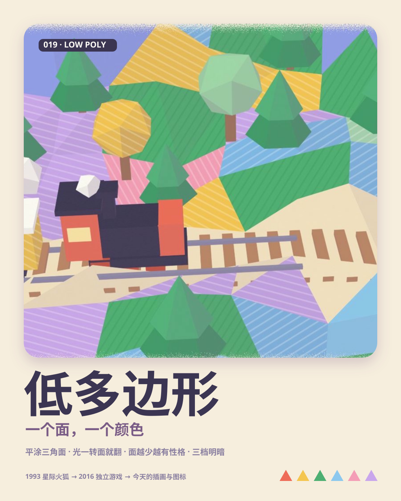
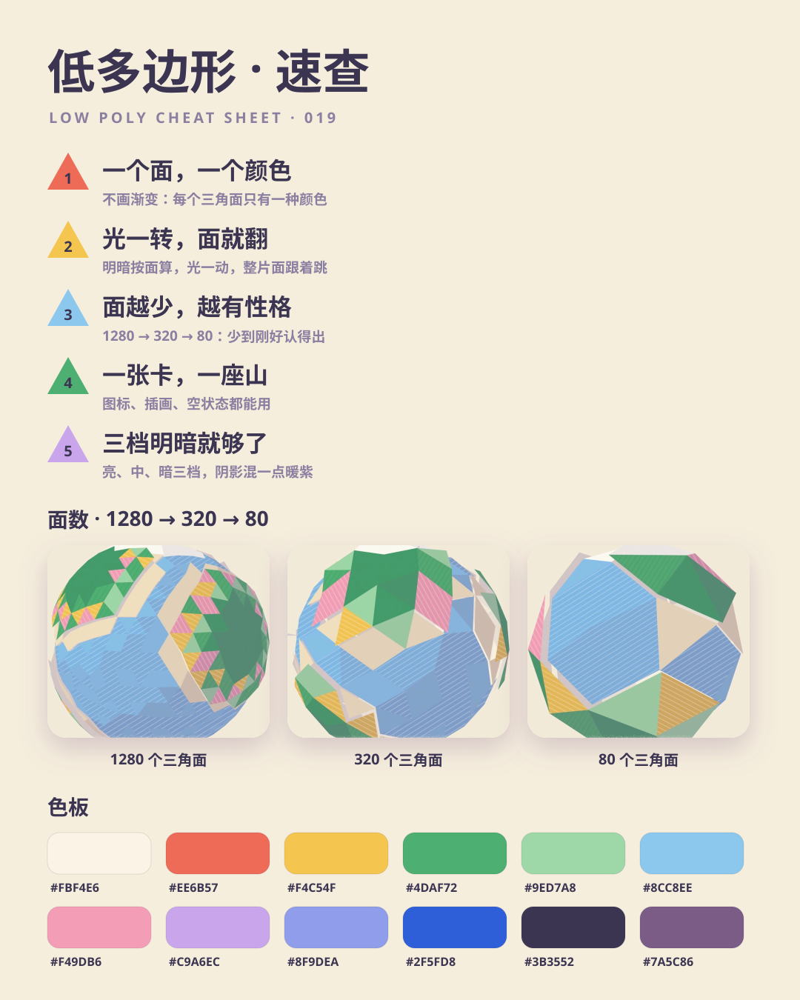
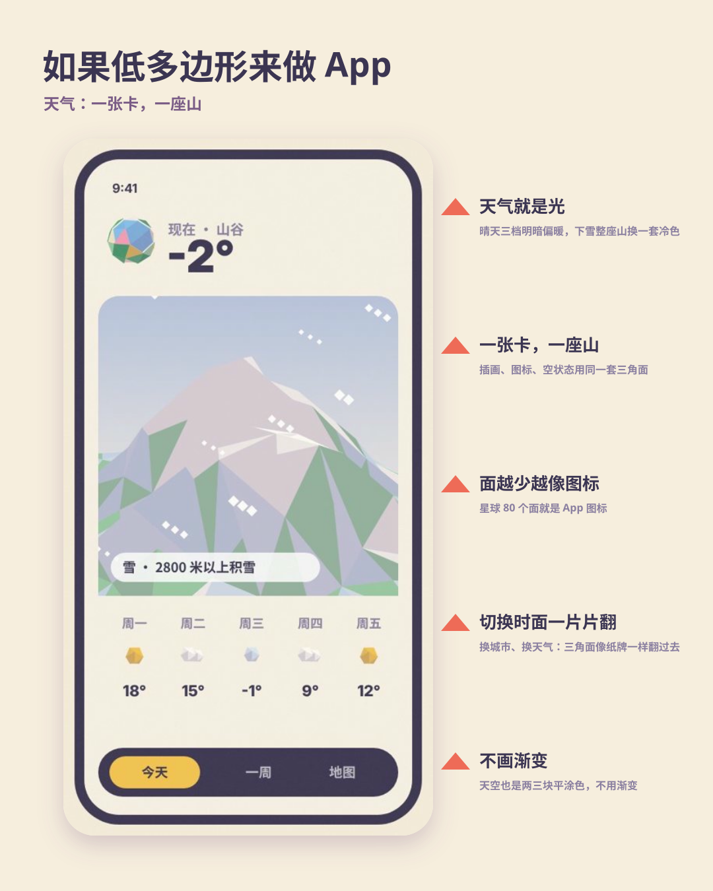
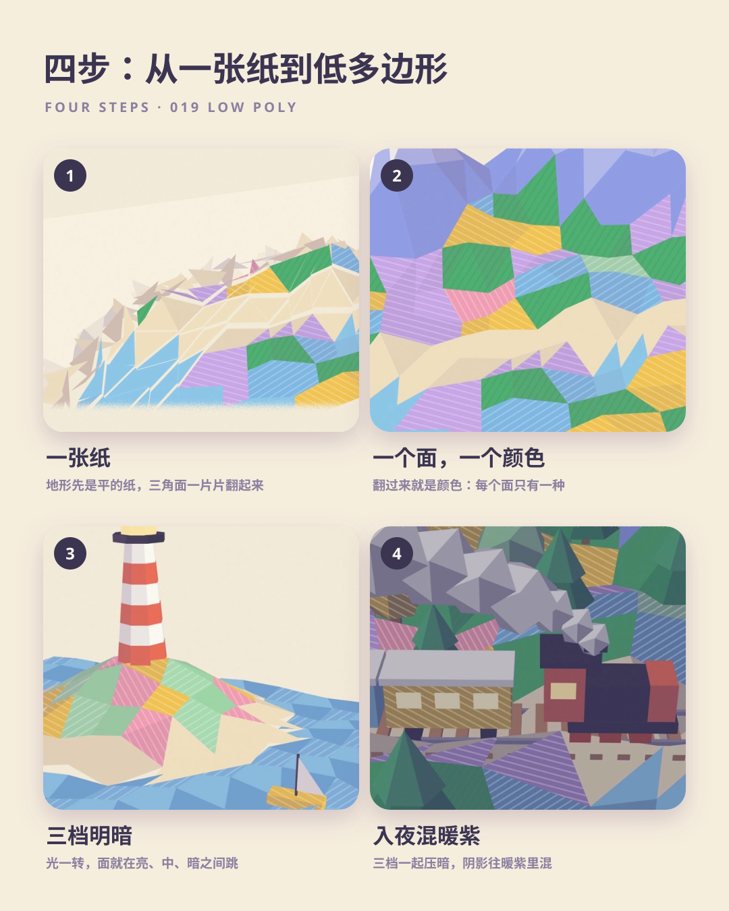

# 019 · Low Poly (1993—today)

[中文](README.md) · **English**

> **In one line:** one face, one colour.

🎬 [Watch the film](https://github.com/guanmo-ai/design-style/releases/tag/day-19) · 🛠 [Process](PROCESS.en.md) · 🎞 [Storyboard](video/STORYBOARD.md)

| Poster | Cheat sheet |
|:-:|:-:|
|  |  |
| **If low poly designed an app** | **Four steps** |
|  |  |

---

## 1 · Where it comes from

| Year | Event |
|---|---|
| **1993** | Nintendo's *Star Fox* draws real-time polygons with the Super FX chip — planes, hills and towers made of a few dozen flat faces. Low poly began as a hardware limit |
| **1996—1999** | *Super Mario 64*, *Tomb Raider*, *Final Fantasy VII*: a character is a few hundred faces |
| **2000s** | Games chase realism; low poly looks dated |
| **2010s** | Indie games and illustrators bring it back as a style: *Monument Valley* (2014), *Superhot* (2016), *Alto's Adventure*; low poly illustration spreads on Dribbble and Behance |
| **2020s** | A favourite Blender beginner project; app icons, empty states, 3D illustration and casual games, now warmer and cuter |

**Why it matters:** low poly turns 3D into something graphic design can control — **every face has one colour, and there are only three shades**. It keeps depth, stays as clean as paper cut-outs, and can drop to so few faces that it still reads as an icon.

## 2 · Five rules

| # | Rule | How | Watch out |
|:-:|---|---|---|
| 01 | **One face, one colour** | Each triangle is one flat colour; neighbours differ by a shade | Gradients or smooth shading make it ordinary 3D |
| 02 | **Turn the light, faces flip** | Shade by face normal: when the light moves, whole faces jump | Don't light per pixel; the jump is the animation |
| 03 | **Fewer faces, more character** | 1280 → 320 → 80: just enough to recognise | Too many looks realistic; too few is unreadable |
| 04 | **One card, one mountain** | Illustrations, icons and empty states share the same faces | Don't cram a whole world into one card |
| 05 | **Three shades are enough** | Light, mid, dark; dark faces mix toward warm purple `#7A5C86` | Five or more starts to look like a gradient |

## 3 · Palette

Paper `#FBF4E6` · background `#F6EEDD` · green `#4DAF72` · light green `#9ED7A8` · yellow `#F4C54F` · sky `#8CC8EE` · pink `#F49DB6` · lilac `#C9A6EC` · periwinkle `#8F9DEA` · red `#EE6B57` · blue `#2F5FD8` · ink `#3B3552` · shade `#7A5C86`.

## 4 · Parameters

- A small SVG renderer (`poly3d.py`): projection, painter's sort, back-face culling, three flat shading bands mixed toward warm purple
- Card flip: each triangle turns 180° on one edge in 0.5 s, paper on the back, ≈5% overshoot; the ending reverses it far-to-near
- Chapter 2 reverses the move: coloured triangles slam down from the sky, back rows first
- Planet: icosphere subdivided 3 / 2 / 1 times = 1280 / 320 / 80 faces, reductions on eighth notes
- Music: D major future bass at 120 BPM with bar lines starting at 0.5 s (a pickup) so the 4.5 s drop lands on a downbeat; supersaw chords with sidechain pumping, sub plus mid bass (audible on phone speakers), plucks, bells, formant "vocal chops", electronic drums. Both face reductions bit-crush the whole mix; the ending resolves to the tonic for the first time and stops — no loop. −14 LUFS.

## 5 · 20-second storyboard

| Time | Chapter | Picture | Rule |
|---|---|---|---|
| 0:00—4.5 | 01 Valley & train | Triangles flip up from paper into a valley; trees pop; the train arrives; steam covers the lens | One face, one colour |
| 4.5—8.0 | 02 Lighthouse | Drop: triangles slam down from the sky; the lighthouse springs up; the sun circles and faces jump | Turn the light, faces flip |
| 8.0—11.6 | 03 Planet | Faces fly in to form a planet; 1280 → 320 → 80; shrinks into an icon | Fewer faces, more character |
| 11.6—15.0 | 04 On screen | Weather app: a mountain in a card turns snowy | One card, one mountain |
| 15.0—17.4 | 05 Night | All three shades darken; train windows glow; three swatches pop up | Three shades are enough |
| 17.4—20.0 | Finale | The valley flips back into paper; the title rises on the tonic chord; the author's byline | — |

See the file tree and commands in the [Chinese README](README.md#10--文件).
