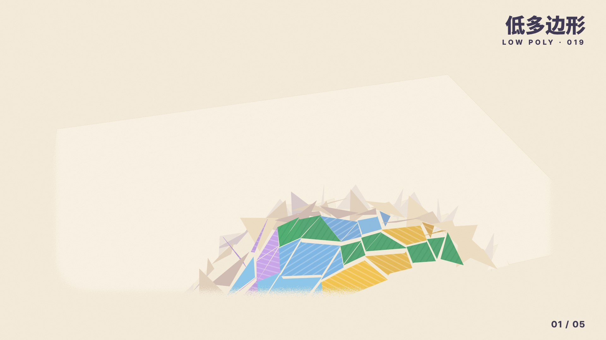

# 019 · 低多边形 Low Poly（1993—今天）

**中文** · [English](README.en.md)

> **一句话：** 一个面，一个颜色。

🎬 看视频（Release `day-19`，成片审过后发布）· 🛠 [制作过程](PROCESS.md) · 🎞 [分镜](video/STORYBOARD.md)

| 海报 | 速查卡 |
|:-:|:-:|
|  |  |
| **如果低多边形来做 App** | **四步改造** |
|  |  |

---

## 1 · 它从哪来

| 年份 | 事件 |
|---|---|
| **1993** | 任天堂《星际火狐》用 Super FX 芯片在家用机上实时画多边形：飞机、山、楼都是几十个平涂的面。“低多边形”最早是硬件不够时的不得已 |
| **1996—1999** | 《超级马力欧 64》《古墓丽影》《最终幻想 VII》：一个角色几百个面，棱角就是那个年代的样子 |
| **2000 年代** | 显卡越来越强，游戏追求写实，低多边形一度被当成“过时” |
| **2010 年代** | 独立游戏和插画把它捡回来，当成一种风格而不是限制：《Monument Valley》（2014）、《Superhot》（2016）、《Firewatch》的平涂色块、《Alto's Adventure》；Timothy Reynolds 等人的低多边形插画在 Dribbble、Behance 上流行 |
| **2013—2016** | “三角形背景”生成器、低多边形人像海报、品牌插画大量出现 |
| **2020 年代** | Blender 教程里最受欢迎的入门作品之一；App 图标、空状态、3D 插画和小游戏里随处可见，配合暖色和柔和阴影，变得更“可爱” |

**为什么重要：** 低多边形把“3D”简化成了平面设计能控制的东西——**每个面只有一种颜色，明暗只有三档**。它保留了立体感，又像剪纸一样干净，而且面数可以按需要减到很少，小到图标也认得出。

> 画面里的山谷、灯塔、星球、天气 App 都是为这一期设计的；App 里的城市和温度是虚构的。

## 2 · 五条规则

| # | 规则 | 怎么做 | 小心 |
|:-:|---|---|---|
| 01 | **一个面，一个颜色** | 每个三角面平涂一种颜色，不画渐变；邻接的面颜色差一档 | 加了渐变或光滑着色就变成普通 3D 了 |
| 02 | **光一转，面就翻** | 明暗按面的朝向算：光一动，整片面同时跳亮跳暗 | 别逐像素打光；跳的那一下就是这种风格的动画 |
| 03 | **面越少，越有性格** | 1280 → 320 → 80：减到刚好认得出 | 面太多就像写实模型；太少认不出是什么 |
| 04 | **一张卡，一座山** | 插画、图标、空状态用同一套三角面；卡片里放一座小山就够了 | 别在一张卡里塞整个世界 |
| 05 | **三档明暗就够了** | 亮、中、暗三档；暗面往暖紫 `#7A5C86` 里混，不发灰 | 五档以上就开始像渐变 |

## 3 · 色板

| 名称 | HEX | 建议面积 | 用途 |
|---|---|:-:|---|
| 纸 | `#FBF4E6` | 30% | 纸、三角面的背面 |
| 底 | `#F6EEDD` | — | 底色 |
| 绿 | `#4DAF72` | 15% | 山、松树 |
| 浅绿 | `#9ED7A8` | 10% | 草地 |
| 黄 | `#F4C54F` | 10% | 田、树冠、按钮 |
| 天蓝 | `#8CC8EE` | 8% | 湖、天 |
| 粉 | `#F49DB6` | 6% | 田垄、花 |
| 淡紫 | `#C9A6EC` | 6% | 远山 |
| 长春花 | `#8F9DEA` | 5% | 山顶、阴面 |
| 红 | `#EE6B57` | 4% | 火车、灯塔、强调 |
| 蓝 | `#2F5FD8` | 2% | 点缀 |
| 墨紫 | `#3B3552` | 4% | 文字、火车头 |
| 影 | `#7A5C86` | — | 暗面往这里混 |

> 面上叠一层细斜纹（田垄），只给少数几种颜色，用来区分“地”和“山”。

## 4 · 字体

中文 **思源黑体 / Noto Sans SC** Black · 拉丁 **Inter** 800。规则卡是墨紫底白字的圆角条；片名居中、按行从遮罩里升起。

## 5 · 参数

**视频（1920×1080，60fps，120 BPM，纯 SVG 逐帧渲染）**
- 自己写的小渲染器 `poly3d.py`：三角面投影、画家算法排序、背面剔除，每个面按法线和光算出三档明暗，再往暖紫里混
- 翻牌：以一条边为铰链翻 180°，0.5 秒，背面是纸，过冲约 5%；第 1 章由近到远，结尾反过来由远到近翻回纸
- 第 2 章：三角面从天上砸下来，由远到近一排排落
- 星球：二十面体细分 3 / 2 / 1 次 = 1280 / 320 / 80 个面，减面落在八分音符上
- 纸云盖屏换章；纸屑边、颗粒

**配乐：** D 大调电子 future bass，120 BPM，小节线从 0.5 秒开始（开头半拍弱起），让 4.5 秒的 drop 落在强拍上。超锯齿和弦 + 侧链抽吸、亚低音 + 中低音（手机喇叭也听得到）、拨弦、钟琴、人声切片（共振峰合成）、电子鼓。两次减面时整条音乐跟着降采样；结尾第一次回到主和弦 D，自然收掉，不循环。−14 LUFS。

## 6 · 这样做 / 别这样

**✅ 这样做：** 每个面一种颜色 · 三档明暗 · 暗面混暖紫 · 面数减到刚好认得出 · 光动起来让面跳 · 翻牌出场
**❌ 别这样：** 渐变和光滑着色 · 冷灰阴影 · 面太多 · 面与面颜色一样（看不出棱） · 淡入

## 7 · 其他误区

- **低多边形 ≠ 微缩景观（见 018）。** 微缩景观是“块”，有圆角、阴影和材质，靠移轴变小；低多边形是“面”，平涂、没有材质。
- **低多边形 ≠ 三角形图案背景。** 只是把图片切成三角形不算，要有立体和光——面的明暗要跟着朝向走。
- **面少不等于粗糙。** 好的低多边形每一条棱都放在形状转折的地方。

## 8 · AI 提示词（直接复制）

**图片**

```
Low poly 3D illustration of a valley with a tiny steam train, pine trees, fields and a lake, every triangle a single flat colour,
three shading bands only, shadows tinted warm purple #7A5C86, palette paper #FBF4E6, green #4DAF72, yellow #F4C54F,
sky #8CC8EE, pink #F49DB6, lilac #C9A6EC, red #EE6B57, faint diagonal stripes on fields, no gradients, no textures,
soft daylight from the left, clean cream background --ar 4:5
```

**视频**

```
Low poly motion graphics: triangles flip up from a flat sheet of paper like cards, paper on the back, colour on the front,
building a valley with a little train; then coloured triangles slam down from the sky to build a lighthouse island while the sun
circles and every facet jumps between three shades; a planet assembles from flying triangles and drops from 1280 to 320 to 80 faces;
a weather app card with a low poly mountain turning snowy; night falls; the valley flips back into paper; upbeat 120 bpm future bass.
```

**代码**

```
用低多边形风格做这个界面：背景 #F6EEDD，文字 #3B3552。插画用 three.js：MeshLambertMaterial({flatShading: true})，
或者自己按面法线算三档明暗（亮 / 中 / 暗，暗面往 #7A5C86 混 26%）。不用渐变和贴图。
入场：每个三角面以一条边为铰链翻 180°（背面是纸色 #FBF4E6），0.5 秒、easeOutBack(1.2)，按到镜头的距离错开。
图标用 80 个面的二十面体细分球。prefers-reduced-motion 时直接显示结果。设计令牌见 tokens.json。
```

## 9 · 20 秒分镜



| 时间 | 章节 | 画面 | 规则 |
|---|---|---|---|
| 0:00—4.5 | 01 山谷与小火车 | 纸上的三角形一片片翻起来拼成山谷；树冒出来；火车开进来；蒸汽盖满镜头 | 一个面，一个颜色 |
| 4.5—8.0 | 02 海边灯塔 | drop：三角面从天上砸下来；灯塔弹上去；太阳绕一圈，面在三档明暗间跳 | 光一转，面就翻 |
| 8.0—11.6 | 03 小星球 | 面飞回来拼成星球；1280 → 320 → 80；缩成图标 | 面越少，越有性格 |
| 11.6—15.0 | 04 落到界面 | 天气 App：卡片里一座小山，晴 → 下雪 | 一张卡，一座山 |
| 15.0—17.4 | 05 夜里的山谷 | 三档一起压暗，车窗亮着，弹出三档颜色 | 三档明暗就够了 |
| 17.4—20.0 | 片尾 | 山谷翻回一张纸；片名升起，落在主和弦上；署名「观默」 | — |

## 10 · 文件

```
019-low-poly/
├─ PROCESS.md                     # 制作过程
├─ process/timeline.json          # 时间轴（帧）
├─ tokens.json                    # 设计令牌（颜色、三档明暗、面数、翻牌、节拍）
├─ video/
│  ├─ poly3d.py                   # 小渲染器：相机、三角面、排序、三档平涂、背面剔除 → SVG
│  ├─ common.py                   # 调色、缓动、翻牌 unfold、砸下 slam_tris、纸云、SVG defs
│  ├─ ch1_valley.py … ch4_app.py  # 四章（第 5 章和片尾复用第 1 章的山谷）
│  ├─ episode.py                  # 主时间轴：章节、文字层、夜、片尾
│  ├─ render.cjs                  # SVG → PNG（Playwright + Chromium）
│  ├─ STORYBOARD.md · cover.jpg
├─ audio/make_music.py            # 配乐：numpy 合成，D 大调 future bass，−14 LUFS
└─ images/make_svgs.py · preview/ # 四张图
```

**命令：**
```
cd styles/019-low-poly/video
python3 episode.py out 60 && node render.cjs out           # 60fps 正片（纯 SVG，云端 4 进程约 40 分钟）
python3 ../audio/make_music.py out/music.wav
ffmpeg -framerate 60 -i out/f%04d.png -i out/music.wav -c:v libx264 -crf 16 -pix_fmt yuv420p -c:a aac -b:a 256k -shortest 019.mp4
```

**延伸阅读：** Timothy J. Reynolds 的低多边形插画 · ustwo《Monument Valley》美术访谈 · Blender 官方手册 “Flat Shading” · 《星际火狐》Super FX 芯片的开发回顾
