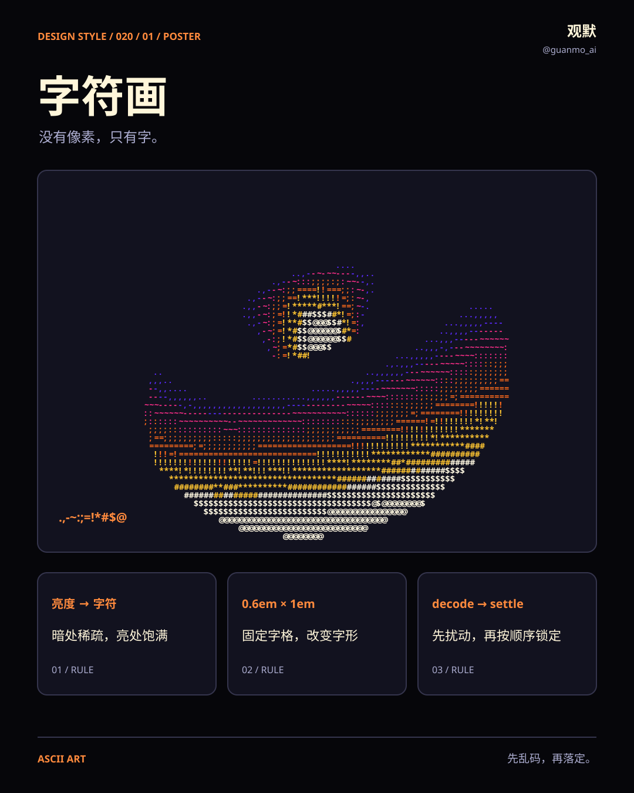
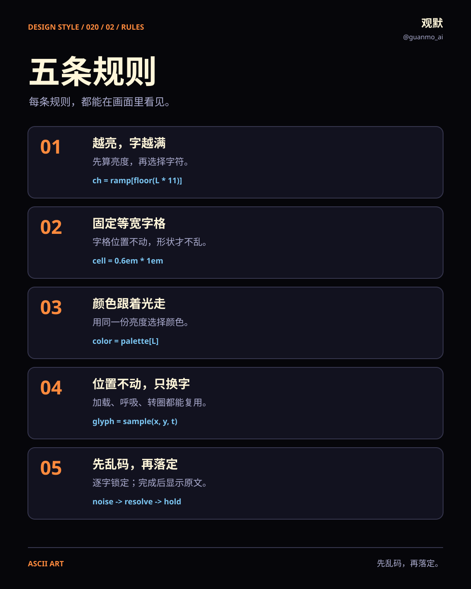
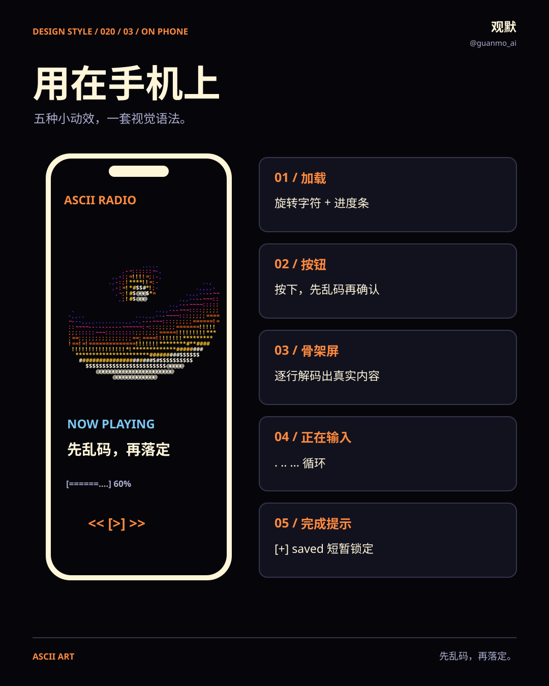
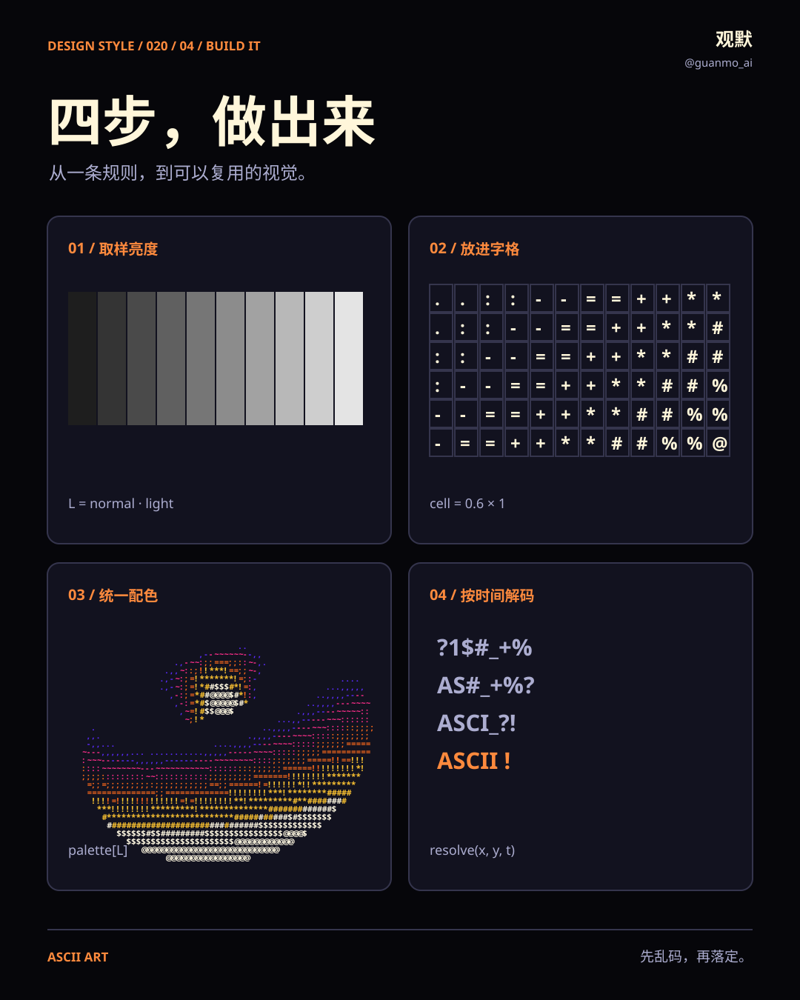

# 020 · 字符画 ASCII Art

**没有像素，只有字。** Donut、数字雨、网页大字、手机播放器与字符火焰依次接力，再用五条规则和五个手机界面演示可复用的动作。

[在线观看](https://guanmo-ai.github.io/design-style/#work-020-ascii-art) · [成片与完整源码](https://github.com/guanmo-ai/design-style/releases/tag/day-20) · [制作过程](PROCESS.md) · [English](README.en.md)

## 这期的视觉语法

先乱码，再落定。 全片保留固定的章节外框，让主角在同一张画面里散开、重排、缩小或生长。120 BPM 的同一首配乐贯穿 18 秒，换章靠和弦和旋律变化衔接。

## 五条规则

1. 越亮，换越满的字：亮度映射到 `.,-~:;=!*#$@`。
2. 字格固定为 `0.6em × 1em`，用等宽字体对齐。
3. 字符与颜色共享亮度输入，保持光感一致。
4. 转圈、呼吸和进度条可以只换字符、保留位置。
5. 乱码只是过渡；逐字锁定后显示完整文字。

## 放进手机界面

- 加载：甜甜圈与字符进度条。
- 按钮：按下后乱码，再落定到结果。
- 骨架屏：一行行解码。
- 输入中：`. .. ...` 循环。
- 完成：短促弹入的 `[+] saved`。

片中的界面是视觉与动效示范。复用时要把最终文字、操作结果、加载进度与实际业务状态连接，并提供减少动态效果的版本。

## 四张可编辑图解

海报、速查卡、手机应用与四步教程都由代码输出为 SVG。`images/*.svg` 保留可编辑文字与路径；`images/preview/*.svg` 嵌入字体子集，`images/png/` 为 2 倍尺寸图片。

## 参数与复用

| 参数 | 本期取值 |
|---|---|
| 正片 | 1920 × 1080 · 60fps · 1080 帧 · 18 秒 |
| 节拍 | 120 BPM · 每拍 30 帧 |
| 画面 | Canvas 2D · `video/film.html` |
| 时间 | `video/timeline.js` → 配乐与动效共用 |
| 颜色与字体 | [tokens.json](tokens.json) |
| 生成脚本 | `images/make_svgs.py` |

复现与依赖见[制作过程](PROCESS.md)，第三方来源与字体许可见 [SOURCES.md](SOURCES.md)。作者：观默 [@guanmo_ai](https://x.com/guanmo_ai)。
