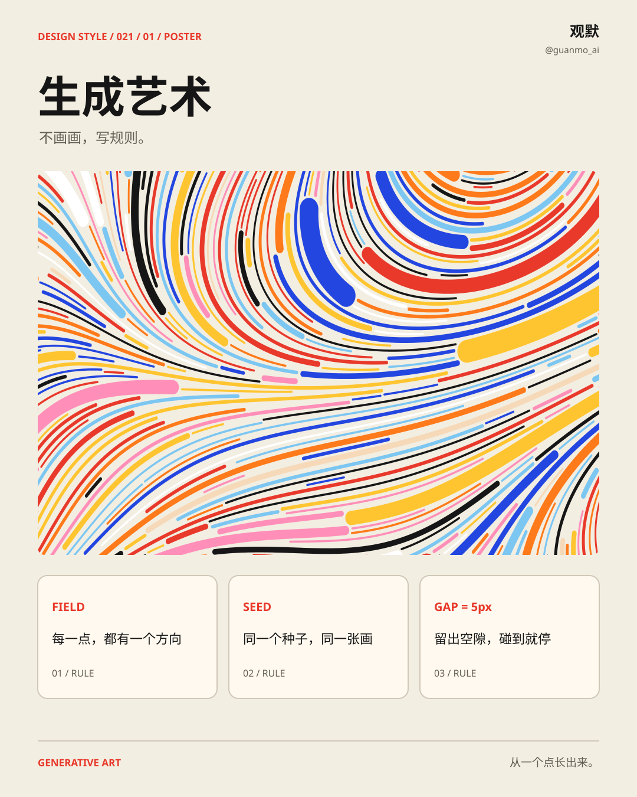
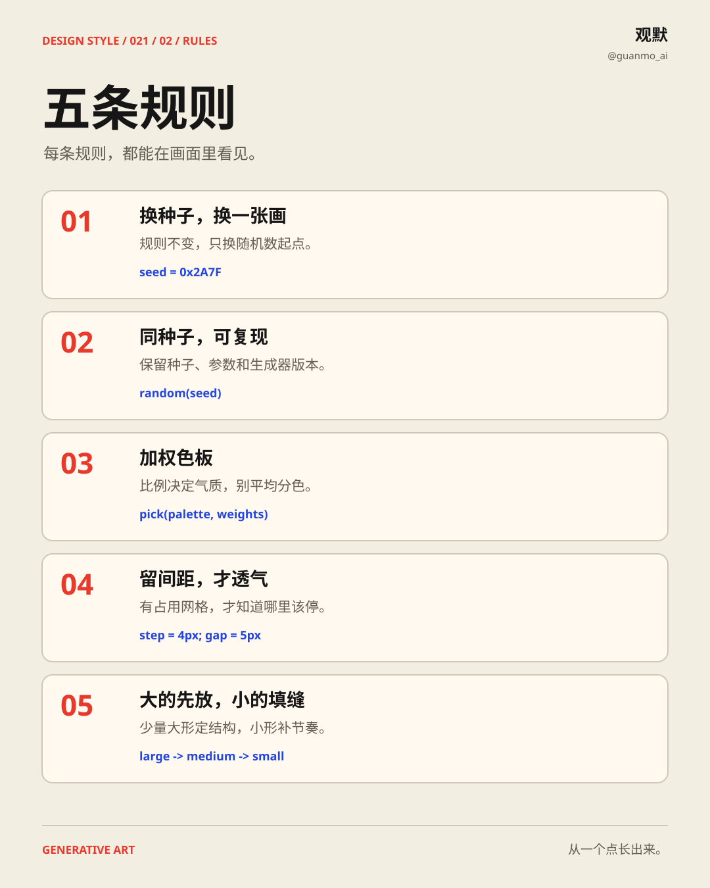
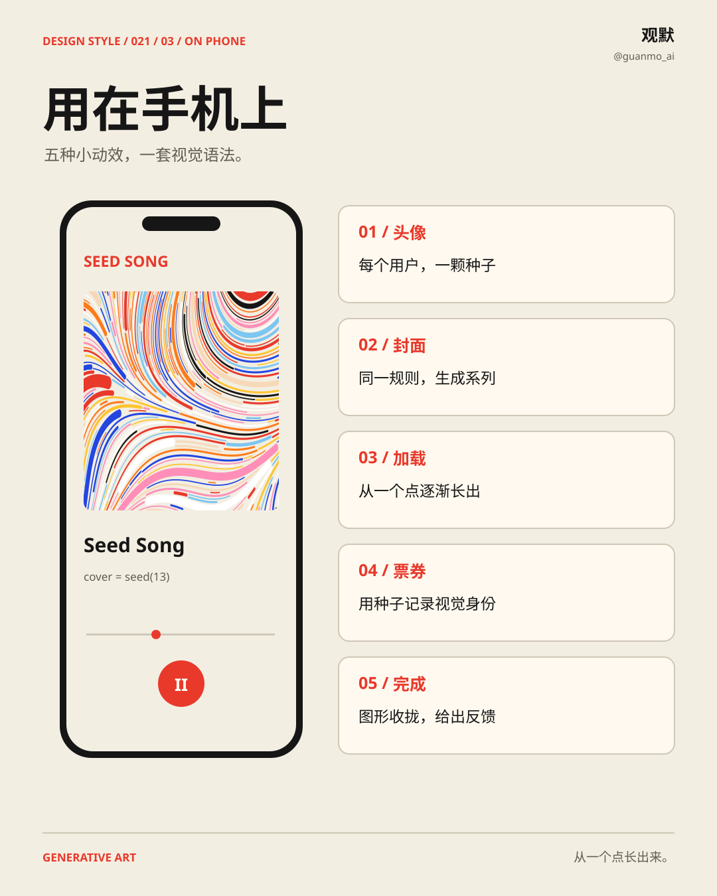
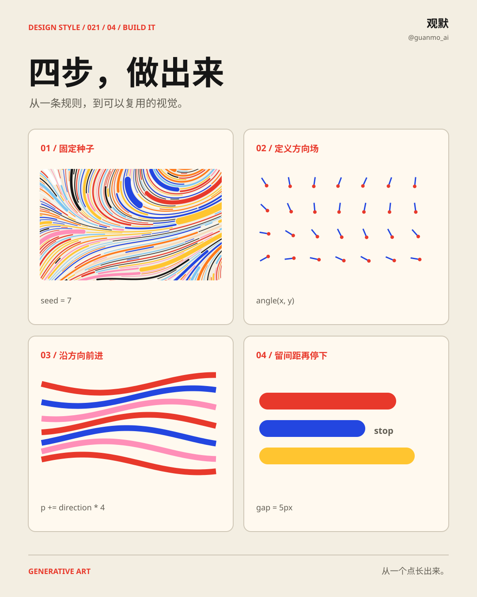

# 021 · 生成艺术 Generative Art

**不画画，写规则。** 流场色带、受控随机方块、特鲁谢瓷砖、网页生成器与分叉树依次接力，再把种子、色板、间距和生长动作放进手机。

[在线观看](https://guanmo-ai.github.io/design-style/#work-021-generative-art) · [成片与完整源码](https://github.com/guanmo-ai/design-style/releases/tag/day-21) · [制作过程](PROCESS.md) · [English](README.en.md)

## 这期的视觉语法

从一个点长出来。 全片保留固定的章节外框，让主角在同一张画面里散开、重排、缩小或生长。120 BPM 的同一首配乐贯穿 18 秒，换章靠和弦和旋律变化衔接。

## 五条规则

1. 换种子、保留规则，就能得到同系列的另一张画。
2. 同种子只有在相同算法、版本和参数下才得到同一结果。
3. 按权重选色，大色块先确定画面比例。
4. 沿方向场每次走 4px，碰撞由 4px 占用网格判断，间距为 5px。
5. 先放大的，再用小的填缝，保持层次。

## 放进手机界面

- 头像：由用户对应的种子生成。
- 封面：同规则的系列图形。
- 加载：从一点长出轨迹。
- 票券：用种子对应一张图案。
- 完成：聚拢图形，给出状态反馈。

片中的界面是视觉与动效示范。复用时要把最终文字、操作结果、加载进度与实际业务状态连接，并提供减少动态效果的版本。

## 四张可编辑图解

海报、速查卡、手机应用与四步教程都由代码输出为 SVG。`images/*.svg` 保留可编辑文字与路径；`images/preview/*.svg` 嵌入字体子集，`images/png/` 为 2 倍尺寸图片。

## 参数与复用

| 参数 | 本期取值 |
|---|---|
| 正片 | 1920 × 1080 · 60fps · 1080 帧 · 18 秒 |
| 节拍 | 120 BPM · 每拍 30 帧 |
| 画面 | Canvas 2D · `video/film.html` |
| 时间 | `video/timeline.js` → 配乐与动效共用 |
| 颜色与字体 | [tokens.json](tokens.json) |
| 生成脚本 | `images/make_svgs.py` |

复现与依赖见[制作过程](PROCESS.md)，第三方来源与字体许可见 [SOURCES.md](SOURCES.md)。作者：观默 [@guanmo_ai](https://x.com/guanmo_ai)。
