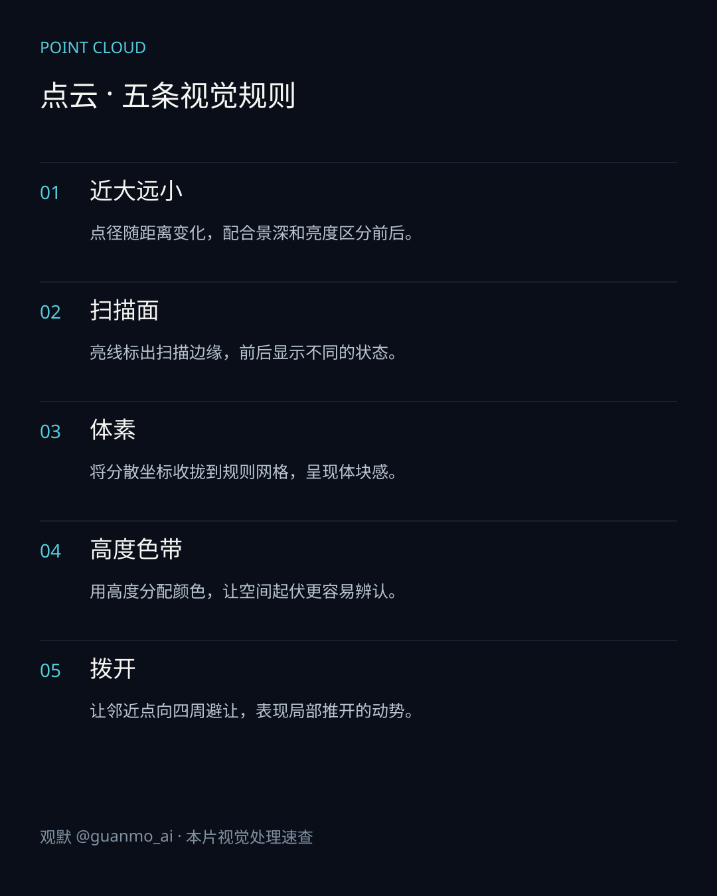
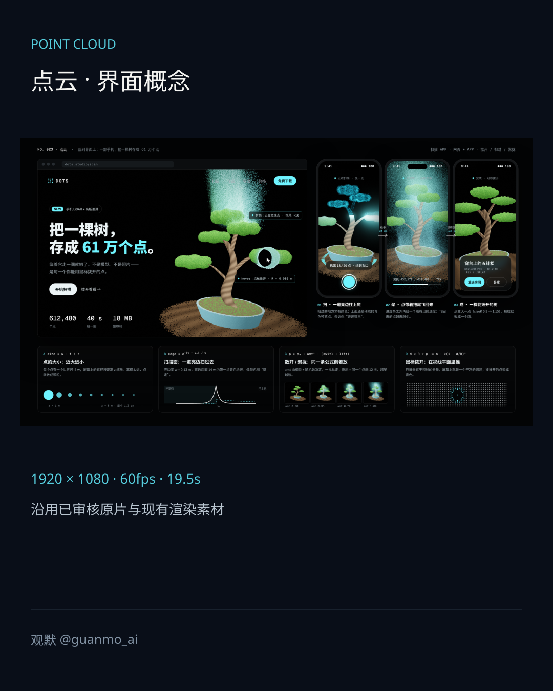
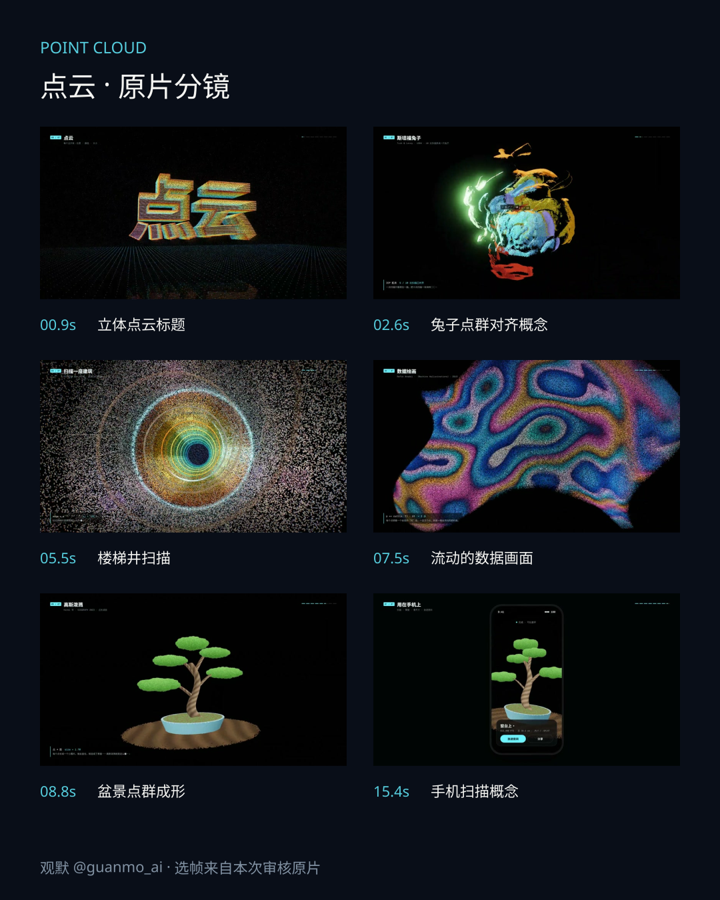

# 022 · Point Cloud

800,000 points form lettering, a bunny, streets and a bonsai in a 19.5-second study of scanning and interface states.

## Visual study

The four sheets cover the existing key visual, five visual rules, the interface concept and six frames from the approved film. The original media retains Chinese labels. This is a concise English guide, not a translation of the artwork.

## Implementation

Native WebGL2/GLSL renders the frames; Python/NumPy synthesizes music and sound effects. The bunny uses samples from a Stanford Bunny mesh. Alignment, scanning, surface formation and phone measurements are preset visual concepts, not field scans, an ICP solver or trained 3D Gaussian Splatting.

1920×1080, 60fps, 19.5 seconds. Playback frame rate is not a real-time rendering benchmark.

[Production](PROCESS.en.md) · [Source entry](video/README.md)
