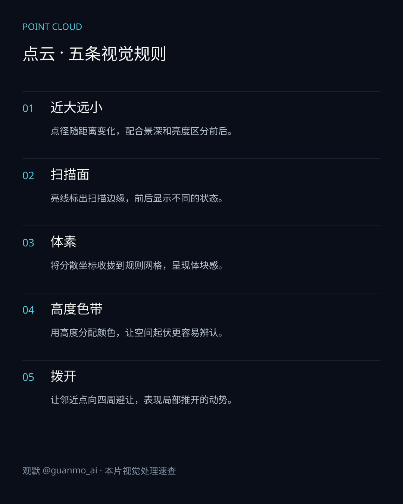
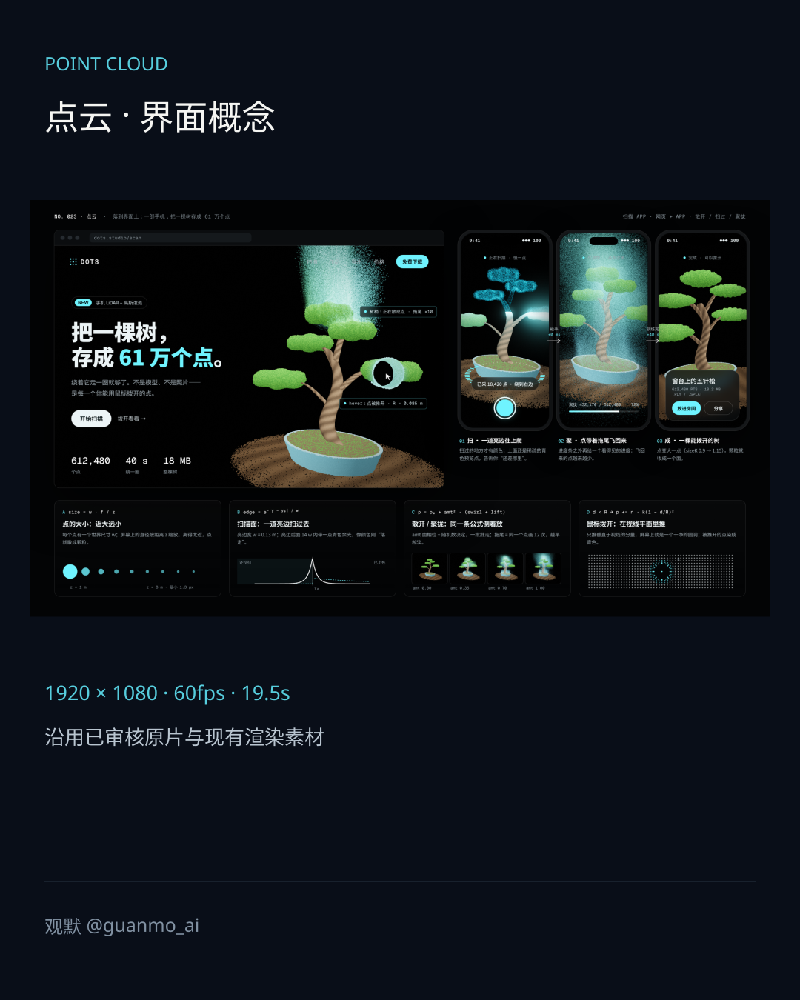
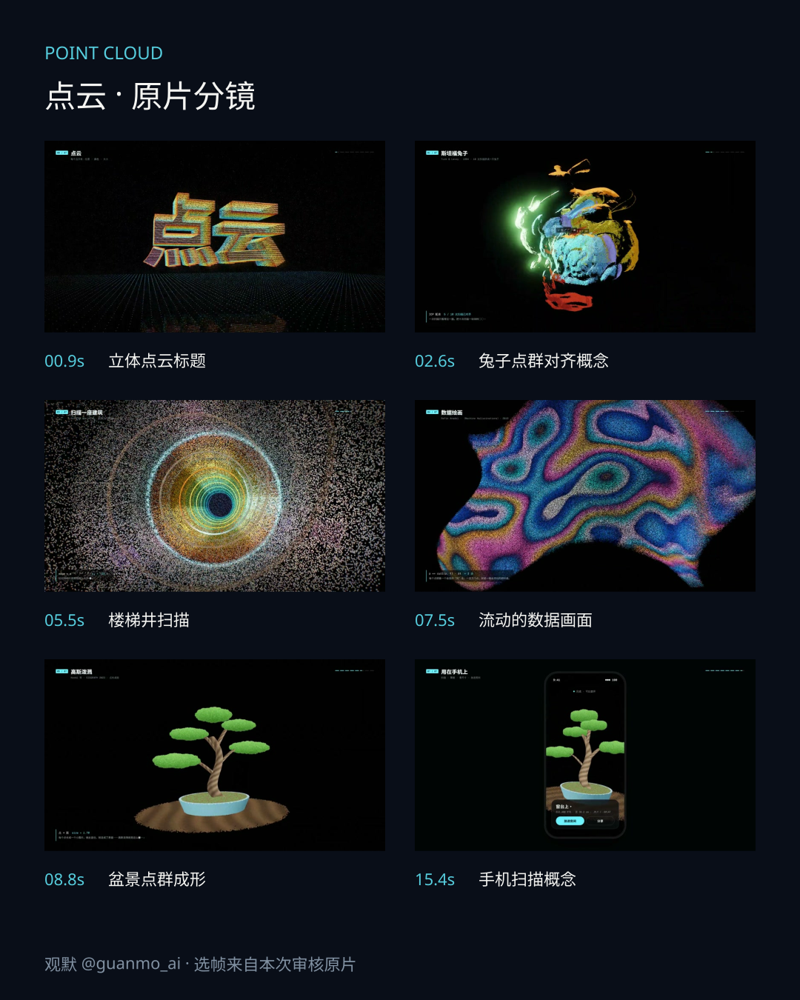

# 022 · 点云 Point Cloud

80万个点构成文字、兔子、街道与盆景，演示扫描、聚拢和手机界面中的状态变化。

## 设计要点

- **近大远小**：点径随距离变化，配合景深和亮度区分前后。
- **扫描面**：亮线标出扫描边缘，前后显示不同的状态。
- **体素**：将分散坐标收拢到规则网格，呈现体块感。
- **高度色带**：用高度分配颜色，让空间起伏更容易辨认。
- **拨开**：让邻近点向四周避让，表现局部推开的动势。

## 画面与图解

## 实现与边界

原生WebGL2 / GLSL绘制；Python与NumPy合成配乐、音效。兔子取自Stanford Bunny网格，本片用网格采样点和预设动画演示对齐概念；街道、楼梯与盆景为代码构造。未实施实地扫描、ICP求解或照片训练的3D Gaussian Splatting。手机中的扫描和尺寸均为时间轴概念演示。

规格：1920×1080、60fps、19.5秒。60fps表示成片播放规格；原片逐帧输出，不承诺实时渲染性能。

## 源码与制作

[渲染源码](video/README.md) · [制作过程](PROCESS.md) · [来源](SOURCES.md)
