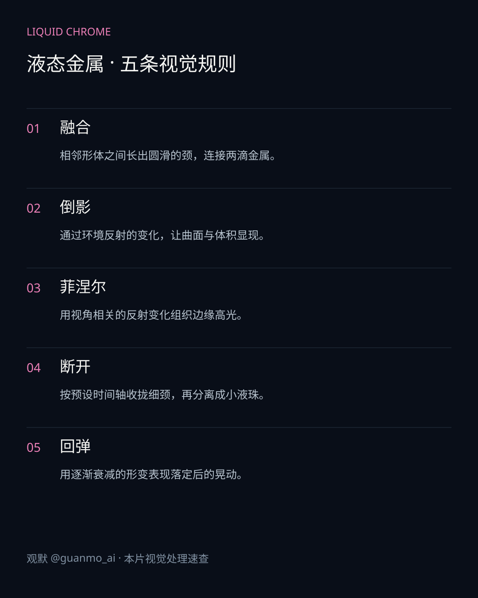
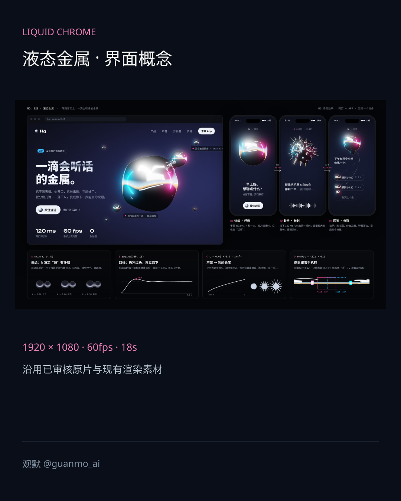
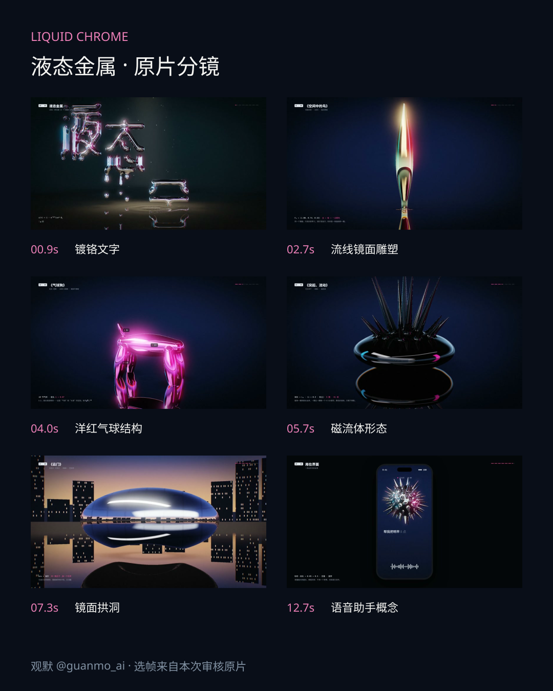

# 023 · Liquid Chrome

An 18-second mirror-material film connecting lettering, sculpture-like forms and a voice-assistant interface concept.

## Visual study

The four sheets cover the existing key visual, five visual rules, the interface concept and six frames from the approved film. The original media retains Chinese labels. This is a concise English guide, not a translation of the artwork.

## Implementation

Native WebGL2/GLSL renders the frames; Python/NumPy synthesizes music and sound effects. Distance fields and timeline parameters drive the forms. This is an artistic material study, not a fluid solver or a functioning voice/calendar assistant.

1920×1080, 60fps, 18 seconds. Playback frame rate is not a real-time rendering benchmark.

[Production](PROCESS.en.md) · [Source entry](video/README.md)
