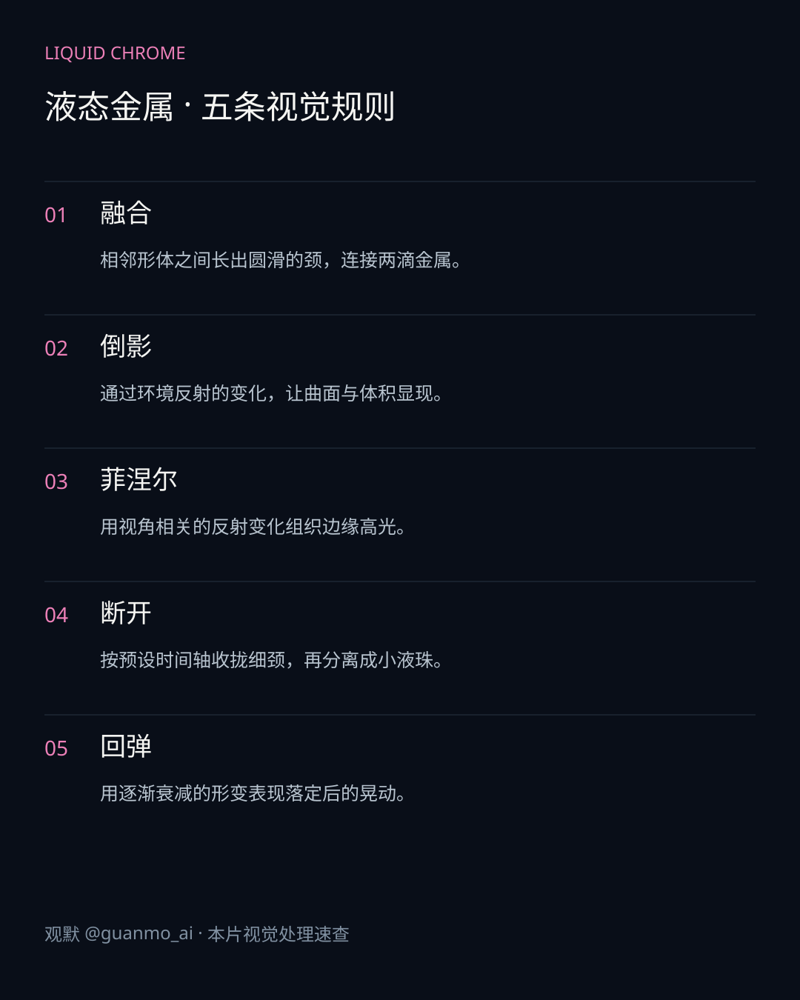
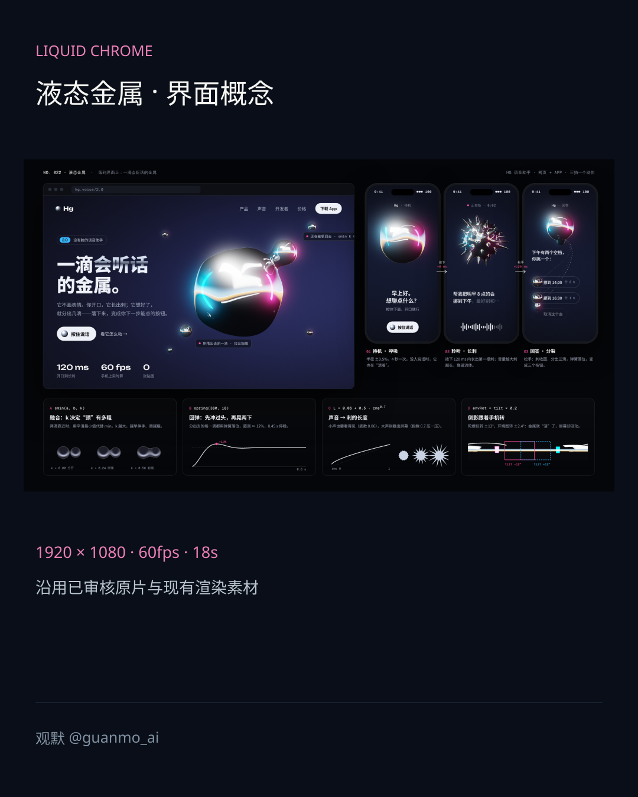
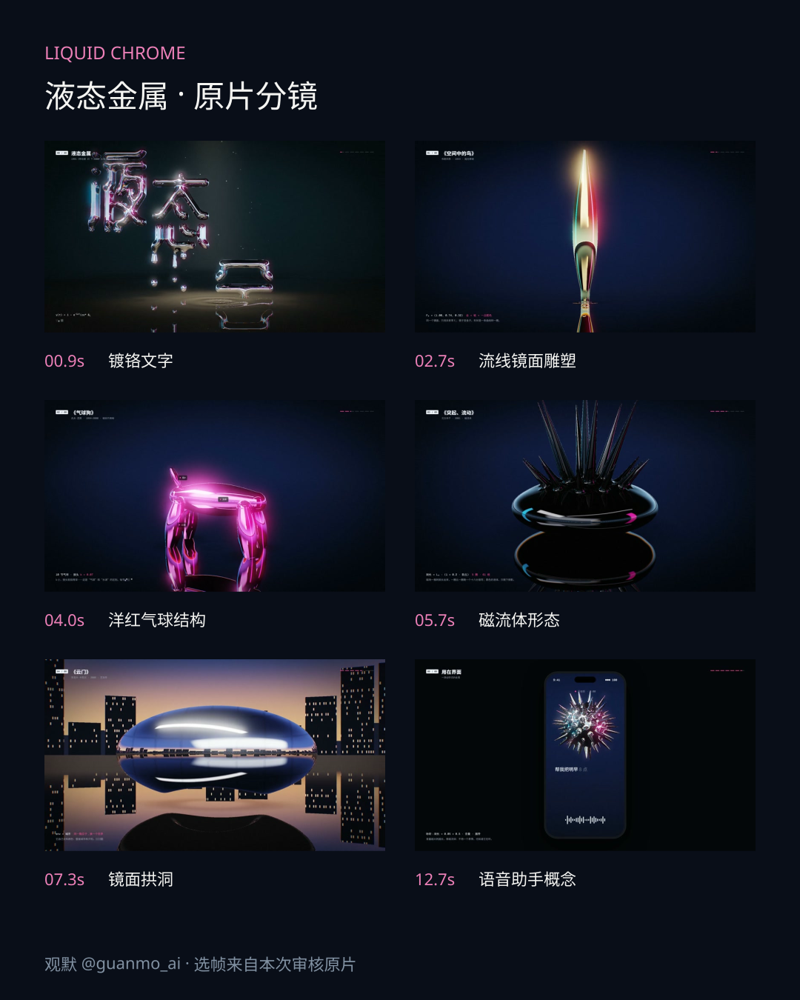

# 023 · 液态金属 Liquid Chrome

18秒镜面材质短片：文字、流线雕塑、气球结构与磁流体形态接力，收束到语音助手概念动效。

## 设计要点

- **融合**：相邻形体之间长出圆滑的颈，连接两滴金属。
- **倒影**：通过环境反射的变化，让曲面与体积显现。
- **菲涅尔**：用视角相关的反射变化组织边缘高光。
- **断开**：按预设时间轴收拢细颈，再分离成小液珠。
- **回弹**：用逐渐衰减的形变表现落定后的晃动。

## 画面与图解

## 实现与边界

原生WebGL2 / GLSL绘制；Python与NumPy合成配乐、音效。形体由距离场和时间轴参数控制，表现液滴融合、断开与回弹，不是科学级流体求解。颜色包含艺术调色；手机语音助手为预设概念动效，没有接入真实语音识别或日历。

规格：1920×1080、60fps、18秒。60fps表示成片播放规格；原片逐帧输出，不承诺实时渲染性能。

## 源码与制作

[渲染源码](video/README.md) · [制作过程](PROCESS.md) · [来源](SOURCES.md)
