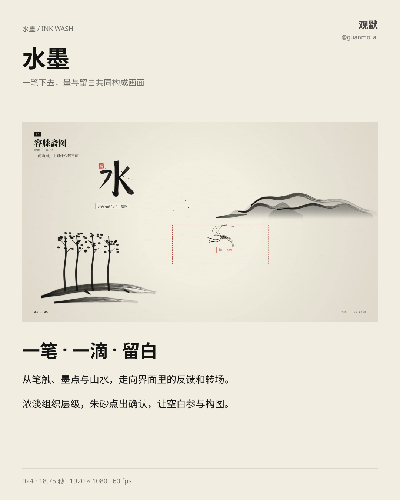
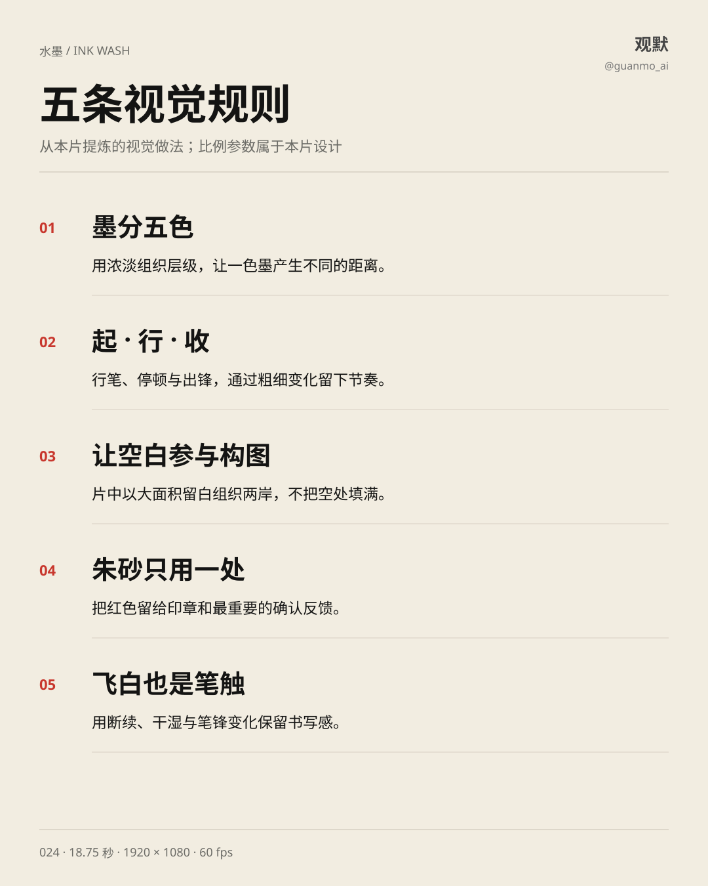
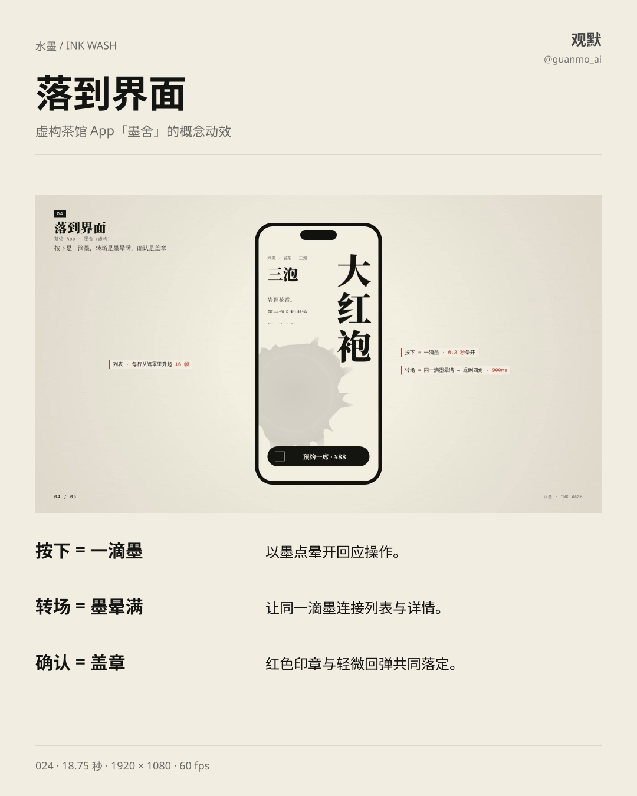
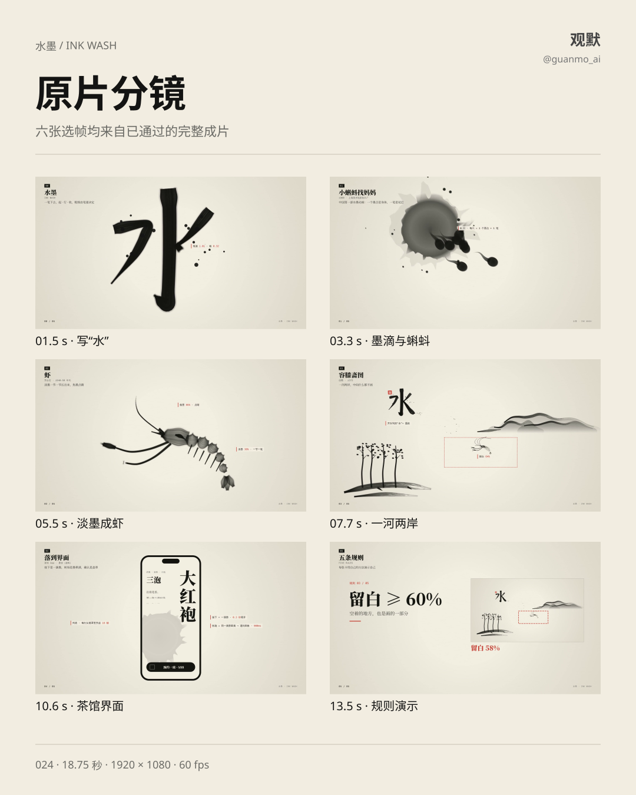

# 024 · Ink Wash

An 18.75-second motion study connecting brush lettering, ink drops, tadpoles, a shrimp and a sparse landscape with a fictional tea-app interface and five visual rules.

## Visual study

Ink density establishes hierarchy; brush width, dry strokes and empty space shape the composition. A restrained vermilion accent marks seals and confirmation. Interface actions reuse an ink drop, an expanding wash and a stamped response.

Canvas 2D and DOM render the visuals; Python / NumPy synthesize music and sound effects. This is an artistic ink study with a fictional tea-app concept. Percentages shown in the film are composition choices. Original media labels remain in Chinese.

1920×1080, 60fps, 1125 frames, 18.75 seconds. The approved master is reused without re-rendering or transcoding.

[Production](PROCESS.en.md) · [Source entry](video/README.md)
