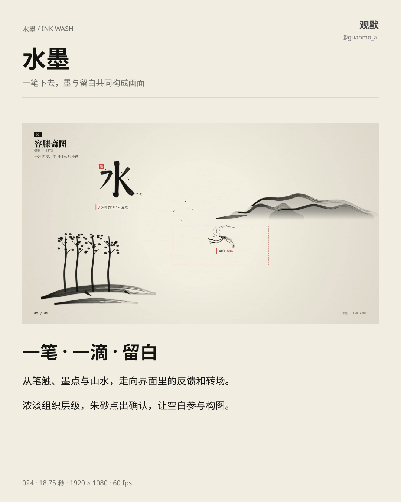
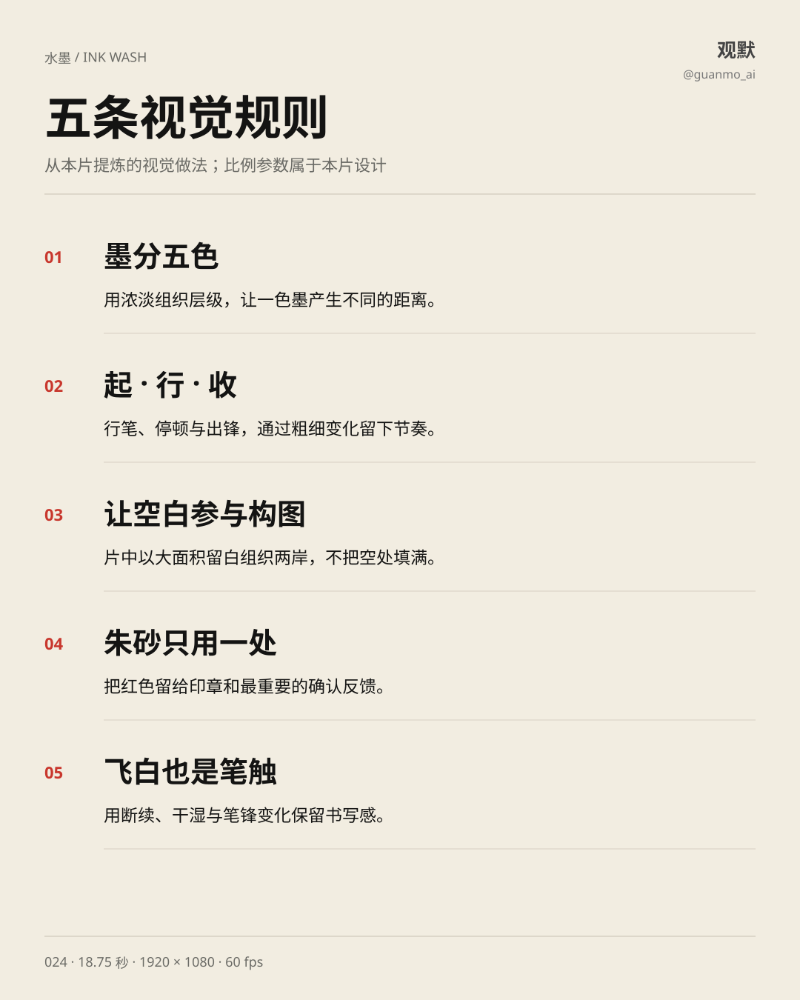
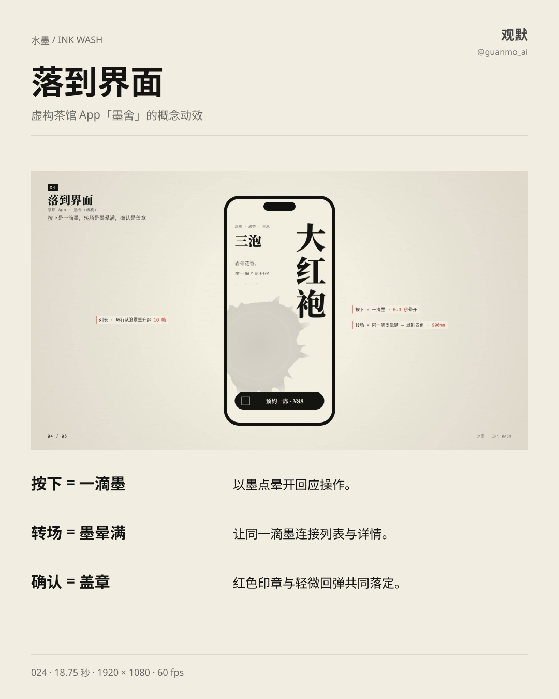
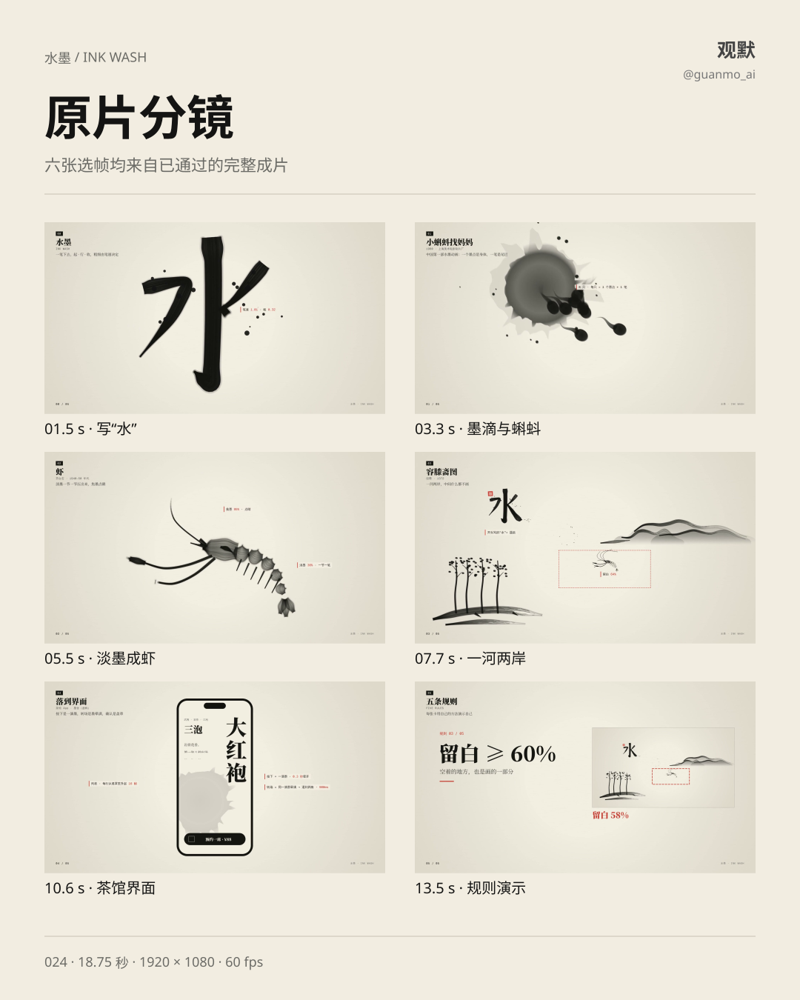

# 024 · 水墨 Ink Wash

18.75 秒的水墨动效短片：写“水”、墨滴与蝌蚪、淡墨成虾、一河两岸，再落到茶馆界面的操作反馈和五条视觉规则。

## 设计要点

- 浓淡组织层级，笔触的起、行、收带出粗细变化。
- 墨点晕开、飞白与大面积留白共同构图。
- 朱砂用于印章和确认，让视觉重心集中。
- 界面中以墨滴回应按下、以墨晕连接转场、以盖章表现确认。

## 画面与图解

## 实现与边界

Canvas 2D 绘制笔触与场景，DOM 显示章节和读数；Python / NumPy 合成配乐与音效。墨点、晕染、纸面和笔锋由代码生成，是水墨视觉的艺术化表达。茶馆 App「墨舍」为虚构概念，片内比例为本片的构图参数。

规格：1920×1080、60fps、1125 帧、18.75 秒。直接沿用用户已通过的完整成片，画面与音轨未重渲、未转码。

[制作过程](PROCESS.md) · [渲染源码](video/README.md) · [来源](SOURCES.md)
