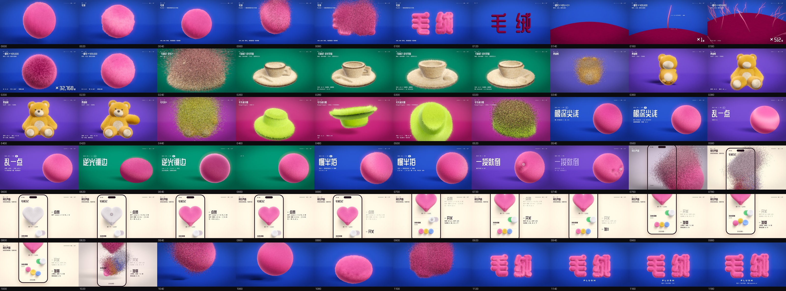
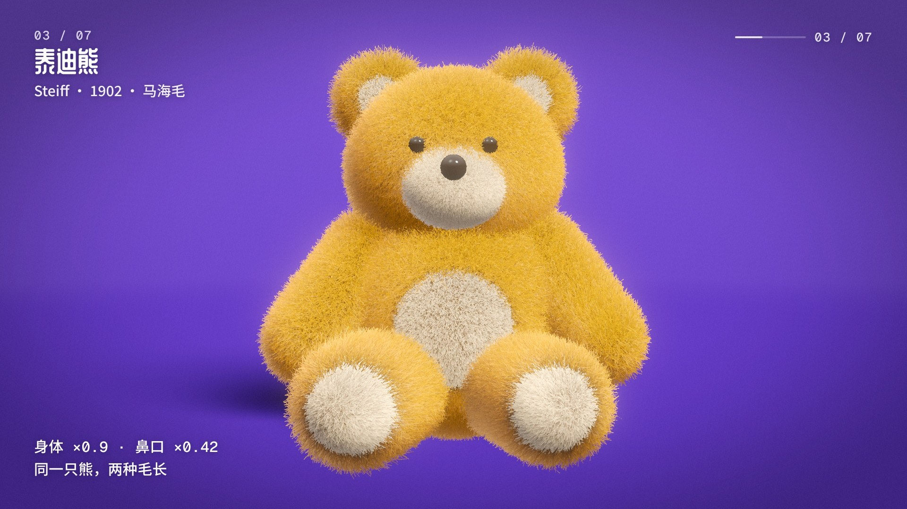

> 上架补记（2026-11-11）：用户已授权合入主干并在画廊上线。正式网站期号为风格 018，目录为 `025-plush`；下文保留当时的完整制作复盘。

# 025 · 毛绒 Plush · 制作过程

> **这是一份记录，不是规则。** 写的是这一期实际怎么做出来的、哪里走了弯路、哪些地方只是碰巧。下一期的材料不一样，做法也应该不一样；有用就拿，不合适就绕开。必须守的只有 [`docs/DESIGN_NOTES.md`](https://github.com/guanmo-ai/design-style/blob/main/docs/DESIGN_NOTES.md) 开头那八条。

🎬 [成片](https://github.com/guanmo-ai/design-style/blob/main/drafts/plush/film/plush-film.mp4) · 🧾 [分镜](https://github.com/guanmo-ai/design-style/blob/main/drafts/plush/film/STORYBOARD.md) · 🖐 [可以摸的 demo](https://github.com/guanmo-ai/design-style/blob/main/drafts/plush/demo.html) · 一张图看完全片：

## 0 · 一览

| | |
|---|---|
| 成片 | 20 秒 · 1920×1080 · 60fps · 22.9 MB，配乐由代码合成（-14 LUFS） |
| 画面 | WebGL2，409,600 根毛逐根画；每一帧是帧号的纯函数 |
| 源码 | 约 1,200 行：渲染器 435 + 形状 113 + 场景与镜头 226 + HUD 130 + 时间轴 40 + 配乐 198 + demo 44 |
| 外部素材 | 没有。字体是站酷庆科黄油体、Noto Sans SC、Geist Mono、Unbounded（都可免费商用） |
| 用时 | 一个云端会话（4 核、没有显卡）。读仓库约 15 分钟 → 渲染器从零到第一张能看的图约 25 分钟 → 全片代码和三轮检查约 25 分钟 → 正片渲染 70 分钟（后台，同时写配乐和文档）→ 合成 1 分钟 |
| 谁做的 | 主人给了一个词（“毛绒的”）和目标排序；选题拆解、代码、画面、配乐、审片都是 Claude |

## 1 · 一个词怎么变成一条片子

主人只说了“毛绒的”。这一步没有先出三个候选（默认流程是先出候选），因为题目已经定了，直接做全片。

想清楚三件事就开工了：

1. **这种材料自己会怎么动？** 毛绒和别的东西不一样的地方只有一个：身体停了，毛还没停。于是全片的物理只有一条——每根毛是一根弹簧。这一条定下来，后面所有动作（砸下来、压扁、零件弹出来、帽子翻一圈、按钮被捏）都不用再设计“毛怎么动”，只设计身体怎么动。
2. **什么东西从头接力到尾？** 同一批 409,600 根毛。换章就是这批毛飞到下一个形状上。这个决定同时解决了转场（不用想每一章怎么切）和主题（“毛绒 = 一根毛 × 四十万”）。
3. **设计师能拿走什么？** 一根毛只有四件事：根深尖浅、根粗尖细、乱一点、慢半拍。再加两条用光和交互的：逆光镶边、一按就倒。这六件事每一件都能写成一个数。

之后才去套骨架（开场 / 代表作 / 规则 / 手机 / 片尾）。回头看，**片子里最好的两段——一根毛长成四十万根、熊一块块弹出来——都是第 1、2 条直接推出来的；最平的一段是五张规则卡**，同一颗球站了将近 4 秒，那一段是照着清单填的。下一期如果时间只够把一件事做好，做前者。

## 2 · 技术路线：为什么是一根根画

毛绒常见的做法有两种：一层层的壳（游戏里常用，便宜，但轮廓上露馅、毛不能单独动）和真的一根根画。选了后者，因为“每根毛是一根弹簧”和“同一批毛飞来飞去”都要求每根毛是一个独立的东西。

渲染分两步，都在 [`fur.js`](https://github.com/guanmo-ai/design-style/blob/main/drafts/_lib/fur/fur.js)：

1. **每根毛算一次**（片元着色器，一根毛一个像素，输出到 6 张浮点纹理）：毛根现在在哪、朝哪、被弹簧甩到哪、被风吹和被手拨开多少、什么颜色、这一撮亮不亮。
2. **每根毛画成一条细带**（4 段、10 个顶点），顶点着色器用顶点号去查上一步的纹理。光照是 Kajiya–Kay（1989）：漫反射 = sin(毛的方向, 光)，所以高光是一条垂直于毛的亮带。

形状在 [`shapes.js`](https://github.com/guanmo-ai/design-style/blob/main/drafts/_lib/kit/shapes.js)：椭球、胶囊、旋转体（茶杯、帽子）直接按面积撒毛根；字和心形是先画成平面图形，算距离场，再“充气”成枕头。**每个形状都正好用完同一批 N 根毛**，所以任何两个形状之间都能直接飞。

### 签名物理是怎么实现的

没有做模拟（模拟要一帧帧往前推，就不能并行渲、不能断点续渲了）。用的是一个等价的写法：

> 毛尖的位置 = 身体过去 60 帧的位置 ⊗ 一根欠阻尼弹簧的冲激响应

每个零件每一帧的姿态是一个 4×4 矩阵，是帧号的纯函数。把它过去 60 帧的矩阵按弹簧的响应曲线加权求和，得到“弹簧滤过的姿态”；毛根用现在的姿态，毛尖往滤过的姿态那边弯。因为权重有正有负，会自然地晚到、冲过头、抖回来。两组弹簧（2.6 Hz · ζ 0.22 和 4.6 Hz · ζ 0.3），每根毛在两者之间取一个固定的随机比例，所以一片毛不会齐步走。

这一招不只适用于毛：任何“主体带着一堆附属物”的东西（流苏、草、布条、粒子尾巴）都可以这样做，而且每帧仍然是纯函数。

## 3 · 实际的工作顺序

1. **读仓库**：设计笔记、标杆拆解、GPU 经验、六轮草稿的记录。记下主人说过的话，而不是规则条文。
2. **先测速，再定画质。** 写了一个只有一颗毛球的测试页，第一张图就对了，但一帧 9 秒。花了大约 15 分钟、七八次对照实验才找到真正的原因（见下一节）。**如果没有先测速就去写全片，会在渲染 3 个小时之后才发现。**
3. **调质感**：只调了三轮——加“成撮”（一小块里的毛往同一边倒、同深浅）、压光（别发白）、修坏点。
4. **写全片**：时间轴（一份帧号，画面和配乐共用）→ 场景（形状、每个零件的姿态函数、镜头关键帧、背景色接力）→ HUD。
5. **三种检查，从便宜到贵：**
   - 全片联系表：每 15 帧一张、毛减到四分之一，2 分钟。看节奏、构图、有没有哪段是空的。
   - 关键动作的连续帧：每 2—4 帧一张，各半分钟。看起势、过冲、毛有没有跟上。
   - 全质量单帧：9 张，各 13 秒。看质感、字有没有压到东西。
6. **开渲正片**（后台 70 分钟），同时写配乐、分镜、demo。
7. **合成**，从成片里解码两帧，确认压缩没有把毛压糊。

三轮检查发现并改掉的：第 0 帧球被画面切掉一半还带淡入（封面发暗）；短毛的地方露出背景（没有“皮”）；手机那一章太小太灰；“一根毛”那一根根本没画出来（旋转方向写反了）；规则卡的标签换行压住了大字；帽子绕自己的轴转看不出来在转（改成像煎饼一样翻）。

## 4 · 走过的弯路

| 问题 | 一开始以为 | 实际 | 怎么发现的 |
|---|---|---|---|
| 一帧 9 秒 | 实例化绘制太慢 | 改掉实例化之后变成 11 秒。真正的原因是三角带里两根毛之间的“连接三角形”：面积是零，但光栅器照样沿着它横穿屏幕走一遍 | 把背面的毛塌成一个点，时间少了 40%，而顶点数没变——说明慢的不是顶点，是三角形 |
| 分段计时全是 0 | 计时代码写错了 | 浏览器里 `gl.finish()` 不等显卡进程 | 改用读一个像素来等 |
| 满屏彩色坏点 | `pow(0, y)` 出了 NaN（确实有，修了，但坏点还在） | 多重采样时细带只盖住半个像素，颜色在像素中心被外推成很大的数或负数 | 放大看：坏点是纯红、纯绿、纯黑的单个像素，是“某一个通道爆了”，不是整个颜色坏了 |
| 熊的肚子发灰 | 光的颜色不对 | 短毛盖不住，透出了后面的紫色背景 | 发灰的地方正好都是毛最短的地方 |
| 预览里球上有黑斑 | 又是 NaN | 预览把毛减到四分之一，“皮”的圆片不够密，有洞。正片没有 | 算了一下覆盖率 |

共同的教训：**每次只改一个变量再量一次**，比猜快。前两条如果一开始就做对照实验，能省十分钟。

渲染上的细节（给以后做“几何很多”的片子）在 [`docs/GPU_MOTION.md`](https://github.com/guanmo-ai/design-style/blob/main/docs/GPU_MOTION.md) 最后一节。

### 主人说“丝滑”之后才发现的两处跳变

主人看完成片说很丝滑。之后为了把“丝滑”变成能量的东西，写了 [`_lib/smooth.py`](https://github.com/guanmo-ai/design-style/blob/main/drafts/_lib/smooth.py)（逐帧量画面变化），结果它在这条片子里量出两帧整屏亮度的突变：进手机（第 769 帧）和出手机（第 1021 帧）。原因是“地面换成一面墙”用了一个 `if (inUI > 0.5)` 的开关，墙的亮度算法和地面不一样，那一帧整屏亮了 30%。只有一帧，前后都是满屏飞着的毛，静帧和联系表上完全看不出来。

改法：亮度、光、暗角、影子全部按进度渐变，只把“换成墙”这件事推迟到两边已经一样的时候（0.92）再切。重渲了受影响的约 120 帧，最大单帧变化从 61 降到 19（剩下的最大值是帽子翻面，有意的）。顺手修了规则卡收走时大字突然消失、左上章节闪回 6 帧的问题。

**教训：看不见的开关也是硬切。** 以后凡是 `if (进度 > 某个数)` 切换画法的地方，交片前都量一遍。

## 5 · 配乐

沿用 [`_lib/song.py`](https://github.com/guanmo-ai/design-style/blob/main/drafts/_lib/song.py)（一整首歌，换章只换和弦）。这一期自己加的只有四个音色，都在 [`film/audio.py`](https://github.com/guanmo-ai/design-style/blob/main/drafts/plush/film/audio.py) 开头：“噗”（低通噪声、音头磨圆，毛蓬开用）、“啵”（音高往上一挑，零件弹出来用）、一把毛刷过去、压扁弹回的弹簧音。主旋律换成马林巴，所有音头都是软的。

每个声音的时间直接取自 `timeline.js` 的帧号；每个字落定的“嗒”取自页面空跑一遍导出的 `events.json`。

**没验证的：** Claude 听不了声音，只核对了时长、响度（-14 LUFS）和每半秒的音量曲线（没有塌掉或爆掉的段落）。好不好听要人来判断。

## 6 · 没做、没验证的

- **没做：** 四张风格图、tokens、正式期号、风格指南。等主人决定收不收录。
- **没验证连续播放的观感**：Claude 看的是静帧和连续帧拼图，不是播放。“丝滑”是主人看完说的。
- **`demo.html` 的交互没试过**：云端没有显卡，只确认了能渲出一帧。
- **只有横版。** 手机上看，左下角的参数字偏小。

## 7 · 如果重做，会改什么

- 五张规则卡各换一个主角和构图，而不是同一颗球站五次；或者干脆把规则揉进前面的章节里（一根毛那一章其实已经讲完了两条）。
- 手机那一章的界面元素再大一点，或者直接从手机里的那颗心开场。
- 出一版竖的。每帧是纯函数，只要改镜头和字的位置。
- 渲正片之前先渲一版低密度的全片（不抽帧）跑一遍 `smooth.py`，而不是等主人看完才量。
- 渲染前先在第 0 帧上多花五分钟：它是封面，这一期差点带着淡入发出去。

## 8 · 留给以后的东西

主人看完说“希望它能拆出很多组件、代码能复用”，于是把这条片子拆了（2026-11-11）。**通用的**进了 [`drafts/_lib/kit/`](https://github.com/guanmo-ai/design-style/blob/main/drafts/_lib/kit/README.md)，**毛绒专用的**进了 `drafts/_lib/fur/`，这个目录里只剩毛绒自己的内容（形状、姿态、文字、和弦）。

| 组件 | 是什么 | 以后可以拿来做 |
|---|---|---|
| [`kit/motion.js`](https://github.com/guanmo-ai/design-style/blob/main/drafts/_lib/kit/motion.js) | 缓动、弹簧、压扁弹回、`springPoses`（姿态历史 ⊗ 弹簧响应） | 任何片子：不做模拟也有跟随和过冲，每帧仍是纯函数 |
| [`kit/director.js`](https://github.com/guanmo-ai/design-style/blob/main/drafts/_lib/kit/director.js) | 镜头关键帧、颜色接力、形状之间的转场、3D ↔ 屏幕、正对一面墙的镜头 | 任何片子 |
| [`kit/stage.js`](https://github.com/guanmo-ai/design-style/blob/main/drafts/_lib/kit/stage.js) | 无缝背景、地面软影、亮珠子、泛光 / 调色 / 颗粒 | 任何 3D 渲染器：在 `begin` 和 `end` 之间画自己的东西 |
| [`kit/hud.js`](https://github.com/guanmo-ai/design-style/blob/main/drafts/_lib/kit/hud.js) | 章节外框、参数、规则卡、大数字、标注线、手机框、手指、片尾署名 | 任何片子，每一块可选 |
| [`kit/shapes.js`](https://github.com/guanmo-ai/design-style/blob/main/drafts/_lib/kit/shapes.js) | 椭球 / 胶囊 / 旋转体 / 充气的平面图形 → 均匀撒点 | “同一批粒子在形状之间接力”的片子 |
| [`fur/fur.js`](https://github.com/guanmo-ai/design-style/blob/main/drafts/_lib/fur/fur.js) | 毛绒渲染器（专用） | 毛、草、地毯、毛线、羽毛、流苏、海葵 |
| [`softfx.py`](https://github.com/guanmo-ai/design-style/blob/main/drafts/_lib/softfx.py) | 噗、啵、刷过去、弹簧音、软的落地 | 软、圆、可爱的片子 |
| [`smooth.py`](https://github.com/guanmo-ai/design-style/blob/main/drafts/_lib/smooth.py) | 逐帧量有没有跳变和死区 | 每一条片子交片前 |
| `kit/new_film.mjs` + `kit/template/` | 一条命令生成能直接渲的新片空架子 | 起下一条片子 |

**拆完之后怎么确认没拆坏：** 用拆过的代码重渲 18 帧，17 帧和认可的成片逐字节一致；剩下的第 158 帧只有标注线上 12 个像素的亚像素差——拆之前的代码单独渲这一帧也是同样的结果（长时间连续渲染时 DOM 的亚像素位置会漂一点）。配乐用原来的 cue 重新合成，和成片的音轨逐样本一致。

**一个没处理的小出入：** 成片的音轨是修“章节标题闪回”之前合成的，规则卡开头（第 525—541 帧）多了十几声没有对应文字的“嗒”，被砸字的声音盖着。现在重新出片会没有这几声，后面“嗒”的随机音高也会跟着换一组。成片没动，因为那是主人认可的版本。

复现：`npm ci && npm run fonts && pip install -r requirements.txt && bash drafts/plush/film/make.sh`（云端约 75 分钟；本地第一次还要 `npx playwright install chromium`）。

## 正式收录

本次补齐四张可编辑 SVG 图解、中英文指南、规格与时间轴，沿用已审成片，不重新渲染或转码。

[风格指南](README.md) · [正式源码入口](video/README.md)
