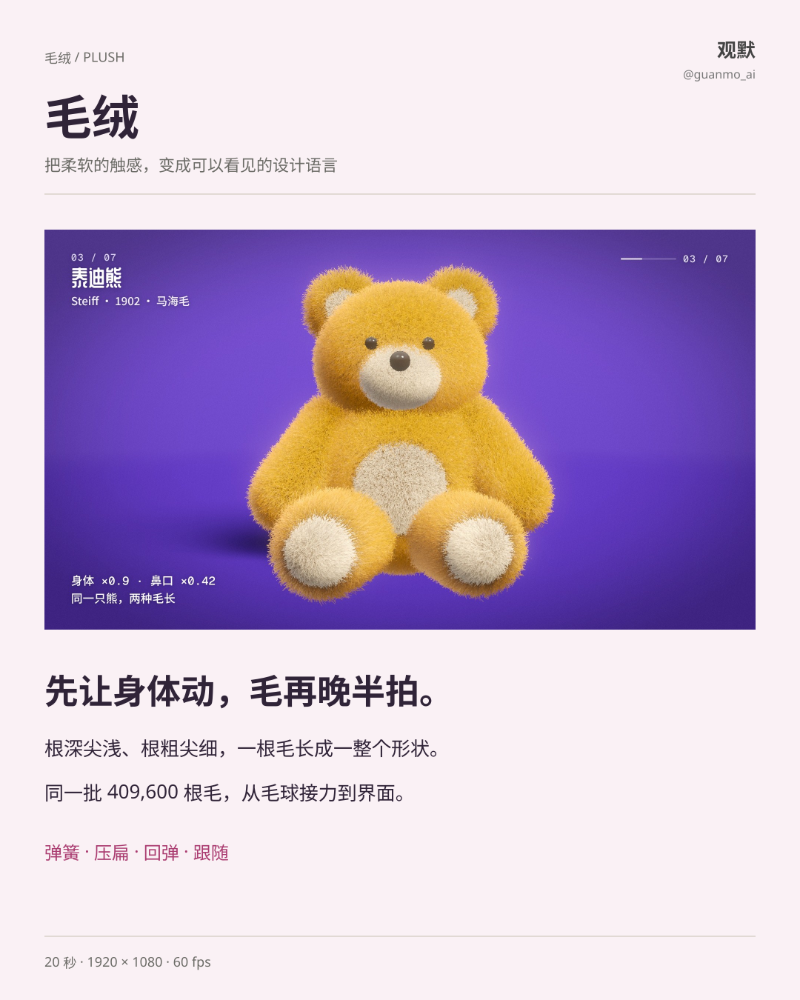
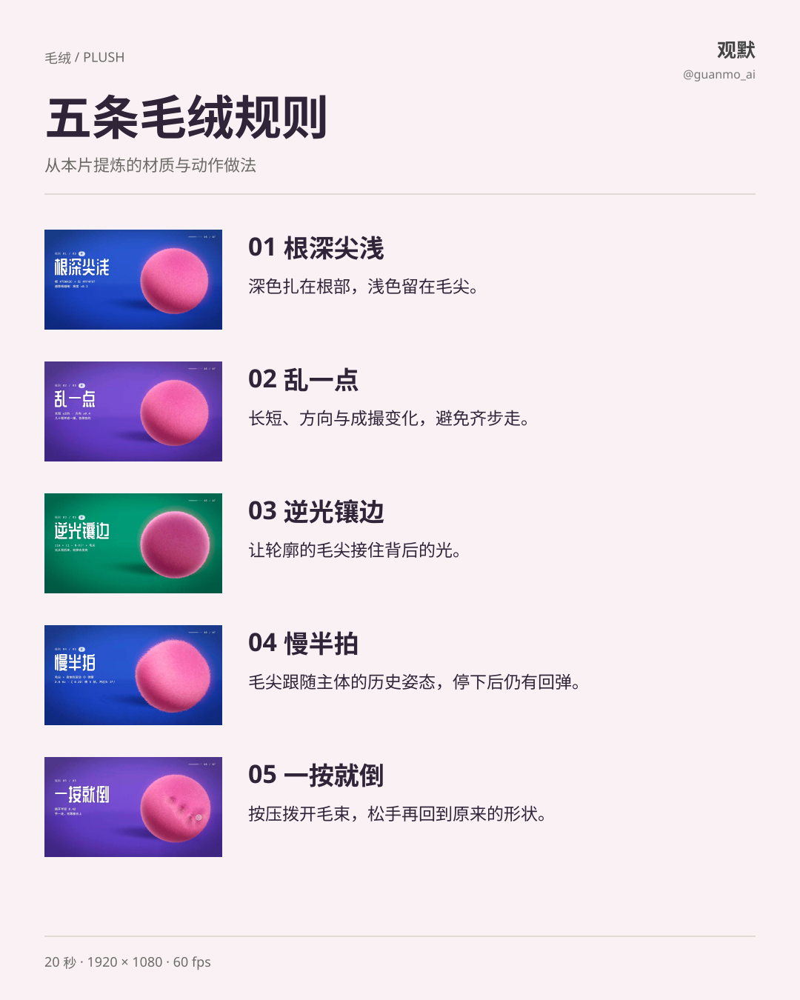
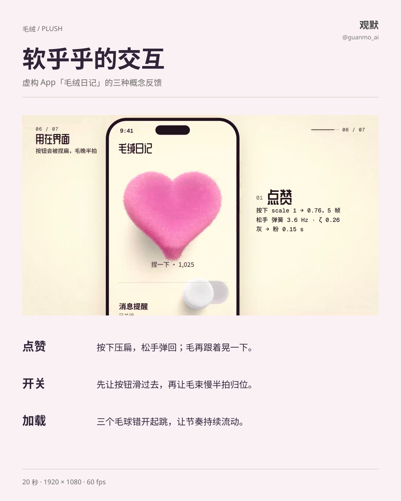
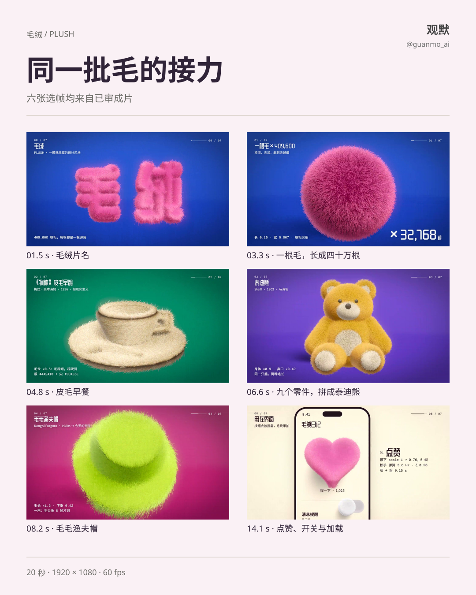

# 025 · Plush

A 20-second material study of soft silhouettes, root-to-tip shading and spring-driven follow-through. The same 409,600 strands morph from a ball into lettering, objects, a teddy bear and playful interface feedback.

## Material and motion

Keep roots dark and tips light. Vary length, direction and clumping. Separate the silhouette with rim light. Let strands follow the body's earlier poses, then overshoot and settle after the body stops. Respond to a press with compression and recovery.

## Interface study

The fictional plush diary demonstrates a compressible like button, a sliding toggle with delayed fur motion and three staggered loading balls. Values shown are choices for this film, not universal interface requirements.

## Reuse

1920×1080, 60fps, 1200 frames, 20 seconds, 120 BPM. WebGL and DOM render the visuals; Python / NumPy synthesize the score and sound effects. The approved master is preserved without re-rendering or transcoding. Sheet text and layout remain editable; preview SVGs embed font subsets and the OFL license. Original media labels remain in Chinese.

[Production](PROCESS.en.md) · [Source entry](video/README.md) · [Watch the film](https://github.com/guanmo-ai/design-style/releases/tag/day-25)

Please credit Guanmo @guanmo_ai when sharing the media.
