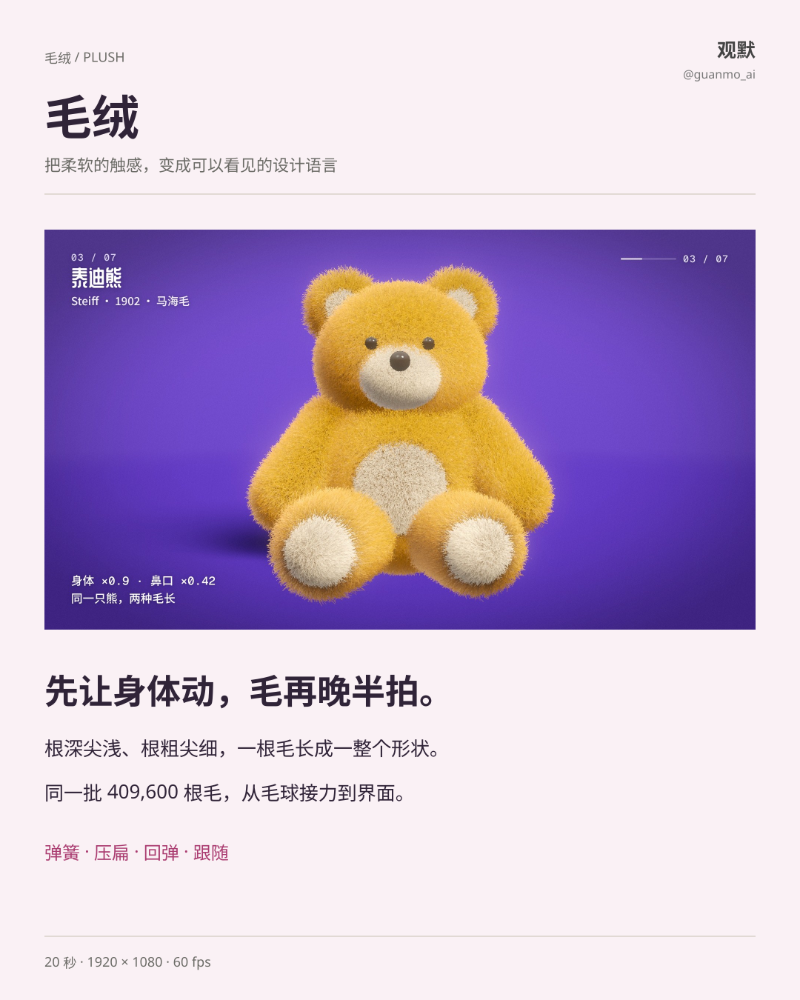
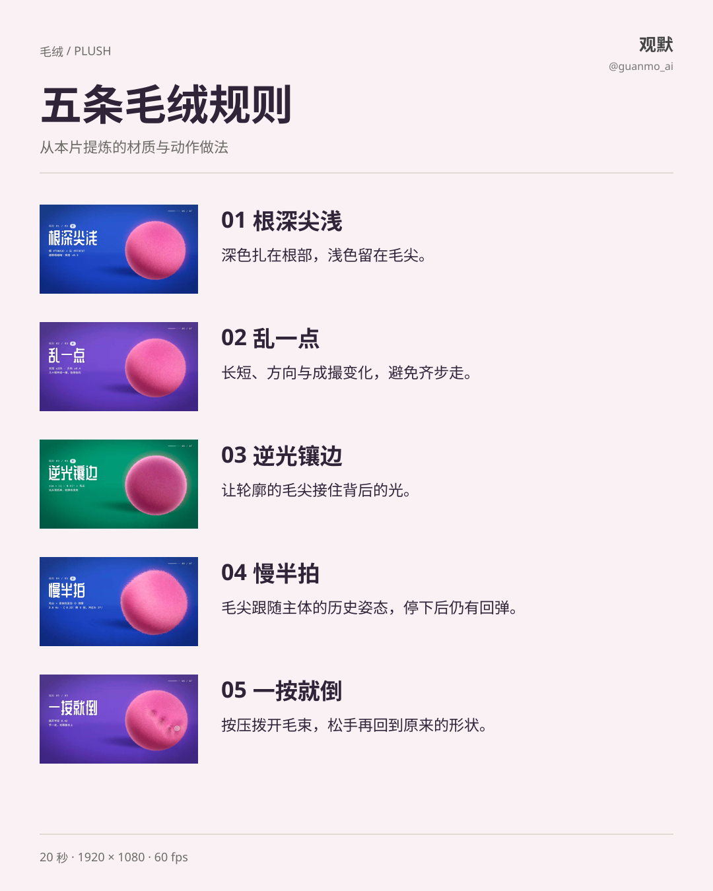
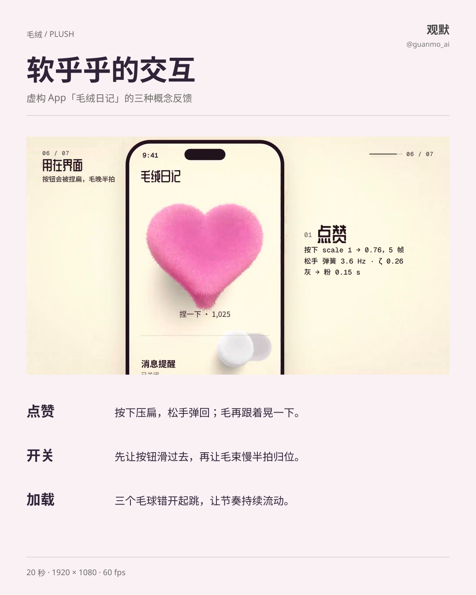
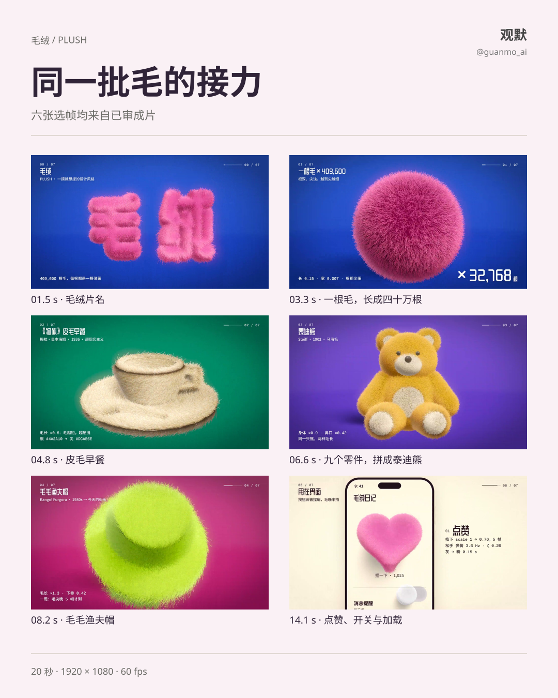

# 025 · 毛绒 Plush

把柔软的触感变成一种看得见的设计语言：根深尖浅的毛束、压扁又弹回的形状，以及比主体晚半拍的跟随。

[观看完整短片](https://github.com/guanmo-ai/design-style/releases/tag/day-25) · [制作过程](PROCESS.md) · [渲染源码](video/README.md)

## 从一根毛开始

本片始终使用同一批 409,600 根毛：先变成毛球和「毛绒」片名，再形成皮毛早餐、泰迪熊、毛毛渔夫帽，最后进入虚构 App「毛绒日记」。材质的形状在变化，毛的运动规律保持连续。

## 五条视觉与动作规则

1. **根深尖浅。** 深色扎在根部，浅色和细轮廓留在毛尖。
2. **乱一点。** 长短、方向与成撮变化要有差异，不让所有毛一起摆动。
3. **逆光镶边。** 用背光分离轮廓，保留柔软的边缘。
4. **慢半拍。** 毛尖跟随主体的历史姿态；主体停下，毛仍会回弹。
5. **一按就倒。** 通过拨开、压扁和回弹回应触碰。

## 用在界面

点赞先压扁再回弹；开关先滑动，毛束再归位；加载让三个球错开起跳。它们是本片的界面概念，比例与弹簧参数属于具体设计，不是统一规范。

## 形状之间的接力

## 规格与复用

20 秒，1920×1080，60fps，1200 帧，120 BPM。画面由 WebGL 与 DOM 生成，配乐与声音由 Python / NumPy 合成。画廊沿用已审原片，未重渲、未转码或改动音轨；图解从原片抽帧，文字与布局可编辑，中文字体子集及 OFL 许可内嵌在预览 SVG 中。

- [完整制作复盘](PROCESS.md)
- [源码入口与出片方法](video/README.md)
- [English guide](README.en.md)

视频和图解请注明观默 @guanmo_ai。原片中的中文标注保留原样。
