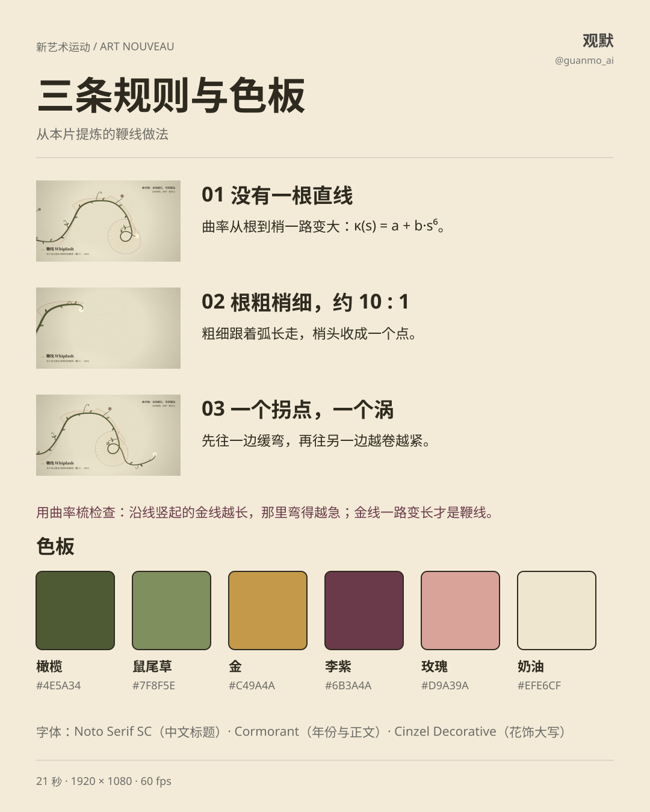
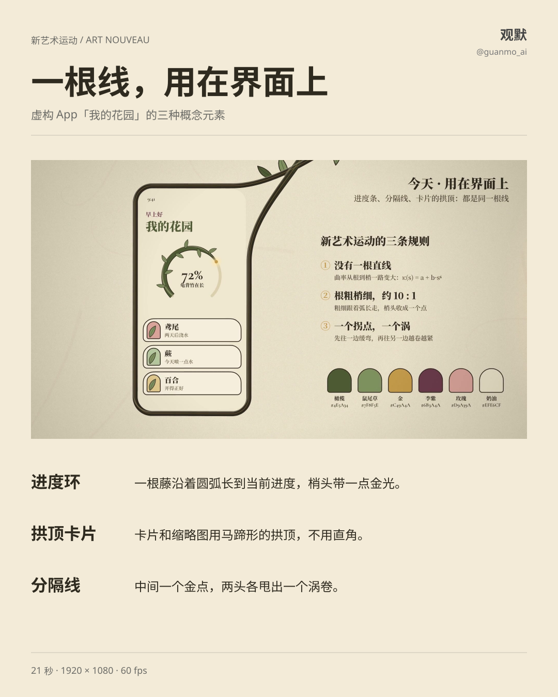
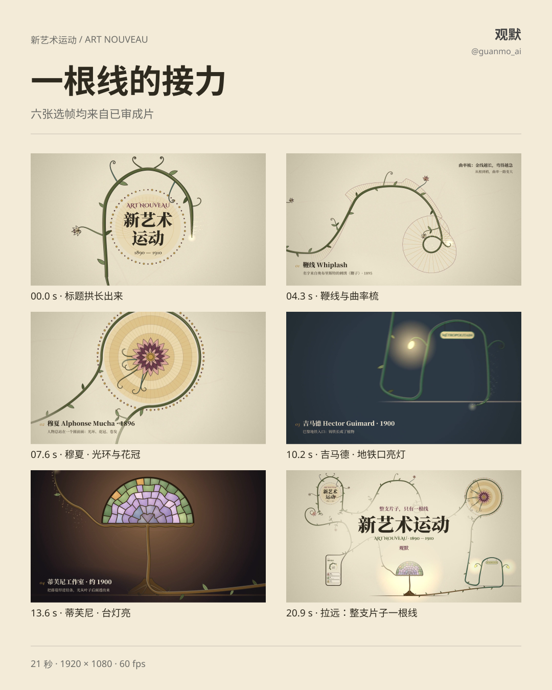

# 026 · Art Nouveau

1890–1910: every straight line becomes a growing vine. A whiplash line curls ever tighter from root to tip, and its tip unfurls like a fern as it grows.

## One line for the whole film

A single line starts at the foot of the title arch and travels clockwise around the world: a whiplash, a Mucha-style halo, a Guimard-style Paris Métro entrance, a Tiffany-style lamp and a phone frame, then returns home and curls in beneath the title. In the final pull-back the whole film reads as one whiplash. Leaves, flowers, lamps and glass grow only after the line has passed.

## Three rules

1. **No straight lines.** Curvature grows from root to tip, κ(s) = a + b·s⁶.
2. **Thick root, thin tip, about 10 : 1.** Width follows arc length and the tip ends in a point.
3. **One inflection, one curl.** Bend gently one way, cross an inflection, then curl ever tighter the other way.

Check a curve with a **curvature comb**: tick lengths proportional to curvature should keep growing toward the tip.

Palette: olive `#4E5A34`, sage `#7F8F5E`, gold `#C49A4A`, plum `#6B3A4A`, rose `#D9A39A`, cream `#EFE6CF`. Type: Noto Serif SC, Cormorant and Cinzel Decorative (all OFL).

## Interface study

In the fictional "My Garden" app, progress is a vine growing along an arc, cards and thumbnails use horseshoe arches, and dividers end in a curl at each side. Values are choices for this film, not universal requirements.

## Reuse

1920×1080, 60fps, 1260 frames, 21 seconds, a 3/4 waltz at 180 BPM. Canvas 2D renders each frame as a pure function of its frame number, with four sub-frames of motion blur; Python / NumPy synthesize the score. The style is drawn from, not copied from, Obrist, Mucha, Guimard and Tiffany Studios. Original media labels remain in Chinese.

[Production](PROCESS.en.md) · [Source entry](video/README.md) · [Watch the film](https://github.com/guanmo-ai/design-style/releases/tag/day-26)

Please credit Guanmo @guanmo_ai when sharing the media.
