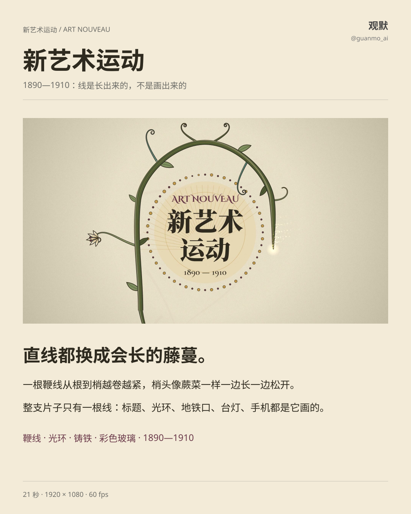
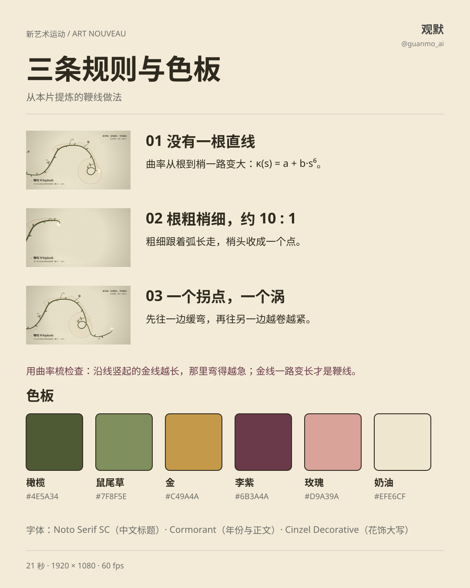
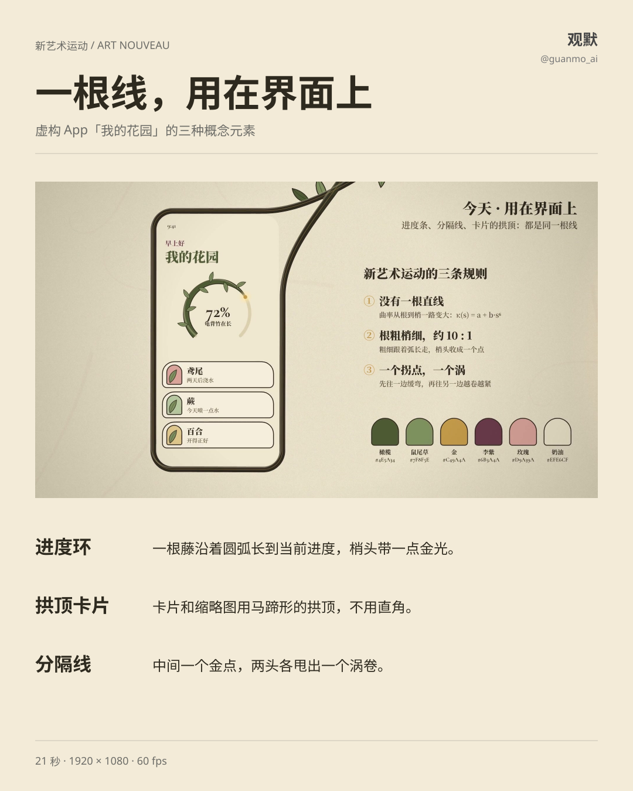
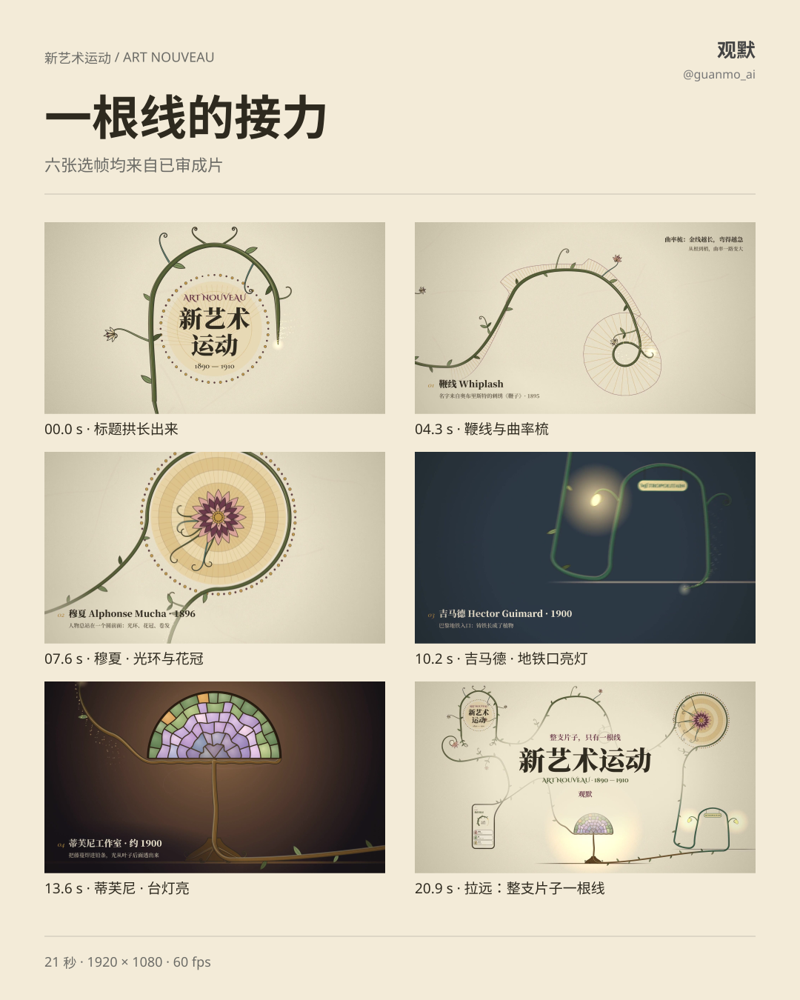

# 026 · 新艺术运动 Art Nouveau

1890—1910：把直线都换成会长的藤蔓。一根鞭线从根到梢越卷越紧，梢头像蕨菜的嫩芽一样，一边往前长一边松开。

[观看完整短片](https://github.com/guanmo-ai/design-style/releases/tag/day-26) · [制作过程](PROCESS.md) · [渲染源码](video/README.md)

## 整支片子只有一根线

本片的主线从标题拱的左脚出发，顺时针绕世界一圈：先打出一根鞭线，再绕出穆夏的光环、长成吉马德的巴黎地铁口、描出蒂芙尼的台灯、勾出手机的机身，最后回到标题脚下卷进去。片尾镜头拉远，整支片子本身就是一根鞭线。叶、花、灯、玻璃都在主线经过之后才长出来。

## 三条规则

1. **没有一根直线。** 曲率从根到梢一路变大，可以写成 κ(s) = a + b·s⁶：前面几乎是直的，越往梢头弯得越急。
2. **根粗梢细，约 10 : 1。** 粗细跟着弧长走，梢头收成一个点；刚长出来的嫩梢最细。
3. **一个拐点，一个涡。** 先往一边缓弯，过一个拐点，再往另一边越卷越紧。

检查一根线是不是鞭线，可以用**曲率梳**：沿线每隔一段竖一根短线，长度等于那里的曲率。梳齿一路变长，才是鞭线。

## 色板与字体

橄榄 `#4E5A34` · 鼠尾草 `#7F8F5E` · 金 `#C49A4A` · 李紫 `#6B3A4A` · 玫瑰 `#D9A39A` · 奶油 `#EFE6CF`。主线按章节换材质：橄榄的藤 → 吉马德的铸铁绿 `#2F5D4A` → 蒂芙尼的青铜 `#6E4E26` → 墨。字体用 Noto Serif SC（中文标题）、Cormorant（年份与正文）、Cinzel Decorative（花饰大写），都是 OFL。

## 用在界面

虚构 App「我的花园」：进度是一根沿圆弧长到当前值的藤，卡片和缩略图用马蹄形的拱顶，分隔线中间一个金点、两头各甩出一个涡卷。这些是本片的界面概念，比例和数值属于具体设计，不是统一规范。

## 一根线的接力

## 规格与复用

21 秒，1920×1080，60fps，1260 帧，圆舞曲 3/4 拍 180 BPM（一小节 = 1 秒）。画面由 Canvas 2D 逐帧生成，每帧是帧号的纯函数，4 个子帧做运动模糊；配乐与声音由 Python / NumPy 合成。图解从已审原片抽帧，文字与布局可编辑，中文字体子集及 OFL 许可内嵌在预览 SVG 中。

代表作只提取风格，不照搬造型：Hermann Obrist《鞭子》刺绣（1895）、Alphonse Mucha 的海报（1896 起）、Hector Guimard 的巴黎地铁入口（1900）、Tiffany Studios 的彩色玻璃台灯（约 1900）。

- [完整制作复盘](PROCESS.md)
- [源码入口与出片方法](video/README.md)
- [English guide](README.en.md)

视频和图解请注明观默 @guanmo_ai。原片中的中文标注保留原样。
