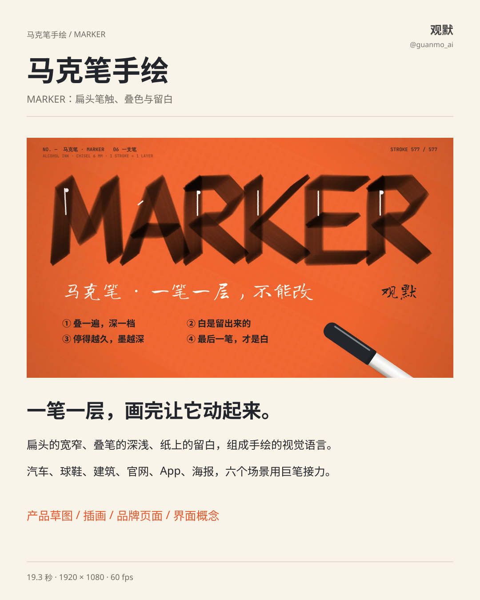
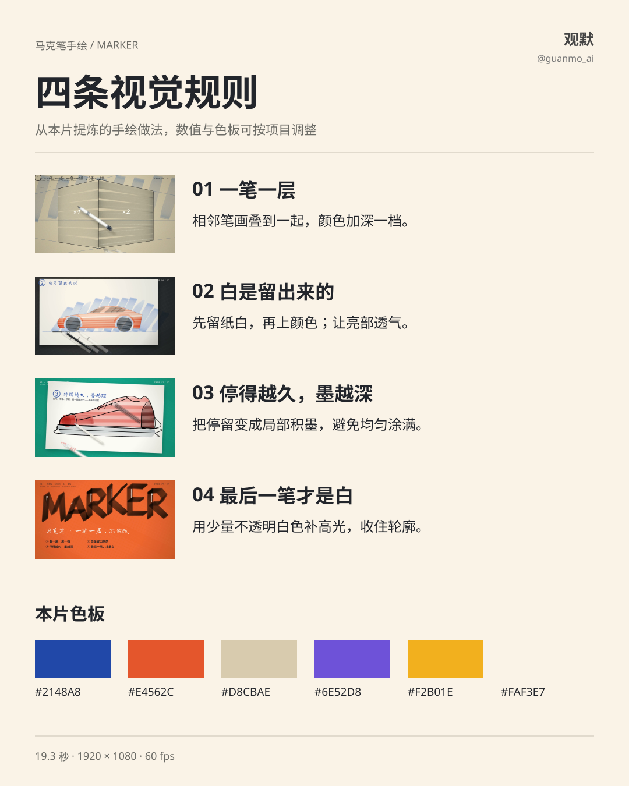
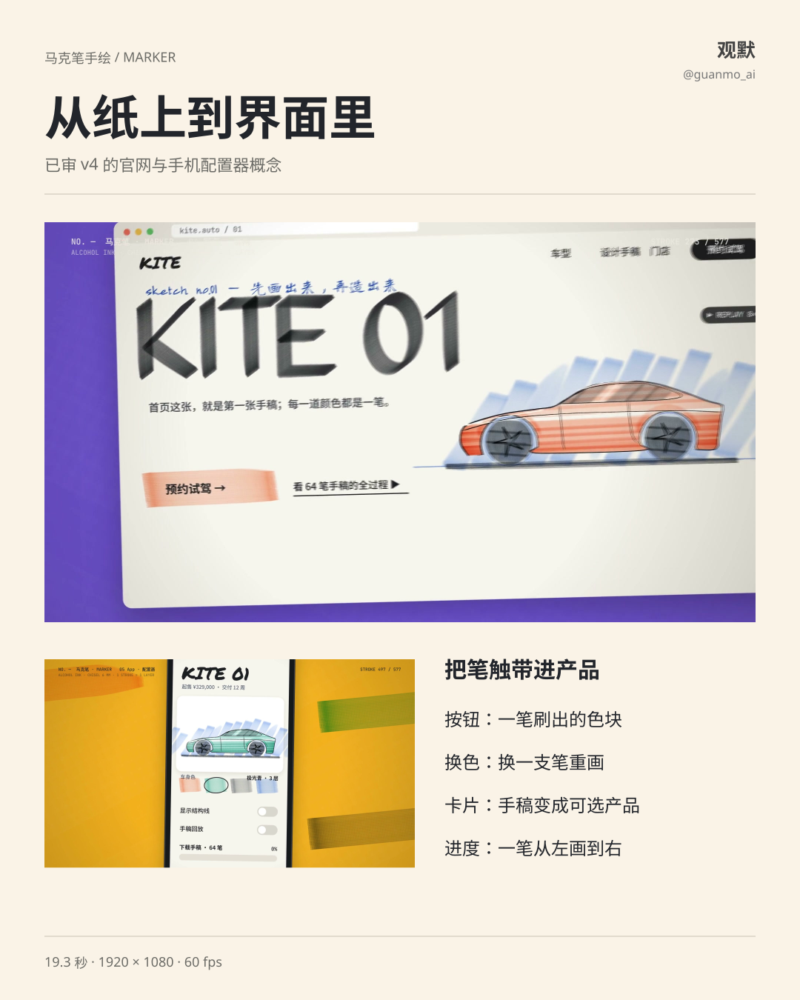
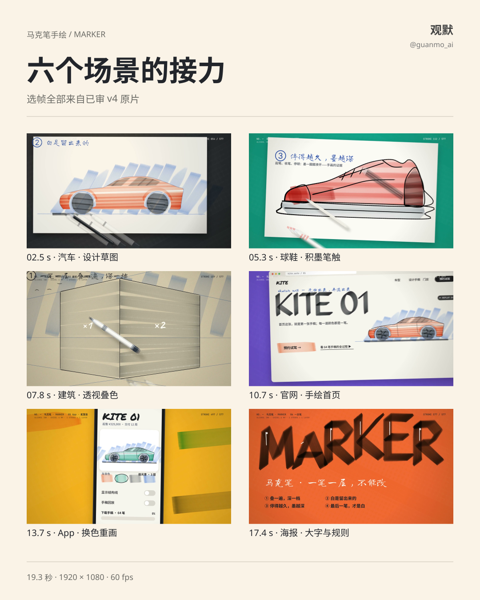

# 027 · Marker Illustration

Chisel-tip strokes, transparent overlaps and reserved paper white form a visual language for product sketches, illustrations, posters and interface concepts.

The approved **v4** master is reused unchanged: 19.3 seconds across six scenes. A car drives off the page, a shoe flips and lands, windows light up, then oversized marker strokes connect a website, a phone configurator and a poster.

## Four visual rules

1. One stroke, one layer: separate overlapping strokes deepen the colour.
2. Reserve paper white before adding transparent colour.
3. Longer dwell creates a darker ink pool in this simulation.
4. Add a small amount of opaque white for final highlights.

These rules describe the film's rendering choices, not universal behaviour of all markers and papers.

## Interface study

The fictional KITE website and configurator use painted buttons, sketch-like product cards, redraws for colour changes and a progress bar made with one stroke. Keep body text and controls readable.

## Reuse

Canvas 2D, 1920×1080, 60fps, 1160 frames and 144 BPM. The renderer, stroke generator, scenes and Python score remain in the original v4 source tree. Original video and sheet labels remain in Chinese. No image generation model is used.

[Production](PROCESS.en.md) · [Source entry](video/README.md) · [Release](https://github.com/guanmo-ai/design-style/releases/tag/day-27)

Please credit Guanmo @guanmo_ai when sharing the media.
