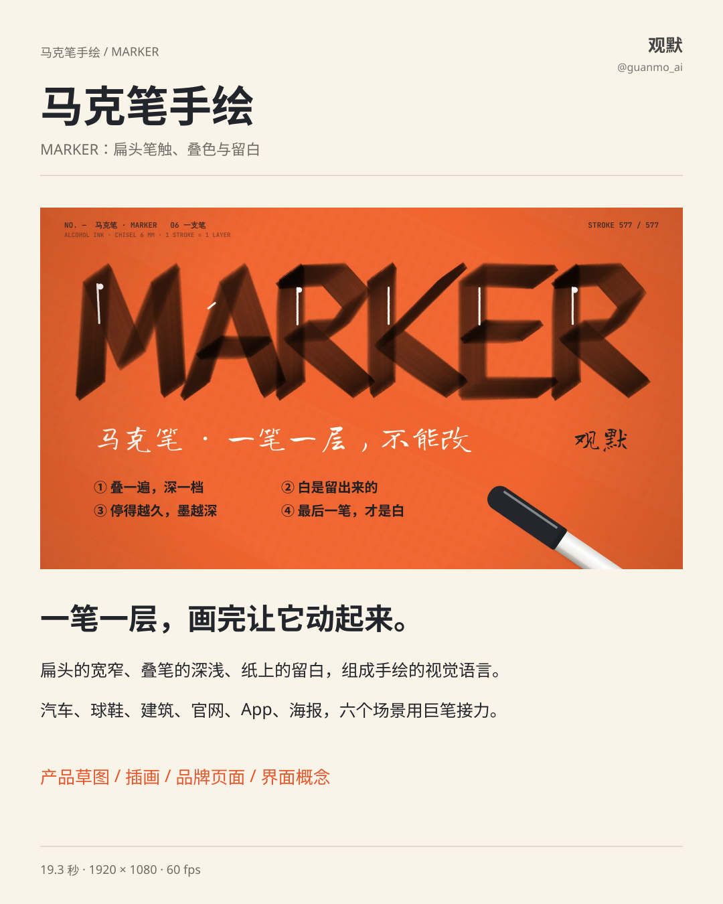
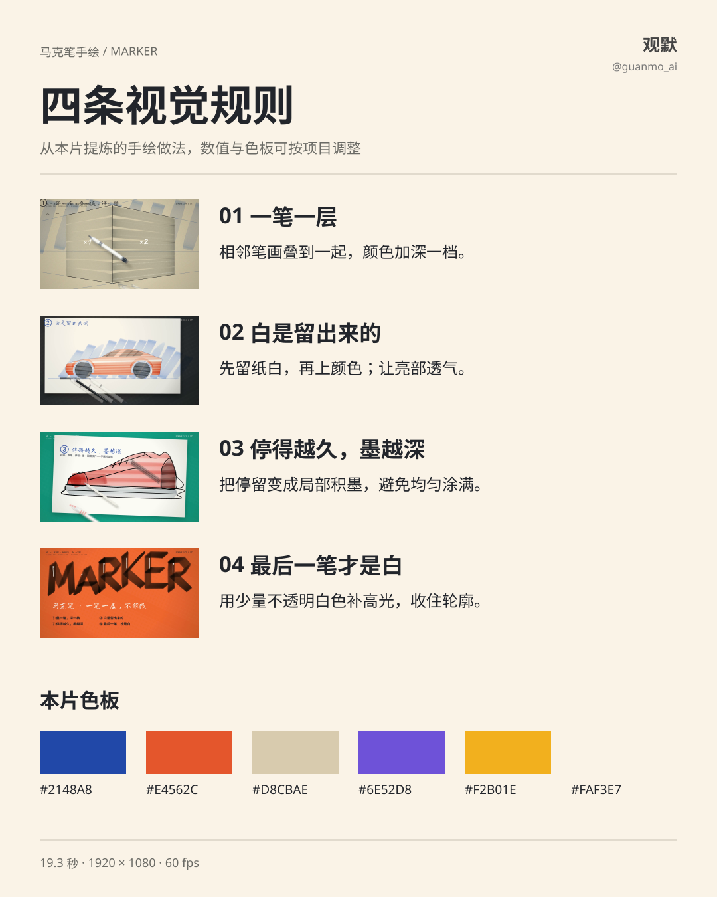
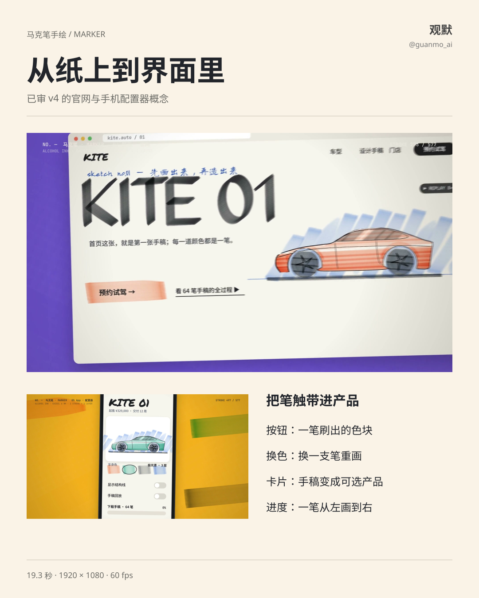
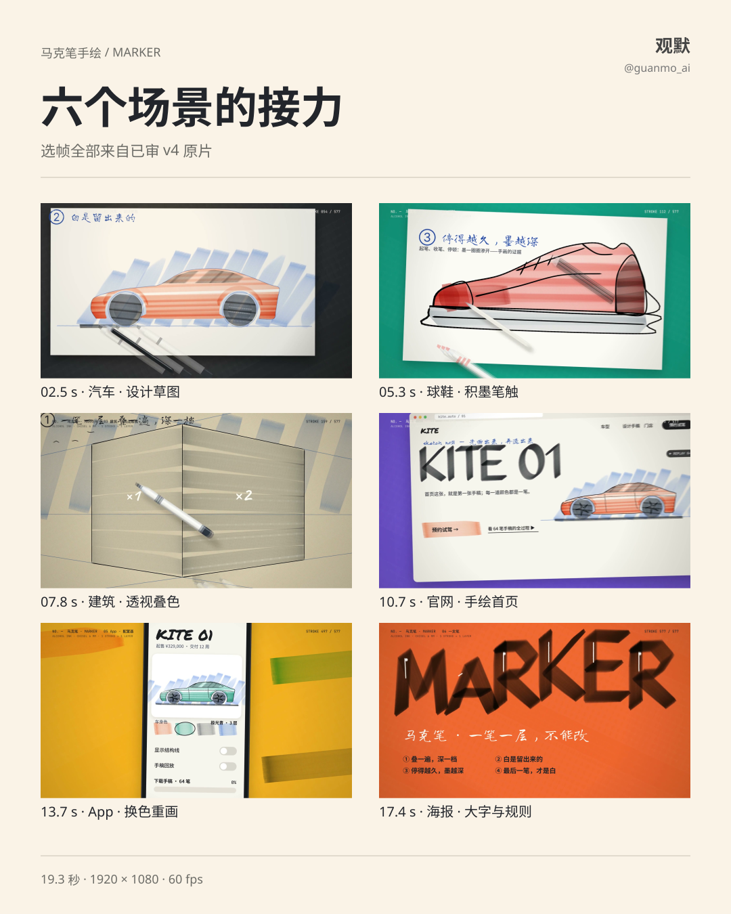

# 027 · 马克笔手绘 Marker

扁头笔触、透明叠色和纸上留白，组成一套能用于产品草图、插画、海报与界面概念的手绘视觉语言。

本期采用已认可的 **v4**：19.3 秒、六个场景。汽车画完开走，球鞋翻转落地，建筑窗户逐层亮起；巨笔接力到官网、手机配置器和海报。视频与音轨沿用原片。

## 四条视觉规则

1. **一笔一层。** 同一笔不靠反复覆盖刷深；相邻笔画交叠时，颜色加深一档。
2. **白是留出来的。** 先安排纸白与高光，再铺透明底色，让轮廓保持通透。
3. **停得越久，墨越深。** 扁头停留产生积墨，快笔留下更浅的笔触。
4. **最后一笔才是白。** 大面积亮部留纸白；少量不透明白色用于最后的反光与收边。

这里描述的是本片的视觉模拟，不是所有马克笔、纸张和颜料都遵循的物理定律。

## 从手稿到界面

本片的虚构品牌 KITE 把汽车草图带进官网和配置器：按钮像一笔刷出的色块，产品卡片保留手稿，换色表现为换一支笔重画，进度条是一笔画满。适合强调创作过程、探索与定制的页面；正文与操作标签保留清晰的无衬线字。

## 动起来的手绘

绘画过程之外，已经画好的物体也参与动效：汽车冲出纸面、球鞋翻圈、窗户亮起、卡片产品摇动、大字依次跳起。六个场景的底色与构图不同，用铺满屏幕的巨笔连接。

## 色彩与字体

底色与主色以靛蓝 `#2148A8`、橙红 `#E4562C`、牛皮纸 `#D8CBAE`、紫 `#6E52D8`、黄 `#F2B01E`、奶油白 `#FAF3E7` 为参考。原片另含既有青色场景；以上配色不是强制规范。

视频字体：Long Cang、Caveat、Permanent Marker、Noto Sans SC、JetBrains Mono；配套图解为 Noto Sans SC。字体许可证与下载入口随源码提供。

## 复用

Canvas 2D 逐帧渲染，1920×1080、60fps、1160 帧、144 BPM。墨迹、笔画生成器、场景与配乐分开维护；制作时一拍 25 帧，换场重击位于第 50 / 250 / 400 / 550 / 750 / 900 帧。

[制作过程](PROCESS.md) · [源码与重渲入口](video/README.md) · [Release 视频](https://github.com/guanmo-ai/design-style/releases/tag/day-27)

转载视频与图片请注明观默 @guanmo_ai。
