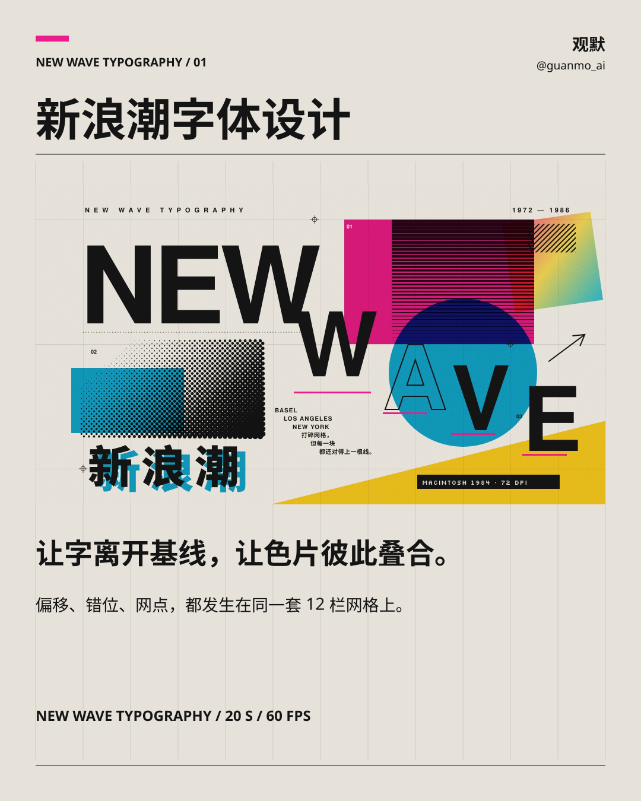
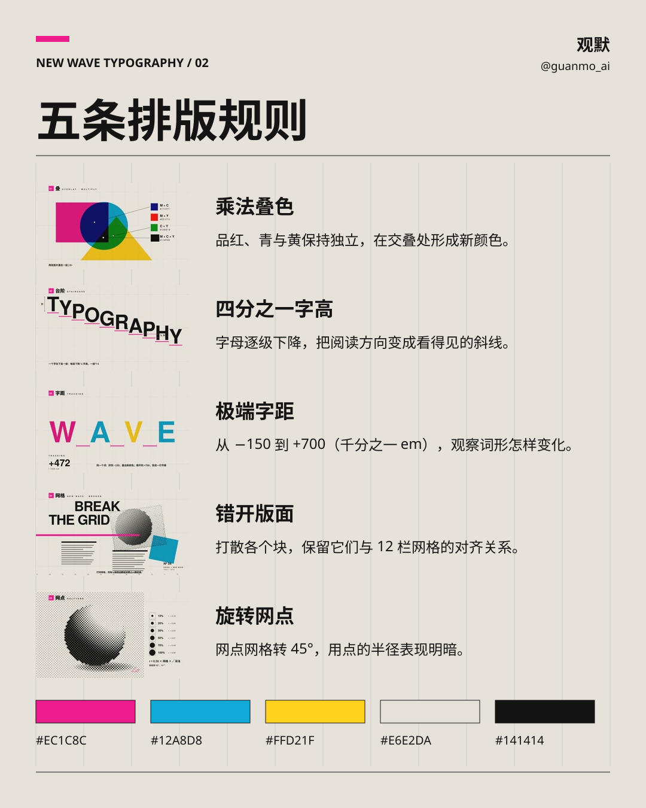
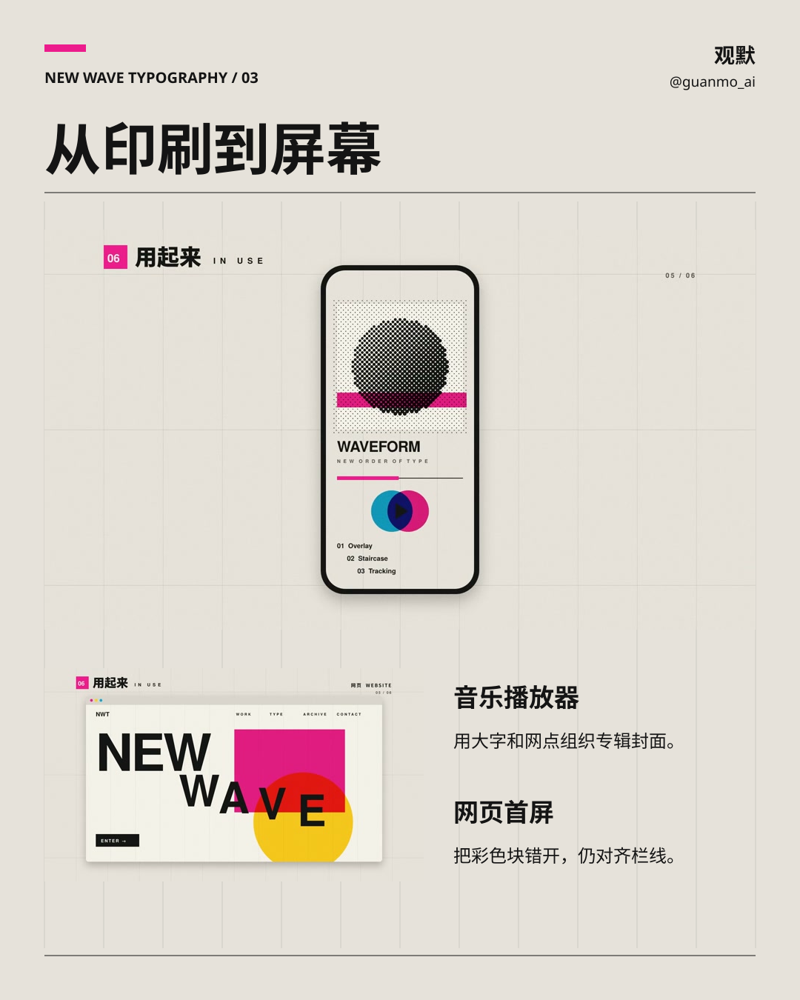
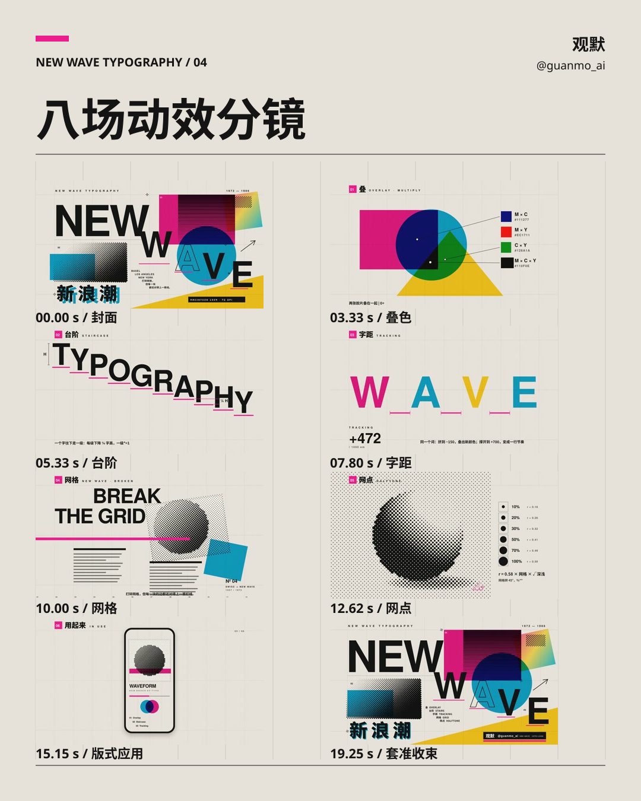

# 028 · New Wave Typography

Magenta, cyan and yellow behave like transparent sheets on a light table. They slide into view, overlap to form new colors, and send type stepping down the grid. Eight scenes in twenty seconds carry the idea into posters, record sleeves, magazines, apps, websites and tickets.

## Five typography rules

1. **Multiply.** Keep each color sheet's outline visible and multiply colors where the sheets overlap.
2. **Step.** Drop each letter by a quarter of its height to give the reading order a direction.
3. **Track.** Move the same word from overlap to wide spacing. The film demonstrates −150 to +700 in thousandths of an em.
4. **Displace.** Shift blocks and images while keeping their edges attached to a 12-column grid.
5. **Halftone.** Rotate the dot grid by 45° and vary the dot size to control tone.

## From print to screen

The music app carries oversize type and halftones from a record sleeve into a player. The website shifts its headline, color sheets and image while keeping them on column guides. In an interface, reserve the strongest shifts for the headline and main graphic so controls remain easy to read.

## Motion and music

A new sheet slides in, the camera passes through the counter of an O, or halftone dots expand to fill the screen. Version two sets the pushes, halftone transition and final registration snap to the accents of “Minimalist Design Pulse.”

Further reading: [Wolfgang Weingart in the Letterform Archive collection](https://letterformarchive.org/news/from-the-collection-legacies-of-swiss-style-part-2-wolfgang-weingart/) · [New Wave graphics at Cooper Hewitt](https://exhibitions.cooperhewitt.org/willismith/williwear-new-wave-graphics/)

[Making of](PROCESS.en.md) · [Source and render instructions](video/README.md) · [Release video](https://github.com/guanmo-ai/design-style/releases/tag/day-28)

Credit Guanmo @guanmo_ai when sharing the video or images.
