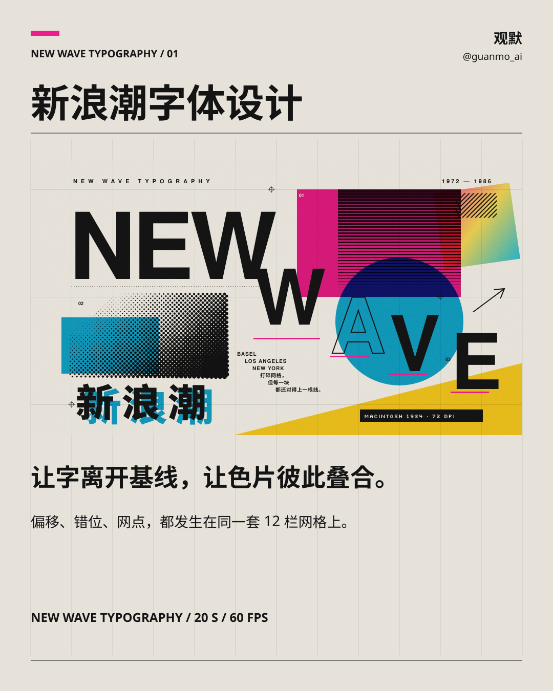
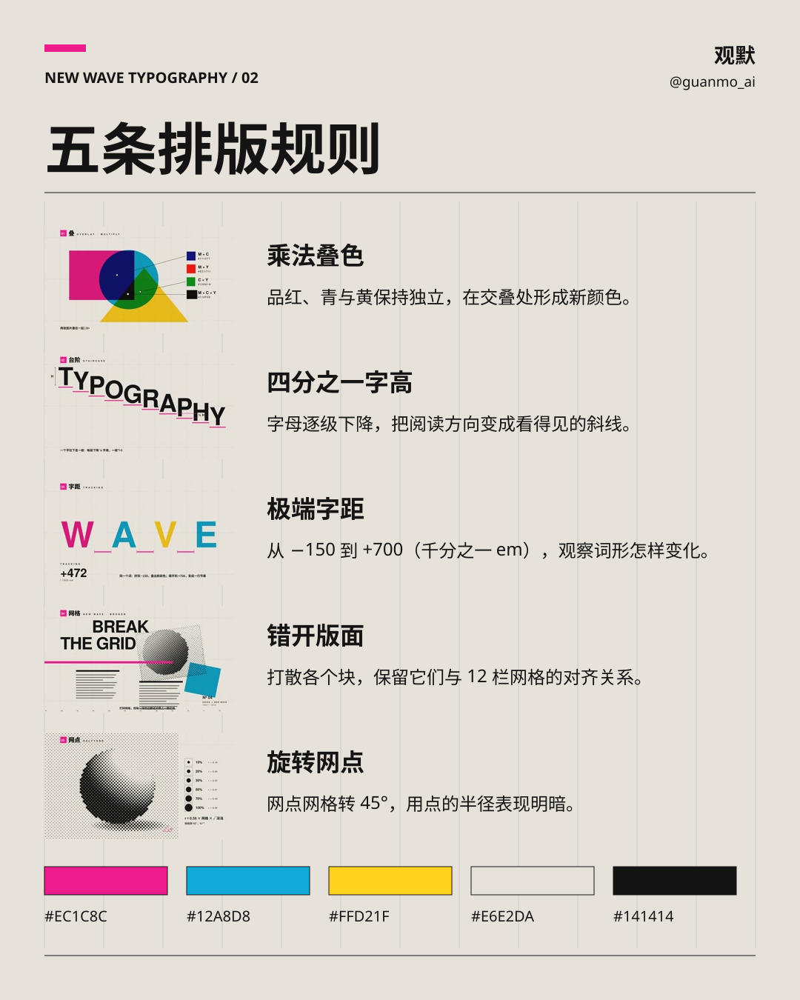
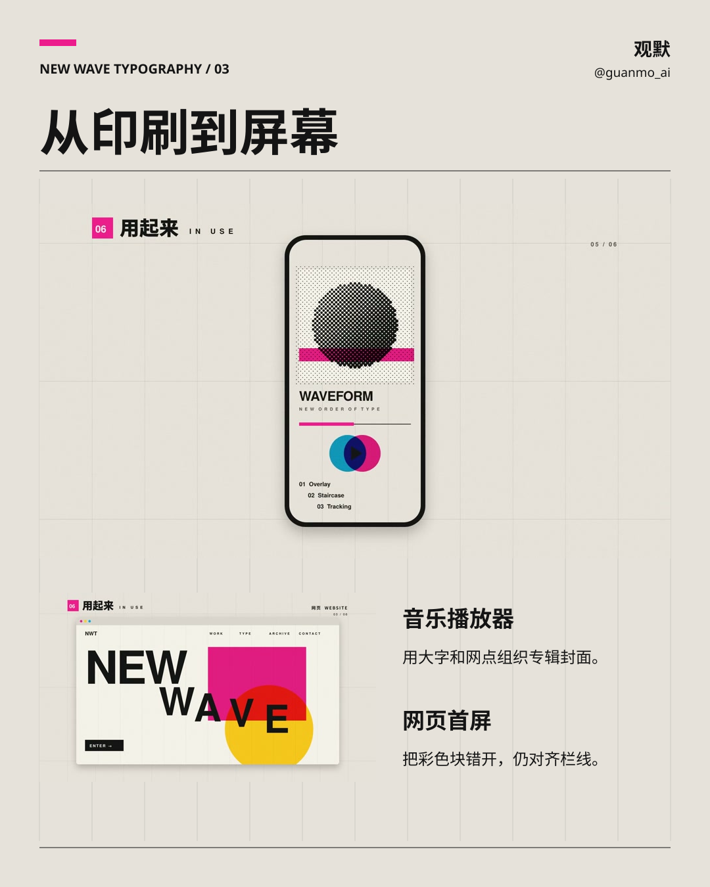
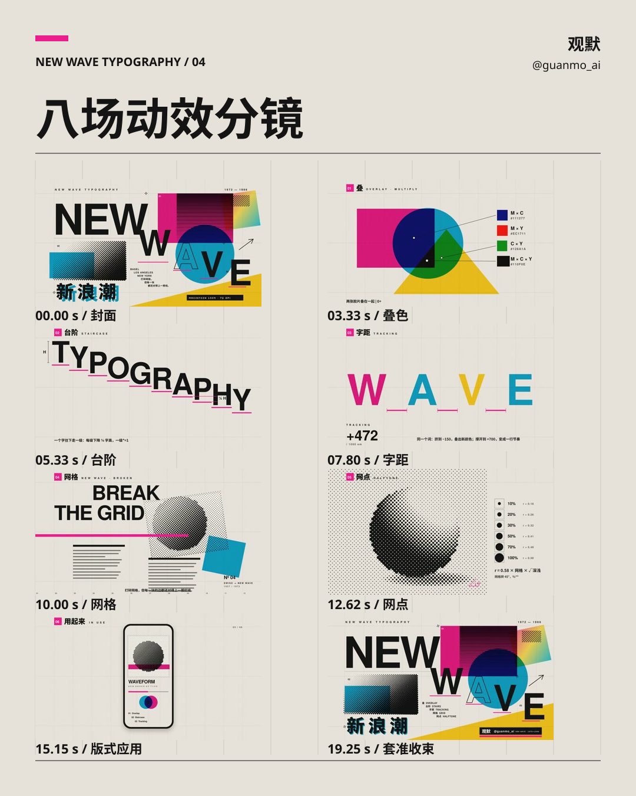

# 028 · 新浪潮 New Wave Typography

把品红、青和黄当作灯箱上的透明胶片。它们滑进画面，叠出新颜色，字母沿网格落成台阶。20 秒内，八个场景把这些动作带到海报、唱片封面、杂志、App、网页和票券。

## 五条排版规则

1. **叠色。** 三张色片各自保留轮廓，在交叠处用乘法混色。
2. **台阶。** 让字母逐个下降四分之一字高，给阅读顺序一个方向。
3. **字距。** 同一个词从紧叠到拉开。片中以 −150 至 +700（千分之一 em）演示两端。
4. **网格。** 把色块和图像错开，仍让各块的边对齐 12 栏网格。
5. **网点。** 网点网格旋转 45°，用点的大小表现明暗。

## 从印刷到屏幕

片中的音乐 App 把唱片封面的网点和大字搬进播放器。网页把标题、色片和图片错开，仍用栏线维持对齐。将同一规则用到界面时，可以把强烈的错位留给标题与主视觉，操作标签保持清晰。

## 动效与配乐

换场用一张新胶片滑入、穿过字母 O、或网点长大铺满屏幕完成。第二版以《Minimalist Design Pulse》为配乐，把场景推进、网点转场与最后一记套准放到音乐的重拍。

延伸阅读：[Letterform Archive 馆藏中的 Wolfgang Weingart](https://letterformarchive.org/news/from-the-collection-legacies-of-swiss-style-part-2-wolfgang-weingart/) · [Cooper Hewitt 的新浪潮平面设计展览资料](https://exhibitions.cooperhewitt.org/willismith/williwear-new-wave-graphics/)

[制作过程](PROCESS.md) · [源码与重渲入口](video/README.md) · [Release 视频](https://github.com/guanmo-ai/design-style/releases/tag/day-28)

转载视频与图片请注明观默 @guanmo_ai。
