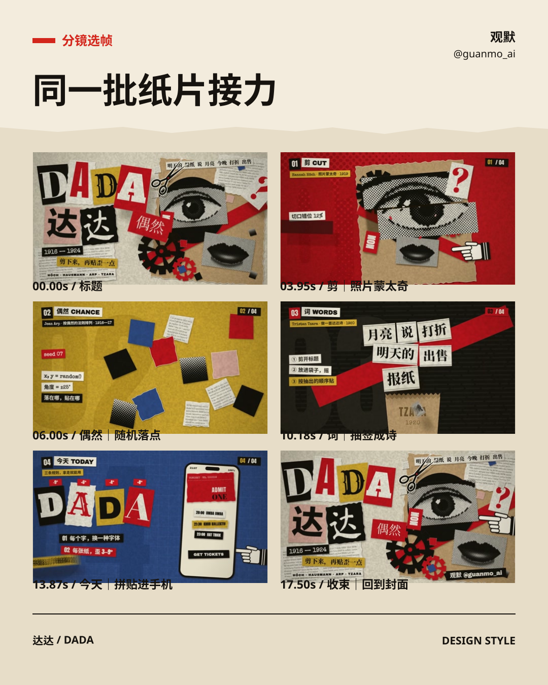

# 达达 · 制作过程

第二版成片为 1920×1080、60 fps，共 1072 帧。六段画面由约 60 张纸片接力完成。纸片按抛物线落下，重击会震动邻近纸片并带起纸屑。换章沿四个方向撕走整张底纸，从米色依次切到红、赭黄、黑、蓝，再回到米色。

## 第二版改了什么

首版 20 秒。第二版重新编排了底纸、镜头和落地动作，把时长压到 17.87 秒。《Cut and Paste》为美图设计室生成的纯音乐，实测约 128.63 BPM。混音脚本截取原曲并叠加代码合成的落纸、剪刀、撕纸和打字声。片尾署名在第 1012 帧拍下，与实测的音乐最后一击对应。

## 源码与原片

渲染使用 Node 和 `@napi-rs/canvas`，每帧取五次子帧进行运动模糊，再用 FFmpeg 编码。画廊视频使用经确认的第二版原片。图解从成片选帧和既有界面稿整理，版面、文字和色块可在 SVG 中编辑。

[完整原始制作记录](https://github.com/guanmo-ai/design-style/blob/main/drafts/dada/PROCESS.md) · [逐拍分镜](https://github.com/guanmo-ai/design-style/blob/main/drafts/dada/film/STORYBOARD.md) · [渲染入口](video/README.md) · [设计指南](README.md)
