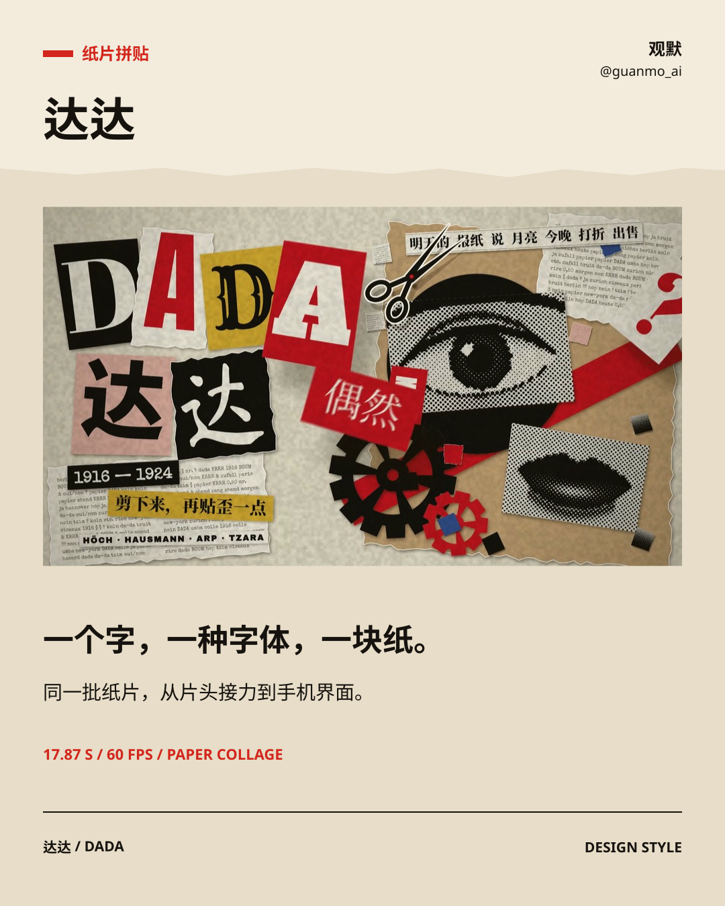
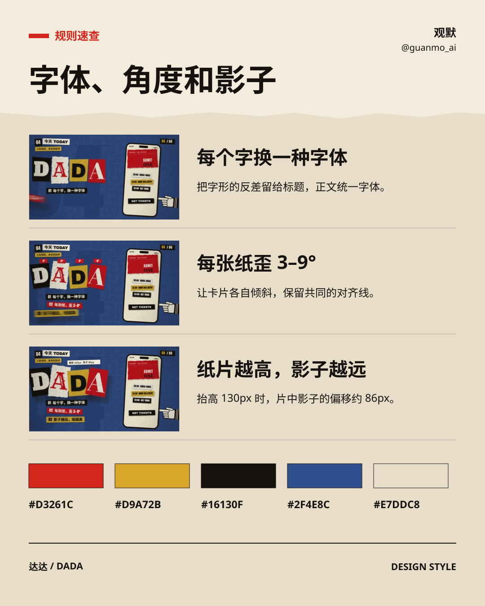

# Style 029 · Dada

Dada emerged during World War I. Zurich’s Cabaret Voltaire was one of its birthplaces. In this 17.87-second film, the same paper scraps become a photomontage, a chance collage, a cut-up poem, and a mobile interface.

## Cut and rearrange

Hannah Höch’s *Cut with the Kitchen Knife* (1919) rearranged images cut from printed publications. The film draws an eye in halftone and offsets the two halves by about 12%. Jean Arp’s chance collage of 1916–17 starts from the fall of paper scraps. Tristan Tzara’s 1920 instructions apply a similar procedure to words. Cut them from a newspaper article, shake them in a bag, and copy them down in the order drawn.

## Use the technique in an interface

Try different typefaces across a display word. Tilt each scrap by 3–9° while keeping a shared alignment line. Move the shadow farther away and soften it as the scrap rises. In the ticket interface, the headline carries the collage, and the time, venue, and controls keep their alignment.

Historical references. [Cabaret Voltaire](https://www.metmuseum.org/research-centers/leonard-a-lauder-research-center/research-resources/modern-art-index-project/ball-and-hennings) · [Höch collection record](https://id.smb.museum/object/961048) · [Arp collection record](https://www.moma.org/collection/works/37013) · [Tzara’s 1920 publication](https://sdrc.lib.uiowa.edu/dada/litterature/15/pages/18.htm)

[Making of](PROCESS.en.md) · [Source and render instructions](video/README.md) · [Release video](https://github.com/guanmo-ai/design-style/releases/tag/day-29)

Credit Guanmo @guanmo_ai when reposting images or the film. The soundtrack uses AI-generated music and code-synthesized paper sounds.
