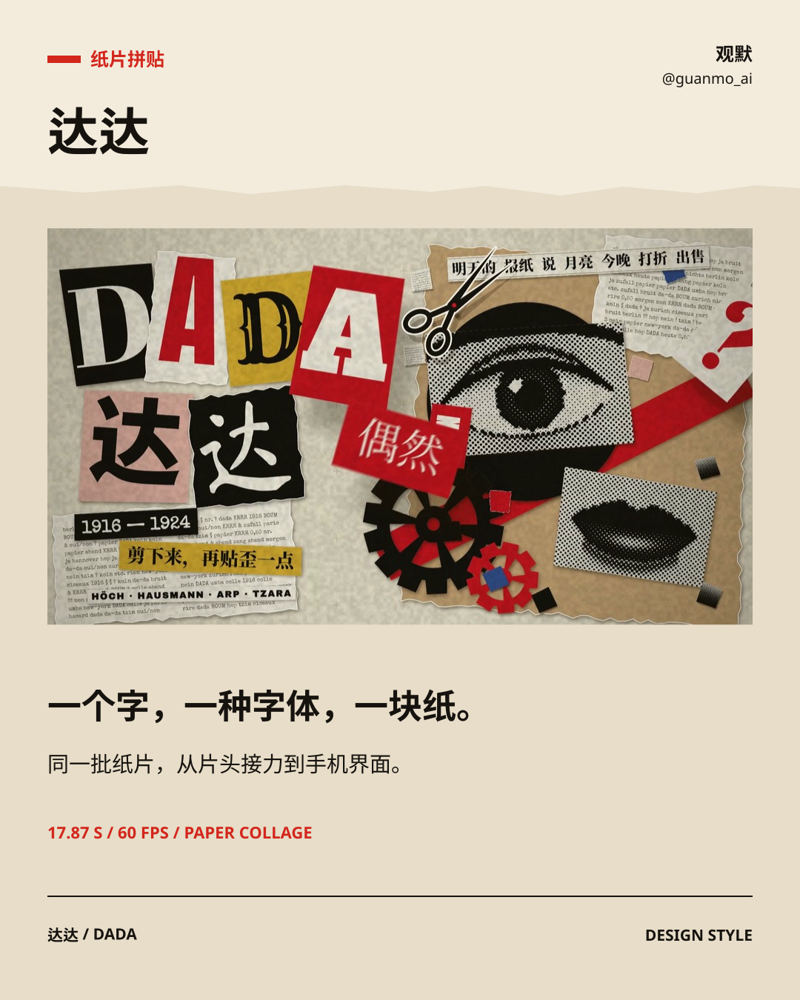
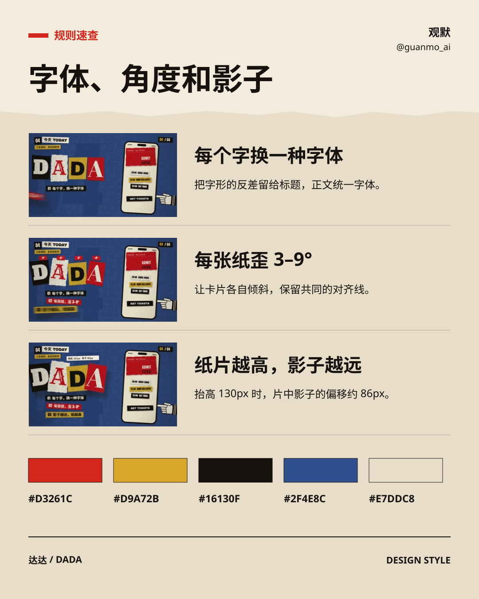

# 风格 029 · 达达 Dada

达达兴起于一战期间。苏黎世的伏尔泰酒馆是它的发源地之一，运动的活跃期约为 1916—1924 年。这支 17.87 秒的短片用同一批纸片演示照片蒙太奇、偶然拼贴和剪报成诗。

## 剪开、重排、留出反差

汉娜·赫希 1919 年的《用达达餐刀切开……》用刊物上的图像碎片重新组织画面。动手时可以先挑一张辨识度高的照片，放大局部，再把剪开的两半错开。短片里的眼睛由网点函数绘制，切口两侧错开约 12%。

让·阿尔普 1916—1917 年的拼贴以偶然性为起点。让纸片先随机落下，再观察哪些重叠、方向和留白值得保留。查拉 1920 年的文字给了另一种做法：剪下报道里的词，放进袋子轻摇，再按抽出的顺序抄下来。

## 用在标题和界面上

标题的每个字可以换一种字体。成组纸片分别倾斜 3–9°，保留共同的对齐线。需要表现抬起时，随着纸片升高把影子拉远、放虚。手机票夹把错位留给标题和装饰，时间、地点和操作仍按行对齐。

历史参考。[苏黎世伏尔泰酒馆](https://www.metmuseum.org/research-centers/leonard-a-lauder-research-center/research-resources/modern-art-index-project/ball-and-hennings) · [赫希作品档案](https://id.smb.museum/object/961048) · [阿尔普作品档案](https://www.moma.org/collection/works/37013) · [查拉的期刊原页](https://sdrc.lib.uiowa.edu/dada/litterature/15/pages/18.htm)

[制作过程](PROCESS.md) · [源码与重渲入口](video/README.md) · [Release 视频](https://github.com/guanmo-ai/design-style/releases/tag/day-29)

转载视频与图片请注明观默 @guanmo_ai。视频配乐为 AI 生成，纸声为代码合成。
