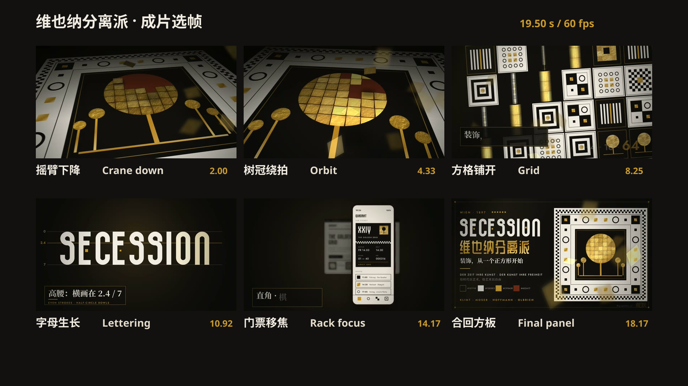

# Vienna Secession · Making of

The film runs 1,170 frames at 60 fps and 1920 × 1080. A title establishes the composition before the gilding close-up leaves the frame to the moving camera, panel and light.

## The panel and the gold leaf

The camera drops from overhead, orbits the canopy from near table height and rises again. Canvas 2D draws the panel's perspective in horizontal strips, with a higher-resolution texture for the canopy. Each leaf tilts on its own. Its normal, the light and the viewing angle determine which leaves catch a highlight.

## From one square to sixty-four

The pullback begins at frame 357, revealing 4, 16 and 64 squares in successive layers. The squares become a poster, a website, a mobile ticket and magazine covers. The layout folds back into the panel and the last leaf lands at frame 1,064.

The panel, patterns and interface textures share SVG geometry. Canvas draws the camera, lettering and gold leaves at each frame, increasing subframe sampling during fast moves. Code-generated sound effects are tied to the frames of individual actions.

[Chinese production notes](PROCESS.md) · [Timeline](process/timeline.json) · [Rendering instructions](video/README.md) · [Design guide](README.en.md)
