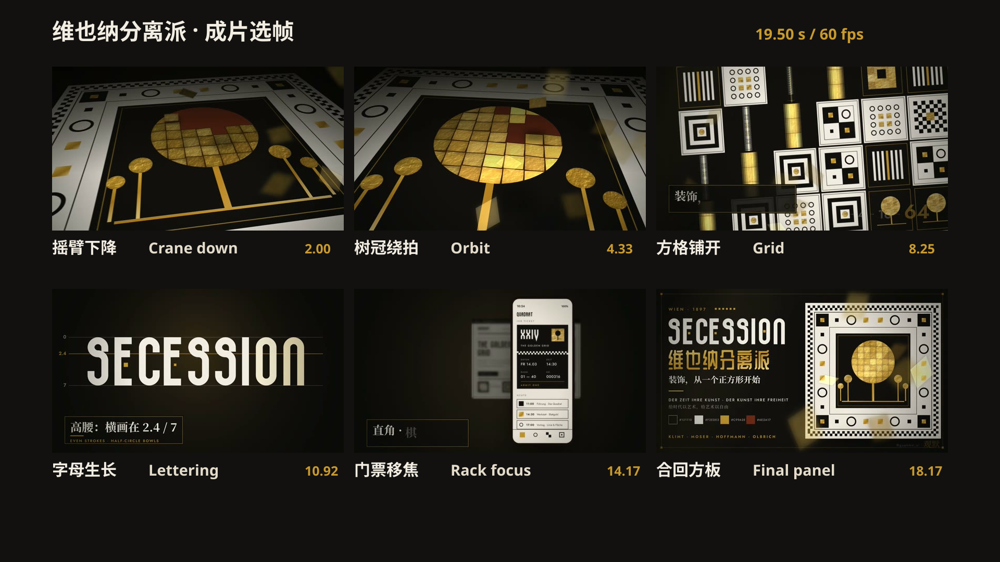

# 维也纳分离派 · 制作过程

成片为 1920 × 1080、60 fps，共 1,170 帧。开场先用标题定住构图，随后在金箔特写中只保留镜头、方板和光。

## 方板与金箔

镜头从俯视下降到桌面附近，绕过树冠，再回到正上方。Canvas 2D 把方板切成横条来画透视，树冠附近另铺一张高分辨率贴图。每张金箔独立计算位置与倾角，按法线、光源和视线计算高光。金箔落下时先翻面、投影，再压回树冠所在的平面。

## 从一格到六十四格

第 357 帧开始，镜头随节拍逐层拉远，露出 4、16、64 格。方格中的纹样从角上展开。海报、网页、手机门票与杂志封面都从方格里翻出，再缩回原位。最后一张金箔在第 1,064 帧落定。

## 渲染与同步

静态方板、装饰纹样、海报和界面由同一套 SVG 几何生成。Canvas 按帧计算镜头、字母笔画和金箔，高速镜头增加子帧采样。动作时刻以帧号记录，金箔、翻卡和分格的声音用代码合成。

[时间轴](process/timeline.json) · [源码和重渲步骤](video/README.md) · [风格指南](README.md)
